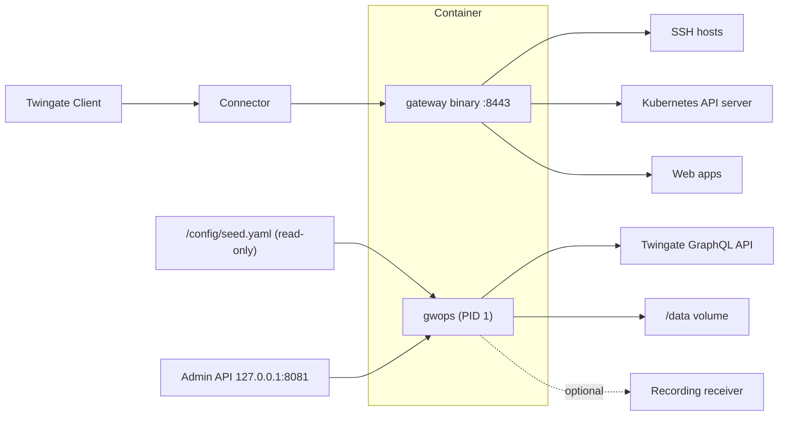

# gwops: Twingate Gateway with a managed control plane

> [!WARNING]
> ⚠️ **Example project — provided as-is, with no support or warranty.** gwops is published as a
> reference example to build from, not a supported product. Nothing here is guaranteed and no
> support is attached to it. It was developed with help from an LLM-based coding assistant. Review
> the code and test it yourself before using it in any critical or production environment. Your
> use is governed by the [Apache License 2.0](LICENSE), including its "AS IS", no-warranty
> (Section 7), and limitation-of-liability (Section 8) terms.

This image runs the official Twingate Gateway binary (`twingate/gateway`, pinned to 2.0.0) under
**gwops**, a Python asyncio control plane that runs as PID 1 in the container. gwops manages the
gateway's certificates, keeps the Twingate resources it fronts in sync with a declarative seed
file, renders and supervises the gateway's configuration, and exposes a small admin API. You
describe your SSH hosts, Kubernetes API server and internal web apps in one YAML file. gwops
creates and maintains the matching objects on your Twingate tenant and keeps the gateway serving
them.

## What it does

- **Certificate lifecycle.** gwops generates X.509 and SSH certificate authorities on first run,
  or uses CAs you bring. It mints and renews a TLS leaf that covers every upstream address and
  web-app alias. Public certificate mode serves certificates from a public CA instead, either from
  files you supply or issued and renewed by gwops itself over ACME (Let's Encrypt, Cloudflare
  DNS-01).
- **Tenant sync.** Twingate SSH, Kubernetes and web-app resources are created, updated and deleted
  to match the seed, with group and security policy assignment. gwops updates or deletes only the
  resources and CAs it created itself, and never touches objects made in the Admin Console.
- **Gateway configuration.** gwops renders the gateway config, checks each candidate by starting
  the binary on it before swapping it in, and restarts the gateway only when the rendered config
  changes. A renewed certificate is hot-reloaded without a restart.
- **Web apps.** The gateway acts as an L7 reverse proxy for internal HTTP(S) apps. It can inject
  the signed Twingate access token and identity headers into each request. gwops enforces a header
  and TLS policy that refuses unsafe combinations.
- **Session recording delivery (optional).** gwops can ship SSH and `kubectl exec` session
  recordings and HTTP audit lines to an HTTP NDJSON receiver you choose, such as your SIEM's
  ingest pipeline. Lines are buffered in a bounded on-disk spool. See
  [Session recording](guides/session-recording.md).
- **Admin API.** A bearer-authenticated HTTP API reports status and accepts changes. Each change
  persists as an overlay on the seed, and gwops reconciles it before responding.

## Who it is for

This image is for Twingate admins who want the Gateway to run as one container, providing
privileged access to SSH hosts, a Kubernetes API server and internal web apps, with certificates
and Twingate resource objects managed for them.

## How it fits

A Twingate Client reaches the container through a Connector on port 8443, where the gateway binary
forwards traffic to the SSH, Kubernetes and web-app upstreams. Inside the same container gwops
supervises the gateway. It reads the read-only seed at `/config/seed.yaml`, keeps its state on the
`/data` volume, talks to your tenant's GraphQL API, serves the admin API (published on the host's
loopback, `127.0.0.1:8081`, by `compose.yaml`), and,
if you turn recording on, posts recordings to your receiver. The container does not join the
Twingate network itself. Clients reach it through a Connector.

## Requirements

- Docker Engine with Docker Compose v2.
- A Twingate tenant with a Remote Network and a healthy Connector that can reach the Docker host
  on TCP 8443.
- A Twingate API key with read and write access, including resources, certificate authorities and
  gateways.
- A linux/amd64 host. The published image is built for amd64 only.

## Get started

Follow the [Quickstart](quickstart/README.md). It takes you through a first deployment that
fronts one SSH host, from an empty directory to a working `ssh` session.

## Documentation

| Section | What you will find |
| --- | --- |
| [Quickstart](quickstart/README.md) | First deployment, end to end |
| [Recipes](recipes/README.md) | Complete deployments by environment and use case, built from the guides |
| [Guides](guides/README.md) | One capability per page: gateway modes, CAs, public certificates, SSH, Kubernetes, web apps, access control, recording, automation |
| [Operations](operations/README.md) | Day-2 tasks: monitoring, troubleshooting, admin API exposure, rotation, backup, upgrades, building the image |
| [Architecture](architecture/README.md) | How gwops works: boot, reconcile pass, certificates, gateway process, recording, security model |
| [Reference](reference/README.md) | Exact keys, variables, routes, formats and limits |
| [Seed reference](reference/seed.md) | Every seed key, its default and whether the API can change it |
| [Admin API reference](reference/admin-api.md) | Routes, schemas, authentication and status codes |
| [Image reference](reference/image.md) | Ports, mounts, `/data` layout, runtime user, healthcheck, build arguments |
| [Known limitations](reference/limitations.md) | What the image and the gateway binary do not do |

## Pinned versions

- Gateway binary: `twingate/gateway:2.0.0`, pinned by tag and image-index digest.
- ACME client: `goacme/lego:v5.5.2`, pinned by tag and digest.
- Base image: `python:3.12-slim`, pinned by tag and digest.
- Python dependencies: exact versions in `pyproject.toml`, installed from the hash-locked
  `requirements.lock`.
- GitHub Actions: pinned to full commit SHAs.

No image is ever taken from a floating tag. See [Upgrades and pins](operations/upgrades-and-pins.md)
for how to move a pin.

## Security

- Secrets (`TWINGATE_API_KEY`, `GWOPS_ADMIN_TOKEN`, `GWOPS_AUTOMATION_TOKEN`, `GWOPS_RECORDING_TOKEN`)
  come only from environment variables. They never appear in the seed, overlays, the rendered
  gateway config or logs.
- The admin API is plain HTTP and binds to `127.0.0.1` inside the container by default, which
  `compose.yaml`'s `127.0.0.1:8081:8081` publish cannot reach; the quickstart sets
  `admin_api.bind: 0.0.0.0` so the host can, as does `seed.example.yaml`. Do not expose it on a routable interface without a
  TLS proxy in front.
- Shipped recordings are not redacted. Terminal output, URLs and request headers reach the spool
  and your receiver exactly as the gateway wrote them.
- The container log (`docker logs`) carries the gateway's operational lines, including the user's
  id, username and groups on each connection. Audit lines and session recordings never reach it.

See the [security model](architecture/security-model.md) for trust boundaries, key storage and
accepted risks.

## License

Licensed under the [Apache License 2.0](LICENSE).
