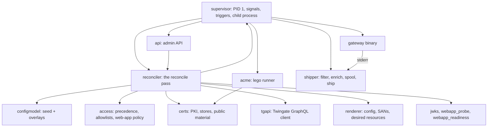
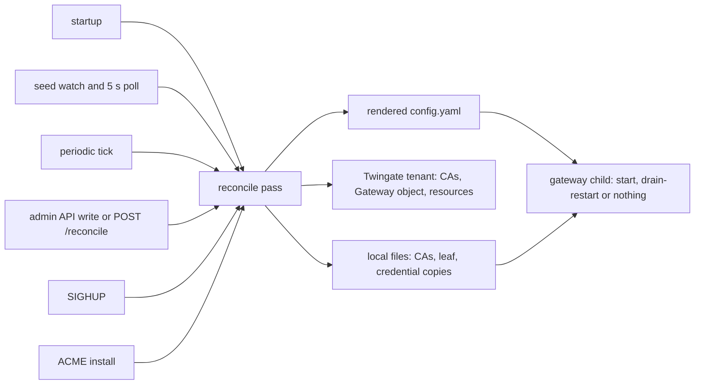

# Architecture

This section explains how the container works: which program owns which job, the order things
happen in, and what happens when something fails. The pages are written for architects, security
reviewers, contributors and operators who want to know why the container behaves as it does. For
step-by-step tasks, see the [recipes](../recipes/README.md), [guides](../guides/README.md) and
[operations](../operations/README.md) pages; for every key, route and variable, see the
[reference](../reference/README.md).

## The two programs in the container

The image runs two programs.

| Program | What it is | How it runs |
| --- | --- | --- |
| The gateway binary | The official, unmodified Twingate Gateway, copied out of the `twingate/gateway` image pinned to tag `2.0.0` and its image-index digest. It terminates Client TLS on port 8443 and proxies SSH, Kubernetes API and web-app traffic to the upstreams. | Started by gwops as `/usr/local/bin/gateway start --config /run/gateway/config.yaml`, as a child process with piped stdout and stderr. |
| gwops | A Python 3.12 asyncio control plane. It owns everything around the binary: certificates, the Twingate tenant objects, the rendered config, the binary's lifecycle, recording delivery and an admin API. | The container entrypoint, `python -m gwops`, so it is PID 1. It runs as uid/gid 10001. |

The gateway binary is deliberately treated as a black box. It has three gaps that shape the
design, and gwops compensates for each:

| What the binary lacks | What gwops does instead | Where |
| --- | --- | --- |
| A `config validate` subcommand | Pre-flight by spawn: start the binary on a candidate config for 5 s and judge the outcome before swapping the config in | [Gateway process](gateway-process.md#pre-flight-by-spawn) |
| A SIGHUP config reload | Drain-restart: SIGTERM the running gateway, wait for it to exit, start a new one. Certificate files are the exception: the binary hot-reloads them, so gwops lays them out to trigger that | [Gateway process](gateway-process.md#apply), [Certificates](certificates.md#atomic-store-and-hot-reload) |
| A recording sink | Read the binary's stderr, keep the recording and audit lines, spool them on disk and POST them to a receiver you choose | [Recording pipeline](recording-pipeline.md) |

The container does not join the Twingate network itself. Twingate Clients reach port 8443 through
a Connector in the same Remote Network, exactly as with any other Gateway deployment.

## Component map

The supervisor starts everything and owns the gateway child. The reconciler is the hub: it reads
the effective configuration, applies policy, manages certificates, syncs the tenant, renders the
config and asks the supervisor to start or restart the gateway. The admin API writes overlays and
runs passes through the reconciler. The ACME runner installs certificates on its own schedule and
then wakes the reconciler. Gateway stderr flows into the shipper.

| Module (`src/gwops/`) | Responsibility | Page |
| --- | --- | --- |
| [`supervisor/`](../src/gwops/supervisor) | PID 1 entrypoint, startup gate, signal handling, teardown; the gateway child process, its pipes, early-exit rollback and crash backoff; the pre-flight spawn; the child environment allowlist | [Startup and shutdown](startup-and-shutdown.md), [Gateway process](gateway-process.md) |
| [`configmodel/`](../src/gwops/configmodel) | The strict seed schema, the overlay store, the layered merge and per-path provenance | [Configuration model](configuration-model.md) |
| [`reconciler/`](../src/gwops/reconciler) | The single-flight reconcile pass, its trigger sources and the ownership registry | [Reconciler](reconciler.md) |
| [`tgapi/`](../src/gwops/tgapi) | The Twingate GraphQL client: retries, 429 handling, attribution User-Agent; the typed operations | [Twingate integration](twingate-integration.md) |
| [`certs/`](../src/gwops/certs) | X.509 and SSH CAs, leaf minting, the atomic certificate store, CA rotation, public certificate validation, on-demand suitability | [Certificates](certificates.md) |
| [`acme/`](../src/gwops/acme) | The lego runner: scheduling, subprocess control, failure classes, backoff state, token-file checks | [ACME](acme.md) |
| [`renderer/`](../src/gwops/renderer) | The gateway `config.yaml`, the leaf SAN set, the desired Twingate resources | [Gateway process](gateway-process.md#rendering), [Certificates](certificates.md) |
| [`access/`](../src/gwops/access) | Access precedence, name resolution, the seed allowlists, the web-app policy | [Twingate integration](twingate-integration.md#access-assignment), [Admin API](admin-api.md#guardrails), [Web apps](web-apps.md#the-web-app-policy) |
| [`api/`](../src/gwops/api) | The FastAPI admin API: auth, principals, transactional writes, `/healthz`, `/status` | [Admin API](admin-api.md), [Health and observability](health-and-observability.md) |
| [`shipper/`](../src/gwops/shipper) | The stderr line filter, web-app enrichment, the bounded spool, the HTTP shipper | [Recording pipeline](recording-pipeline.md) |
| [`jwks.py`](../src/gwops/jwks.py) | Reachability check of the tenant key set the gateway uses to verify web-app tokens | [Web apps](web-apps.md#jwks-reachability) |
| [`webapp_probe.py`](../src/gwops/webapp_probe.py) | Opt-in TLS handshake probe of web-app upstreams | [Web apps](web-apps.md#upstream-tls-probe) |
| [`webapp_readiness.py`](../src/gwops/webapp_readiness.py) | Per-web-app readiness reasons in `/status` | [Web apps](web-apps.md#readiness) |
| [`confined.py`](../src/gwops/confined.py) | Confined file reads under the read-only mounts, content-addressed copies, garbage collection | [Reconciler](reconciler.md#credentials-and-ca-bundles), [Security model](security-model.md#file-confinement) |
| [`healthcheck.py`](../src/gwops/healthcheck.py) | The Docker `HEALTHCHECK` client | [Health and observability](health-and-observability.md#healthz) |
| [`kinds.py`](../src/gwops/kinds.py) | The resource-kind registry (SSH, Kubernetes, web app): everything kind-specific iterates it | [Reconciler](reconciler.md) |

## Data and control flow

Every trigger leads to the same reconcile pass, and passes are single-flight. A pass reads the seed
and overlays from scratch, makes local state (CA files, the leaf, copies of credential files) and
the tenant (CA objects, the Gateway object, resources) match it, renders the gateway config,
pre-flights it and then starts the gateway, drain-restarts it, or leaves it alone when only
certificate contents changed.

## Design principles

- **Level-triggered and idempotent.** A pass never acts on "what changed". It compares the full
  declared state with what exists and corrects the difference. A missed event is healed by the
  next pass; a burst of triggers costs at most one extra pass.
- **Local correctness beats remote sync.** A tenant outage, a missing API key or a throttled write
  is recorded as an error and retried, but never stops the certificate, render and apply steps. A
  gateway already serving keeps serving.
- **Fail loud at startup, keep last good after.** Bad configuration, unusable CA material or a
  config the binary refuses aborts startup with an actionable message. After startup, the same
  failures are recorded on the pass and the last good config keeps running.
- **gwops touches only what it created.** The ownership registry (`/data/state.json`) lists every
  tenant object gwops created or adopted. Only those ids are ever updated or deleted; resources
  made in the Admin Console are never touched.
- **Secrets come only from the environment.** `TWINGATE_API_KEY`, `GWOPS_ADMIN_TOKEN`,
  `GWOPS_AUTOMATION_TOKEN` and `GWOPS_RECORDING_TOKEN` are read from env vars. They never appear in the
  seed, overlays, the rendered config, `/state`, or logs, and never reach the gateway child.
- **The seed is never written.** `/config/seed.yaml` is mounted read-only. Admin API changes are
  stored separately as overlays under `/data/overlays/`.

## Filesystem layout at a glance

| Path | Kind | Holds |
| --- | --- | --- |
| `/config/seed.yaml` | read-only mount | The declarative seed |
| `/config/k8s-creds/`, `/config/webapp-cas/`, `/config/public-tls/`, `/config/acme/` | optional read-only mounts | The only places gwops reads credential, CA bundle, public certificate and DNS token files from |
| `/data` | persistent volume | Generated CAs and the leaf (`pki/`), overlays, the ownership registry (`state.json`), the recording spool (`spool/`), content-addressed credential and CA bundle copies, installed public certificates, ACME account and schedule |
| `/run/gateway` | tmpfs | The rendered `config.yaml`, the pre-flight candidate and the last-good copy |

The full `/data` tree with file modes is in [`reference/image.md`](../reference/image.md#data-volume-layout).

## Reading paths

**Operators** deploying and running the container:

1. [Startup and shutdown](startup-and-shutdown.md): what a good boot looks like and what aborts it.
2. [Configuration model](configuration-model.md): seed, overlays, and when changes take effect.
3. [Certificates](certificates.md) and, if you use public certificates, [ACME](acme.md).
4. [Health and observability](health-and-observability.md).
5. [Recording pipeline](recording-pipeline.md) if you turn recording on.

**Security reviewers**:

1. [Security model](security-model.md).
2. [Twingate integration](twingate-integration.md): what gwops does on your tenant.
3. [Admin API](admin-api.md): authentication, principals, guardrails.
4. [Certificates](certificates.md): key material, on-demand issuance, public mode trust.
5. [Recording pipeline](recording-pipeline.md#confidentiality).

**Contributors**:

1. This page, then [Reconciler](reconciler.md) end to end.
2. [Gateway process](gateway-process.md) and [Startup and shutdown](startup-and-shutdown.md).
3. [Configuration model](configuration-model.md) and [Twingate integration](twingate-integration.md).
4. [`reference/development.md`](../reference/development.md) for the dev loop and the
   resource-kind registry.

## See also

- [`reference/image.md`](../reference/image.md): ports, mounts, user, pins, egress.
- [`reference/seed.md`](../reference/seed.md): every seed key.
- [`reference/limitations.md`](../reference/limitations.md): known limitations and accepted risks.
- [`recipes/README.md`](../recipes/README.md): end-to-end deployments by environment.
- [`guides/README.md`](../guides/README.md): one capability per page.
- [`operations/README.md`](../operations/README.md): day-2 tasks.
