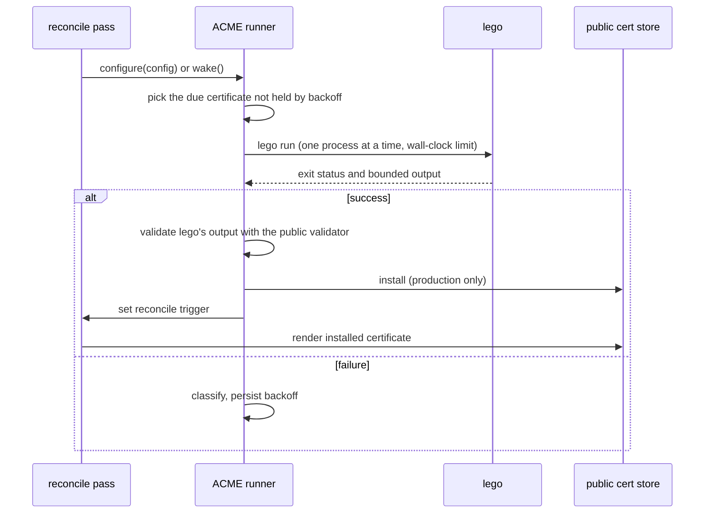

# ACME

In public certificate mode a certificate can be `source: acme`: gwops issues and renews it itself
with [lego](https://go-acme.github.io/lego/), the ACME client bundled in the image. This page
explains how the runner schedules lego, what it passes to it, how a certificate lands, and how
failures are classified and backed off.

Code: [`src/gwops/acme/`](../src/gwops/acme) (`runner.py`, `lego.py`, `state.py`, `token.py`),
`lego_storage_dir` in [`src/gwops/settings.py`](../src/gwops/settings.py), and `_sync_acme` and
`_read_installed_acme` in the reconciler.

## Scope

|  |  |
| --- | --- |
| ACME CA | Let's Encrypt (`public_tls.acme.directory: staging`, the default, or `production`), or any `https://` ACME directory URL. The registered root is always ISRG Root X1, so a certificate from another CA must still chain to it to be installed. |
| Challenge | DNS-01 only |
| DNS provider | Cloudflare only (`provider: cloudflare`) |
| Client | lego `v5.5.2`, copied from the official `goacme/lego` image pinned by tag and digest, at `/usr/local/bin/lego` (`GWOPS_LEGO_BINARY`) |
| State | `/data/acme/`: the runner's `state.json` (directory 0700, file 0600) and lego's own storage under `/data/acme/lego/<directory host>/` |

Any other CA, challenge type or DNS provider: obtain the certificate yourself and use
`source: file`. See [Let's Encrypt's documentation](https://letsencrypt.org/docs/) for its rate
limits and chains.

## The runner

`AcmeRunner` is a background task started by `main` after the first pass. A reconcile pass never
awaits it: each pass hands the runner the current ACME configuration (the `public_tls.acme` block,
the `source: acme` certificates, the zones and the root), reads its snapshot for `/status`, and
wakes it when the set of pending certificates changes.



The runner picks the certificate that is due, runs lego for it, validates what lego wrote, installs
it through the shared store in production and triggers a pass that renders it; a failure is
classified and backed off instead.

**When a certificate is due**, in priority order:

1. an admin request with `force` (`POST /certs/public/{name}/issue` with `{"force": true}`);
2. an admin request without `force`;
3. nothing is installed for it (`missing`);
4. its declared `names` changed since it was issued;
5. the ACME directory changed since it was issued;
6. its scheduled check: every 12 h plus or minus 1 h of uniform jitter.

**One process at a time.** Only one lego run is in flight. Each run gets a closed stdin, one merged
stdout and stderr stream of which the last 64 KiB is kept, its own process group, and a wall-clock
limit of `GWOPS_LEGO_TIMEOUT_SECONDS` (default 600 s, at most 3600 s). At the limit the runner sends
SIGTERM to the whole process group and SIGKILL 10 s later. A run in flight at shutdown is
terminated the same way; teardown closes the runner before the gateway stops, so no lego process
outlives the container's shutdown.

**lego owns renewal timing.** The scheduled check only asks lego. `lego run` obtains a certificate
when none is stored and otherwise renews it if it is due, using the CA's renewal information (ARI)
or, without it, one third of the lifetime remaining. A run that is not due exits 0 and writes
nothing, so the runner compares the result with the installed certificate's serial and
fingerprint to tell a renewal from a no-op.

## lego invocation

`build_argv` in [`acme/lego.py`](../src/gwops/acme/lego.py) is a pure function of the seed and
settings:

```text
/usr/local/bin/lego --log.format json --log.level info run \
  --path /data/acme/lego/acme-v02.api.letsencrypt.org \
  --server https://acme-v02.api.letsencrypt.org/directory \
  --email ops@example.com --accept-tos --dns cloudflare \
  --dns.propagation.disable-ans \
  --key-type EC256 \
  --cert.name=apps --domains=*.apps.example.com,apps.example.com \
  --force-cert-domains --no-random-sleep
```

- `--path` is per directory host, so staging and production never share an account or files.
- `--dns.propagation.disable-ans` is added unless `public_tls.acme.propagation: authoritative`: by
  default lego checks propagation through the container's resolver rather than querying the
  authoritative nameservers directly.
- `--cert.name` and `--domains` come from the seed and use the `--flag=value` form, so a value
  starting with `-` cannot be parsed as a flag.
- `--renew-force` is added for a forced admin request; it skips lego's renewal-window check and
  never skips gwops' backoff.
- `challenge_alias` is not passed to lego: it is validated and documented in the seed, and lego
  follows the `_acme-challenge` CNAME delegation on its own.

**Environment.** lego gets the same allowlist as the gateway child (process, locale, proxy, trust
store and Go runtime variables; see [Gateway process](gateway-process.md#child-environment)),
minus any `CF_*`, `CLOUDFLARE_*` or `LEGO_*` name and `GODEBUG`, plus exactly two variables that
name the token file:

```text
CF_DNS_API_TOKEN_FILE=/config/acme/cloudflare-token
CF_ZONE_API_TOKEN_FILE=/config/acme/cloudflare-token
```

The value is the symlink-resolved path checked at attempt time. Every lego flag can also be set by
a `LEGO_*` variable and Cloudflare credentials by `CF_*` or `CLOUDFLARE_*` variables, so none of
them is inherited; a `CF_*` or `CLOUDFLARE_*` variable in the container environment is ignored and
logged at startup as `supervisor.acme_cloudflare_environment_ignored` (names only).

## Staging is a dry run

With `public_tls.acme.directory: staging` (or the Let's Encrypt staging URL written out), lego
issues from Let's Encrypt's staging CA and the runner validates the result with every check except
the chain to the registered root, which staging certificates cannot satisfy. It then reports
`certs.public[].acme.state: dry_run_ok` and **installs nothing**, because a Client does not trust
staging roots.

The consequences are deliberate and loud:

- startup logs `supervisor.acme_staging_dry_run`;
- readiness reports `acme_staging_dry_run:<cert>` for every web app the certificate covers;
- if every declared certificate is `source: acme`, the gateway stays held down
  (`supervisor.waiting_for_acme`) for as long as the directory is staging.

Switch to `directory: production` once the dry run is `dry_run_ok`.

## Landing a certificate

Nothing is ever served from lego's `--path`. After a clean exit the runner reads the files lego
wrote, confined to that directory, and runs the same validator used for `source: file`
certificates (see [Certificates](certificates.md#public-certificate-mode)).

- **Refused output** is classified `invalid_output` and nothing is installed.
- **Production**: valid output is installed through the public certificate store under
  `/data/public-tls/<name>/`, the same store instance the reconciler uses, so installs and the
  reconciler's sweep share one lock. The runner then sets the reconcile trigger. The pass sees
  the installed material, validates it again, and renders it: the first certificate for a held-down
  gateway starts it, a new entry drain-restarts it, and a renewal hot-reloads.
- **Pending names.** While a `source: acme` certificate has nothing valid installed it is not
  rendered, and its names stay uncovered. If other certificates can be rendered the gateway runs
  without it; if none can, the gateway is held down.
- **Installed material the reconciler refuses** (for example after its declared `names` changed)
  is reported as `invalid` or `pending: awaiting reissue for changed names`, and the runner is told
  the stored pair is unusable so it reissues.

## Failure classes and backoff

A failed run is classified from lego's output into one of these codes, shown as
`certs.public[].acme.error_code` in `/status` and as `acme_failed:<code>` in web-app readiness:

| Code | Meaning |
| --- | --- |
| `rate_limited` | ACME `rateLimited` (HTTP 429), including a run killed while lego slept on a retry-after |
| `dns_auth` | Cloudflare refused the request: token rejected (401, 403) or bad request (400) |
| `dns_zone` | The Cloudflare zone could not be found: a resolver problem, or the token cannot see the zone |
| `dns_propagation` | Timed out waiting for the TXT record to be visible |
| `unauthorized` | The CA's validation of the challenge failed |
| `acme_unreachable` | The ACME directory or API was unreachable or answered 5xx, or Cloudflare answered 429 or 5xx or was unreachable |
| `timeout` | The run exceeded `GWOPS_LEGO_TIMEOUT_SECONDS` and was killed |
| `invalid_output` | lego exited 0 but the material failed validation |
| `config` | A usage, credentials, terms-of-service or read-only filesystem error, an ACME problem only a configuration change fixes (`invalidContact`, `rejectedIdentifier`, `malformed`, `accountDoesNotExist`, `userActionRequired`), or an unusable token file |
| `internal` | Anything else, including an unusable runner state file or a runner that is not running |

**Backoff** is persisted in `/data/acme/state.json`, so it survives a restart:

- After `n` consecutive failures the next attempt waits 15 min doubling per failure (15 min,
  30 min, 1 h, ...), capped at 24 h.
- After `rate_limited`, the wait is at least 1 h, and longer if the CA named a retry-after time
  (honoured up to 7 days).
- In production, the runner also keeps failed validations under Let's Encrypt's limit: with four
  failures inside the last hour, it waits until the oldest ages out.
- A run that started but never recorded an outcome (gwops was killed mid-run) counts as
  interrupted and is held back the same way, so a crash loop cannot hammer the CA.

**Operator-fixable classes release early.** For a certificate whose last failure is `config`,
`dns_auth` or `dns_zone`, a change to its effective configuration or to the token file (by inode,
modification time or size; the file is never opened) clears the backoff, so the fix is tried on
the next pass. The comparison is in memory, so a change made while gwops was stopped is not seen
as a change.

**Admin requests** (`POST /certs/public/{name}/issue`) are limited too: an accepted request for one
certificate at most every 60 s, and a production `force` is refused while the installed
certificate is younger than 24 h. A refused request answers 429 with `Retry-After` and a `reason`
of `backoff`, `force_window` or `request_floor`.

An ACME problem never fails a pass, never sets `local_ok: false` and never stops gwops. It is
reported in `/status` (`certs.public[].acme`, `certs.public_acme_errors`) and readiness, and the
installed certificate keeps serving.

## Secrets

> **Security:** gwops never reads the Cloudflare token. Scope it to `Zone:Read` and `DNS:Edit` on
> one zone, and for production delegate `_acme-challenge.<name>` with a CNAME to a dedicated
> zone and scope the token to that zone alone. The gateway binary runs as the same uid as gwops
> and can read the token file.

- The token file must resolve, after following symlinks, under `/config/acme/`, and be a non-empty
  regular file. gwops checks this by metadata only (`stat`) and hands lego the path. A missing,
  empty, non-regular or escaping file stops issuance and renewal (`acme_failed:config`, logged once
  per distinct problem) until it is fixed; installed certificates keep serving.
- No token value reaches argv, gwops' environment values, `state.json`, logs or `/status`.
- lego's own output reaches state and logs only as a bounded excerpt (512 characters) that has been
  scrubbed: PEM blocks replaced, lines carrying an `Authorization` or `Bearer` credential or a
  Cloudflare auth header withheld, values of token, secret, password, API key and credential
  assignments replaced, and Cloudflare-token-shaped strings replaced. This is defence in depth;
  the control is that gwops never holds the token.

## See also

- [`guides/public-certs-acme.md`](../guides/public-certs-acme.md): setting up ACME, the staging
  dry run, split-horizon DNS.
- [`reference/admin-api.md`](../reference/admin-api.md#certspublicacme): the
  `certs.public[].acme` block of `/status`.
- [`reference/admin-api.md`](../reference/admin-api.md#post-certspublicnameissue): forcing an
  attempt.
- [`reference/seed.md`](../reference/seed.md#public_tls): the `public_tls` and `public_tls.acme`
  keys.
- [Certificates](certificates.md#public-certificate-mode): validation, install and binding.
