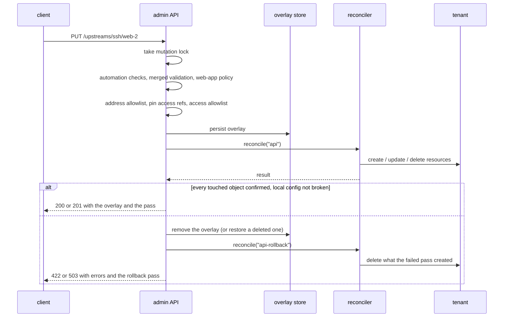

# Admin API

The admin API is how people and automation change a running gateway without editing the seed:
add or remove an upstream, apply an overlay, force a pass, rotate certificates, and read status.
Every change persists as an overlay, is reconciled before the response, and is rolled back if it
did not take effect end to end. This page explains the model; every route, body and status code is
in [`reference/admin-api.md`](../reference/admin-api.md).

Code: [`src/gwops/api/`](../src/gwops/api) (`app.py`, `routes_state.py`, `routes_actions.py`,
`ownership.py`) and [`src/gwops/access/allowlist.py`](../src/gwops/access/allowlist.py).

## Purpose and shape

| Property | Value |
| --- | --- |
| Server | FastAPI on uvicorn, inside the gwops process |
| Protocol | Plain HTTP, JSON bodies |
| Bind | `admin_api.bind`:`admin_api.port` from the seed, default `127.0.0.1:8081`; read once at startup |
| Documentation endpoints | None: `/docs`, `/redoc` and `/openapi.json` are disabled |
| Access log | uvicorn's access log is off; gwops writes its own audit line per mutation |

Route groups:

| Routes | Purpose |
| --- | --- |
| `GET /healthz` | Container health; the only unauthenticated route |
| `GET /status`, `GET /state`, `GET /overlays`, `GET /upstreams/{segment}/{name}` | Read state |
| `POST /overlays`, `DELETE /overlays/{id}`, `PUT`/`DELETE /upstreams/{segment}/{name}` | Transactional writes |
| `POST /reconcile`, `POST /certs/rotate-leaf`, `POST /certs/rotate-ca`, `POST /certs/public/{name}/issue` | Actions |

`{segment}` is `ssh`, `k8s` or `webapp`.

> **Note:** The default bind, `127.0.0.1`, is the container's own loopback interface. Docker
> forwards a published port to the container's network interface, not to its loopback, so with
> the default bind the API answers only from inside the container's network namespace. To reach
> it through the shipped `127.0.0.1:8081:8081` port mapping from the host, set
> `admin_api.bind: 0.0.0.0`; the host side of the mapping still keeps it on host loopback. See
> [`operations/admin-api-behind-tls-proxy.md`](../operations/admin-api-behind-tls-proxy.md).

## Authentication

Every route except `GET /healthz` needs `Authorization: Bearer <token>`.

- **Two tokens.** The presented token is compared against `GWOPS_ADMIN_TOKEN` and
  `GWOPS_AUTOMATION_TOKEN` with a constant-time comparison. Both comparisons always run, so the
  response time does not reveal which token matched or how close a guess was.
- **Bodiless 401.** A missing header, a scheme other than `Bearer`, an empty token or a wrong token
  all get the same response: 401 with `WWW-Authenticate: Bearer` and no body. The response never
  says why.
- **Fails closed.** With `GWOPS_ADMIN_TOKEN` unset, gwops logs `api.admin_token_unset` once at
  startup and every protected route answers 401. There is no unauthenticated mode.
- **Startup rules.** `GWOPS_AUTOMATION_TOKEN` must differ from `GWOPS_ADMIN_TOKEN`, and requires
  both seed allowlists, or startup aborts.
- **`/healthz`** returns only booleans, the process state and a timestamp, because reconcile
  actions and errors can name addresses, tenant ids and file paths.

## Principals

A matching token sets the request's principal.

|  | `admin` | `automation` |
| --- | --- | --- |
| Token | `GWOPS_ADMIN_TOKEN` | `GWOPS_AUTOMATION_TOKEN` |
| Routes | All | Only `PUT`, `DELETE` and `GET` on `/upstreams/{segment}/{name}`; anything else is 403 |
| Kinds | All | `ssh`; `webapp` only when the seed sets `admin_api.automation.web_apps.enabled: true`; never `k8s` (a Kubernetes entry names credential files inside the container, which an unattended caller must never choose) |
| Names | Any | Must start with `admin_api.automation.name_prefix` when set (403 otherwise) |
| Namespace | Any entry | Only entries the automation token created and no admin write has touched since; a seed entry or an admin-created or admin-edited entry is 409 |
| Missing entry on `DELETE` | 404 | `200 {"deleted": false}`, nothing written, so a retried webhook is harmless |
| Web-app fields | Policy only | Also a per-field policy: `upstream_tls: verify_full`, request header names only from `admin_api.automation.web_apps.request_header_names` and never `{{jwt}}`, and an address and alias that no other entry and no tenant resource already uses (exact spelling) |

Ownership is derived from overlay origins: each overlay records the principal that wrote it. A name in the seed is always owned by the seed; otherwise the overlay that creates an entry sets its owner, any later admin overlay that touches it makes it admin-owned, and a delete ends it. The
automation checks run before the body is merged with stored state, so a caller that fails them
learns nothing about an entry's stored values from a validation error. `/status`
`web_apps.automation_off_policy` lists automation-owned web apps that a later seed change put
outside the field policy.

## Guardrails

The two seed-only allowlists bound what **any** write may do, the admin token included:

| Allowlist | Checks | Rules |
| --- | --- | --- |
| `twingate.address_allowlist` | Every `address` and `alias` the patch supplies | `cidrs` for IP literals; `dns_suffixes` for names, matched at a label boundary (`apps.example.com` allows `x.apps.example.com`, not `xapps.example.com`). No DNS resolution is done: a name is judged by its spelling. |
| `twingate.access_allowlist` | Every group and security policy the patch grants | Compared on **resolved ids**, after the patch's references have been pinned, so an `{id}` reference cannot bypass a name entry. The allowlist's own names are resolved through the same cache as seed references. |

- Absent allowlist: that dimension is unrestricted. Present but empty: nothing is allowed.
- Only what the patch supplies is checked. Seed entries and `twingate.resource_defaults` are
  written by whoever controls the seed and are implicitly allowed.
- A violation is 403 with the violating entries. An allowlist gwops cannot evaluate right now
  (tenant unreachable, or an allowlist name matching no single object) is 503. Nothing is written
  in either case.

Together with the seed-only keys (see
[Configuration model](configuration-model.md#what-overlays-may-and-may-not-set)), this means the
admin token can manage upstreams and their access within limits the seed sets, but cannot change
the tenant, the CAs, the recording destination, the web-app proxy policy or the allowlists
themselves.

## Transactional writes

Every overlay-writing route goes through one path, `persist_overlay` and `apply_overlay_change`
in [`api/routes_state.py`](../src/gwops/api/routes_state.py). There is no second way to mutate
state.



A write is validated, checked against policy and the allowlists, persisted as an overlay, and
reconciled synchronously; it is kept only if the pass confirmed it on the tenant without breaking a
working local config, and otherwise undone by a second pass.

In order:

1. **Mutation lock.** Writes are serialised, so each one's before-and-after comparison sees only
   its own change.
2. **Validation.** For the automation token, the body on its own, then the namespace check. Then
   forbidden top-level keys (422), then the candidate is merged onto the real seed and every
   persisted overlay and fully validated before anything is written (422 with the dotted path).
3. **Web-app policy.** The violations the write is answerable for (422). Violations that already
   existed on entries the write does not touch are not blamed on it.
4. **Allowlists and pinning.** Address allowlist (403), then every access reference is resolved and
   rewritten as `{id, name}` (422 on no match or several, 503 when the tenant is unreachable or the
   API key is unset), then the access allowlist on those ids (403). For automation web-app writes,
   address exclusivity against the whole tenant runs last.
5. **Persist** the pinned patch as an overlay with the caller's principal as its origin. The store
   refuses a patch over 256 KiB or deeper than 32 levels (422).
6. **Reconcile synchronously** (`trigger: api`).
7. **Confirm.** The write succeeds only if every desired resource it added or changed ended the
   pass confirmed in sync on the tenant, every resource it removed is no longer owned, and it did
   not turn a locally healthy gateway config into a failing one. Failures that predate the write
   (another resource's tenant error, an already-broken local state) are not attributed to it.
8. **Keep or roll back.** On failure the overlay is removed (or, for `DELETE /overlays/{id}`,
   restored under its original id so it keeps its place in order), a second pass
   (`trigger: api-rollback`) converges the tenant back, for example by deleting a resource the
   failed pass already created, and the request fails with the pass's errors and the rollback
   pass. A failed write never leaves an orphaned overlay.

| Outcome | Status |
| --- | --- |
| Write kept | 200 (`PUT`, `DELETE /upstreams/...`), 201 (`POST /overlays`), 204 (`DELETE /overlays/{id}`) |
| Rolled back: the tenant was unusable for the whole pass (no API key, gateway unresolved, listing failed) | 503 |
| Rolled back: anything else, including a throttled and deferred write, or a broken local config | 422 |
| Rolled back because the pass's web-app policy refused the state | 422 with the violations |

Expect a write to take a few seconds: it is a full pass. A change that alters the rendered config
also waits for the gateway's drain-restart.

The other actions are not transactional in this sense. `POST /reconcile` runs or joins a pass and
returns it. `POST /certs/rotate-leaf` mints a leaf directly. `POST /certs/rotate-ca` runs the
two-phase rotation and reports tenant problems in `errors` with status 200. `POST
/certs/public/{name}/issue` queues work for the ACME runner (202). A completed CA rotation
triggers a reconcile pass, and so does an ACME certificate once it installs; a leaf minted by
`rotate-leaf` is picked up by the gateway's hot reload.

## Audit trail

Every `POST`, `PUT`, `DELETE` or `PATCH` request, allowed or not, produces exactly one `api.audit`
log line when it finishes:

```json
{"event": "api.audit", "principal": "automation", "method": "PUT",
 "route": "/upstreams/ssh/auto-app-42", "status": 200,
 "overlay_id": "0007-api-put-ssh-upstreams-auto-app-42",
 "level": "info", "timestamp": "2026-10-20T09:14:05.311Z"}
```

| Field | Value |
| --- | --- |
| `principal` | `admin`, `automation`, or `null` for an unauthenticated request |
| `method`, `route`, `status` | The request and its final status; a handler that raised is audited as 500 |
| `overlay_id` | The overlay the request wrote or deleted, when there was one |

Request bodies and credentials are never logged. A rolled-back write additionally logs
`api.change_rolled_back` with the reason and the pass errors. ACME issue requests log
`api.acme_issue` or `api.acme_issue_refused`; a completed CA rotation logs
`api.rotate_ca_completed`.

## Exposure

> **Security:** The admin API is plain HTTP. Never publish port 8081 on a routable interface
> without TLS in front of it. A bearer token sent over plain HTTP on a network can be captured and
> replayed.

Safe ways to reach it from elsewhere:

- publish a Twingate resource for the admin port, so callers reach it through the Twingate Client;
- bind `admin_api.bind` to an address only a TLS reverse proxy can reach, and let the proxy
  terminate TLS.

Hand unattended callers the automation token, never the admin token, and keep both allowlists
tight. [Automation and CI](../guides/automation-and-ci.md) has the details.

## See also

- [`reference/admin-api.md`](../reference/admin-api.md): every route, schema and status code.
- [`reference/admin-api.md`](../reference/admin-api.md#automation-and-web-apps): the automation
  rules for web apps.
- [`guides/automation-and-ci.md`](../guides/automation-and-ci.md): webhooks and CI.
- [`operations/admin-api-behind-tls-proxy.md`](../operations/admin-api-behind-tls-proxy.md): exposing the
  API safely.
- [`reference/seed.md`](../reference/seed.md#admin_api): the `admin_api` block.
- [Configuration model](configuration-model.md), [Security model](security-model.md).
