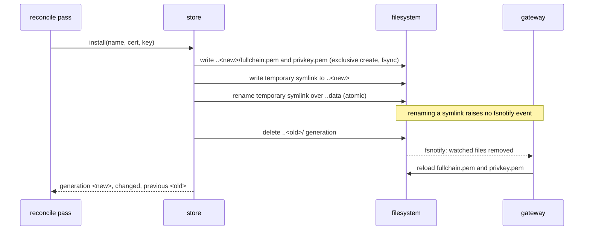
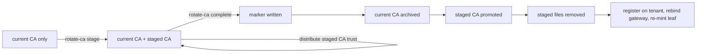

# Certificates

gwops owns every certificate the gateway uses. In **private CA mode** (the default) it keeps an
X.509 CA and an SSH CA, mints the gateway's TLS leaf from the X.509 CA, and keeps that leaf
covering every name clients dial. In **public certificate mode** it serves certificates that chain
to a public root instead, supplied as files or issued by ACME. In both modes the gateway signs
short-lived SSH user certificates with the SSH CA.

The gateway binary performs no checks on the certificate files it is given, so gwops validates
everything before the binary sees it.

Code: [`src/gwops/certs/`](../src/gwops/certs) (`manager.py`, `store.py`, `validate.py`,
`public.py`, `on_demand.py`), [`src/gwops/renderer/sans.py`](../src/gwops/renderer/sans.py),
`_render_tls` and `_render_ssh` in [`src/gwops/renderer/render.py`](../src/gwops/renderer/render.py),
and the certificate step of the reconciler.

## Why the leaf lists every upstream

The Twingate Client verifies the gateway's TLS certificate against the **resource address it is
dialing**, not against the gateway's own address. One gateway fronts many resources, so its leaf
must carry every name a client can reach through it.

`required_sans` computes that set from the effective state: the portless `address` of every SSH
upstream, Kubernetes cluster and web app, plus every web-app `alias`. When the leaf is minted, a
dotted-quad IPv4 literal becomes an IP SAN and anything else becomes a DNS SAN. IPv6 literals
cannot be written as addresses at all (the address grammar does not accept them).

Adding or removing an upstream therefore changes the required set, and the next pass re-mints the
leaf. The gateway hot-reloads it, so this needs no restart.

## Private mode PKI

Everything lives under `/data/pki/`:

```text
/data/pki/
  x509-ca.crt         0644  X.509 CA certificate
  x509-ca.key         0600  X.509 CA private key (EC P-256, PKCS#8, unencrypted)
  ssh-ca.key          0600  SSH CA private key (ed25519, OpenSSH format)
  ssh-ca.key.pub      0644  SSH CA public key, the line SSH targets trust
  leaf/               atomic store of the TLS leaf (see below)
  staged/             a staged X.509 CA during rotation
  archive/            X.509 CAs displaced by a completed rotation
```

|  | Generated (`generate: true`, the default) | Bring-your-own (`generate: false`) |
| --- | --- | --- |
| X.509 CA | EC P-256, self-signed, subject `CN=Twingate Gateway TLS CA`, `CA:TRUE` (critical), key usage `keyCertSign` and `cRLSign`, valid 10 years, backdated 5 minutes. Generated once and never overwritten. | `ca.x509.cert_path` and `key_path`, used as given |
| SSH CA | ed25519, public key line comment `twingate-ssh-ca`. Generated once and never overwritten. | `ca.ssh.key_path`; the public half must sit beside it as `<key_path>.pub` |
| Registered on the tenant | Once, by gwops (see [Twingate integration](twingate-integration.md#gateway-resolution)) | Never by gwops |
| Rotation | `POST /certs/rotate-ca` (X.509 only) | Yours: replace the files and restart |

Every write of CA material is atomic: written to a temporary file with the final mode, fsync'd,
renamed into place, and the directory fsync'd. A temporary file that may hold a private key is
removed if any step fails.

Existing material is always loaded and validated, whether gwops generated it or you supplied it.
The X.509 CA must be `CA:TRUE`, inside its validity window, have an **EC** private key, and the key
must match the certificate. Any problem is a load error naming the file and the property. Exactly
one file of a pair present is treated as a corrupt PKI directory (restore the missing file or
remove the other), never as a reason to generate. Missing files with `generate: false` are an
error too. At startup any of these aborts; on a later pass it is a local error and the gateway
keeps the last good config.

## Leaf lifecycle

The leaf is minted by gwops, outside the gateway binary:

| Property | Value |
| --- | --- |
| Key | EC P-256, generated per mint |
| Subject | `CN=gateway` |
| SANs | Exactly the required set |
| Validity | 90 days, backdated 5 minutes |
| Extensions | `CA:FALSE` (critical), key usage `digitalSignature` and `keyEncipherment` (critical), extended key usage `serverAuth` |
| Issuer | The active X.509 CA |
| Files | `fullchain.pem` (leaf then CA, 0644), `privkey.pem` (0600) |

Each pass that has at least one SAN checks the leaf and re-mints it unless it is `ok`:

| State | Meaning |
| --- | --- |
| `ok` | Valid, covers exactly the required SANs, more than 14 days left |
| `missing` | No leaf yet |
| `expiring` | Otherwise healthy, fewer than 14 days left |
| `sans_incomplete` | The only problems are missing required SANs |
| `sans_extra` | Valid, but carries a name no longer required, so it is re-minted to shed it |
| `invalid` | Expired or not yet valid, no `serverAuth`, `CA:TRUE`, unparseable, a broken chain, or bundled with a CA that is not the active one (for example after a CA rotation) |

Precedence is `invalid`, `sans_incomplete`, `sans_extra`, `expiring`, `ok`. The state is shown in
`/status` as `certs.leaf_state`, with `certs.leaf_not_after` and `certs.x509_ca_not_after`.

`POST /certs/rotate-leaf` mints a fresh leaf on demand. It answers 409 with no upstreams (the SAN
set is empty) and in public mode.

## Atomic store and hot reload

The gateway reloads certificate files on its own: it watches them with fsnotify. gwops never
restarts the gateway for a new leaf or a renewed public certificate. Instead it installs the new
pair so that the gateway always reads a matching certificate and key, and so that its watcher
fires.

The store ([`certs/store.py`](../src/gwops/certs/store.py)) keeps one directory per name, the leaf
under `/data/pki/leaf/` and each public certificate under `/data/public-tls/<name>/`:

```text
leaf/
  ..3f9a1c0be2d4/        a generation: fullchain.pem (0644), privkey.pem (0600)
  ..data -> ..3f9a1c0be2d4
  fullchain.pem -> ..data/fullchain.pem
  privkey.pem   -> ..data/privkey.pem
```

The rendered config references only the stable paths, `fullchain.pem` and `privkey.pem`. A
generation id is the first 12 hex digits of `sha256(cert + NUL + key)`.



An install writes a complete new generation, swaps the `..data` link in one atomic rename, then
deletes the previous generation; that delete is what triggers the gateway's reload, and the stable
paths already resolve to the new pair.

Consequences:

- An install of the identical pair changes nothing.
- If the previous generation cannot be deleted, the new pair is in place but the gateway has not
  reloaded. The pass records `leaf certificate: installed but previous generation not removed;
  gateway has not reloaded` as a local error, and every following pass retries the delete before
  doing anything else with the leaf.
- Store files are opened without following symlinks and read with a 1 MiB bound. Key bytes never
  appear in a log event or an error message.

## Rendered TLS

Private CA mode renders:

```yaml
tls:
  certificates:
    files:
      - certificateFile: /data/pki/leaf/fullchain.pem
        privateKeyFile: /data/pki/leaf/privkey.pem
ssh:
  gateway:
    username: gateway
    key:
      type: ed25519
    hostCertificate:
      ttl: 24h
    userCertificate:
      ttl: 5m
  ca:
    local:
      privateKeyFile: /data/pki/ssh-ca.key
```

- `tls.certificates.files[0]` is the leaf and the only static certificate.
- `ssh.ca.local.privateKeyFile` is the generated SSH CA, or `ca.ssh.key_path` for a
  bring-your-own CA. The gateway signs 5-minute SSH user certificates and 24-hour host
  certificates with it. SSH targets must trust the SSH CA public key (`ssh-ca.key.pub`).
- With on-demand issuance, `tls.automation.issuer.local` is added (below).

In public mode, `tls.certificates.files` holds one entry per installed public certificate and no
leaf; see [Gateway process](gateway-process.md#rendering) for the full shape.

## X.509 CA rotation

Rotation replaces the generated X.509 CA in two phases, so you can distribute trust in the new CA
before anything serves with it.



`stage` generates a new CA next to the current one; `complete` writes a recovery marker, archives
the current CA, promotes the staged one, removes the staged files, and then registers the new CA
on the tenant, rebinds the gateway and re-mints the leaf.

**`stage`** generates a new CA under `/data/pki/staged/` and returns its PEM (`ca_pem`), its path
and `manual_steps`. It is idempotent: a second `stage` returns the CA already staged rather than
generating another. Nothing that serves changes.

**`complete`**:

1. Promotes the staged CA crash-safely:
   1. writes `staged/.rotation-stamp` with an archive timestamp before touching anything else;
   2. copies the current CA to `archive/x509-ca-<stamp>.crt` and `.key`, once;
   3. writes the staged CA over `x509-ca.crt` and `x509-ca.key`;
   4. deletes the staged files and the marker.
2. Registers the new CA on the tenant as `gwops-x509-<gateway id>`, rebinds the Gateway object to
   it, and records it as `ca/x509`.
3. Re-mints the leaf under the new CA (when there are upstreams).
4. With on-demand issuance on, drain-restarts a running gateway so its issuer loads the new CA.
5. Triggers a reconcile pass.

A tenant failure in step 2 (no API key, no resolved gateway, an API error) does not undo the local
promotion: the response is 200 with the problem in `errors`, telling you to register the CA and
rebind manually. A second `complete` with nothing staged answers 409. The previous CA object stays
registered on the tenant; delete it there once nothing trusts it.

**Crash safety.** The staged files are the source of truth until promotion has finished, and the
marker exists only while a completion is in progress. On boot, `recover_x509_rotation` finishes a
promotion whose marker is present (archiving is skipped once the stamped archive exists, and the
promotion rewrites identical bytes), and leaves a staged CA without a marker alone: that is a
rotation you have staged but not completed, and promoting it would serve a CA the tenant has not
been told to trust.

Rotation is refused with 409 for a bring-your-own CA (`generate: false`) and in public mode. There
is no SSH CA rotation route.

## On-demand issuance

> **Security:** With `ca.x509.on_demand_issuance: true`, a client that presents **any SNI to port
> 8443 receives a certificate for that name signed by the gwops X.509 CA, before its access token
> is authenticated.** The CA key is not disclosed, but the gateway loads it and uses it on a path
> anyone who can reach 8443 can trigger. If the CA is in browser trust stores (expected for a
> generated CA serving `downstream.tls: tls13` web apps) or is a bring-your-own CA that devices
> already trust, such a certificate would be accepted for any name. Enable it only when that
> exposure is acceptable.

When enabled, gwops adds the gateway's local issuer beside the static leaf:

```yaml
tls:
  certificates:
    files:
      - certificateFile: /data/pki/leaf/fullchain.pem
        privateKeyFile: /data/pki/leaf/privkey.pem
  automation:
    issuer:
      local:
        certificateFile: /data/pki/x509-ca.crt
        privateKeyFile: /data/pki/x509-ca.key
```

The issuer points at the active X.509 CA (the bring-your-own paths when `generate: false`). The leaf
is still minted and checked exactly as above; a handshake for a name it covers gets the leaf, and
the gateway issues a certificate for any other SNI, valid 24 hours and held only in gateway memory.

Before it renders the issuer, gwops checks that the CA certificate is `CA:TRUE`, that a `keyUsage`
extension, if present, includes `keyCertSign`, and that the key is an unencrypted PEM. Startup
aborts otherwise; a later pass records a local error and keeps the previous config.

`tls.on_demand_issuance_active` is logged at every startup in this mode and when a seed change
turns it on (`tls.on_demand_issuance_disabled` when turned off). `/status` reports
`tls.mode: "static+on_demand"` and a `tls.warning` that is stronger for a bring-your-own CA and
for a generated CA with a `tls13` web app. Web-app readiness reports names the leaf lacks but the
issuer covers as `covered_on_demand:<name>`. On-demand issuance is not available in public mode.

## Public certificate mode

> **Security:** In public mode gwops registers a public root, ISRG Root X1, as the gateway's X.509
> CA on your tenant. A Client that fetches the gateway's trust anchor then accepts **any**
> certificate that chains to that root for the names it dials through this gateway, not only the
> certificates gwops serves. That is the cost of serving publicly trusted certificates without a
> private CA.

The seed-only `public_tls` block turns the mode on. It is mutually exclusive with an explicit
`ca.x509` block; `ca.ssh` still applies. gwops mints no X.509 CA or leaf in this mode, and
`/status` reports `tls.mode: "public"`.

**The registered root.** The only accepted value is `isrg_root_x1`. gwops finds it in the image's
system trust store (`/etc/ssl/certs/ca-certificates.crt`) by the SHA-256 fingerprint of its DER
encoding, never by subject name. If it is not there, nothing can be validated or registered.

**Validation.** Every certificate is validated before it is installed or rendered, in a fixed order
(certificate file, key file, leaf profile, key match, chain), so a leaf problem is reported as
itself rather than as a chain failure:

| Check | Rule |
| --- | --- |
| Certificate file | `CERTIFICATE` blocks only, UTF-8, at least one; the leaf first, then intermediates |
| Key file | Exactly one private key block, unencrypted; EC P-256, EC P-384, or RSA of 2048 bits or more |
| Leaf profile | `CA:FALSE`, carries `serverAuth`, not expired, no IP SANs, every DNS SAN inside a `public_tls.zones` entry, every declared `names` entry covered by a SAN |
| Key match | The key matches the leaf's public key |
| Chain | Builds through the served intermediates to the registered root, using a verifier that applies the CA/Browser Forum profile. A Let's Encrypt ECDSA hierarchy therefore needs its cross-signed intermediates in `fullchain.pem`. |

Refusal messages name the certificate, the file and the property, never contents.

**Coverage.** Every served name (each address and alias) must be a DNS name with at least two
labels, inside a zone, and match exactly one certificate's `names`; otherwise the seed is refused at
load. IP addresses and the in-cluster name `kubernetes.default.svc` cannot be served. Before
anything is installed, a served name that the SANs of a second certificate also match is refused,
because the gateway would serve whichever entry loads first.

**Install, all or nothing.** Each pass reads and validates every `source: file` certificate from
`/config/public-tls/`. If any fails, none is installed that pass: the failing one is `invalid` with
`last_error`, the others are `pending`, and the last good generations keep serving. If all pass,
each is installed through the store under `/data/public-tls/<name>/`. `source: acme` certificates
are judged on what the ACME runner has installed there (see [ACME](acme.md)).

| `certs.public[].state` | Meaning |
| --- | --- |
| `ok` | Valid and installed |
| `expiring` | Valid, less than a third of its lifetime left |
| `invalid` | Refused this pass; the last good generation, if any, keeps serving |
| `pending` | Validated but not installed because another certificate failed, or a `source: acme` certificate with nothing installed yet |

At startup a refused `source: file` certificate aborts. After startup it is a local error.

**Rendering and changes.** One `tls.certificates.files` entry per installed certificate at its
stable store paths, sorted by name (the gateway uses the first certificate that matches the
ClientHello). Renewing a certificate's content installs a new generation behind the same paths and
hot-reloads. Adding or removing an entry changes the rendered file list, which the gateway reads
only at start, so it drain-restarts (`restart-required: TLS certificate set changed`).

**Binding the root.** Every pass reads the Gateway object's X.509 CA binding and compares its
fingerprint with the root's. When they differ, a rebind is decided, and sent only after the same
pass rendered and applied its config successfully; otherwise it is deferred and the action line
says why. A rebind changes what every Client accepts, so it never happens while the local side is
broken. `certs.registered_root.bound` reports the result, and readiness reports
`gateway_ca_unbound` until it is true. A new gateway in remote-network mode is created already
bound to the root.

**Leaving public mode.** Switching from private to public rebinds automatically. Switching back
does not rebind the gateway to a gwops X.509 CA that was registered before: gwops only binds a CA
when it registers it. Rebind the gateway on the tenant yourself to the id recorded as `ca/x509` in
`/data/state.json`.

## See also

- [`guides/private-ca-generated.md`](../guides/private-ca-generated.md),
  [`guides/private-ca-byo.md`](../guides/private-ca-byo.md)
- [`operations/ca-and-leaf-rotation.md`](../operations/ca-and-leaf-rotation.md) and
  [`reference/admin-api.md`](../reference/admin-api.md#post-certsrotate-ca)
- [`guides/on-demand-issuance.md`](../guides/on-demand-issuance.md)
- [`guides/public-certs-files.md`](../guides/public-certs-files.md),
  [`guides/public-certs-acme.md`](../guides/public-certs-acme.md),
  [`guides/public-mode-mixed.md`](../guides/public-mode-mixed.md)
- [`reference/seed.md`](../reference/seed.md#ca), [`reference/seed.md`](../reference/seed.md#public_tls)
- [ACME](acme.md), [Security model](security-model.md#key-material-at-rest)
