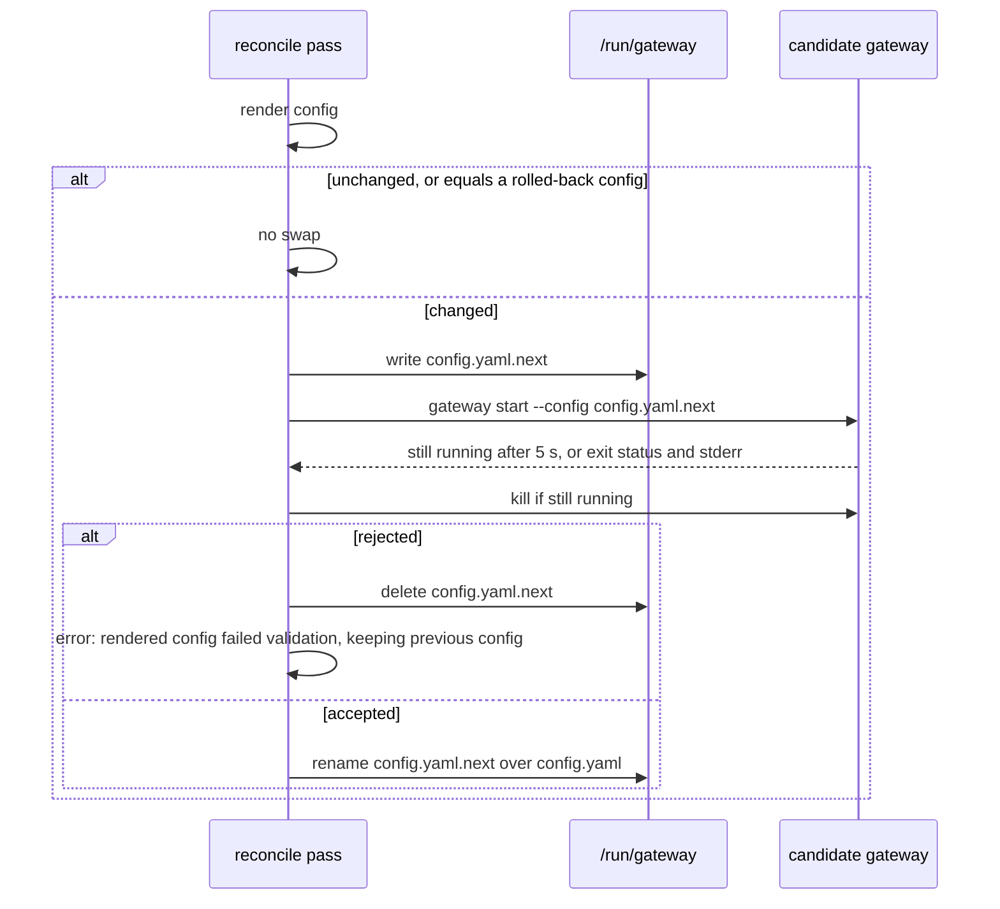
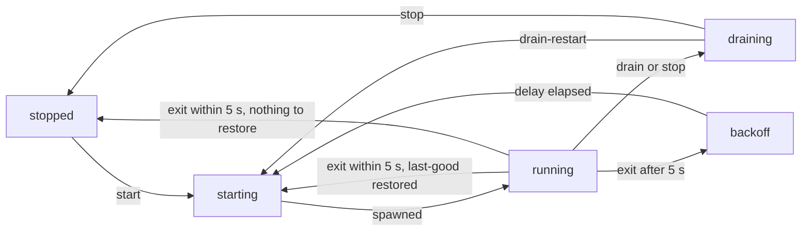

# Gateway process

gwops renders the gateway binary's config from the effective state, proves the binary accepts it
before using it, and then starts, restarts or leaves the gateway alone. It supervises the child
for its whole life: an early exit rolls back to the last config that ran, a later crash backs off
and restarts. This page covers that lifecycle and the environment and output handling around it.

Code: [`src/gwops/renderer/render.py`](../src/gwops/renderer/render.py),
[`src/gwops/supervisor/spawn.py`](../src/gwops/supervisor/spawn.py),
[`src/gwops/supervisor/process.py`](../src/gwops/supervisor/process.py),
[`src/gwops/supervisor/childenv.py`](../src/gwops/supervisor/childenv.py), and `_render_and_write`,
`_apply` and `_restart_required_reasons` in
[`src/gwops/reconciler/core.py`](../src/gwops/reconciler/core.py).

## Rendering

gwops renders only the gateway 2.0 config schema; the image refuses to build against a 1.x binary.
The config is written to `/run/gateway/config.yaml` (tmpfs). A private-mode render with one
Kubernetes cluster and one web app looks like this:

```yaml
twingate:
  network: acme
  host: twingate.com
port: 8443
metricsPort: 9090
tls:
  certificates:
    files:
      - certificateFile: /data/pki/leaf/fullchain.pem
        privateKeyFile: /data/pki/leaf/privkey.pem
log:
  sessionRecording:
    segment:
      maxSize: 256000
ssh:
  gateway:
    username: gateway
    key:
      type: ed25519
    hostCertificate:
      ttl: 24h
    userCertificate:
      ttl: 5m
  ca:
    local:
      privateKeyFile: /data/pki/ssh-ca.key
kubernetes:
  upstreams:
    - name: prod
      bearerTokenFile: /data/k8s-creds/prod-token-1a2b3c4d5e6f
      caFile: /data/k8s-creds/prod-ca-6f5e4d3c2b1a.crt
webApp:
  requestHeaders:
    X-Trusted-User: '{{username}}'
    X-Trusted_User: '{{username}}'
    X_Trusted-User: '{{username}}'
    X_Trusted_User: '{{username}}'
upstreamTrustedCABundles:
  - file: /data/upstream-ca/corp-root-abcdef123456.pem
```

| Section | Source | Notes |
| --- | --- | --- |
| `twingate` | `twingate.network`, `twingate.host` | The gateway uses these to reach the tenant and its key set |
| `port`, `metricsPort` | Fixed | Always 8443 and 9090 |
| `tls` | Private mode: the leaf at its stable store path, plus `automation.issuer.local` with on-demand issuance. Public mode: one entry per installed public certificate, sorted by name, no leaf, no `automation` | See [Certificates](certificates.md#rendered-tls) |
| `log.sessionRecording.segment.maxSize` | Fixed at 256000 | Just under the binary's 256 KiB ceiling |
| `ssh` | Fixed gateway identity and TTLs; the SSH CA key path | Generated key at `/data/pki/ssh-ca.key`, or `ca.ssh.key_path` |
| `kubernetes.upstreams` | The single `k8s_clusters` entry | Paths are the content-addressed copies, never the `/config/k8s-creds/` sources |
| `webApp.requestHeaders` | `web_app_proxy.request_headers` | Only when at least one web app is declared; omitted when the map is empty |
| `upstreamTrustedCABundles` | `web_app_proxy.upstream_ca_bundles` copies | Only when at least one web app is declared |

What the renderer never emits:

- **`ssh.upstreams`**: the binary ignores it. SSH targets come from the Twingate resources gwops
  syncs; the gateway learns them from the tenant.
- **Upstream ports and addresses** in general: the gateway dials the address and upstream port of
  the Twingate resource, which is why gwops keeps those correct on the tenant.
- **`log.*.output`**: every gateway log stream stays on its default, stderr. See
  [Recording pipeline](recording-pipeline.md#where-the-gateway-writes).

Rules the renderer enforces, each a `RenderError` that keeps the previous config:

- **One Kubernetes cluster.** The binary's `kubernetes.upstreams` consumes a single entry, so two
  or more `k8s_clusters` entries is an error (`2 Kubernetes clusters configured, ... Reduce to one
  cluster.`), not a silent drop.
- **Trusted header spellings.** A gateway-wide header whose value uses `{{jwt}}`, `{{username}}`
  or `{{groups}}` is an identity header. Many frameworks treat `-` and `_` in header names as the
  same character, so a client could otherwise send `X_Trusted_User` and have the app read it as
  `X-Trusted-User`. The renderer emits every `-`/`_` spelling of each trusted name with the same
  value, so the gateway overwrites any client-supplied variant. A name with more than four
  separators, or a spelling that collides with a header of a different value, is an error.
- **Empty header values** and two CA bundles sharing a file are errors.

## Pre-flight by spawn

The binary has no `config validate` subcommand, so the only way to test a config is to start the
binary with it. A good config never exits on its own; a bad one exits quickly with a recognisable
message.



A changed render is written as `config.yaml.next` and the binary is started on it for up to 5 s;
gwops then kills it and either discards the candidate or renames it over the live config.

The binary's startup has three steps, and the stderr text tells gwops which one failed:

| Step | Failure marker | Means |
| --- | --- | --- |
| 1. Load | `failed to load config` | YAML or type error: the config is broken |
| 2. Validate | `failed to validate config` | A structural rule failed: the config is broken |
| 3. Create the proxy | anything else (`failed to create proxy`, a file open error, address in use) | An environmental problem, not a config problem |

The verdict depends on whether the live gateway is running:

| Live gateway | Rejected when | Why |
| --- | --- | --- |
| Running | Only a step 1 or 2 marker (a schema break) | The live gateway holds ports 8443 and 9090, so a valid candidate always fails step 3 with "address in use" |
| Not running | Anything other than still running at 5 s | The ports are free, so the pre-flight is authoritative |

A candidate that passes while the gateway runs but cannot start at runtime is caught after the
swap by the early-exit rollback below.

Two more rules:

- A render identical to the live `config.yaml` is not pre-flighted or swapped.
- A render identical to a config that was rolled back after a failed start is never re-applied:
  the pass records `rendered config matches one that was rolled back after a failed start; not
  re-applying` as a local error until the seed or credentials that produce it change.

The pre-flight child gets the same argv and environment as the real gateway. Its stdout is
discarded and its stderr is read only for the verdict and the error text. The same
classification runs in CI against the pinned binary (`python -m gwops.ci.preflight`).

## Apply

After a successful render the pass applies the cheapest sufficient action:

| Gateway state | Change | Action |
| --- | --- | --- |
| Stopped | Any (first start, after rollback, after a hold) | Start it on the config on disk. With no valid config ever produced, this is an error. |
| Running | The rendered config changed | **Drain-restart**: SIGTERM, wait up to 30 s, SIGKILL if needed, then start on the new config |
| Running | Only the leaf or a public certificate's content changed | Nothing. The files changed behind stable paths and the gateway hot-reloads them (`leaf-only change: gateway hot-reloads certificate files, no action needed`) |
| Starting, draining or in backoff | The config changed | Nothing now; the pending start picks up the new file |
| gwops shutting down | Any | Nothing (`skipped gateway apply: shutting down`) |

The binary has no reload signal, so any rendered change is a drain-restart. The action line names
the settings that the binary reads only at start when they are what changed:

- `listener port changed (8443 -> ...)`,
- `SSH CA key path changed (...)`,
- `TLS certificate set changed`: a `tls.certificates.files` entry was added, removed or moved,
  for example a public certificate added to the seed.

Anything else is reported as `drain-restarted gateway (config changed)`. Changes that cause a
restart include a rotated Kubernetes credential or CA bundle (new content-addressed path), a
changed gateway-wide header, the first or last web app (which adds or removes the `webApp` and
`upstreamTrustedCABundles` sections), and turning on-demand issuance on or off.

## Supervision

`GatewayProcess` tracks the child through five states:



A started child is `running`. A deliberate stop or restart goes through `draining`. An unexpected
exit within the first 5 s is treated as a failed start: the config is rolled back and the gateway
started once on the restored config, or left `stopped` when there is nothing to restore or the
restored config also fails. A later exit is a crash and goes to `backoff` before restarting.

**Early-exit rollback.** An exit within 5 s of the start (the same window as the pre-flight) is a
failed start, not a routine crash. gwops remembers the config that failed, restores
`config.yaml` from `config.yaml.last-good`, logs `gateway.early_exit_rollback` at error level, and
starts the gateway once on the restored config. If that also exits early, or there is no last-good
file, it stays `stopped`, and the next pass retries with the config on disk. Meanwhile the
reconciler refuses to re-apply the failed config. A config is promoted to `config.yaml.last-good`
once the gateway has run on it for 5 s.

**Crash backoff.** An exit after the 5 s window logs `gateway.crashed` with the exit code and the
delay, then restarts after 1 s, doubling on each consecutive crash up to 60 s. The delay resets to
1 s once a run has lasted 300 s.

**Drain.** Stop and drain-restart send SIGTERM and wait up to 30 s; on timeout they log
`gateway.drain_timeout` and send SIGKILL. Pending restart and promotion timers are cancelled first,
so a drain never races a backoff restart.

The process state is `process.state` in `/status`, and `/healthz` is healthy only while it is
`running` or `starting`.

## Child environment

The gateway child (and the pre-flight child) gets a new environment built from an exact allowlist
of inherited names, matched case-sensitively:

```text
PATH  HOME  LANG  LC_ALL  TZ
SSL_CERT_FILE  SSL_CERT_DIR
HTTP_PROXY  HTTPS_PROXY  NO_PROXY  http_proxy  https_proxy  no_proxy
GOMEMLIMIT  GOMAXPROCS  GOGC  GODEBUG
```

Nothing else is inherited. In particular `TWINGATE_API_KEY`, `GWOPS_ADMIN_TOKEN`,
`GWOPS_AUTOMATION_TOKEN`, `GWOPS_RECORDING_TOKEN`, every other `GWOPS_*` setting and any `CF_*` variable
never reach the gateway. An allowlist is used rather than a denylist so that a secret variable
added later cannot leak by default. The binary's own `TWINGATE_CONFIG` variable is not passed
either; `--config` supersedes it.

> **Note:** `GODEBUG` is passed through so you can tune the Go runtime, and it is under your
> control. It can also re-enable legacy TLS and X.509 behaviour in the gateway. Leave it unset
> unless you know which setting you need.

## Output handling

The child's stdout and stderr are both piped and read in 64 KiB chunks by a line framer that
delivers a line of up to 16 MiB whole and discards a longer one whole (logged as
`gateway.line_too_long` with the stream and byte count).

| Stream | Content in gwops' log (`docker logs`) | Also sent to |
| --- | --- | --- |
| stdout | Each line as `gateway.line` with `stream: gateway-stdout` and the line text | Nothing else |
| stderr | Each line produces a metadata-only `gateway.line` event: `stream: gateway-stderr`, `bytes: <n>`, `content: "[suppressed]"`. A `system` line is also relayed in full as a `gateway.system` event | The recording filter, when recording is enabled |

The renderer always enables the gateway's session recording capability, so any stderr line may be
a session recording carrying terminal content. stderr text is therefore never echoed as such,
whether recording is on or off. The one relay is fail-closed and runs in `relay_system_line`
(`src/gwops/supervisor/main.py`): only a JSON object whose
`logger` is exactly `system` and that carries no `asciicast` key is logged as `gateway.system`,
with every field of the line as a top-level key. **Gateway operational output appears in
`docker logs`; audit lines (HTTP and SSH) and session recordings do not.** A relay failure logs
`gateway.system_relay_failed` and never disturbs the recording filter. The pre-flight events
`spawn.validate_rejected` and `spawn.validate_exited_zero_early` also carry the candidate's
stderr text. How audit and recording lines leave the container is described in
[Recording pipeline](recording-pipeline.md#what-reaches-docker-logs).

## See also

- [`reference/image.md`](../reference/image.md#gateway-child-environment): the child environment
  in the image reference.
- [`reference/image.md`](../reference/image.md#pinned-binaries): the binary pin.
- [Reconciler](reconciler.md): where render and apply sit in a pass.
- [`operations/troubleshooting.md`](../operations/troubleshooting.md): pre-flight rejections and
  rollbacks.
- [`operations/upgrades-and-pins.md`](../operations/upgrades-and-pins.md): moving the gateway pin.
