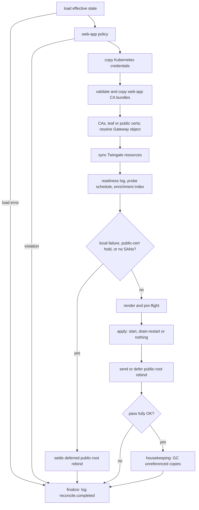

# Reconciler

The reconciler is the core loop. One reconcile pass takes the declared state from the seed and
overlays to a running gateway: it makes the local files, the Twingate tenant and the rendered
config match the declaration, then starts or restarts the gateway only when it has to. It is
level-triggered: every pass compares the whole declared state with what exists, so a missed event
is healed by the next pass.

Code: `Reconciler` in [`src/gwops/reconciler/core.py`](../src/gwops/reconciler/core.py) (`reconcile`,
`_run` and the step methods), trigger sources in
[`src/gwops/reconciler/watch.py`](../src/gwops/reconciler/watch.py).

## One pass

A pass loads and checks the configuration, prepares local files and certificates, resolves the
Gateway object, syncs tenant resources, and then, unless a local step failed or nothing can be
served yet, renders, pre-flights and applies the config. Housekeeping runs only after a fully
successful pass.

The steps in order:

1. **Load and policy.** The effective state is loaded from disk. A load error, or a web-app policy
   violation, records a local error and ends the pass immediately (`kept previous gateway config
   (local step failed)`). The tenant client's attribution User-Agent is updated from the state.
2. **Kubernetes credentials.** Each cluster's `bearer_token_file` and `ca_file` is read under
   `/config/k8s-creds/` and written to a content-addressed copy under `/data/k8s-creds/`. See
   [Credentials and CA bundles](#credentials-and-ca-bundles).
3. **Web-app CA bundles.** Each `web_app_proxy.upstream_ca_bundles` file is read under
   `/config/webapp-cas/`, validated, and (while web apps exist) copied under `/data/upstream-ca/`.
4. **Certificates and gateway resolution.**
   - *Private CA mode*: ensure the X.509 and SSH CAs, register gwops-generated CAs on the tenant
     once, resolve the Gateway object (pinned, adopted or created) and rebind it to any newly
     registered CA, then retry deleting any stale leaf generation, and re-mint the leaf when it is
     missing, expiring, invalid or has the wrong SANs.
   - *Public certificate mode*: resolve the registered root, validate and install every
     `source: file` certificate (all or nothing), judge `source: acme` certificates by what is
     installed, hand the ACME runner its configuration, ensure the SSH CA, register the root on
     the tenant, resolve the Gateway object and decide whether it needs rebinding to the root.

   This step runs before resource sync because creating a Gateway object needs the registered
   X.509 CA id, and resources are attached to the resolved gateway.
5. **Resource sync.** Diff the desired SSH, Kubernetes and web-app resources against the tenant
   listing; create, correct and delete only objects in the ownership registry. See
   [Twingate integration](twingate-integration.md).
6. **Observation.** Log web-app readiness when it changes, schedule the opt-in upstream TLS probe,
   and feed the tenant's web-app listing to the recording enrichment index. None of these can fail
   the pass.
7. **Hold checks**, in this order:
   - a local step failed: keep the previous config;
   - public mode with a `source: file` certificate that has nothing installed, or with every
     certificate a pending `source: acme` one: hold the gateway down;
   - no upstreams at all, so no SANs: hold the gateway down.
8. **Render and pre-flight.** Render `config.yaml`. If it differs from the live file and is not a
   config that was rolled back after a failed start, write it to `config.yaml.next`, run the binary
   on it, and either swap it in or discard it. See [Gateway process](gateway-process.md).
9. **Apply.** Start the gateway if it is stopped; drain-restart it if the config changed; do
   nothing for a leaf-only change, which the gateway hot-reloads.
10. **Deferred public-root rebind.** In public mode, a rebind of the Gateway object's X.509 CA to
    the registered root is sent only when credentials, CA bundles, certificates, render and apply
    all succeeded this pass; otherwise it is deferred with a reason in `actions`. A pending SSH CA
    binding is sent either way, because it does not depend on the local steps.
11. **Housekeeping.** After a fully local-OK pass: remove credential and CA bundle copies that
    neither `config.yaml` nor `config.yaml.last-good` references, sweep the public certificate
    store, and remove legacy leaf files and credential directories no config names.

## Triggers and single-flight

| Trigger name | Source |
| --- | --- |
| `startup` | The first pass, run by the startup gate |
| `seed-change` | The seed file watch (2 s debounce) or the 5 s content-hash poll |
| `tick` | Every `GWOPS_RECONCILE_TICK_SECONDS` (default 600) |
| `api` | An admin API write, `POST /reconcile`, or the event set by a completed CA rotation or an ACME install |
| `api-rollback` | The second pass that undoes a failed admin API write |
| `sighup` | `SIGHUP` to PID 1 |

Passes are single-flight: one pass holds the reconciler's lock at a time. A trigger that arrives
while a pass is running waits for exactly one follow-up pass, and every other trigger arriving in
the meantime joins that same follow-up and receives its result. Because the follow-up re-reads the
full state, nothing any of the coalesced triggers observed is lost, and a burst of seed events,
ticks and API calls costs at most one extra pass. A follow-up that is cancelled while waiting
clears itself, so later triggers never wait on a pass that will not run.

A trigger source whose pass raises logs `watch.reconcile_raised` and keeps running. If a trigger
source itself dies, the error propagates and the remaining sources are cancelled, so gwops never
runs silently without triggers.

## Failure containment

Three rules keep one problem from becoming an outage.

- **Tenant errors never stop local steps.** No API key, an unreachable tenant, a 5xx, a rejected
  write, a 429: each is recorded in `errors` and the pass carries on to render and apply. A gateway
  that is already serving keeps serving, and a new upstream still gets its SAN and its config.
  Its tenant resource is created on a later pass.
- **Any local failure skips render and apply.** A credential file outside its root, unusable CA
  material, a leaf that cannot be minted, a refused public certificate, a render error or a
  pre-flight rejection sets `local_ok: false`. The pass records `kept previous gateway config
  (local step failed)`, skips steps 8 and 9 entirely, and the gateway keeps running on the last
  good config. This is the guarantee that every failure path leaves the gateway serving and says
  why.
- **Per-resource errors stay per resource.** An access reference that cannot be resolved, or a
  create, update or delete that fails, is recorded under that resource's `<kind>/<name>` key. The
  other resources in the pass are still synced. A resource whose access cannot be resolved is not
  created at all, because it would come up with the wrong access; an existing one keeps its
  address and port sync but skips the access change.

Observation steps (readiness, probe scheduling, enrichment index, web-app snapshot) catch their own
exceptions and log a warning; they never fail a pass. Housekeeping failures are recorded in
`housekeeping_errors` (exception type only) and never fail a pass either.

## Credentials and CA bundles

Kubernetes credentials and private upstream CA bundles are operator files that the gateway must
read. gwops never points the gateway at the operator's file directly. It copies the content to a
content-addressed file and renders that path instead.

| Source | Confined root | Copy | Mode |
| --- | --- | --- | --- |
| `k8s_clusters[].bearer_token_file` | `/config/k8s-creds/` | `/data/k8s-creds/<cluster>-token-<sha12>` | 0600 |
| `k8s_clusters[].ca_file` | `/config/k8s-creds/` | `/data/k8s-creds/<cluster>-ca-<sha12>.crt` | 0644 |
| `web_app_proxy.upstream_ca_bundles[].file` | `/config/webapp-cas/` | `/data/upstream-ca/<bundle>-<sha12>.pem` | 0644 |

`<sha12>` is the first 12 hex digits of the SHA-256 of the content.

The confined read ([`src/gwops/confined.py`](../src/gwops/confined.py), `read_confined`) resolves
symlinks and `..` before checking that the result is under the root, requires a regular file,
refuses one larger than 1 MiB, opens it without following a final symlink, and refuses a file
whose identity changed between the check and the open. Both files of a cluster are read before
either copy is written, so a refused source never leaves a half-updated cluster. All CA bundles
are validated (`CERTIFICATE` blocks only, `CA:TRUE`, in date) before any copy is written.

Why content addressing:

- **A changed credential changes the config.** Rotating a token rewrites the source; the next pass
  writes a copy at a new path, the rendered config changes, and the gateway is drain-restarted.
  The binary reads these files only at start, so a restart is what applies the new credential.
- **Rollback stays consistent.** The previous copy is still on disk while `config.yaml.last-good`
  references it, so an early-exit rollback restores a config whose files exist.
- **Cleanup is safe.** After a fully successful pass, a copy is removed only if neither
  `config.yaml` nor `config.yaml.last-good` mentions its path.

CA bundle copies are written only while at least one web app is declared; the bundles are not
rendered otherwise.

## The ReconcileResult

Every pass produces a result. `/status` returns the last one as `last_reconcile`, and
`POST /reconcile` and the write routes return the pass they ran.

| Field | Meaning |
| --- | --- |
| `ok` | `true` only when the pass recorded no error of any kind |
| `local_ok` | `false` only when a local step failed (load, policy, credentials, CA material, leaf, public certificates, render, pre-flight, start or apply). Tenant errors alone leave it `true`. `/healthz` uses this, so a tenant problem never makes the container unhealthy. |
| `trigger` | What started the pass |
| `started_at` | ISO timestamp |
| `actions` | What the pass did, one line each: `created ssh resource 'web-1' (...)`, `minted TLS leaf (...)`, `drain-restarted gateway (restart-required: TLS certificate set changed)`, `kept previous gateway config (local step failed)` |
| `errors` | What went wrong, one line each, prefixed by area: `TG sync: ssh/web-1: ...`, `CA registration: ...`, `render failed: ...`, `rendered config failed validation, keeping previous config: ...` |

Internally the result also tracks which resources ended the pass confirmed in sync on the tenant,
whether tenant sync was skipped wholesale, and per-resource errors; the admin API uses these to
decide whether a write reached the tenant. The full JSON shape is in
[`reference/admin-api.md`](../reference/admin-api.md#reconcileresult).

`reconcile.started` and `reconcile.completed` are logged for every pass; `reconcile.completed`
carries `ok`, `actions`, `errors` and `duration`, at `info` when `ok` and `warning` otherwise.

## Rate limiting

The Twingate API throttles with HTTP 429. Two mechanisms keep a throttled tenant from stalling the
loop.

**Per call**, in the GraphQL client ([`src/gwops/tgapi/client.py`](../src/gwops/tgapi/client.py)):
a 429 waits for the server's hint, `Retry-After` (seconds or an HTTP date), else the body text
`Expected available in N seconds`, capped at 60 s plus up to 1 s of jitter. With no hint it uses
the exponential backoff. A call makes at most six attempts.

**Per pass**:

- Every pass starts with a fresh 90 s budget of 429 sleeping (`begin_pass`). A wait that would
  exceed what is left fails at once with a rate-limited error instead of sleeping, so a throttled
  tenant cannot hold one pass for minutes per call.
- Once any write in a pass has been throttled, even if its retry then succeeded, every later write
  in that pass is skipped. Each skipped resource gets the per-resource error
  `deferred: rate-limited` and a `reconcile.tg_write_deferred` warning, and is not counted as in
  sync. Gateway and CA writes skipped this way are recorded as `CA registration: deferred:
  rate-limited` or `gateway create: deferred: rate-limited`. The next pass retries them. Reads are
  never skipped.

An admin API write whose resource was deferred is therefore rolled back with 422, because its
change was not confirmed on the tenant. Retry it after the tenant recovers.

## See also

- [`reference/admin-api.md`](../reference/admin-api.md#reconcileresult): the result's JSON shape.
- [Gateway process](gateway-process.md): render, pre-flight and apply in detail.
- [Twingate integration](twingate-integration.md): what resource sync does on the tenant.
- [Certificates](certificates.md): the certificate step.
- [`guides/kubernetes.md`](../guides/kubernetes.md): credential files and rotation.
- [`operations/troubleshooting.md`](../operations/troubleshooting.md): reading `actions` and `errors`.
