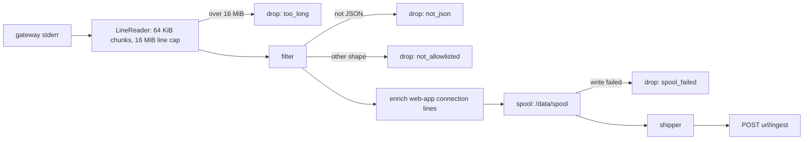

# Recording pipeline

The gateway binary records interactive SSH and Kubernetes sessions and audits HTTP requests, but
it has no delivery mechanism of its own: it writes everything to its stderr. When recording is
enabled, gwops reads that stream, keeps the recording and audit lines, enriches web-app connection
lines, stores them in a bounded on-disk spool, and POSTs them as NDJSON to an HTTP **recording
receiver** you choose. Any service that implements the
[wire format](../reference/recording-wire-format.md) can be the receiver.

Code: [`src/gwops/shipper/`](../src/gwops/shipper) (`filter.py`, `enrich.py`, `spool.py`,
`ship.py`, `limits.py`, `counters.py`), `LineReader` and `_pump` in
[`src/gwops/supervisor/process.py`](../src/gwops/supervisor/process.py), and `record` and
`child_stderr` in [`src/gwops/supervisor/main.py`](../src/gwops/supervisor/main.py).

## Where the gateway writes

The binary emits JSON log lines from three named loggers, interleaved on **stderr**:

| Logger | Carries |
| --- | --- |
| `system` | Operational logs: startup, listeners, certificate reloads, proxy errors, and one `Authenticated connection` line per authenticated client connection |
| `audit` | Audit events: SSH connection established and closed, and per-request HTTP audit (`API request completed`, `API request failed`) for Kubernetes and web-app traffic |
| `session_recording` | Session recordings: `session recording` segments and a final `session finished` line, each with an `asciicast` string |

The binary can route each logger to stderr, stdout or a file, but gwops renders no `log.*.output`
setting, so all three stay on stderr. The renderer always sets the recording segment size
(`log.sessionRecording.segment.maxSize: 256000`), so the gateway records sessions whether or not
gwops ships them.

## What reaches docker logs

> **Note:** A log collector that scrapes `docker logs` sees gwops' own log and the gateway's
> operational (`system`) lines, but none of its audit or recording content.

| Reaches the container log (stdout) | Does not |
| --- | --- |
| gwops' own structured JSON log | `audit` lines (HTTP and SSH) |
| Gateway `system` lines, relayed in full as `gateway.system` events (including `Authenticated connection` lines with the user's id, username and groups) | `session_recording` lines, and any line with an `asciicast` key |
| A metadata-only `gateway.line` event per gateway stderr line (`stream`, `bytes`, `content: "[suppressed]"`) | Lines that are not JSON objects, or are malformed |
| Gateway stdout lines, as `gateway.line` events with the text |  |

These rules hold **whether recording is on or off**. Any stderr line may be a session recording
containing terminal content, so the `system` relay is fail-closed: only a JSON object whose
`logger` is exactly `system` and that has no `asciicast` key qualifies (`system_fields` in
`src/gwops/shipper/filter.py`). The relay does not change what
is spooled or shipped. The event format is in [Log events](../reference/log-events.md).

The consequences:

- With recording **off**, gateway audit and recording output is read and discarded. It is not
  stored anywhere. Operational lines reach `docker logs`.
- With recording **on**, the recording pipeline is the only way gateway audit and recording data
  leaves the container, and it carries only the line shapes the filter keeps (below). Gateway
  operational lines, including proxy errors, are not shipped; they reach `docker logs` only.
- The gateway's metrics server on port 9090 is a separate channel (see
  [Health and observability](health-and-observability.md#gateway-metrics)).

## Pipeline



Each stderr line is framed, classified, optionally enriched, appended to the on-disk spool, and
shipped in batches to the receiver's `/ingest` endpoint; every line that does not make it is
counted by reason.

Recording is configured by three seed keys, read once at startup:

| Key | Meaning |
| --- | --- |
| `recording.enabled` | Default `false`. When `false` there is no spool, no shipper, and `/status` `shipper.mode` is `disabled`. |
| `recording.receiver_url` | The receiver's base URL, `http://` or `https://`; any receiver that implements the wire format works. gwops POSTs to `<url with trailing / removed>/ingest`. Seed-only. |
| `recording.spool_max_bytes` | Spool bound, default 256 MiB, minimum 16 MiB |

The bearer token is the `GWOPS_RECORDING_TOKEN` environment variable. Without it, lines are filtered and
spooled but never sent (`supervisor.shipper_token_missing`) until a restart supplies the token.

Dropped lines are counted by reason (`not_json`, `not_allowlisted`, `too_long`, `spool_failed`)
and reported in `/status` `shipper.dropped_lines`, and as a `shipper.lines_dropped` log event every
5 minutes when the counts changed (and once more at shutdown).

## The filter

The filter ([`shipper/filter.py`](../src/gwops/shipper/filter.py)) is an allowlist. A line is kept
only if it is a JSON object of one of three shapes:

| Shape | Rule |
| --- | --- |
| Recording | `logger` is `session_recording` and `asciicast` is a string (any message) |
| HTTP audit | `logger` is `audit`, there is no `asciicast` key, and `message` is `API request completed` or `API request failed` |
| Connection start | `logger` is `system` and `message` is `Authenticated connection` |

Everything else is dropped and counted as `not_allowlisted`, including:

- the SSH audit events (`SSH connection established`, `SSH connection closed`);
- every other `system` line: startup, certificate reloads, `Failed to authenticate connection`,
  reverse-proxy errors such as upstream TLS verification failures;
- any line from a logger name the filter does not know.

A line that does not start with `{` or does not parse as a JSON object is `not_json`.

Kept lines are shipped byte for byte as the gateway wrote them; the only modification is the
enrichment below.

> **Note:** The filter keys on the gateway's logger names (`system`, `audit`,
> `session_recording`). A gateway release that renamed them would make the filter drop
> everything; this is checked whenever the gateway pin moves.

## Enrichment

The gateway's `Authenticated connection` line for a web app names the resource address but not
how gwops configured the app. gwops adds a top-level `gwops` object to exactly those lines:
`logger: system`, `message: Authenticated connection`, `resource_type: WEB_APP`, and no `gwops`
key already present. SSH and Kubernetes connection lines, audit lines and recordings are never
modified.

```json
{"logger":"system","message":"Authenticated connection","resource_type":"WEB_APP",
 "resource_address":"grafana.apps.example.com","conn_id":"...","user":{"...":"..."},
 "gwops":{"schema":1,"gateway_id":"R2F0ZXdheTo0Mg==","match":"exact","app":"grafana",
          "managed":true,"downstream_tls":"tls13","downstream_port":443,
          "upstream_tls":"verify_full","upstream_port":3000}}
```

| Field | Meaning |
| --- | --- |
| `schema` | `1`; bumped on any incompatible change |
| `gateway_id` | gwops' Gateway object id |
| `match` | `exact`: one web app on this gateway has that address. `none`: none does, or no tenant listing has been applied yet. `ambiguous`: more than one does. App fields are present only for `exact`. |
| `app`, `managed` | The declared name for a gwops-managed app, else the tenant resource name, and whether gwops owns it |
| `downstream_tls`, `downstream_port`, `upstream_tls`, `upstream_port` | The app's TLS modes (in seed spelling: `tls13`, `none`, `verify_full`, ...) and ports, as the tenant listing reports them |

The index behind it is rebuilt from the tenant listing on every pass that lists the tenant. If an
update fails, lines are enriched from the last successful listing and `enrich.index_stale` is
logged. If enrichment of one line fails, the line ships unchanged and `shipper.enrich_failed`
counts it; a line is never lost to enrichment.

## Spool

The spool ([`shipper/spool.py`](../src/gwops/shipper/spool.py)) sits between the gateway and the
network so that a slow or unreachable receiver never blocks the gateway and a restart loses
nothing that was acknowledged as stored.

| Property | Value |
| --- | --- |
| Location | `/data/spool` (directory 0700, segment files 0600) |
| Segments | Numbered NDJSON files (`0000001.ndjson`); a segment is sealed before a line would push it past 4 MiB, so a larger line sits alone in its own segment |
| Cursor | `cursor.json`, the next unread position, written atomically (temporary file, fsync, rename) on every commit |
| Durability | Appends are buffered and flushed periodically and before every batch read; a segment is fsync'd when it rotates; the active segment is fsync'd at shutdown |
| Torn tail | A segment left without a final newline by a hard kill is sealed at open and a fresh segment started; readers skip the partial line |
| Delivered data | Segments behind the committed cursor are deleted at commit time |
| Bound | `recording.spool_max_bytes` (default 256 MiB, minimum 16 MiB, the longest line) |

**Eviction.** When the spool exceeds its bound, whole oldest segments are deleted, and each
eviction logs `spool.evicted` at error level with the exact number of lines and bytes lost. The
segment holding the newest line is never evicted, so the spool may exceed the bound by one
segment. Because delivered segments are deleted on commit, eviction only ever destroys undelivered
data: it happens when the receiver has been unreachable, rejecting, or slower than the gateway for
long enough to fill the bound.

A failed write drops what was buffered since the last flush (`spool.buffered_lines_lost`) and
reopens the segment, so a partial line never merges with the next one.

## Shipper

The shipper ([`shipper/ship.py`](../src/gwops/shipper/ship.py)) is one task that reads from the
committed cursor and posts batches:

- **Batch**: at most 500 lines and 16 MiB including newlines; one line larger than the remaining
  room ships alone.
- **Request**: `POST <url>/ingest` with `Authorization: Bearer <GWOPS_RECORDING_TOKEN>` and
  `Content-Type: application/x-ndjson`, 30 s timeout.
- **Acknowledgement**: any 2xx commits the cursor past the batch. Anything else (`shipper.post_rejected`)
  or a connection error or timeout (`shipper.post_failed`) retries the **same** batch after a
  backoff with jitter, starting at 1 s and doubling to a 30 s cap, indefinitely.
- **Delivery**: at least once. A crash or a lost response between the receiver's acknowledgement
  and the cursor commit re-sends the batch, so the receiver must deduplicate.
- **Idle**: with nothing to send, the shipper waits for the next append.
- **Transport**: an `http://` URL logs `shipper.insecure_transport` at startup, because the token
  and the recordings then cross the network in cleartext.

The exact request, response and deduplication contract is in
[`reference/recording-wire-format.md`](../reference/recording-wire-format.md). `/status` `shipper`
reports `shipping`, `pending_lines`, `pending_bytes`, `last_success_at`, `dropped_lines`,
`enrich_failed` and the enrichment index state.

## Recording sizes

The gateway emits a recording as segment lines of roughly `log.sessionRecording.segment.maxSize`
(gwops renders 256000 bytes, just under the binary's 256 KiB ceiling) or every five minutes,
followed by a final `session finished` line. The gateway's SSH backend does not apply that cap, so
an entire SSH session can arrive as one line. A line longer than 16 MiB is discarded whole at the
reader, counted as `too_long`, and logged as `gateway.line_too_long`: that recording is lost. Very
long or very busy SSH sessions are the ones at risk.

## Confidentiality

> **Security:** Nothing in the pipeline is redacted. Treat the spool volume and the receiver as
> stores of credentials and privileged session content.

What the shipped lines can contain, exactly as the gateway wrote them:

- terminal input and output of SSH and `kubectl exec` sessions, including anything typed or
  printed, such as passwords entered at a prompt;
- HTTP request and response headers with their values, such as `Authorization`, `Cookie`,
  `X-Api-Key` and `Set-Cookie`;
- full request URLs, query strings included;
- user ids, usernames and group names.

Use `https://` for `recording.receiver_url` outside a trusted network, restrict who can read the
`/data` volume, and apply the same retention and access rules to the receiver as to any credential
store.

## What is recorded at all

| Traffic | What the pipeline delivers |
| --- | --- |
| Interactive SSH sessions | Recording lines, plus the `Authenticated connection` line |
| `kubectl exec` and `attach` with a TTY | Recording lines and the connection line; the API requests themselves appear as HTTP audit lines |
| Other Kubernetes API calls (`get`, `logs`, `apply`, ...) | HTTP audit lines only; the gateway records no session for them |
| Web apps | HTTP audit lines (method, URL, headers, status, user) and the enriched connection line; web-app traffic is never session-recorded |
| SSH audit events (connection established, closed) | Nothing; the filter drops them |
| SSH port forwarding | Nothing; the gateway neither gates nor audits it |

## See also

- [`reference/recording-wire-format.md`](../reference/recording-wire-format.md): what a receiver
  must implement.
- [`guides/session-recording.md`](../guides/session-recording.md): turning recording on and
  choosing a receiver.
- [`reference/admin-api.md`](../reference/admin-api.md#shipper): the `shipper` block of `/status`.
- [`reference/seed.md`](../reference/seed.md#recording): the `recording` keys.
- [Security model](security-model.md#accepted-risks).
