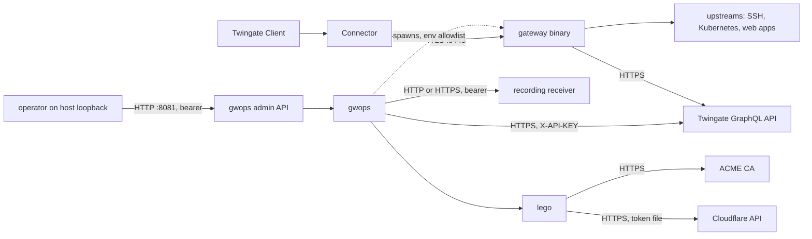

# Security model

This page describes what the container trusts, what it protects, and the risks it accepts. It is
written for security reviewers; each section links to the page with the mechanism in detail.

## Trust boundaries

Clients reach the gateway on 8443 only through a Connector. Operators reach gwops on 8081, by
default only from loopback. gwops talks to the Twingate API with the API key, to the recording
receiver with its bearer token, and runs lego, which talks to the ACME CA and Cloudflare.

| Boundary | Who is on the other side | Protection |
| --- | --- | --- |
| :8443 | Anyone who can reach the port, normally only a Connector | Client TLS with the gwops leaf or public certificates; the gateway authenticates every connection's access token. With on-demand issuance a certificate is signed before authentication (see accepted risks). |
| :8081 | Whoever can reach the bind address | Bearer tokens compared in constant time; bodiless 401; plain HTTP, bound to `127.0.0.1` by default |
| :9090 | Whoever can reach the port | The binary's metrics server; published on host loopback only by `compose.yaml` |
| Tenant API | Twingate | HTTPS to `https://<network>.<host>/api/graphql/` with `X-API-KEY` |
| Recording receiver | The service at `recording.receiver_url` | Bearer token; `https://` recommended (`http://` logs `shipper.insecure_transport`) |
| ACME and Cloudflare | Let's Encrypt (or your directory) and Cloudflare | lego over HTTPS; the token file is read by lego only |
| gateway child | The binary | Exact environment allowlist; no secrets inherited |

## Secrets

The four secrets come only from environment variables:

| Variable | Used for | Never appears in |
| --- | --- | --- |
| `TWINGATE_API_KEY` | The `X-API-KEY` header to the tenant API | Seed, overlays, rendered config, logs, `/state`, the gateway's environment |
| `GWOPS_ADMIN_TOKEN` | Admin API bearer | Same |
| `GWOPS_AUTOMATION_TOKEN` | Limited admin API bearer | Same |
| `GWOPS_RECORDING_TOKEN` | Bearer to the recording receiver | Same |

How that is enforced:

- **Settings types.** The four are held as secret strings that do not render their value.
- **Seed-only destinations.** The tenant (`twingate.*`) and the recording URL are seed-only, so an
  admin API caller cannot redirect the API key or the recording token to a host of their choosing.
- **Child environment allowlist.** The gateway, the pre-flight spawn and lego get a new
  environment built from an allowlist of process, locale, proxy, trust-store and Go runtime
  variables (see [Gateway process](gateway-process.md#child-environment)). A secret added to the
  container later cannot leak by default.
- **Log redaction.** Every log field whose key looks secret is redacted whole (see
  [Health and observability](health-and-observability.md#gwops-logs)). `GET /state` and overlay
  listings apply the same rule.
- **Error text.** Tenant errors, confined-read errors and certificate refusals name files and
  properties, never contents. Policy messages name headers, never their values.
- **Container log contents.** The gateway's operational (`system`) lines are relayed to the
  container log as `gateway.system` events, and `Authenticated connection` lines name the user
  (id, username, groups) and the resource. Restrict who can read `docker logs` accordingly. Audit
  lines and session recordings never reach it (see
  [Recording pipeline](recording-pipeline.md#what-reaches-docker-logs)).

**The DNS token** for ACME is a file under `/config/acme/`, not an environment variable. gwops
checks it by metadata only and never opens it; lego reads it through `CF_DNS_API_TOKEN_FILE`.
`CF_*` and `CLOUDFLARE_*` variables in the container environment are never passed to lego.

> **Security:** gwops and the gateway binary run as the same uid (10001). The gateway process can
> therefore read anything gwops can: the DNS token file, the CA private keys on `/data/pki`, the
> spool. The isolation between them is the environment allowlist, not file permissions.

## Key material at rest

| Material | Location | Mode |
| --- | --- | --- |
| X.509 CA key (generated) | `/data/pki/x509-ca.key` | 0600 |
| SSH CA key (generated) | `/data/pki/ssh-ca.key` | 0600 |
| Leaf key | `/data/pki/leaf/..<sha12>/privkey.pem` | 0600 |
| Archived CA keys after rotation | `/data/pki/archive/` | 0600 |
| Public certificate keys | `/data/public-tls/<name>/..<sha12>/privkey.pem` | 0600 |
| Kubernetes bearer token copies | `/data/k8s-creds/<cluster>-token-<sha12>` | 0600 |
| ACME account and lego storage | `/data/acme/` | directory 0700, state file 0600 |
| Recording spool | `/data/spool/` | directory 0700, segments 0600 |

All private keys are unencrypted files on the `/data` volume. There is no HSM, KMS or Vault
integration. Anyone with read access to the volume (or to backups of it) holds the CA keys and can
mint certificates and SSH user certificates the gateway's clients and targets trust. Protect the
volume and its backups accordingly. Bring-your-own CA files are read from the paths you configure
and are not copied.

## File confinement

Operator-supplied files that the seed or an overlay names are read only from four read-only mount
roots:

| Root | Files |
| --- | --- |
| `/config/k8s-creds/` | `k8s_clusters[].bearer_token_file`, `ca_file` |
| `/config/webapp-cas/` | `web_app_proxy.upstream_ca_bundles[].file` |
| `/config/public-tls/` | `public_tls.certificates[].cert_file`, `key_file` (`source: file`) |
| `/config/acme/` | `public_tls.acme.token_file` (metadata only) |

A confined read resolves symlinks and `..` first and refuses a path that ends up outside the root,
requires a regular file of at most 1 MiB, opens it without following a final symlink, and refuses
a file whose identity changed between the check and the open. The errors name the path and the
allowed root, never contents. Because `k8s_clusters` is overlay-writable, confinement is what
stops an admin API caller from pointing the gateway at an arbitrary file in the container as a
"credential". The automation token cannot write `k8s_clusters` at all.

The bring-your-own CA paths (`ca.x509.cert_path`, `key_path`, `ca.ssh.key_path`) are seed-only and
are used as given, without confinement.

## Container hardening

The image and the shipped `compose.yaml` together:

| Control | Where |
| --- | --- |
| Non-root user uid/gid 10001 | `Dockerfile` (`USER gwops`) |
| Read-only root filesystem | `compose.yaml` `read_only: true` |
| No Linux capabilities | `compose.yaml` `cap_drop: [ALL]`; the gateway listens on 8443 and 9090, which need none |
| No privilege escalation | `compose.yaml` `security_opt: ["no-new-privileges:true"]` |
| Writable paths | Only `/data` and two tmpfs mounts, `/run/gateway` and `/tmp` |
| Admin and metrics ports | Published on host loopback only |
| Pinned inputs | The gateway (`2.0.0`) and lego (`v5.5.2`) are copied from their official images by tag and digest, and the build refuses floating tags for them; the `python:3.12-slim` base image is pinned by digest; Python dependencies are installed from the hash-locked `requirements.lock` with `--require-hashes` |

The compose-level controls are not part of the image; keep them if you write your own deployment.

## Tenant blast radius

What a compromised or misconfigured gwops can do on the tenant is bounded by three things:

- **The API key's permissions.** gwops needs to manage resources, certificate authorities and
  gateways; the key can do whatever Twingate allows that permission level to do.
- **The ownership registry.** gwops only updates or deletes object ids recorded in
  `/data/state.json`. Resources made in the Admin Console are never touched. Access changes are
  deltas against what gwops itself applied, so it never removes a group someone added in the
  console and never resets a policy to Default. It never creates or changes groups, policies,
  remote networks or connectors.
- **The allowlists and token scopes.** `twingate.address_allowlist` and `twingate.access_allowlist`
  bound every API write, admin included. The automation token is limited to upstream entries of
  SSH (and, with an explicit seed opt-in, web apps), to its own name prefix and namespace, and to
  the web-app field policy. See [Admin API](admin-api.md#guardrails).

## Accepted risks

These are known and documented trade-offs, not defects:

| Risk | Detail |
| --- | --- |
| On-demand issuance signs before authentication | With `ca.x509.on_demand_issuance: true`, any client that reaches 8443 gets a certificate for any SNI signed by the gwops CA, before its token is checked. Off by default. See [Certificates](certificates.md#on-demand-issuance). |
| Public mode widens what the Client accepts | Registering ISRG Root X1 as the gateway's CA makes the Client accept any certificate chaining to it for the names it dials through this gateway. See [Certificates](certificates.md#public-certificate-mode). |
| Recordings are not redacted | Shipped lines carry terminal I/O, header values (`Authorization`, `Cookie`, ...), full URLs and identities. The spool and the receiver hold credentials. See [Recording pipeline](recording-pipeline.md#confidentiality). |
| SSH port forwarding is neither gated nor audited | This is gateway behaviour; gwops cannot add it. |
| Command controls are guardrails, not a jail | A user with an interactive shell on a target is constrained by the target, not by the gateway. |
| `GODEBUG` is passed to the gateway | It is operator-controlled and can re-enable legacy TLS and X.509 behaviour. It is not passed to lego. |
| The admin API is plain HTTP | Safe on loopback; anywhere else it needs a TLS proxy or a Twingate resource in front of it. |
| Same uid for gwops and the gateway | The gateway process can read the DNS token file and the CA keys. |

## See also

- [`reference/image.md`](../reference/image.md): user, mounts, ports, egress and pins.
- [`reference/limitations.md`](../reference/limitations.md): every known limitation.
- [`operations/admin-api-behind-tls-proxy.md`](../operations/admin-api-behind-tls-proxy.md)
- [`operations/backup-and-restore.md`](../operations/backup-and-restore.md): protecting `/data`.
- [Twingate integration](twingate-integration.md), [Admin API](admin-api.md).
