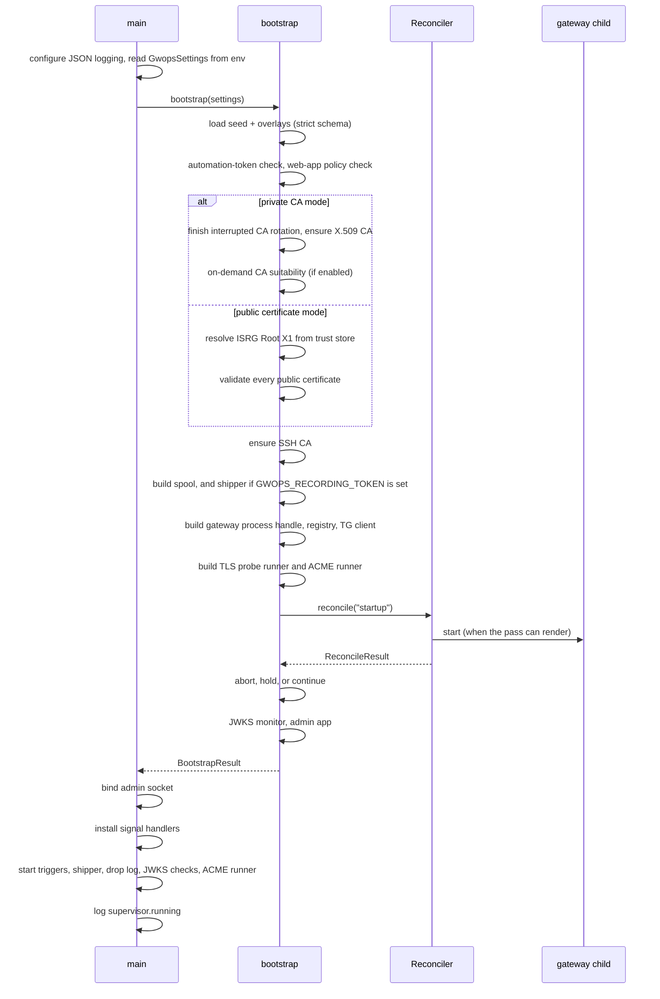
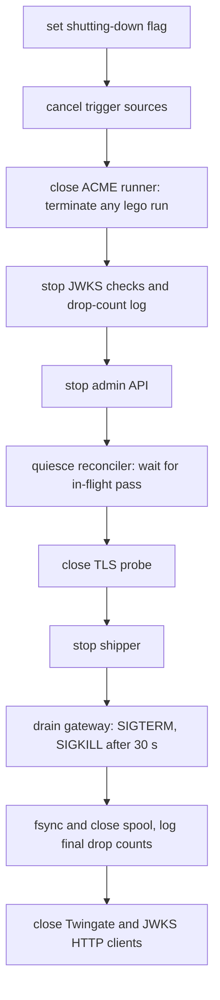

# Startup and shutdown

gwops is PID 1. On boot it runs a fail-loud startup gate, performs the first reconcile pass, and
only then opens the admin API and starts its background tasks. On SIGTERM it tears everything down
in a fixed order so that no reconcile pass, ACME run or gateway restart can outlive the shutdown.

The code is in [`src/gwops/supervisor/main.py`](../src/gwops/supervisor/main.py): `bootstrap`
is the startup gate, `main` wires the long-running tasks, `_teardown` is the shutdown order.

## Boot sequence

`main` configures logging and reads settings from the environment, then `bootstrap` validates the
configuration and CA material, builds every component, and runs the first reconcile pass, which is
what starts the gateway. Only after that pass does `main` bind the admin API, install signal
handlers and start the triggers and background tasks.

Step by step:

1. **Logging and settings.** structlog is set to JSON lines on stdout. `GwopsSettings` reads the
   `GWOPS_*` settings and the four secrets from the environment.
2. **Effective state.** The seed at `/config/seed.yaml` is read, every overlay under
   `/data/overlays/` is merged on top in order, and the result is validated against the strict
   schema. See [Configuration model](configuration-model.md).
3. **Automation token check.** If `GWOPS_AUTOMATION_TOKEN` is set, it must differ from
   `GWOPS_ADMIN_TOKEN`, and both `twingate.access_allowlist` and `twingate.address_allowlist` must
   be present in the seed ([`access/allowlist.py`](../src/gwops/access/allowlist.py),
   `check_automation_startup`).
4. **Web-app policy.** The full [web-app policy](web-apps.md#the-web-app-policy) runs against the
   effective state; any violation is listed.
5. **Certificate material.**
   - *Private CA mode* (no `public_tls` block): an interrupted X.509 CA rotation is finished first
     (`CertManager.recover_x509_rotation`), so a half-completed promotion never leads to a third
     CA. Then the X.509 CA is loaded or generated and validated. If `ca.x509.on_demand_issuance`
     is on, the CA is checked for the gateway's local issuer and `tls.on_demand_issuance_active`
     is logged as a warning.
   - *Public certificate mode*: the registered root (ISRG Root X1) is looked up in the image's
     system trust store by SHA-256 fingerprint. Startup warns if the ACME directory is staging
     (`supervisor.acme_staging_dry_run`) or if `CF_*`/`CLOUDFLARE_*` variables are set
     (`supervisor.acme_cloudflare_environment_ignored`). Every `source: file` certificate is read
     and validated; `source: acme` certificates are judged on what is already installed under
     `/data/public-tls/` and never abort startup.
   - In both modes the SSH CA is then loaded or generated.
6. **Recording path.** If `recording.enabled` is true, the spool under `/data/spool` is opened (a
   torn tail from a hard kill is sealed here). A shipper is built only if `GWOPS_RECORDING_TOKEN` is
   set.
7. **Process handle, registry, tenant client.** The gateway process handle is built with stderr
   content echo off. The ownership registry `/data/state.json` is loaded; a corrupt or
   unknown-version file raises. A Twingate client is built only if `TWINGATE_API_KEY` is set.
8. **Probe runner and ACME runner.** The opt-in TLS probe runner and the ACME runner are built.
   The ACME runner loads `/data/acme/state.json`; if constructing it raises, gwops logs
   `acme.runner_unavailable` and continues without it.
9. **First reconcile pass** (`trigger: startup`). This is a normal pass: tenant sync,
   credentials, certificates, render, pre-flight and start. See [Reconciler](reconciler.md).
10. **Abort, hold or continue.** See the two sections below.
11. **JWKS monitor and admin app.** The JWKS reachability monitor and the FastAPI app are built.
    Neither can abort startup.
12. **Admin socket.** `main` binds `admin_api.bind:admin_api.port` (default `127.0.0.1:8081`)
    itself, so a bind failure raises synchronously instead of dying inside uvicorn. `api.serving`
    is logged.
13. **Signal handlers, triggers and tasks.** Signal handlers are installed after the admin server
    starts, so gwops' handlers win over uvicorn's. Then the trigger sources (seed watch, seed
    poll, tick, API event), the shipper, the drop-count log, the JWKS checks and the ACME runner
    start. `supervisor.running` is logged with `gateway_started`, `tick_seconds`, `admin_port` and
    `shipping`.

> **Note:** The admin API, and so `/healthz`, is not listening until the first pass has finished.
> A first pass that waits on a slow or throttled tenant (each GraphQL call may retry up to six
> times with a 30 s timeout, and 429 waits can take up to 90 s per pass) can therefore outlast the
> healthcheck's 30 s start period, and Docker reports the container unhealthy until the API is
> up.

## What aborts startup

`main` maps startup failures (configuration load errors, render errors, a registered public root
missing from the trust store, and `ValueError`, `RuntimeError` and `OSError` raised by the checks) to `supervisor.startup_failed` with the error
text, and exits with status 1. The container's restart policy then decides what happens next.

| Cause | Where it is detected | What the error names |
| --- | --- | --- |
| Invalid seed or overlay: unknown key, wrong type, broken cross-key rule, unreadable or non-YAML seed | Loading the effective state | The dotted path (named by entry, for example `k8s_clusters.prod.port`) and the layer that set it: `seed` or an overlay id |
| `GWOPS_AUTOMATION_TOKEN` without both allowlists, or equal to `GWOPS_ADMIN_TOKEN` | `check_automation_startup` | The missing allowlist keys |
| Web-app policy violation | `webapp_policy.violations` | Every violation, by location and header name, never values |
| Unusable CA material: a non-CA or out-of-date X.509 CA, a non-EC key, a key that does not match, only half of a CA pair, `generate: false` with files missing | `CertManager.ensure_x509_ca`, `ensure_ssh_ca` | The file paths and the property |
| On-demand issuance on, CA unsuitable for the gateway's issuer | `require_on_demand_ca` | The file and property (`CA:TRUE`, `keyCertSign`, unencrypted key) |
| Public mode: ISRG Root X1 not found in the image trust store | `resolve_registered_root` | The trust store path and the pinned fingerprint |
| Public mode: a refused `source: file` certificate, or two certificates whose SANs both match a served name | `_validate_public_material` | Every refused certificate, file and property |
| A corrupt `/data/state.json` | `StateRegistry` | The path; gwops refuses to guess which tenant objects it owns |
| A seed with at least one upstream whose first pass could not start the gateway (for example a render error, a pre-flight rejection, a credential file outside its root) | After `reconcile("startup")` | The pass's errors, joined |
| The admin socket cannot be bound | `start_admin_server` | The OS error. The gateway is already running at this point, so gwops runs the full teardown before exiting |

Tenant-side problems never abort startup. An unreachable tenant, a rejected API key or a throttled
write is recorded on the pass, and the gateway still starts if the local steps succeeded.

## Degraded starts that do not abort

These states start gwops and keep it running, with a warning that says what is missing.

| Condition | Log event | Behaviour |
| --- | --- | --- |
| The seed declares no upstreams | `supervisor.waiting_for_upstreams` | The SAN set is empty, so no leaf can be minted and the gateway is held down. CAs are still created and registered. The first upstream that arrives (seed edit or admin API write) mints the leaf and starts the gateway. |
| Public mode and every declared certificate is a `source: acme` certificate with nothing valid installed | `supervisor.waiting_for_acme` | The gateway is held down until the ACME runner installs the first certificate. With `public_tls.acme.directory: staging` this never ends, because staging is a dry run that installs nothing. |
| `TWINGATE_API_KEY` unset | `supervisor.tg_sync_disabled` | Local config still applies. Every pass records `TG sync skipped: TWINGATE_API_KEY is not set...`. In remote-network mode no Gateway object can be resolved, so nothing is synced. |
| `GWOPS_ADMIN_TOKEN` unset | `api.admin_token_unset` | The admin API fails closed: every route except `GET /healthz` answers 401. |
| `recording.enabled: true` without `GWOPS_RECORDING_TOKEN` | `supervisor.shipper_token_missing` | Lines are filtered and spooled under `/data/spool` (bounded, oldest evicted with an error) but never sent. A restart with the token set ships the backlog. |
| Constructing the ACME runner raised | `acme.runner_unavailable` | No certificate is issued or renewed. Each pass reports the reason in `/status` and readiness, and `POST /certs/public/{name}/issue` answers 409. |

A held-down gateway still passes the startup gate. Container health is a separate question: with
the gateway stopped, `/healthz` reports unhealthy. See
[Health and observability](health-and-observability.md#healthz).

## Signals

| Signal | Effect |
| --- | --- |
| `SIGTERM`, `SIGINT` | Logged as `supervisor.signal`, then the ordered teardown below. The handler only sets a flag; the gateway is not drained from inside the handler, so teardown cannot race an in-flight pass. |
| `SIGHUP` | Runs one reconcile pass (`trigger: sighup`). This is gwops' SIGHUP; the gateway binary has no reload signal of its own, and gwops never sends it one. |

`docker kill --signal HUP <container>` is therefore a way to force a pass without the admin API.

## Shutdown order

Teardown first stops every source of new work, then waits for the last pass, then stops the
gateway and seals the spool.

Why this order:

- **Triggers and the admin API stop first** so no new pass can start.
- **The ACME runner closes before the gateway stops**, so no lego process outlives teardown and no
  certificate is installed into a store nobody serves.
- **The reconciler is quiesced** (`request_shutdown`): it sets a flag that makes the apply step
  skip any start or restart (`skipped gateway apply: shutting down`), then waits for the pass lock.
  Once it returns, no pass can start a gateway that would then be orphaned.
- **The gateway is drained after the shipper stops** and before the spool closes. Draining sends
  SIGTERM and waits up to 30 s, then sends SIGKILL. The spool is closed after the child exits, so
  no further line arrives; undelivered lines are fsync'd and stay on disk for the next start.

> **Note:** Docker's default stop timeout is 10 s, after which it sends SIGKILL to the whole
> container. The shipped `compose.yaml` sets `stop_grace_period: 40s`, which covers gwops' own
> 30 s drain. Keep a grace period of at least 40 s in your own deployment (Kubernetes:
> `terminationGracePeriodSeconds`), or a gateway that drains slowly is killed before gwops'
> escalation.

`supervisor.exited` is logged when teardown completes.

## Crash recovery on boot

Everything gwops writes is written atomically, and the next boot repairs the few states a hard kill
can leave behind.

| Interrupted operation | What the next boot does |
| --- | --- |
| X.509 CA rotation `complete` | `recover_x509_rotation` sees the `.rotation-stamp` marker under `/data/pki/staged/` and finishes the promotion with the same archive stamp. A staged CA with no marker is a rotation the operator has not completed yet; it is left alone. See [Certificates](certificates.md#x509-ca-rotation). |
| A spool append | The active segment does not end in a newline. The spool seals it and starts a fresh segment; readers skip the trailing partial line. |
| An ACME run | The schedule and backoff resume from `/data/acme/state.json`. A run cut off mid-way is recorded as interrupted and backs off. |
| A config swap or a gateway start | The rendered config lives on tmpfs (`/run/gateway`) and is rebuilt by the first pass. |
| A tenant create | The ownership registry is written synchronously right after each create, so a crash after the create but before the next pass does not forget the object. |

## See also

- [Reconciler](reconciler.md): what the first pass does.
- [Gateway process](gateway-process.md): start, drain-restart and rollback.
- [`operations/troubleshooting.md`](../operations/troubleshooting.md): symptom-to-cause tables for boot
  failures.
- [`reference/log-events.md`](../reference/log-events.md): every startup event.
- [`reference/environment.md`](../reference/environment.md): the variables read at step 1.
