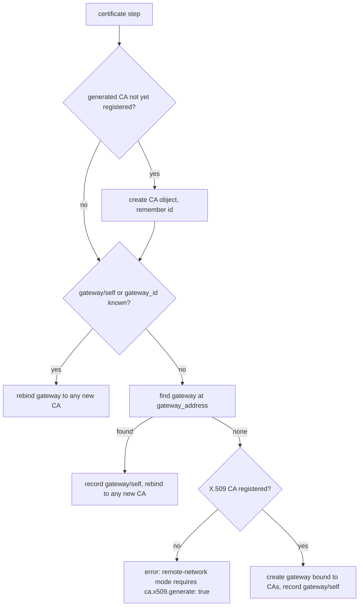

# Twingate integration

gwops keeps a small, well-defined set of objects on your Twingate tenant in step with the seed: the
CA objects the gateway trusts, the Gateway object itself in remote-network mode, and one resource
per declared upstream. This page lists exactly what it reads and writes, how it decides what it
owns, and how access is assigned.

Code: [`src/gwops/tgapi/`](../src/gwops/tgapi) (`client.py`, `ops.py`, `errors.py`), the sync and
gateway steps in [`src/gwops/reconciler/core.py`](../src/gwops/reconciler/core.py), the ownership
registry in [`src/gwops/reconciler/registry.py`](../src/gwops/reconciler/registry.py), and access
handling in [`src/gwops/access/`](../src/gwops/access).

## Endpoint and auth

| Property | Value |
| --- | --- |
| Endpoint | `https://<network>.<host>/api/graphql/`, from `twingate.network` and `twingate.host` (default `twingate.com`) |
| Auth | `X-API-KEY: <TWINGATE_API_KEY>` on every request. Without the variable, no client is built and every pass records that tenant sync was skipped. |
| Timeout | 30 s per request |
| Retries | Up to 6 attempts. 5xx and transport errors back off exponentially with full jitter (1 s base, 30 s cap). 429 waits for the server hint, capped at 60 s plus jitter, from a 90 s per-pass budget (see [Reconciler](reconciler.md#rate-limiting)). |
| Never retried | 401 and 403 (auth error), any other 4xx, and a 200 whose body carries GraphQL `errors[]` |
| Logging | `tgapi.request` per call with the operation name, status, duration and attempt; never the key or the body |

The API key needs read and write access, including resources, certificate authorities and
gateways. Remote-network mode also reads remote networks and gateways; access assignment reads
groups and security policies.

## Objects gwops creates and changes

| Object | When | Name or shape | Operations |
| --- | --- | --- | --- |
| X.509 CA (gwops-generated) | Private CA mode with `ca.x509.generate: true`, once | `gwops-x509-<label>` | `CreateX509CA` |
| SSH CA (gwops-generated) | `ca.ssh.generate: true`, once | `gwops-ssh-<label>` | `CreateSSHCA` |
| X.509 CA for the public root | Public certificate mode, once, unless a CA with the root's fingerprint already exists | `gwops-<label>-isrg_root_x1` | `FindX509CAsByFingerprint`, `CreateX509CA` |
| Gateway object | Remote-network mode, when no gateway exists at `gateway_address` in the remote network | Address `gateway_address`, bound to the registered X.509 CA (and SSH CA) | `CreateGateway` |
| Gateway CA binding | After registering a new CA; after a completed X.509 CA rotation; in public mode, when the binding differs from the root | X.509 CA and/or SSH CA id | `UpdateGateway` |
| `SSHResource` | One per `ssh_upstreams` entry | Name, portless address, upstream port, groups, security policy, attached to the gateway | `CreateSSHResource`, `UpdateSSHResourceUpstream`, `UpdateResourceAddress`, `UpdateResourceAccess`, `DeleteResource` |
| `KubernetesResource` | One per `k8s_clusters` entry | Same, upstream port from `port` | `CreateKubernetesResource`, `UpdateKubernetesResourceUpstream`, `UpdateResourceAddress`, `UpdateResourceAccess`, `DeleteResource` |
| `WebAppResource` | One per `web_apps` entry | Address, upstream port and TLS mode, downstream port and TLS mode, alias, per-resource request header rewrites, access, gateway | `CreateWebAppResource`, `UpdateWebAppResource`, `DeleteResource` |

`<label>` is `twingate.gateway_id` in pinned-gateway mode, else `twingate.gateway_address`. After a
CA rotation the new CA is named `gwops-x509-<gateway id>`.

Resources are created in the remote network the gateway belongs to (looked up with
`GatewayRemoteNetwork` and cached), and their addresses are portless. The port the gateway dials
is the resource's upstream port, not anything in the rendered config, so upstream port drift on the
tenant is corrected like address drift.

Requested header values and aliases are tenant configuration: action lines name fields, never
values (`updated webapp resource 'grafana': request headers [x-env] ...`).

## Objects gwops reads but never changes

| Read | Why | Operation |
| --- | --- | --- |
| Remote network by name | Remote-network mode with `remote_network` (exact name) | `ResolveRemoteNetwork` |
| Gateways in the remote network | Adopt a gateway already at `gateway_address`. More than one match is an error. | `ListGateways` |
| The gateway's X.509 CA binding | Public mode, every pass: is the gateway bound to the root? | `GetGatewayX509CA` |
| Every gateway-attached resource of the managed kinds | The resource diff; web-app readiness; recording enrichment | `ListResources` |
| Every resource address and alias on the tenant | Address exclusivity for automation-token web-app writes | `ListAllResourceAddresses` |
| X.509 CAs by fingerprint | Reuse an existing CA for the public root | `FindX509CAsByFingerprint` |
| Groups and security policies, by exact name or by id | Access assignment and the access allowlist | `FindGroupsByName`, `FindSecurityPoliciesByName`, `GetGroup`, `GetSecurityPolicy` |

gwops never creates, renames or deletes groups, security policies, remote networks or connectors,
and never changes group membership.

## Ownership registry

`/data/state.json` is the ownership ledger. Only object ids recorded in it are ever updated or
deleted, which is what keeps gwops away from everything you manage in the Admin Console.

```json
{
  "version": 2,
  "ids": {
    "ca/x509": "Q2VydGlmaWNhdGVBdXRob3JpdHk6MQ==",
    "ca/ssh": "U1NIQ2VydGlmaWNhdGVBdXRob3JpdHk6Mg==",
    "gateway/self": "R2F0ZXdheTo0Mg==",
    "ssh/web-1": "UmVzb3VyY2U6MTAx",
    "webapp/grafana": "UmVzb3VyY2U6MTAy"
  },
  "access": {
    "ssh/web-1": {"groups": ["R3JvdXA6MTA="], "security_policy": null}
  }
}
```

| Key | Records |
| --- | --- |
| `<kind>/<name>` | A resource gwops created; kinds are `ssh`, `kubernetes`, `webapp` |
| `ca/x509`, `ca/ssh` | The gwops-generated CA objects bound to the gateway |
| `ca/x509-public` | The CA object for the registered public root |
| `gateway/self` | The resolved Gateway object: pinned, adopted or created |
| `access.<kind>/<name>` | The group ids and security policy gwops last applied to that resource |

Rules:

- A desired resource with no recorded id, or whose recorded id is not on the tenant listing, is
  **created** (`created` or `recreated` in the action line). A recorded resource that is no longer
  declared is **deleted**. A resource with the same name created in the Admin Console is never
  matched, adopted or deleted.
- Every write is atomic (temporary file, fsync, rename) and synchronous, and each tenant create is
  recorded immediately, so a crash after a create never forgets the object.
- A corrupt file, an unknown version or a malformed record raises instead of guessing, which
  aborts startup. A version 1 file (a flat map) is read and rewritten as version 2.
- If the file is lost, gwops no longer knows what it created. It creates new resources for every
  declared upstream and leaves the old ones on the tenant; in remote-network mode it re-adopts the
  Gateway object by address. Back up `/data`.

## Gateway resolution

Exactly one of two modes is configured in `twingate` (`TwingateRef` in
[`configmodel/schema.py`](../src/gwops/configmodel/schema.py)):

|  | Pinned-gateway mode | Remote-network mode |
| --- | --- | --- |
| Seed | `gateway_id` | `remote_network` or `remote_network_id`, plus `gateway_address` (`host:port`, port required) |
| First pass | Records `gateway/self` as the pinned id | Adopts a gateway at `gateway_address` in that remote network, else creates one |
| CA requirement | Any | Creation needs a registered X.509 CA, so private CA mode needs `ca.x509.generate: true`; in public mode the gateway is created bound to the public root |



In private CA mode the certificate step registers any gwops-generated CA that is not recorded yet,
then resolves the gateway from the registry or the seed, by adopting one at the address, or by
creating one bound to the registered CAs, and finally rebinds an existing gateway to any CA it has
just registered.

Details:

- **Registration is once.** A generated CA is registered only while its `ca/x509` or `ca/ssh` key
  is absent. The key is recorded only after the gateway is bound to it, and an id created but not
  yet bound is remembered in memory, so a retry after a failed bind never creates a second CA
  object.
- **Bring-your-own CAs are never registered.** With `generate: false`, gwops registers nothing for
  that CA; register it on the tenant and bind the gateway yourself. A bring-your-own X.509 CA
  needs pinned-gateway mode. Remote-network mode with a bring-your-own SSH CA creates the gateway without an SSH CA; bind the
  SSH CA on the tenant yourself.
- **The recorded gateway wins.** Once `gateway/self` is recorded, it is used in preference to
  `twingate.gateway_id`.
- **Public mode** follows the same shape with the root in place of the X.509 CA: register the SSH
  CA if needed, find or create the root's CA object (reusing one the gateway is already bound to,
  or any with the root's SHA-256 fingerprint), create the gateway bound to the root if none exists,
  and otherwise read the binding on every pass. A rebind is decided here but sent only after the
  pass rendered and applied its config (see [Certificates](certificates.md#public-certificate-mode)).
- **No tenant, no resolution.** Without an API key the pass records `TG sync skipped:
  TWINGATE_API_KEY is not set`. When resolution fails on the tenant (or, in remote-network mode,
  before a gateway exists) the pass records `TG sync skipped: the gateway could not be resolved
  this pass` and retries next pass. Local steps still run either way.

## Access assignment

Every resource's groups and security policy come from its own `access` block over
`twingate.resource_defaults` ([`access/precedence.py`](../src/gwops/access/precedence.py)), applied
independently to `groups` and to `security_policy`:

| Per-resource value | Result |
| --- | --- |
| Present, non-empty | Used as is; **replaces** the default, never merged with it |
| `groups: []` | No groups, even when a default exists |
| Omitted or `null` | The `resource_defaults` value |
| Omitted, no default | Not managed: gwops sends nothing and never changes it |

References are a name (exact, case-sensitive), `{id: ...}`, or the pinned `{id, name}` form.

- **Resolution.** A name must match exactly one group or policy; zero or several matches is an
  error. Writes through the admin API resolve and pin every reference to `{id, name}` before the
  overlay is stored, so a typo is a 422 at write time and a group created later under the same
  name can never capture the access. Seed references are resolved on each pass; successful
  lookups are cached for the life of the process, failures are not, so a fix in the Admin Console
  is picked up on the next pass. Explicit ids pass through.
- **Create.** A new resource is created with its resolved groups and policy in the create
  mutation. Unmanaged groups or policy are omitted, so Twingate's defaults apply (no groups, the
  Default policy).
- **Delta, not replacement.** For an existing resource gwops compares the desired groups with
  what it last applied (the registry's `access` record), adds `desired - last` and removes
  `last - desired`. A group someone added in the Admin Console was never in the last-applied set,
  so gwops never removes it. The security policy is set only when it is managed and differs from
  what gwops last set. There is no operation that replaces the whole group set or resets the
  policy to Default.
- **Recorded after success.** The last-applied record is written only after the tenant accepts
  the change.

## Gateway mismatches

Every pass compares the gateway each managed resource is attached to with gwops' own gateway. A
managed resource attached to another gateway is reported in `/status` (`tg.gateway_mismatches`) and
logged once per change of the set (`reconcile.gateway_mismatches`).

- **Web apps** are corrected: their whole update (address, settings, access and gateway) is one
  `UpdateWebAppResource` mutation, and the mismatch is reported with `corrected: true`. Any web-app
  update re-issues access tokens, which the action line says.
- **SSH and Kubernetes resources** are corrected field by field with separate mutations, and the
  gateway is never reassigned on that path: the mismatch is only reported. Move them back on the
  tenant yourself, or delete them there and let gwops recreate them.

## Attribution User-Agent

Every GraphQL request carries a `User-Agent` that tells Twingate which gwops build and which
feature set made the call:

```text
twingate-gwops-gateway/1.2.3 (kinds=ssh,webapp; tls=none; op=write; via=reconcile) python-httpx/0.28.1
```

| Key | Values |
| --- | --- |
| version | The image's `GWOPS_VERSION` build argument (`0.0.0-dev` for a local build) |
| `kinds` | The resource kinds with at least one entry: `ssh`, `kubernetes`, `webapp`, or `none` |
| `tls` | `none` in private CA mode; in public mode the certificate sources in use, `file`, `acme` or `acme,file` |
| `op` | `read` for a query, `write` for a mutation |
| `via` | `reconcile` for calls made by a pass, `admin_api` for calls made while handling an admin API request (pinning references, allowlist checks, exclusivity, a CA rotation) |

The key order is fixed. The header reveals which kinds and certificate sources are configured,
never names, addresses, ids or counts. The JWKS reachability check sends the same product and
version with no keys.

## See also

- [`reference/seed.md`](../reference/seed.md#twingate): the `twingate` block.
- [`guides/gateway-modes.md`](../guides/gateway-modes.md): choosing pinned-gateway or
  remote-network mode.
- [`guides/access-control.md`](../guides/access-control.md): groups, policies, defaults and
  allowlists.
- [`operations/backup-and-restore.md`](../operations/backup-and-restore.md): what losing
  `/data/state.json` means.
- [Security model](security-model.md#tenant-blast-radius).
