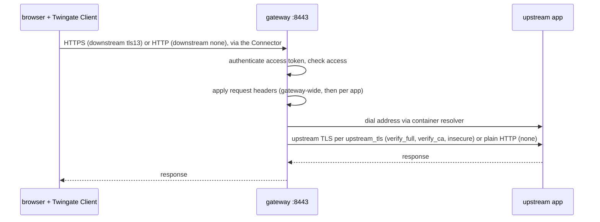

# Web apps

A web app is an internal HTTP or HTTPS application that the gateway fronts as a layer 7 reverse
proxy. On the tenant it is a `WebAppResource`. gwops declares it, keeps its Twingate settings and
the gateway's proxy configuration in step, refuses header and TLS settings that would leak
identity or credentials, and reports per-app readiness so you can see what still stands between a
declared app and a working session.

Code: [`src/gwops/access/webapp_policy.py`](../src/gwops/access/webapp_policy.py),
[`src/gwops/renderer/capabilities.py`](../src/gwops/renderer/capabilities.py),
[`src/gwops/webapp_readiness.py`](../src/gwops/webapp_readiness.py),
[`src/gwops/webapp_probe.py`](../src/gwops/webapp_probe.py),
[`src/gwops/jwks.py`](../src/gwops/jwks.py),
[`src/gwops/api/status_webapps.py`](../src/gwops/api/status_webapps.py), and `WebApp` and
`WebAppProxySettings` in [`src/gwops/configmodel/schema.py`](../src/gwops/configmodel/schema.py).

## The gateway as an L7 proxy

The browser reaches the gateway through the Twingate Client and a Connector. The gateway
terminates the client-side connection, authenticates the user, injects the configured headers,
dials the upstream itself and applies the configured upstream TLS mode.

| Leg | Setting | Values |
| --- | --- | --- |
| Client side | `downstream.tls` | `tls13` (default): the gateway serves HTTPS with the gwops leaf or a public certificate. `none`: plain `http://` inside the Twingate tunnel. |
| Client side port | `downstream.port` | Default 443 for `tls13`, 80 for `none` |
| Upstream | `address` | `host[:port]`; default port 443, or 80 when `upstream_tls: none` |
| Upstream TLS | `upstream_tls` | `verify_full` (default: chain and hostname), `verify_ca` (chain only), `insecure` (no verification), `none` (plain HTTP) |
| Second name | `alias` | A concrete host name or IP literal, no port, no wildcard, different from the address |

**Name resolution is a deployment requirement.** The gateway dials the web app's `address` itself,
through the container's resolver, and verifies the upstream certificate against that name; there is
no separate upstream IP. gwops does not manage `/etc/hosts`. Every web-app address must resolve
inside the container, through DNS or compose `extra_hosts`.

**What gwops manages on the `WebAppResource`:** name, address, upstream port and TLS mode,
downstream port and TLS mode, alias, per-resource request header rewrites (when `request_headers`
is set; `{}` manages an empty set, omitting it leaves the tenant's rewrites alone), groups,
security policy, and the gateway it is attached to. Corrections are sent as one update mutation,
which re-issues access tokens, and a web app attached to another gateway is moved back (see
[Twingate integration](twingate-integration.md#gateway-mismatches)).

**What gwops renders for the gateway:** the `webApp.requestHeaders` section from the gateway-wide
headers and the `upstreamTrustedCABundles` list from the private CA bundles, both only while at
least one web app is declared. Every web app's address and alias is added to the leaf's SANs.

## Header injection

There are two places to set request headers:

| Where | Seed key | Scope | Written to |
| --- | --- | --- | --- |
| Gateway-wide | `web_app_proxy.request_headers` (seed-only) | Every web app on this gateway | The rendered `webApp.requestHeaders` |
| Per app | `web_apps[].request_headers` | One web app | The `WebAppResource`'s request header rewrites on the tenant |

A value is either static text or text around exactly one `{{key}}` template. The keys the gateway
binary accepts, case-sensitively:

| Key | Inserts |
| --- | --- |
| `jwt` | The signed access token (ES256) for this request |
| `username` | The user's username |
| `groups` | The user's groups |
| `clientGeoLatLong`, `clientGeoCity`, `clientGeoRegion`, `clientGeoCountry` | The client's geolocation |

**Trusted names.** A gateway-wide header whose template uses `jwt`, `username` or `groups` carries
identity, and the upstream app is expected to trust it. Such a name is a trusted name: no per-app
rewrite may set it, and no automation header name may equal it. Because many frameworks (WSGI, PHP,
Rack) treat `-` and `_` in header names as the same character, names are compared with `_` folded
to `-`, and the renderer emits every `-`/`_` spelling of a trusted name with the same value, so a
client cannot smuggle a variant spelling past the gateway's overwrite. A trusted name may have at
most four separators.

## The web-app policy

The Twingate API accepts header and TLS combinations that the gateway would mishandle or that
would leak credentials. The policy refuses them.

| Refused | Why |
| --- | --- |
| Hop-by-hop and framing headers: `Connection`, `Keep-Alive`, `TE`, `Trailer`, `Transfer-Encoding`, `Upgrade`, `Content-Length`, `Expect`, any `Proxy-*` | They change how the request is framed or forwarded |
| Forwarding headers: `Forwarded`, `X-Real-IP`, `Via`, any `X-Forwarded-*` | They would let a rewrite spoof the client's origin |
| Routing overrides: `X-Original-URL`, `X-Rewrite-URL`, `X-HTTP-Method-Override` | They change what the upstream executes |
| `Cookie`, `Host` | Session and routing integrity; there is no `Host` rewrite |
| A malformed template (braces other than one `{{key}}`), or an unsupported key | The gateway would send it literally or refuse it |
| `{{jwt}}` gateway-wide | It would overwrite every app's `Authorization` header and send the token to every upstream; set it per app |
| A static value under a secret-like name (`token`, `key`, `secret`, `password`, `auth`, ...), or static text that looks like a secret (20+ characters of 32+ hex, or 3+ character classes at 3.8+ bits of entropy per character) | Secrets belong in the app, not in tenant configuration |
| An empty static value | Almost certainly a mistake |
| `{{jwt}}` in any header toward an upstream with `upstream_tls` `none`, `verify_ca` or `insecure`, unless the upstream host is loopback | `none` sends the token in plaintext; `verify_ca` does not check the hostname, so any holder of a trusted certificate could receive it; `insecure` lets anyone on the path read it |
| `upstream_tls` `none` or `insecure` for a host outside `web_app_proxy.plaintext_upstreams` (`cidrs`, `dns_suffixes`; absent allows none) | Plaintext and unverified upstreams are opt-in per host |
| A trusted name with more than four separators, or a per-app or automation header equal to a trusted name | See trusted names above |
| CA bundle files with anything but `CERTIFICATE` blocks, a non-CA certificate, or an out-of-date certificate | Checked when the bundle is read each pass |

Header names compare case-insensitively with `_` folded to `-`. Violation messages name the
location and the header, never its value.

**Warnings, not violations.** Settings that weaken security but are allowed are reported in
`/status` `web_apps.warnings` and logged once per change (`reconcile.webapp_policy_warnings`):
`upstream_tls` `verify_ca`, `insecure` or `none`, and `downstream.tls: none` (Secure cookies break).

**Where it runs:**

| Point | On violation |
| --- | --- |
| Startup | Abort with every violation listed |
| Every reconcile pass | Local error; the pass ends and the last good config keeps running |
| Every admin API write that touches a web app | 422 listing the violations the write is answerable for, before anything is written |
| `DELETE /overlays/{id}` of an overlay with web apps | 422 if removing it would add violations |

## Readiness

Each pass that lists the tenant computes, for every web app on this gateway or declared in the
seed, a state and a list of reasons ([`webapp_readiness.py`](../src/gwops/webapp_readiness.py)).
`/status` reports them as `web_apps.readiness[]`, and a change is logged as
`reconcile.webapp_readiness`. A state is `action_required` if any reason is actionable, else
`unverifiable` if any is unverifiable, else `ready`.

**Action required:**

| Reason | Meaning |
| --- | --- |
| `san_missing:<name>` | The leaf lacks a client-facing name (in public mode: no certificate covers it) |
| `on_demand_unavailable:<name>` | On-demand issuance would cover the name, but this pass's local steps failed |
| `public_cert_invalid:<cert>` | A covering public certificate failed validation, or validated but was not installed because another failed |
| `public_cert_pending:<cert>` | A covering `source: acme` certificate has nothing valid installed yet |
| `acme_failed:<code>` | The ACME runner's last attempt for a covering certificate failed with that class; also `config` for an unusable token file and `internal` for an unavailable runner |
| `acme_staging_dry_run:<cert>` | A covering certificate uses the staging directory, which never installs |
| `gateway_ca_unbound` | Public mode: the gateway is not bound to the registered root (on every entry) |
| `plaintext_upstreams` | `none`/`insecure` upstream outside `plaintext_upstreams` |
| `unmanaged` | On this gateway but not declared in the seed |
| `unserved` | On this gateway while the seed declares no web apps (no `webApp` section is rendered) |
| `gateway_mismatch` | A managed app still attached to another gateway |
| `not_on_tenant` | Declared, absent from the tenant listing |
| `probe:<outcome>` | The upstream TLS probe did not end `ok` |
| `probe_ca_unusable` | An upstream CA file could not be loaded for the probe |

**Unverifiable:** `leaf_unreadable`, `wildcard_address` (a wildcard resource made outside gwops
cannot be checked against the leaf), `computation_failed`, `probe_unverifiable` (the probe may not
dial this address), `probe_refused_address`, `probe_error:<ErrorType>`.

**Informational:** `operator_action` (a generated CA must be installed in browser trust stores),
`byo_ca` (browser trust is yours), `covered_on_demand:<name>`, `public_cert_expiring:<cert>`,
`acme_backoff`, `probe_pending`.

A pass that did not list the tenant keeps the previous readiness. `/status`
`web_apps.readiness_status` is `ok`, `tenant_unlisted` or `computation_failed`.

## JWKS reachability

The gateway verifies each web-app access token against the tenant's key set at
`https://<network>.<host>/api/v1/jwk/ec`. If the container cannot reach that URL, sessions fail. gwops
checks it so an egress, proxy, DNS or TLS problem is visible before users report it.

- Checked once at startup and then every `GWOPS_RECONCILE_TICK_SECONDS` (default 600 s),
  sequentially, with a 5 s request timeout and a 30 s overall bound per check.
- The request carries no credentials, uses the system trust roots and honours the proxy
  environment variables. Response bodies are never logged.
- `/status` `jwks` reports `ok`, `checked_at`, `error_class` and `reason`. Classes: `unreachable`
  (connection, DNS, TLS or proxy failure, with a hint), `degraded` (an error status, a transient
  failure, or a check that timed out), `invalid` (the body is not a usable key set),
  `internal_error`.
- It is observation only: it never affects a reconcile pass, `/healthz` or startup.

## Upstream TLS probe

`web_app_proxy.upstream_tls_probe: true` turns on an active, advisory check of each upstream's TLS.
It is off by default and read on every pass, so turning it on or off needs no restart (turning it
off clears the results).

| Aspect | Behaviour |
| --- | --- |
| When | After each pass that listed the tenant and whose CA bundle step succeeded; never awaited by the pass |
| Targets | Every web app whose `upstream_tls` is `verify_full` or `verify_ca`: declared entries, plus unmanaged apps on this gateway whose address passes `twingate.address_allowlist`, dialled on the upstream port the tenant reports. Any other address is `probe_unverifiable` and is never resolved or dialled. |
| Resolution | The name is resolved first. A loopback, link-local, unspecified (including `0.0.0.0/8`), multicast or cloud metadata (`fd00:ec2::254`, `100.100.100.200`) result, also inside an IPv6 form that embeds an IPv4 address, is refused (`probe_refused_address`). Private and unique-local addresses are dialled. |
| Handshake | The checked IP is dialled with the name as the TLS server name, a TLS 1.3-minimum handshake with the system roots plus the web-app CA bundles, then closed. No application data is sent. |
| Bounds | At most once per distinct upstream per batch, 4 at a time, 5 s each |
| Proxies | Ignores `HTTP_PROXY`, `HTTPS_PROXY` and `NO_PROXY`; it dials directly |
| Outcomes | `ok`, `untrusted_issuer`, `hostname`, `tls12_only`, `unreachable`, `ca_unusable`, reported as `web_apps.readiness[].probe` |

The probe runs from the gwops process, not from the gateway. If the gateway reaches an upstream by
another path, for example through a proxy, the results can differ.

## Browser trust

With `downstream.tls: tls13` the browser validates the certificate the gateway serves:

| Certificate mode | What the browser needs |
| --- | --- |
| Private CA mode, generated CA | `/data/pki/x509-ca.crt` installed in the OS or browser trust store. That is an operator step; `/status` `web_apps.browser_trust` and the readiness reason `operator_action` say so. |
| Private CA mode, bring-your-own CA | Whatever trust your CA already has (`byo_ca`) |
| Public certificate mode | Nothing; the certificates chain to a public root, and `browser_trust` is `null` |

The browser must also be pointed at `https://` and one of the app's names (address or alias).

## Limits

- **TLS 1.3 upstream minimum.** Every upstream TLS mode that uses TLS has a TLS 1.3 minimum in the
  gateway. An upstream that only speaks TLS 1.2 fails with a `502`; the probe reports `tls12_only`.
- **HTTP/1.1 toward the client.** The gateway offers no ALPN protocols on the client side.
- **No `Host` rewrite.** `Host` is a denied name, so the upstream receives the name the client
  dialled.
- **No wildcard addresses or aliases.** Both must be concrete names or IP literals.
- **Connections end at token expiry.** The gateway closes a client connection when its access
  token expires, so a WebSocket, server-sent event stream or long transfer ends then.
- **The first request after an update may get `401`.** The gateway applies no leeway to a token's
  issue time, so a freshly issued token (first access, and first access after any resource update,
  which re-issues tokens) is rejected while the container's clock is behind the tenant's. A retry
  succeeds. Keep the host clock on NTP.
- **gwops does not verify tokens.** The app verifies the injected `{{jwt}}` itself, including that
  its `resource.id` is the app's own resource id. See
  [`guides/web-apps-identity.md`](../guides/web-apps-identity.md).
- **Not session-recorded.** Web-app traffic produces HTTP audit lines, not recordings. See
  [Recording pipeline](recording-pipeline.md#what-is-recorded-at-all).

## See also

- [`guides/web-apps.md`](../guides/web-apps.md): declaring a web app.
- [`guides/web-apps-identity.md`](../guides/web-apps-identity.md): injecting the token and
  identity headers, and what the app must verify.
- [`guides/web-apps-upstream-tls.md`](../guides/web-apps-upstream-tls.md): private upstream CAs,
  plaintext upstreams, the probe.
- [`reference/admin-api.md`](../reference/admin-api.md#web_apps): the `web_apps` block of `/status`.
- [`reference/seed.md`](../reference/seed.md#web_apps), [`reference/seed.md`](../reference/seed.md#web_app_proxy)
