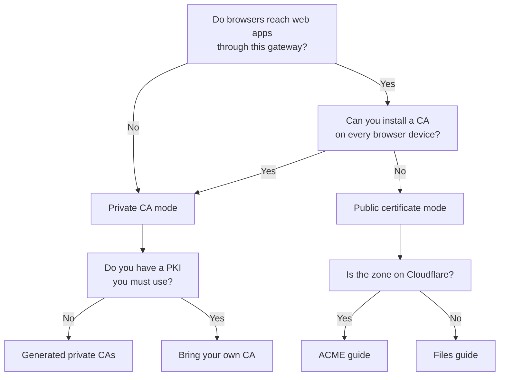

# Guides

Each guide configures one capability of the gateway container: a gateway mode, a certificate
source, a kind of upstream, an access rule or an integration. Guides are the building blocks that
the [recipes](../recipes/README.md) combine into complete deployments. Day-2 tasks such as
monitoring, upgrades and backups are in [Operations](../operations/README.md).

Every guide starts from a working deployment. If you have not deployed yet, start with the
[quickstart](../quickstart/README.md).

## Pick a guide

| I want to... | Guide |
| --- | --- |
| Point gwops at a Gateway object I already created in the Admin Console | [Gateway modes](gateway-modes.md) |
| Let gwops adopt or create the Gateway object for me | [Gateway modes](gateway-modes.md) |
| Use the default: gwops generates the X.509 and SSH CAs | [Generated private CAs](private-ca-generated.md) |
| Use CAs from my existing PKI | [Bring your own CA](private-ca-byo.md) |
| Serve names the leaf does not list | [On-demand issuance](on-demand-issuance.md) |
| Serve publicly trusted certificates I obtain and renew myself | [Public certificates from files](public-certs-files.md) |
| Have gwops issue and renew Let's Encrypt certificates | [Public certificates with ACME](public-certs-acme.md) |
| Mix file and ACME certificates, or run SSH and Kubernetes in public mode | [Mixed public mode](public-mode-mixed.md) |
| Front SSH hosts | [SSH resources](ssh-resources.md) |
| Front a Kubernetes API server | [Kubernetes](kubernetes.md) |
| Front an internal web app | [Web apps](web-apps.md) |
| Pass the user's identity or access token to a web app | [Web-app identity](web-apps-identity.md) |
| Reach web apps behind a private CA or plain HTTP | [Web-app upstream TLS](web-apps-upstream-tls.md) |
| Control which groups and security policies resources get | [Access control](access-control.md) |
| Ship session recordings to my SIEM, log platform or recording browser | [Session recording](session-recording.md) |
| Let a webhook or CI pipeline add and remove upstreams | [Automation and CI](automation-and-ci.md) |

### Choosing a certificate mode



If the diagram does not render: without browsers, or when you can install a CA on every
browser device, use private CA mode, with generated CAs by default or your own CA when your
PKI requires it. When browsers must trust the gateway without a CA install, use public
certificate mode: ACME if the zone is on Cloudflare, otherwise certificates you supply as
files. A gateway runs one mode: private CA and public certificates cannot be mixed in one
container.

## Index

### Gateway and certificates

- [Gateway modes](gateway-modes.md): pinned-gateway mode versus remote-network mode.
- [Generated private CAs](private-ca-generated.md): the default, and how to distribute trust.
- [Bring your own CA](private-ca-byo.md): your X.509 and SSH CAs.
- [On-demand issuance](on-demand-issuance.md): certificates for uncovered names, and its
  security caveat.
- [Public certificates from files](public-certs-files.md): public certificate mode with files
  you renew.
- [Public certificates with ACME](public-certs-acme.md): Let's Encrypt through Cloudflare DNS-01.
- [Mixed public mode](public-mode-mixed.md): file and ACME certificates together; SSH and
  Kubernetes in public mode.

Rotating the leaf or the generated CA is a day-2 task: see
[CA and leaf rotation](../operations/ca-and-leaf-rotation.md).

### Resources and access

- [SSH resources](ssh-resources.md): SSH upstreams and target trust.
- [Kubernetes](kubernetes.md): one Kubernetes API server per gateway.
- [Access control](access-control.md): groups, security policies, defaults and allowlists.

### Web apps

- [Web apps](web-apps.md): declare a web app, name resolution, browser trust.
- [Web-app identity](web-apps-identity.md): inject the access token and identity headers.
- [Web-app upstream TLS](web-apps-upstream-tls.md): private upstream CAs, plaintext upstreams,
  the upstream TLS probe.

### Integrations

- [Session recording](session-recording.md): deliver recordings to a receiver you run.
- [Automation and CI](automation-and-ci.md): the automation token and admin-token pipelines.

## Guide format

Each guide uses the same sections:

- **When to use**: the situation the guide is for.
- **Prerequisites**: what must be in place first.
- **Steps**: what to change, in order. Seed snippets show only the keys the guide changes;
  `# ...rest of your seed` marks the part you keep.
- **Verify**: how to confirm it worked, usually with `/status`.
- **Roll back**: how to undo it, where there is something to undo.
- **Related**: architecture pages and reference sections for the keys involved.

Shell examples assume you are in the directory that holds `compose.yaml` and that these are
set:

```sh
export BASE=http://127.0.0.1:8081
export TOKEN=<admin-token>
```

> **Note:** Docker forwards a published port to the container's network interface, not to its
> loopback. For `curl` on the host to reach the admin API through the `127.0.0.1:8081` publish in
> `compose.yaml`, gwops must listen on all container interfaces (`admin_api.bind: 0.0.0.0`).
> [Admin API behind a TLS proxy](../operations/admin-api-behind-tls-proxy.md) explains the
> options.
