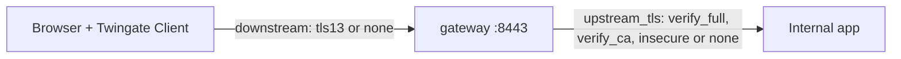

# Web apps

A `web_apps` entry puts an internal HTTP or HTTPS app behind the gateway, which acts as a layer 7
reverse proxy. The browser connects through the Twingate Client to the gateway, which terminates
the browser's TLS session, checks the user's access, and opens its own connection to the app.
gwops keeps one Twingate web-app resource per entry in sync and keeps the gateway's TLS leaf
covering every web-app address and alias.



The browser's hop is set by `downstream.tls`; the hop from the gateway to the app is set by
`upstream_tls`.

## When to use

You want users to reach internal web apps by name through Twingate, with access decided by group
and security policy, and optionally with the user's identity passed to the app (see
[Pass identity to a web app](web-apps-identity.md)).

## Prerequisites

- A running gwops container (see the [quickstart](../quickstart/README.md)).
- Each app's address resolves **inside the container** to the app, and the container can reach it.
- Egress from the container to `https://<network>.<host>/api/v1/jwk/ec`, the tenant's
  token-signing key set, which the gateway fetches. gwops checks it too and reports it as `/status`
  `jwks`.
- The host clock synced over NTP. The gateway applies no leeway to a token's issue time.
- With an HTTPS app that uses a private CA: the CA as a PEM bundle; see
  [Web-app upstream TLS](web-apps-upstream-tls.md).
- A plan for browser trust; see [Browser trust](#browser-trust).

## Steps

### Declare the app

In the seed:

```yaml
web_apps:
  - name: grafana
    address: grafana.apps.example.com:3000
    alias: metrics.apps.example.com
    upstream_tls: verify_full
    downstream:
      tls: tls13
    access:
      groups: ["App Users"]
# ...rest of your seed
```

| Key | Default | Rule |
| --- | --- | --- |
| `name` | (required) | `[a-z0-9-]{1,63}`, unique. Also the Twingate resource's name. |
| `address` | (required) | `host` or `host:port`. The port is the app's port, which the gateway dials. Default 443, or 80 with `upstream_tls: none`. Lowercased. The host is also a name users open. |
| `alias` | none | A second name users can open. A concrete host name or IP address: no port, no `*`, different from the address. Omitted or `null` clears it on the tenant. |
| `upstream_tls` | `verify_full` | How the gateway checks the app: `verify_full` (certificate and host name), `verify_ca` (certificate chain only), `insecure` (no check), `none` (plain HTTP). `insecure` and `none` need the host in `web_app_proxy.plaintext_upstreams`. |
| `downstream.tls` | `tls13` | `tls13`: the browser uses `https://`. `none`: plain `http://` inside the Twingate tunnel; `Secure` cookies break. |
| `downstream.port` | 443, or 80 with `none` | The port users open. |
| `request_headers` | unmanaged | Header rewrites for this app; see [Pass identity to a web app](web-apps-identity.md). |
| `access` | `resource_defaults` | Groups and security policy, as for [SSH resources](ssh-resources.md#declare-the-target). |

Or add it at runtime with the admin API. The change persists as an overlay and is reconciled before
the response:

```sh
export BASE=http://127.0.0.1:8081
export TOKEN=<admin-token>   # the GWOPS_ADMIN_TOKEN value from .env

curl -s -X PUT -H "Authorization: Bearer $TOKEN" -H "Content-Type: application/json" \
  -d '{"address": "grafana.apps.example.com:3000", "alias": "metrics.apps.example.com", "upstream_tls": "verify_full"}' \
  $BASE/upstreams/webapp/grafana
```

gwops checks every web-app write against its web-app policy before anything is stored. A violation,
such as a denied header name or `upstream_tls: none` for a host outside `plaintext_upstreams`, is a
`422` listing every violation; at startup it aborts startup, and in a later pass it is a local error
that applies nothing. Allowed settings that weaken security (`verify_ca`, `insecure`, `none`,
downstream `none`) are reported in `/status` `web_apps.warnings`.

The first web app adds a `webApp` section to the gateway config, so the gateway drain-restarts once.
Each new address or alias re-mints the leaf, which hot-reloads. Updating a web app's settings on
the tenant re-issues users' access tokens.

### Make the address resolve inside the container

The gateway dials the web app's `address` itself, through the container's resolver, and with
`verify_full` checks the app's certificate against that name. There is no separate upstream IP
setting. gwops does not manage `/etc/hosts`, so name resolution is a deployment requirement:

- Serve the name from DNS that the container uses, or
- Pin it in `compose.yaml` with `extra_hosts` on the `gateway` service:

  ```yaml
  services:
    gateway:
      extra_hosts:
        - "grafana.apps.example.com:10.0.0.11"
  ```

  A web app added later through the admin API then also needs a compose edit and
  `docker compose up -d` before it resolves.

Check from inside the container:

```sh
docker compose exec gateway getent hosts grafana.apps.example.com
```

With ACME and split-horizon DNS, see
[Split-horizon DNS](public-certs-acme.md#split-horizon-dns) for setups that resolve both the app
names and the ACME challenge.

### Browser trust

With `downstream.tls: tls13` the browser verifies the gateway's certificate for the name it opened.
What that needs depends on the certificate mode:

| Certificate mode | What browsers need | `/status` signal |
| --- | --- | --- |
| [Generated X.509 CA](private-ca-generated.md) | Install `/data/pki/x509-ca.crt` in the OS or browser trust store of each device. | `web_apps.browser_trust` note; readiness reason `operator_action` |
| [Bring-your-own CA](private-ca-byo.md) | Whatever trust your CA already has. | Readiness reason `byo_ca` |
| [Public certificates](public-certs-files.md) | Nothing. | `browser_trust` is `null` |

Users open `https://<address host or alias>` (with `:<downstream.port>` if it is not 443) with the
Twingate Client signed in.

### Limits

- Upstreams that use TLS need TLS 1.3. An upstream that only speaks TLS 1.2 fails with `502`.
- The gateway speaks HTTP/1.1 to the browser; it offers no ALPN protocols.
- No `Host` rewrite: the app receives the name the browser opened.
- No wildcard addresses or aliases. A wildcard web-app resource created outside gwops is reported
  as `wildcard_address`.
- The gateway closes a connection when its access token expires, so a WebSocket, server-sent event
  stream or long download ends then.
- The first request after a web-app update may fail with `401` while the gateway's clock is behind
  the tenant's. A retry succeeds. Keep the host clock NTP-synced.
- Web-app traffic is not session-recorded. With recording on, its HTTP audit lines are shipped.

## Verify

```sh
curl -s -H "Authorization: Bearer $TOKEN" $BASE/upstreams/webapp/grafana | jq '{tg_resource_id, alias, upstream_tls, downstream, warnings, errors}'
curl -s -H "Authorization: Bearer $TOKEN" $BASE/status | jq '{jwks: .jwks, readiness: .web_apps.readiness}'
```

- `tg_resource_id` is set and `errors` is empty.
- `jwks.ok` is `true`.
- The app's `web_apps.readiness[]` entry has `state: "ready"`. Informational reasons such as
  `operator_action` do not change that. Any `action_required` reason names what to fix, for
  example `san_missing:<name>` (the leaf lacks a name), `plaintext_upstreams`, `not_on_tenant` or
  `gateway_mismatch`.

Web apps attached to this gateway that gwops does not manage appear in `web_apps.unmanaged` with
the readiness reason `unmanaged`.

## Roll back

Remove the entry from the seed, or `DELETE /upstreams/webapp/grafana`. gwops deletes the web-app
resource it created and re-mints the leaf without the app's names.

## Related

- [Web apps architecture](../architecture/web-apps.md): the proxy model, policy and readiness.
- [Seed reference: `web_apps`](../reference/seed.md#web_apps),
  [`web_app_proxy`](../reference/seed.md#web_app_proxy)
- [Admin API: `web_apps` in `/status`](../reference/admin-api.md#web_apps)
- [Pass identity to a web app](web-apps-identity.md),
  [Web-app upstream TLS](web-apps-upstream-tls.md)
