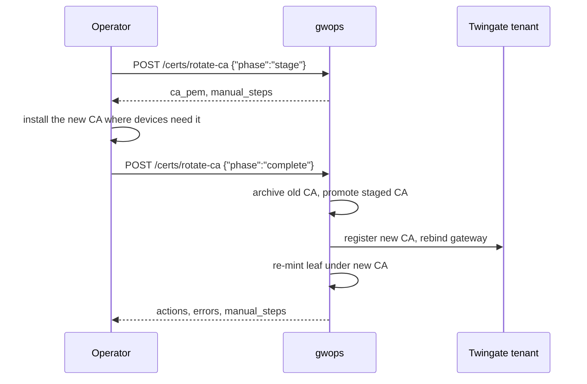

# Rotate the leaf and the CA

gwops renews the gateway's TLS leaf on its own. You can also force a new leaf, and replace the
gwops-generated X.509 CA in two phases through the admin API.

| What | Automatic | Manual route | Gateway restart |
| --- | --- | --- | --- |
| TLS leaf | Yes | `POST /certs/rotate-leaf` | No: hot reload |
| Generated X.509 CA | No | `POST /certs/rotate-ca` (`stage`, then `complete`) | Only with on-demand issuance on |
| SSH CA | No | None | Not applicable |

Both routes work in private CA mode with a generated X.509 CA only. In
[public certificate mode](../guides/public-certs-files.md) both answer `409`. With a
[bring-your-own CA](../guides/private-ca-byo.md), `rotate-ca` answers `409` and you replace the files yourself.

## When to use

- **Leaf:** you suspect the leaf key is exposed, or you want a fresh leaf now instead of waiting for
  the next pass.
- **CA:** the X.509 CA key may be exposed, your policy requires periodic CA rotation, or the CA is
  approaching its 10-year expiry.

## Prerequisites

- Admin token (`GWOPS_ADMIN_TOKEN`). The automation token cannot call these routes.
- For the CA: `TWINGATE_API_KEY` set and the Gateway object resolved (one reconcile pass has run),
  so `complete` can register the new CA and rebind the gateway.
- For the CA, when web apps use `downstream.tls: tls13`: a way to install a CA certificate on every
  device that opens them.

```sh
export BASE=http://127.0.0.1:8081
export TOKEN=<admin-token>   # the GWOPS_ADMIN_TOKEN value from .env
```

## Steps

### Leaf: automatic renewal

Every reconcile pass checks the leaf and mints a new one, valid 90 days, when it is:

- missing,
- within 14 days of expiry,
- missing a served name (a new upstream address or web-app alias), or carrying one no longer served,
- otherwise invalid, or not signed by the active X.509 CA.

Passes run at startup, on seed changes, on admin-API writes and on the periodic tick
(`GWOPS_RECONCILE_TICK_SECONDS`, default 600 s). The gateway hot-reloads the new leaf; there is no
restart. The pass records `minted TLS leaf (<reason>) covering <n> SAN(s)` in
`last_reconcile.actions`.

### Leaf: rotate now

```sh
curl -s -X POST -H "Authorization: Bearer $TOKEN" $BASE/certs/rotate-leaf
```

```json
{"minted": true, "sans": ["10.0.10.5", "build.internal.example.com"], "not_after": "2026-11-05T00:00:00+00:00"}
```

The gateway hot-reloads it. `409` means no upstreams are declared (there is nothing to cover) or the
seed is in public certificate mode. `500` means minting failed; the body names the cause.

### CA: two-phase rotation



`stage` generates the new CA beside the current one, which keeps serving. You distribute trust for
it. `complete` swaps it in, registers it on the tenant, rebinds the Gateway object and re-mints the
leaf.

1. Stage a new CA:

   ```sh
   curl -s -X POST -H "Authorization: Bearer $TOKEN" -H "Content-Type: application/json" \
     -d '{"phase": "stage"}' $BASE/certs/rotate-ca > stage.json
   jq -r .ca_pem stage.json > gwops-x509-ca-new.crt
   ```

   The response carries `ca_pem` (the new CA certificate), `staged_cert_path`
   (`/data/pki/staged/x509-ca.crt`) and `manual_steps`. Staging again returns the same staged CA;
   it does not generate another one. A restart leaves the staged CA staged.

2. Distribute trust for the new CA where devices need it. Twingate Clients need nothing: they
   trust the CA the tenant binds to the gateway, which `complete` updates. Browsers that open web
   apps with `downstream.tls: tls13` need `gwops-x509-ca-new.crt` installed beside the current CA,
   so they accept the leaf from the moment `complete` re-mints it. Do the same for any other client
   that pins or otherwise trusts the gateway's TLS CA. SSH targets need no change: this rotation
   does not touch the SSH CA. `manual_steps` says the same.

3. Complete the rotation:

   ```sh
   curl -s -X POST -H "Authorization: Bearer $TOKEN" -H "Content-Type: application/json" \
     -d '{"phase": "complete"}' $BASE/certs/rotate-ca
   ```

   ```json
   {
     "phase": "complete",
     "actions": [
       "promoted staged X.509 CA (previous CA archived)",
       "registered new X.509 CA (<id>) and rebound gateway",
       "re-minted TLS leaf under the new CA (2 SAN(s))"
     ],
     "errors": [],
     "manual_steps": [
       "Before 'complete': distribute the staged X.509 CA (ca_pem) to any client that pins or otherwise trusts the gateway's TLS CA. SSH upstream targets need no change: this rotation does not touch the SSH CA.",
       "After 'complete': the previous CA object remains registered on the Twingate tenant; delete it there once nothing trusts it anymore."
     ]
   }
   ```

   `complete` archives the previous CA under `/data/pki/archive/x509-ca-<timestamp>.crt` and
   `.key`, promotes the staged CA, registers it on the tenant as `gwops-x509-<gateway id>`, rebinds
   the Gateway object to it and re-mints the leaf. The gateway hot-reloads the leaf.

4. Clean up. The previous CA object stays registered on the tenant: delete it in the Admin Console
   once nothing trusts it. Remove the old CA from browser trust stores.

### When `complete` reports errors

The status is `200` even when `errors` is non-empty. The local rotation has happened: the new CA
is promoted and the leaf is re-minted under it. Typical errors:

| `errors` entry starts with | Cause | Fix |
| --- | --- | --- |
| `TWINGATE_API_KEY is not set` | No API key | Register the new CA on the tenant and rebind the Gateway object yourself. |
| `the gateway has not been resolved yet` | No reconcile pass has resolved the Gateway object | Run `POST /reconcile`, then register and rebind yourself, or run `stage` and `complete` again. |
| `CA registration failed` | The tenant refused or was unreachable | Register and rebind yourself, or run `stage` and `complete` again. |
| `leaf re-mint failed` | Local certificate error | Fix the cause in the message; the next pass re-mints the leaf. |

Until the tenant binds the new CA, Clients do not trust the re-minted leaf. A reconcile pass does
not repair this on its own: it registers a CA only while none is recorded, and the previous CA is
still recorded. A second `complete` answers `409` (`no staged CA rotation to complete; POST
phase='stage' first`).

### With on-demand issuance on

The gateway's on-demand issuer loads the CA when the gateway starts, so `complete` also restarts it.
It waits for any in-flight change or reconcile pass, then acts on the gateway state:

| Gateway state | Result |
| --- | --- |
| `running` | Drain-restart. `actions` gains `drain-restarted gateway so the on-demand issuer loads the new CA`. |
| `starting` | No restart. `errors` gains `gateway was starting; restart it to load the new CA`. Restart it with `docker compose restart gateway`. |
| Any other, or gwops is shutting down | `actions` gains `gateway loads the new CA on next start`. |

### Crash safety

A crash or restart during `complete` does not leave the CA half-replaced. gwops writes a marker
before it touches the current CA, and on the next boot it finishes an interrupted promotion before
it loads the CA. It does not register the new CA on the tenant at boot. If `complete` did not
return, check `last_reconcile` and the tenant, and register and rebind yourself if needed. A crash
before the marker was written leaves the old CA in place and the new one staged: run `complete`
again.

### SSH CA

There is no rotation route for the SSH CA. gwops never replaces the SSH CA files.

## Verify

```sh
curl -s -H "Authorization: Bearer $TOKEN" $BASE/status | jq '{x509_ca_not_after: .certs.x509_ca_not_after, leaf_state: .certs.leaf_state, leaf_not_after: .certs.leaf_not_after}'
```

- After a leaf rotation: `certs.leaf_state` is `ok` and `certs.leaf_not_after` is about 90 days out.
- After a CA rotation: `certs.x509_ca_not_after` is about 10 years out, and `certs.leaf_state` is
  `ok`. In the Admin Console, the Gateway object is bound to the new `gwops-x509-*` CA.

## Roll back

A leaf rotation needs no rollback.

A completed CA rotation cannot be undone through the API. The previous CA is kept in
`/data/pki/archive/`. To return to it, stop the container, copy the archived pair back to
`/data/pki/x509-ca.crt` and `/data/pki/x509-ca.key` (keeping the key mode 0600, owner uid 10001),
start the container, and rebind the Gateway object to the previous CA object on the tenant. The
next pass re-mints the leaf under the restored CA.

To abandon a staged rotation before `complete`, stop the container and delete
`/data/pki/staged/`.

## Related

- [Certificates](../architecture/certificates.md): leaf lifecycle, atomic store, CA rotation.
- [Admin API: `POST /certs/rotate-ca`](../reference/admin-api.md#post-certsrotate-ca),
  [`POST /certs/rotate-leaf`](../reference/admin-api.md#post-certsrotate-leaf)
- [Seed reference: `ca`](../reference/seed.md#ca)
- [Use gwops-generated CAs](../guides/private-ca-generated.md), [On-demand issuance](../guides/on-demand-issuance.md)
