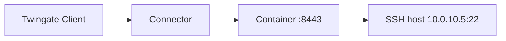

# Quickstart

This guide takes you from a fresh clone to a working SSH session through the gateway. It uses
the shipped `compose.yaml`, generated certificate authorities, and remote-network mode, in which
gwops finds or creates the Gateway object on your tenant for you, so no Admin Console step is
needed to pre-create it. Recording stays off.

Allow about 20 minutes, most of it spent on the prerequisites.

## What you will end up with

- One container running the gateway binary under gwops, listening on TCP 8443 of your Docker
  host.
- An X.509 CA and an SSH CA generated on first run, stored on the `/data` volume and registered
  on your Twingate tenant.
- A Gateway object in your Remote Network, bound to those CAs.
- A Twingate SSH resource for one host, assigned to a group you choose.
- An admin API on `127.0.0.1:8081` that you use to check status and add a second host without
  editing the seed.



Your Twingate Client connects through your Connector to the container on port 8443, and the
gateway opens the SSH connection to the host on your behalf.

## Before you start

You need the following.

**On your Twingate tenant:**

- **The tenant slug and host.** Take them from your Admin Console URL. For
  `https://acme.twingate.com` the slug is `acme` and the host is `twingate.com`. For a shard URL
  such as `https://acme.us1.twingate.com` the slug is `acme` and the host is `us1.twingate.com`.
  These become the seed keys `twingate.network` and `twingate.host`.
- **A Remote Network** with a **healthy Connector** that can reach your Docker host on TCP 8443.
  Note the Remote Network's exact name.
- **An API key** with read and write access, including resources, certificate authorities and
  gateways. See the [Twingate documentation](https://www.twingate.com/docs) for creating API keys.
- **A group** to grant access to (optional, recommended). This guide uses "Platform Engineers".
  The group must already exist: gwops assigns groups but never creates them.

**On the Docker host:**

- Docker Engine and Docker Compose v2, on linux/amd64. The published image is amd64 only.
- Outbound HTTPS from the host to `https://<network>.<host>/api/graphql/` (the Twingate API) and
  `https://<network>.<host>/api/v1/jwk/ec` (the tenant's token-signing keys).
- A clock synced over NTP.

**An SSH target:**

- An SSH host reachable from the Docker host (this guide uses `10.0.10.5:22`), where you can edit
  `sshd_config` and reload `sshd`.

## 1. Get the files

```sh
git clone https://github.com/twingate-solutions/gwops.git
cd gwops
```

Three files in the repository root matter for a deployment:

| File | Purpose |
| --- | --- |
| `compose.yaml` | The service definition. It pulls the prebuilt image and never builds locally. |
| `.env.example` | Template for the secrets file `.env`. |
| `seed.example.yaml` | An annotated seed showing every option. |

You also create a fourth file, `seed.yaml`. It is your seed, mounted read-only into the
container at `/config/seed.yaml`. It is gitignored and not in the repository, so you create it in
step 3.

## 2. Set secrets

```sh
cp .env.example .env
openssl rand -hex 32        # use the output as GWOPS_ADMIN_TOKEN
```

Edit `.env` and set the two required values:

```sh
TWINGATE_API_KEY=<your Twingate API key>
GWOPS_ADMIN_TOKEN=<the value openssl printed>
```

Secrets come only from the environment. Never put them in the seed. `compose.yaml` refuses to
start if either variable is unset or empty: `docker compose up` stops with
`set TWINGATE_API_KEY in .env` (or the same message for `GWOPS_ADMIN_TOKEN`).

## 3. Write the seed

Create `seed.yaml` before you start the container:

```sh
cp seed.example.yaml seed.yaml
```

> **Note:** If `seed.yaml` does not exist when you run `docker compose up`, Docker creates an
> empty directory with that name, and gwops then fails to read the seed. Delete the directory and
> create the file.

Keep `seed.example.yaml` open as a reference, and replace the whole contents of `seed.yaml` with
this minimal seed, using your own values:

```yaml
twingate:
  network: acme
  host: twingate.com
  remote_network: Production DC
  gateway_address: 10.0.0.20:8443   # the Docker host as the Connector reaches it
  resource_defaults:
    groups: ["Platform Engineers"]
ssh_upstreams:
  - name: web-1
    address: 10.0.10.5:22
admin_api:
  bind: 0.0.0.0                     # reachable through compose's loopback-only port mapping
```

What each key does:

- `network` and `host` identify your tenant.
- `remote_network` is the exact name of the Remote Network that holds your Connector. You can use
  `remote_network_id` (its GraphQL id) instead. Set exactly one of them.
- `gateway_address` is the address the Connector uses to reach this container. It must carry an
  explicit port, such as `10.0.0.20:8443`. A bare host is refused.
- `resource_defaults.groups` assigns the group to every resource gwops creates. Names must match
  exactly one existing group.
- `ssh_upstreams` lists the SSH hosts the gateway fronts. `name` must match `[a-z0-9-]{1,63}`.
  `address` is `host` or `host:port`, and the port defaults to 22. The gateway dials it from
  inside the container, so a host name must resolve there, not only on the Docker host. If your
  DNS does not serve it to the container, add it to `extra_hosts` in `compose.yaml` (see
  [Name resolution](../operations/troubleshooting.md#name-resolution)).
- `admin_api.bind: 0.0.0.0` makes the admin API listen on the container's network interface.
  The default, `127.0.0.1`, is the container's own loopback, which Docker's published port never
  reaches, so `curl` from the host would fail. This is safe here because `compose.yaml` publishes
  port 8081 on the host's loopback only (`127.0.0.1:8081:8081`), so the API is still not
  reachable from the network. See the [`admin_api` seed reference](../reference/seed.md#admin_api).

Everything else uses its default: gwops generates both CAs, recording is off, and the admin API
port is 8081.

> **Note:** `seed.example.yaml` is a valid seed in remote-network mode, with recording off and
> `admin_api.bind: 0.0.0.0`, but its values (tenant, Remote Network, gateway address, upstreams)
> are placeholders: replace them with your own. Its `k8s_clusters` entry points at credential files
> under `/config/k8s-creds/`; mount those files or delete the block, or startup aborts. If you
> start from the example instead of the minimal seed, make those changes first.

Setting both `gateway_id` and the remote-network keys, or neither, is refused at startup. See
the [`twingate` seed reference](../reference/seed.md#twingate) and
[Gateway modes](../guides/gateway-modes.md) for the alternatives. Every key is listed in the
[seed reference](../reference/seed.md).

## 4. Start it

```sh
docker compose up -d
docker compose logs -f gateway
```

`compose.yaml` pulls the image from GHCR with `pull_policy: missing`: it pulls only when the
image is not already on the host. If the pull fails with an authorization error, the package is
private to you and you need to run `docker login ghcr.io` first. For a reproducible deployment,
replace the `:latest` tag in `compose.yaml` with a published version tag.

gwops logs one JSON object per line. On a good first boot, look for a `reconcile.completed` line
with `"trigger": "startup"` and `"ok": true`. Its `actions` list includes entries like these
(ids and paths shortened):

```text
created gateway (R2F0ZXdheTox) at 10.0.0.20:8443 in remote network UmVtb3RlTmV0d29yazox
registered X.509 CA (...) and bound it to gateway
registered SSH CA (...) and bound it to gateway
minted TLS leaf (missing: no leaf certificate found at ...) covering 1 SAN(s)
created ssh resource 'web-1' (...)
wrote gateway config /run/gateway/config.yaml
started gateway
```

If a gateway already exists at `gateway_address` in that Remote Network, you see
`adopted existing gateway (...) at 10.0.0.20:8443` instead of `created gateway`. gwops records the
Gateway object in `/data/state.json` and reuses it on every later start.

The boot ends with a `supervisor.running` line carrying `"gateway_started": true`. Press Ctrl+C to
stop following the log. The container keeps running.

## 5. Check health and status

```sh
docker compose ps
```

The `STATUS` column shows `(healthy)` once the gateway is running and the last reconcile pass had
no local failure. The first health check runs after a 30 s start period.

For the full picture, query the admin API from the Docker host. Load the token from `.env` into
your shell first:

```sh
export GWOPS_ADMIN_TOKEN=<the value from .env>
BASE=http://127.0.0.1:8081
curl -s -H "Authorization: Bearer $GWOPS_ADMIN_TOKEN" $BASE/status
```

The fields to check first:

| Field | Healthy value | Meaning |
| --- | --- | --- |
| `process.state` | `running` | The gateway binary is up. |
| `last_reconcile.ok` | `true` | The last reconcile pass had no errors. `last_reconcile.errors` lists any. |
| `tg.ok` | `true` | The last pass synced with your tenant without errors. |
| `certs.leaf_state` | `ok` | The TLS leaf exists, is in date and covers every upstream address. |

Every field is described in the [`GET /status` reference](../reference/admin-api.md#get-status).

## 6. Trust the SSH CA on the target

The gateway signs short-lived (5-minute) SSH user certificates with the SSH CA gwops generated.
Your SSH host must trust that CA's public key. Print it:

```sh
docker compose exec gateway cat /data/pki/ssh-ca.key.pub
```

On the SSH host, save the output to a file such as `/etc/ssh/twingate_ca.pub`, then point `sshd`
at it in `/etc/ssh/sshd_config`:

```text
TrustedUserCAKeys /etc/ssh/twingate_ca.pub
```

Reload `sshd` (for example `sudo systemctl reload sshd`, or `ssh` on Debian and Ubuntu). For
target-side settings beyond trusting the CA, see the
[Twingate documentation](https://www.twingate.com/docs) and the
[SSH resources guide](../guides/ssh-resources.md).

## 7. Connect

Sign in to the Twingate Client as a member of the group you granted ("Platform Engineers" here),
then connect to the resource address:

```sh
ssh <user>@10.0.10.5
```

The Client routes the connection through your Connector to the gateway, which authenticates to the
host with a certificate signed by the SSH CA. See the
[Twingate documentation](https://www.twingate.com/docs) for Client-side SSH setup.

## 8. Add a second host without editing the seed

The admin API can add upstreams at runtime. Add `web-2` at `10.0.10.6:22`:

```sh
curl -s -X PUT \
  -H "Authorization: Bearer $GWOPS_ADMIN_TOKEN" \
  -H "Content-Type: application/json" \
  -d '{"address": "10.0.10.6:22"}' \
  $BASE/upstreams/ssh/web-2
```

The change persists as an overlay under `/data/overlays/`. The seed file is never written. gwops
runs a reconcile pass before it responds: it creates the Twingate SSH resource (assigned to your
default group) and re-mints the TLS leaf to cover the new address. A `200` response carries the
overlay and the pass's result in `reconcile`. If the pass cannot confirm the change, gwops rolls
the overlay back and returns `422` (or `503` if Twingate was unreachable). See the
[`PUT /upstreams/{segment}/{name}` reference](../reference/admin-api.md#put-upstreamssegmentname).

Trust the SSH CA on the new host as in step 6, then connect with `ssh <user>@10.0.10.6`.

## Next steps

- [Recipes](../recipes/README.md): complete deployments for common environments.
- [Guides](../guides/README.md): configure one capability at a time.
- [Operations](../operations/README.md): monitor, back up, upgrade and troubleshoot.
- [Web apps](../guides/web-apps.md): front internal HTTP(S) apps with identity headers.
- [Kubernetes](../guides/kubernetes.md): front one Kubernetes API server.
- [Session recording](../guides/session-recording.md): ship SSH recordings and audit lines to a
  receiver you run.
- [Public certificates with ACME](../guides/public-certs-acme.md): serve Let's Encrypt
  certificates instead of the private CA.
- [Admin API behind a TLS proxy](../operations/admin-api-behind-tls-proxy.md): reach the API from
  another machine safely.
- [Environment variables](../reference/environment.md): every variable the container reads.
- [Architecture](../architecture/README.md): how gwops works inside.

## If something goes wrong

**The container exits right after start.** Look for `supervisor.startup_failed` in
`docker compose logs gateway`. Its `error` field says why. Common causes are an invalid seed (the
message names the key path), setting both `gateway_id` and `remote_network`, a `gateway_address`
without a port, and a seed copied from `seed.example.yaml` with its `k8s_clusters` block left in
and no credential files mounted.

**`tg.ok` is `false`.** Read `tg.errors` and `last_reconcile.errors` in `/status`. The usual causes
are an API key without write access to resources, certificate authorities or gateways, a
`twingate.network` or `twingate.host` that does not match your Admin Console URL, a Remote Network
name that does not match exactly, or a group name that matches no group. The gateway keeps running
on its local config while Twingate errors persist, and every pass retries.

**The container stays unhealthy.** Check `process.state` and `last_reconcile.errors` in `/status`.
Unhealthy means the gateway is not running or the last pass had a local failure, such as a
certificate or config problem. Twingate-side errors alone never make the container unhealthy.

More symptoms and fixes are in [Troubleshooting](../operations/troubleshooting.md).
