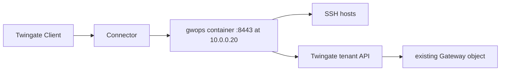

# Adopt a Gateway object that already exists

For teams that already have a Gateway object on the tenant, created in the Admin Console, by
Terraform, or by an earlier deployment of the stock `twingate/gateway` image, and want gwops to run
it from now on. gwops takes over the same Gateway object at the same address, so the Connector path
does not change. This recipe shows two ways to do it and what each changes on the tenant.

## Environment

- An existing Gateway object in the Remote Network `Production DC`, address `10.0.0.20:8443`,
  served today by a stock `twingate/gateway` container on the Docker host `10.0.0.20`
  (`linux/amd64`, Docker Engine and Compose v2).
- A Connector in `Production DC` that already reaches `10.0.0.20:8443`.
- SSH hosts `10.0.10.5` and `10.0.10.6` that trust the SSH CA the old gateway signs with
  (`TrustedUserCAKeys`). Its key pair is available as two files, `ssh-ca.key` and `ssh-ca.key.pub`.
- Two SSH resources made in the Admin Console, `web-1` and `web-2`, attached to that Gateway
  object.
- The Docker host has outbound HTTPS to the tenant (`acme.twingate.com`).

## What you get

- gwops serving the existing Gateway object. Choose one variant:
  - **Variant A, pinned and keep SSH trust** (recommended): pinned-gateway mode, your existing SSH
    CA from files, a generated X.509 CA. SSH targets keep working with no change.
  - **Variant B, adopt by address**: remote-network mode with the same `gateway_address`, generated
    X.509 and SSH CAs. Every SSH target must trust the new SSH CA.
- New SSH resources created and owned by gwops, one per seed entry, with access from
  `resource_defaults`.
- The console-made resources left exactly as they are, for you to delete once gwops serves.
- No recording. Out of scope: gwops never adopts, edits or deletes resources it did not create, and
  never deletes the Gateway object or CA objects.

## Architecture



The Client still reaches `10.0.0.20:8443` through the same Connector; behind that address the gwops
container replaces the stock gateway and manages the same Gateway object through the tenant API.

## Twingate prerequisites

1. **The Gateway object's id** (Variant A) and its Remote Network. List the gateways of a Remote
   Network with the GraphQL API:

   ```sh
   curl -s https://acme.twingate.com/api/graphql/ \
     -H "X-API-KEY: $TWINGATE_API_KEY" -H "Content-Type: application/json" \
     -d '{"query": "{ remoteNetworks(filter: {name: {eq: \"Production DC\"}}) { edges { node { id name gateways(first: 50) { edges { node { id address } } } } } } }"}'
   ```

   Note the `id` of the gateway whose `address` is `10.0.0.20:8443`.
2. **An inventory of the resources attached to it**, with their addresses and groups. Each one you
   want to keep becomes a seed entry.
3. **For Variant A**: the SSH CA your targets trust must be registered on the tenant and bound to
   the Gateway object. If the old deployment used it, it already is.
4. The groups and security policies the seed names. gwops never creates them.
5. An API key with read and write access, including resources, certificate authorities and
   gateways.

See the [Twingate documentation](https://www.twingate.com/docs).

## Files

### Directory layout

```text
gwops/
├── compose.yaml
├── .env
├── seed.yaml
└── ca/                  # Variant A only
    ├── ssh-ca.key       # 0600, uid 10001
    └── ssh-ca.key.pub   # 0644, uid 10001
```

### seed.yaml (Variant A: pinned, keep SSH trust)

```yaml
twingate:
  network: acme
  host: twingate.com
  gateway_id: R2F0ZXdheTo0Mg==     # the existing Gateway object
  resource_defaults:
    groups: ["Platform Engineers"]  # copy the groups the console-made resources grant

ca:
  ssh:
    generate: false                 # sign with the SSH CA the targets already trust
    key_path: /config/ca/ssh-ca.key # gwops also requires /config/ca/ssh-ca.key.pub
  # no x509 block: gwops generates the X.509 CA, registers it and rebinds the gateway to it

ssh_upstreams:
  - name: web-1
    address: 10.0.10.5:22
  - name: web-2
    address: 10.0.10.6:22

admin_api:
  bind: 0.0.0.0                     # so the loopback-only publish reaches it from the host
```

### seed.yaml (Variant B: adopt by address)

```yaml
twingate:
  network: acme
  host: twingate.com
  remote_network: Production DC
  gateway_address: 10.0.0.20:8443   # must equal the Gateway object's address exactly
  resource_defaults:
    groups: ["Platform Engineers"]

# no ca block: gwops generates both CAs, registers them and rebinds the gateway to both

ssh_upstreams:
  - name: web-1
    address: 10.0.10.5:22
  - name: web-2
    address: 10.0.10.6:22

admin_api:
  bind: 0.0.0.0
```

Remote-network mode adopts a Gateway object only when its address is exactly `gateway_address`
(gwops lowercases the seed value). If none matches, gwops creates a new Gateway object instead. If
more than one gateway in the Remote Network has that address, the pass records a
`gateway resolve/create:` error and syncs no resources until you remove the duplicate.

`admin_api.bind: 0.0.0.0` lets `curl` on the Docker host reach the API through the loopback-only
publish; see [Admin API behind a TLS proxy](../operations/admin-api-behind-tls-proxy.md).

### .env

```sh
TWINGATE_API_KEY=<api-key>
GWOPS_ADMIN_TOKEN=<admin-token>
```

Generate the admin token with `openssl rand -hex 32`. `chmod 0600 .env`.

### compose.yaml

```yaml
services:
  gateway:
    image: ghcr.io/twingate-solutions/gwops:<version>
    pull_policy: missing
    container_name: gwops-gateway
    restart: unless-stopped
    security_opt:
      - "no-new-privileges:true"
    cap_drop:
      - ALL
    read_only: true
    tmpfs:
      - /run/gateway:mode=1777
      - /tmp:mode=1777
    environment:
      TWINGATE_API_KEY: ${TWINGATE_API_KEY:?set TWINGATE_API_KEY in .env}
      GWOPS_ADMIN_TOKEN: ${GWOPS_ADMIN_TOKEN:?set GWOPS_ADMIN_TOKEN in .env}
    volumes:
      - ./seed.yaml:/config/seed.yaml:ro
      - ./ca:/config/ca:ro            # Variant A only; remove for Variant B
      - gwdata:/data
    ports:
      - "8443:8443"
      - "127.0.0.1:9090:9090"
      - "127.0.0.1:8081:8081"

volumes:
  gwdata:
```

The old container publishes host port 8443 too, so the two cannot run at once on this host.

### SSH CA files (Variant A)

```sh
mkdir -p ca
cp /path/to/ssh-ca.key /path/to/ssh-ca.key.pub ca/
sudo chown 10001:10001 ca/*
chmod 0600 ca/ssh-ca.key
chmod 0644 ca/ssh-ca.key.pub
```

The private key must be unencrypted: the gateway reads it directly. A CA held only in a secret
store or HSM that will not export the key cannot be used. See
[Bring your own X.509 or SSH CA](../guides/private-ca-byo.md).

## Deploy

### What changes on the tenant when gwops takes over

|  | Variant A (pinned, BYO SSH CA) | Variant B (adopt, generated CAs) |
| --- | --- | --- |
| Gateway object | Used as-is; recorded as `gateway/self` | Found by address, adopted, recorded as `gateway/self` |
| X.509 CA | `gwops-x509-<gateway id>` registered; gateway rebound to it | `gwops-x509-10.0.0.20:8443` registered; gateway rebound to it |
| SSH CA | Unchanged: gwops registers and binds nothing for a BYO CA | `gwops-ssh-10.0.0.20:8443` registered; gateway rebound to it |
| SSH targets | Keep working | Fail for new sessions until they trust the new SSH CA |
| Resources | gwops creates its own; console-made ones untouched | Same |

The rebind happens on the first pass with the API key. Clients then accept only a TLS leaf signed
by the gwops X.509 CA, which gwops mints and serves in the same pass.

gwops changes only tenant objects in its ownership registry (`/data/state.json`). It never matches
a console-made resource to a seed entry, even with the same name and address, and never deletes
one. The leaf it mints covers only the names in the effective state, so a console-made resource
whose address is not declared in the seed stops working through this gateway once gwops serves:
the Client checks the leaf against the address it dials.

gwops does not check whether a console-made resource already uses an address it creates a resource
for. If the tenant refuses the create, the pass records `TG sync: ssh/web-1: <tenant error>` in
`last_reconcile.errors` and retries on every pass; delete the console-made resource and the next
pass creates the gwops one.

### Cut over

1. Prepare the directory, `.env`, `seed.yaml` and (Variant A) `ca/` on the Docker host. Pull the
   image: `docker compose pull gateway`.
2. Stop the old gateway container. Sessions through it end.
3. Start gwops on the same host and port:

   ```sh
   docker compose up -d
   docker compose logs -f gateway
   ```

4. Read the first pass:

   ```sh
   export BASE=http://127.0.0.1:8081
   export TOKEN=<admin-token>   # the GWOPS_ADMIN_TOKEN value from .env

   curl -s -H "Authorization: Bearer $TOKEN" $BASE/status | jq '{process: .process.state, ok: .last_reconcile.ok, actions: .last_reconcile.actions, errors: .last_reconcile.errors}'
   ```

5. **Variant B only**: roll the new SSH CA out to every target, then reload `sshd`. Until then new
   SSH sessions fail. See
   [Trust the SSH CA on each target](../guides/ssh-resources.md#trust-the-ssh-ca-on-each-target):

   ```sh
   docker compose exec gateway cat /data/pki/ssh-ca.key.pub > twingate-gateway-ssh-ca.pub
   ```

6. Test access through the gwops-created resources (see [Verify](#verify)).
7. Delete the console-made resources (`web-1` and `web-2` from before) in the Admin Console. If the
   tenant refused gwops' creates in step 3, run a pass now:

   ```sh
   curl -s -X POST -H "Authorization: Bearer $TOKEN" $BASE/reconcile | jq '{ok, actions, errors}'
   ```

### Back out

Back out before step 7 and the console-made resources are still in place.

1. Remove the upstreams from the seed (or empty `ssh_upstreams`) and wait for a pass, so gwops
   deletes the resources it created. `last_reconcile.actions` lists
   `deleted ssh resource 'web-1' (<id>)`.
2. Stop gwops: `docker compose stop gateway`. Keep the `gwdata` volume until you are sure.
3. On the tenant, bind the Gateway object back to the X.509 CA (and, for Variant B, the SSH CA) the
   old deployment used. gwops never deletes the Gateway object or the `gwops-*` CA objects; delete
   the CA objects by hand once nothing is bound to them.
4. Start the old gateway container.

## Verify

- **Gateway resolution.** On the first pass, Variant A records no gateway action and
  `registered X.509 CA (<id>) and bound it to gateway`, with no `registered SSH CA` line. Variant B
  records `adopted existing gateway (<id>) at 10.0.0.20:8443`, then the `registered X.509 CA` and
  `registered SSH CA` lines. Neither contains `created gateway`; if Variant B does, the address did
  not match and gwops made a second Gateway object.
- **Tenant sync.** `tg.ok` is `true`; `tg.errors` and `tg.gateway_mismatches` are empty.
- **Resources.** `last_reconcile.actions` contains `created ssh resource 'web-1' (<id>)` and the
  same for `web-2`. `GET /upstreams/ssh/web-1` shows `origin: "seed"`, a `tg_resource_id` and empty
  `errors`:

  ```sh
  curl -s -H "Authorization: Bearer $TOKEN" $BASE/upstreams/ssh/web-1 | jq '{origin, tg_resource_id, errors}'
  ```

- **Certificates.** `certs.leaf_state` is `ok`.
- **End user.** A member of "Platform Engineers", signed in to the Twingate Client, runs
  `ssh <user>@10.0.10.5`.

## Day 2

- **Backups.** `/data/state.json` is now the only record of which resources gwops owns. Back up
  `/data`; see [Backup and restore](../operations/backup-and-restore.md).
- **Add hosts** in the seed or through the admin API; see [SSH resources](../guides/ssh-resources.md).
- **Generated X.509 CA rotation**; see [Rotate the leaf and the CA](../operations/ca-and-leaf-rotation.md).
  A BYO SSH CA is yours to rotate; see
  [Replace a BYO CA](../guides/private-ca-byo.md#replace-a-byo-ca).
- **Upgrades**; see [Upgrades and pins](../operations/upgrades-and-pins.md).

## Variations

### Terraform-managed Gateway object

To keep Terraform owning the Gateway object and its CA bindings, use pinned-gateway mode and bring
both CAs: `ca.x509.generate: false` with `cert_path` and `key_path`, and `ca.ssh.generate: false`
with `key_path`. gwops then registers no CA and never updates the Gateway object; it only creates and
manages resources attached to it. Keep those resources out of Terraform, or the two will undo each
other's changes. See [Bring your own X.509 or SSH CA](../guides/private-ca-byo.md).

### Bring the X.509 CA too

If devices or the tenant must keep the X.509 CA the old deployment used, add a `ca.x509` block with
`generate: false` to Variant A. gwops then leaves the X.509 binding as it is, so your CA must already
be bound to the Gateway object. In Variant B a bring-your-own X.509 CA works only while the address
matches: gwops adopts the Gateway object, but without a generated X.509 CA it cannot create one if
none is found. See [Choose how gwops finds the Gateway object](../guides/gateway-modes.md).

## Related

- [Choose how gwops finds the Gateway object](../guides/gateway-modes.md)
- [Bring your own X.509 or SSH CA](../guides/private-ca-byo.md),
  [Use gwops-generated CAs](../guides/private-ca-generated.md)
- [SSH resources](../guides/ssh-resources.md)
- [Backup and restore](../operations/backup-and-restore.md)
- [Twingate integration](../architecture/twingate-integration.md): ownership registry, gateway
  resolution and gateway mismatches.
- [Known limitations: tenant management](../reference/limitations.md#tenant-management)
