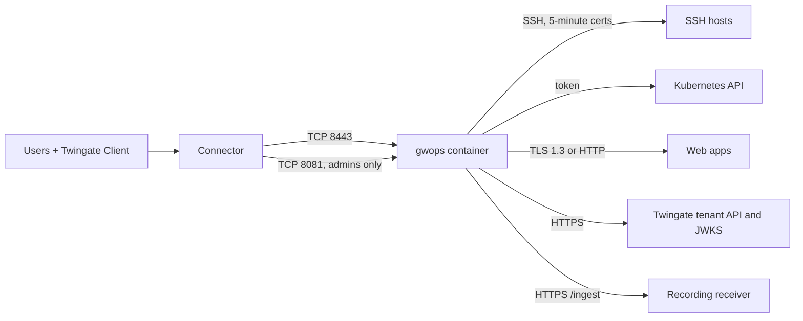

# SSH, Kubernetes and web apps on one gateway

This recipe is for a single site where one gateway fronts the server fleet, the one Kubernetes
cluster and the internal web apps, under one access model, with sessions recorded to your own
receiver. Its seed uses every block except `public_tls`, with comments, and is the reference seed
for readers who want to see everything together. The admin API is reachable from other machines
through a Twingate resource.

## Environment

- One Linux `amd64` host with Docker Engine and Docker Compose v2, at `10.0.0.20`. The image is
  `linux/amd64` only.
- A Twingate Connector in the Remote Network "Production DC" that reaches `10.0.0.20` on TCP 8443
  and TCP 8081.
- Three SSH hosts at `10.0.10.5`, `10.0.10.6` (port 22) and `10.0.10.20` (port 2222), whose
  `sshd_config` you can change.
- One Kubernetes API server at `k8s.internal.example.com:6443`, with a service-account bearer
  token and the API server's CA certificate.
- Three web apps:
  - `grafana.internal.example.com:3000` and `wiki.internal.example.com`: HTTPS with certificates
    from the internal CA "corp-root";
  - `dash.lab.internal.example.com:8080`: plain HTTP on a lab segment.
- Internal DNS resolves `*.internal.example.com`; the container uses the host's resolver.
- A recording receiver at `https://recorder.internal.example.com` that implements the
  [recording wire format](../reference/recording-wire-format.md). It can be your SIEM's HTTP input
  behind an adapter, a custom service, or a ready-made recording browser.
- Browsers that open the web apps run on managed devices that can be given a CA certificate.
- Every upstream that speaks TLS offers TLS 1.3. The host clock is synced over NTP.

## What you get

- Three SSH resources, one Kubernetes resource and three web-app resources, attached to a Gateway
  object that gwops creates in remote-network mode.
- Private CA mode with gwops-generated X.509 and SSH CAs.
- Access: "Platform Engineers" with the "Privileged Access MFA" policy by default; the database
  host with the stricter "Database Access" policy; the web apps for "App Users" with "Standard
  Access".
- Two allowlists that bound every admin-API write, admin token included.
- Identity headers on every web app, and the signed access token on Grafana.
- Recording of interactive SSH sessions and interactive `kubectl exec` and `attach` sessions, and
  HTTP audit lines for web-app and Kubernetes API requests, shipped to your receiver.
- The admin API reachable by "Platform Engineers" through a Twingate resource for port 8081.

Out of scope: browser trust on unmanaged devices (it needs public certificate mode, so a second
container), more than one Kubernetes cluster (one per gateway), and anything on the tenant other
than resources, CA registrations and the Gateway object. gwops never creates groups, policies,
Remote Networks or Connectors, and never changes group membership.

## Architecture



Users reach the gateway through the Connector on port 8443, admins reach the admin API through the
same Connector on port 8081, and the gateway fronts the SSH hosts, the cluster and the web apps
while gwops ships recordings to the receiver.

## Twingate prerequisites

Create these first. See the [Twingate documentation](https://www.twingate.com/docs).

1. The Remote Network "Production DC" with a healthy Connector that reaches `10.0.0.20` on TCP 8443
   and TCP 8081.
2. The groups "Platform Engineers" and "App Users".
3. The security policies "Privileged Access MFA", "Database Access" and "Standard Access". Each
   name must match exactly one object.
4. An API key with read and write access, including resources, certificate authorities and
   gateways.
5. A Resource for the admin API: address `10.0.0.20`, restricted to TCP port 8081, granted to
   "Platform Engineers" only. gwops does not create it; it is an ordinary network resource, not one
   of the gateway's upstreams.

On the cluster: a service account and a long-lived bearer token for it, with the permissions the
[Twingate documentation](https://www.twingate.com/docs) lists for the gateway. The token's
permissions bound what the gateway can do in the cluster.

## Files

### Directory layout

```text
gwops/
├── compose.yaml
├── .env
├── seed.yaml
├── k8s-creds/
│   ├── prod.token        # bearer token, owner 10001, mode 0600
│   └── prod-ca.crt       # API server CA, PEM, owner 10001, mode 0644
└── webapp-cas/
    └── corp-root.pem     # corp-root CA certificate(s), PEM, owner 10001, mode 0644
```

### seed.yaml

```yaml
# Reference seed: every block except public_tls. Secrets never appear here.

# --- Tenant and gateway -----------------------------------------------------------
twingate:
  network: acme                          # tenant slug, from acme.twingate.com
  host: twingate.com
  # Remote-network mode: gwops adopts the Gateway object at gateway_address in this Remote
  # Network, or creates one. Needs the generated X.509 CA below.
  remote_network: Production DC
  gateway_address: 10.0.0.20:8443        # the Docker host as the Connector reaches it
  # Applied to every resource whose own access block omits a key.
  resource_defaults:
    groups: ["Platform Engineers"]
    security_policy: "Privileged Access MFA"
  # Bound every admin-API and overlay write, admin token included. Seed entries and
  # resource_defaults are implicitly allowed. An empty list allows nothing.
  access_allowlist:
    groups: ["Platform Engineers", "App Users"]
    security_policies: ["Privileged Access MFA", "Standard Access"]
  address_allowlist:
    cidrs: ["10.0.10.0/24"]
    dns_suffixes: ["internal.example.com"]   # x.internal.example.com, not xinternal.example.com

# --- Certificate authorities ------------------------------------------------------
# The defaults, written out. Both CAs are generated on first start under /data/pki/.
ca:
  x509:
    generate: true
    on_demand_issuance: false            # keep off; see the on-demand issuance guide
  ssh:
    generate: true

# --- SSH --------------------------------------------------------------------------
ssh_upstreams:
  - name: web-1
    address: 10.0.10.5                   # port 22 by default
  - name: web-2
    address: 10.0.10.6
  - name: db-1
    address: 10.0.10.20:2222
    access:
      security_policy: "Database Access" # replaces the default policy; groups stay default

# --- Kubernetes (one cluster per gateway) -----------------------------------------
k8s_clusters:
  - name: prod
    address: k8s.internal.example.com    # host only; the port is a separate key
    port: 6443
    bearer_token_file: /config/k8s-creds/prod.token
    ca_file: /config/k8s-creds/prod-ca.crt

# --- Web apps -----------------------------------------------------------------------
web_apps:
  - name: grafana
    address: grafana.internal.example.com:3000
    upstream_tls: verify_full            # required for {{jwt}} to a non-loopback upstream
    request_headers:
      Authorization: "Bearer {{jwt}}"    # the app verifies this token
    access:
      groups: ["App Users"]
      security_policy: "Standard Access"
  - name: wiki
    address: wiki.internal.example.com
    alias: kb.internal.example.com       # a second name users can open
    access:
      groups: ["App Users"]
      security_policy: "Standard Access"
  - name: lab-dash
    address: dash.lab.internal.example.com:8080
    upstream_tls: none                   # allowed only by plaintext_upstreams below
    access:
      groups: ["App Users"]
      security_policy: "Standard Access"

# Gateway-wide web-app settings (seed-only).
web_app_proxy:
  request_headers:                       # sent to every web app; trusted identity names
    X-Twingate-User: "{{username}}"
    X-Twingate-Groups: "{{groups}}"
  upstream_ca_bundles:                   # private CAs for upstream TLS, added to the system roots
    - name: corp-root
      file: /config/webapp-cas/corp-root.pem
  plaintext_upstreams:                   # the only hosts allowed upstream_tls none or insecure
    dns_suffixes: ["lab.internal.example.com"]
  upstream_tls_probe: true               # TLS 1.3 handshake check of verify_full/verify_ca upstreams

# --- Recording (read at startup only) ---------------------------------------------
recording:
  enabled: true
  receiver_url: https://recorder.internal.example.com   # base URL of any receiver; gwops POSTs to /ingest
  spool_max_bytes: 536870912             # 512 MiB on /data; at least 16 MiB

# --- Admin API (read at startup only) ---------------------------------------------
admin_api:
  bind: 0.0.0.0                          # needed for any published port to reach it
  port: 8081
```

`recording.receiver_url` takes the base URL of any receiver.

### .env

```sh
# Twingate API key: read and write, including resources, certificate authorities and gateways.
TWINGATE_API_KEY=<twingate-api-key>
# Admin API bearer token. Generate with: openssl rand -hex 32
GWOPS_ADMIN_TOKEN=<admin-token>
# Bearer token gwops presents to the recording receiver.
GWOPS_RECORDING_TOKEN=<receiver-token>
```

### compose.yaml

```yaml
services:
  gateway:
    image: ghcr.io/twingate-solutions/gwops:<version>
    pull_policy: missing
    container_name: gwops-gateway
    restart: unless-stopped
    security_opt:
      - "no-new-privileges:true"
    cap_drop:
      - ALL
    read_only: true
    tmpfs:
      - /run/gateway:mode=1777
      - /tmp:mode=1777
    environment:
      TWINGATE_API_KEY: ${TWINGATE_API_KEY:?set TWINGATE_API_KEY in .env}
      GWOPS_ADMIN_TOKEN: ${GWOPS_ADMIN_TOKEN:?set GWOPS_ADMIN_TOKEN in .env}
      GWOPS_RECORDING_TOKEN: ${GWOPS_RECORDING_TOKEN:?set GWOPS_RECORDING_TOKEN in .env}
    volumes:
      - ./seed.yaml:/config/seed.yaml:ro
      - gwdata:/data                       # CAs, overlays, ownership registry, recording spool
      - ./k8s-creds:/config/k8s-creds:ro
      - ./webapp-cas:/config/webapp-cas:ro
    ports:
      - "8443:8443"              # gateway listener; the Connector must reach it
      - "127.0.0.1:9090:9090"    # gateway metrics, host loopback only
      - "127.0.0.1:8081:8081"    # gwops admin API, host loopback only
      - "10.0.0.20:8081:8081"    # gwops admin API for the Twingate resource; firewall it to the Connector

volumes:
  gwdata:
```

Replace `<version>` with a published version tag. Do not use `:latest` for a production deployment.

The admin API is plain HTTP. The hop from the Client to the Connector is encrypted by Twingate;
the hop from the Connector to `10.0.0.20:8081` is not. Keep the Connector on this host or a trusted
segment, or put a TLS proxy in front instead. Both options are in
[Admin API behind a TLS proxy](../operations/admin-api-behind-tls-proxy.md).

### Mounted files

- `k8s-creds/prod.token` and `k8s-creds/prod-ca.crt`: regular files of at most 1 MiB, readable by
  uid 10001. gwops copies them to content-addressed files under `/data/k8s-creds/`, which the
  gateway reads. See [Front a Kubernetes API server](../guides/kubernetes.md).
- `webapp-cas/corp-root.pem`: `CERTIFICATE` blocks only, each a CA (`CA:TRUE`) and in date. See
  [Web-app upstream TLS](../guides/web-apps-upstream-tls.md#trust-a-private-upstream-ca).

## Deploy

1. Create the directory and the files above, then set ownership:

   ```sh
   sudo chown -R 10001:10001 k8s-creds webapp-cas
   chmod 0600 k8s-creds/prod.token
   chmod 0644 k8s-creds/prod-ca.crt webapp-cas/corp-root.pem
   ```

2. Allow TCP 8081 on `10.0.0.20` only from the Connector, with the host firewall. Docker
   publishes ports through its own rules, so add the rule where your firewall filters Docker
   traffic (for iptables, the `DOCKER-USER` chain).
3. Start the container:

   ```sh
   docker compose up -d
   docker compose logs -f gateway
   ```

   Wait for `reconcile.completed` with `"ok": true`, then press Ctrl+C.
4. Read the first status from the Docker host:

   ```sh
   BASE=http://127.0.0.1:8081
   TOKEN=<admin-token>   # the GWOPS_ADMIN_TOKEN value from .env

   curl -s -H "Authorization: Bearer $TOKEN" $BASE/status | jq '{process: .process.state, ok: .last_reconcile.ok, tg: .tg.ok, leaf: .certs.leaf_state, shipping: .shipper.shipping}'
   ```

   Expect `running`, `true`, `true`, `ok` and `true`.
5. Install the SSH CA on each SSH host:

   ```sh
   docker compose exec gateway cat /data/pki/ssh-ca.key.pub > twingate-gateway-ssh-ca.pub
   ```

   Copy the file to `/etc/ssh/twingate-gateway-ssh-ca.pub` on `10.0.10.5`, `10.0.10.6` and
   `10.0.10.20`, add `TrustedUserCAKeys /etc/ssh/twingate-gateway-ssh-ca.pub` to
   `/etc/ssh/sshd_config`, and reload `sshd`. See
   [SSH resources](../guides/ssh-resources.md#trust-the-ssh-ca-on-each-target).
6. Install the X.509 CA on the devices that open the web apps:

   ```sh
   docker compose exec gateway cat /data/pki/x509-ca.crt > gwops-x509-ca.crt
   ```

   Push `gwops-x509-ca.crt` as a trusted root with your device management tool. See
   [Use gwops-generated CAs](../guides/private-ca-generated.md#trust-the-x509-ca-in-browsers-web-apps-only).

### How changes apply

The gateway binary has no reload signal. A change that alters the rendered gateway config
drain-restarts it, which drops open connections; certificate changes hot-reload.

| Change | Effect on the gateway |
| --- | --- |
| Add, change or remove an SSH host, or a web app other than the first | Leaf re-minted when the served names change; hot reload, no restart |
| A web app's own settings (`upstream_tls`, `request_headers`, `alias`) | Synced to its tenant resource; users' access tokens are re-issued |
| The first web app added, or the last removed | Drain-restart |
| Gateway-wide `request_headers`, a CA bundle's content, the cluster entry or its credential files, `on_demand_issuance` | Drain-restart |
| Leaf renewal or rotation | Hot reload |
| `access`, `resource_defaults`, allowlists, `upstream_tls_probe` | Read on every pass; no effect on the gateway process |
| `recording.*`, `admin_api.*`, any environment variable | Read once at startup: restart the container |

Seed edits are seen within a few seconds. A change to a file under `/config/k8s-creds/` or
`/config/webapp-cas/` is applied on the next pass: the periodic one (every 600 s by default), or
at once with `curl -s -X POST -H "Authorization: Bearer $TOKEN" $BASE/reconcile`. The mechanism is
in [Gateway process](../architecture/gateway-process.md#apply).

### Sizing

- **Spool:** `spool_max_bytes` bounds the recording spool on `/data` (here 512 MiB). Size it for
  the longest receiver outage you want to survive at your recording rate; when it fills, the
  oldest undelivered lines are deleted and logged as `spool.evicted`. Leave the volume room for it.
- **Memory:** one gateway line can be up to 16 MiB, and one SSH session can be a single line.
  Parsing a maximum-size line of non-ASCII text peaks at about 200 MiB. The compose file sets no
  memory limit; if you add one, leave room for that peak.
- **Lines over 16 MiB** are dropped whole, and that recording is lost.

## Verify

```sh
curl -s -H "Authorization: Bearer $TOKEN" $BASE/status | jq '{tg: .tg.ok, mismatches: .tg.gateway_mismatches, leaf: .certs.leaf_state, jwks: .jwks.ok, readiness: [.web_apps.readiness[] | {name, state, reasons}], shipper: {mode: .shipper.mode, shipping: .shipper.shipping, pending: .shipper.pending_lines, last: .shipper.last_success_at}}'
```

### Tenant and certificates

- `tg.ok` is `true` and `tg.gateway_mismatches` is `{}`.
- The first pass's `last_reconcile.actions` lists `created gateway (<id>) at 10.0.0.20:8443 in
  remote network <id>`, `registered X.509 CA (<id>) and bound it to gateway`,
  `registered SSH CA (<id>) and bound it to gateway`, and one `created ssh resource`,
  `created kubernetes resource` or `created webapp resource` line per entry.
- `certs.leaf_state` is `ok` and `tls.mode` is `static`.

### SSH

```sh
curl -s -H "Authorization: Bearer $TOKEN" $BASE/upstreams/ssh/db-1 | jq '{tg_resource_id, effective_access, errors}'
```

`effective_access` shows "Platform Engineers" and "Database Access". A member of
"Platform Engineers" with the Twingate Client connects to the resource address `10.0.10.20` with
their usual SSH client; see [SSH resources](../guides/ssh-resources.md#connect).

### Kubernetes

```sh
curl -s -H "Authorization: Bearer $TOKEN" $BASE/upstreams/k8s/prod | jq '{kind, tg_resource_id, errors}'
docker compose exec gateway ls /data/k8s-creds/
```

`kind` is `kubernetes` and the directory lists `prod-token-<sha12>` and `prod-ca-<sha12>.crt`. A
member of "Platform Engineers" runs `kubectl get ns` with a kubeconfig that points at the resource
address; see the [Twingate documentation](https://www.twingate.com/docs) for the Client and
kubeconfig setup.

### Web apps

- Every `web_apps.readiness[]` entry is `ready`, with `operator_action` among its reasons. That
  reason stays after you install the CA, because gwops cannot see device trust stores. With the
  probe on, `grafana` and `wiki` show `probe.outcome: "ok"` after the first batch.
- `jwks.ok` is `true`.
- On a managed device, `https://kb.internal.example.com` opens with no certificate warning.

### Recording

Open an SSH session to `web-1`, run a few commands and exit. `shipper.pending_lines` rises and
drains to 0, `shipper.last_success_at` advances, and the receiver stores the session's
`session_recording` lines and its `Authenticated connection` line.

### Admin API from another machine

With the Twingate Client signed in as a member of "Platform Engineers":

```sh
curl -s -H "Authorization: Bearer $TOKEN" http://10.0.0.20:8081/status | jq .process
```

From a machine without that access, the connection fails.

## Day 2

- **Hosts and apps:** add or remove them in the seed, or through the admin API inside the
  allowlists (`PUT` and `DELETE /upstreams/{segment}/{name}`). A write outside the allowlists is
  `403` and nothing is stored. See [SSH resources](../guides/ssh-resources.md),
  [Web apps](../guides/web-apps.md) and [Access control](../guides/access-control.md).
- **Cluster credentials:** rewrite `k8s-creds/prod.token`; the next pass copies it and
  drain-restarts the gateway. Prefer a token that lasts days or longer: every new token is a
  restart.
- **Leaf and CA rotation:** the leaf renews itself. For the X.509 CA, see
  [Rotate the leaf and the CA](../operations/ca-and-leaf-rotation.md). There is no rotation route
  for the SSH CA.
- **Overlays:** API changes accumulate as overlays under `/data/overlays/`. List them with
  `GET /overlays` and fold lasting ones back into the seed.
- **Backups:** `/data` holds both CA keys, the ownership registry, the overlays and the spool.
  Losing it means re-trusting a new SSH CA on every host and a new X.509 CA on every device. See
  [Backup and restore](../operations/backup-and-restore.md).
- **Monitoring:** alert on `last_reconcile.ok`, `tg.ok`, `certs.leaf_state`, `jwks.ok`,
  `shipper.pending_lines` growth and `spool.evicted`. Scrape gateway metrics from
  `127.0.0.1:9090`. See [Monitoring](../operations/monitoring.md).
- **Upgrades:** back up `/data` first. See [Upgrades and pins](../operations/upgrades-and-pins.md).

## Variations

### Browser-trusted web apps too

One container serves either a private CA or public certificates, never both. Move the web apps to
a second container in public certificate mode; see
[Private and public gateways on one host](private-and-public-gateways-one-host.md).

### Admin API behind a TLS proxy

Instead of the Twingate resource, terminate TLS in a reverse proxy beside the gateway and remove
the `10.0.0.20:8081` publish. See
[Admin API behind a TLS proxy](../operations/admin-api-behind-tls-proxy.md#option-b-a-tls-reverse-proxy).

### Unattended callers

A webhook that registers hosts gets its own limited token, `GWOPS_AUTOMATION_TOKEN`, bounded by
the allowlists already in this seed. See [Automation and CI](../guides/automation-and-ci.md).

### Recording off

Remove the `recording` block, the `GWOPS_RECORDING_TOKEN` line from `.env` and `compose.yaml`, and
recreate the container. See [Session recording](../guides/session-recording.md#roll-back).

## Related

- Guides: [Gateway modes](../guides/gateway-modes.md),
  [Use gwops-generated CAs](../guides/private-ca-generated.md),
  [SSH resources](../guides/ssh-resources.md), [Front a Kubernetes API server](../guides/kubernetes.md),
  [Web apps](../guides/web-apps.md), [Pass identity to a web app](../guides/web-apps-identity.md),
  [Web-app upstream TLS](../guides/web-apps-upstream-tls.md),
  [Access control](../guides/access-control.md), [Session recording](../guides/session-recording.md)
- Operations: [Admin API behind a TLS proxy](../operations/admin-api-behind-tls-proxy.md),
  [Monitoring](../operations/monitoring.md), [Backup and restore](../operations/backup-and-restore.md),
  [Rotate the leaf and the CA](../operations/ca-and-leaf-rotation.md)
- Architecture: [Gateway process](../architecture/gateway-process.md),
  [Configuration model](../architecture/configuration-model.md)
- Reference: [Seed reference](../reference/seed.md),
  [Recording wire format](../reference/recording-wire-format.md),
  [Known limitations](../reference/limitations.md)
