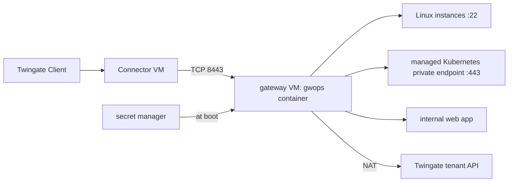

# On a cloud VM (AWS, Azure, Google Cloud)

For teams running their upstreams in a cloud VPC or VNet: Linux instances, a managed Kubernetes
cluster with a private API endpoint, and internal web apps. The gateway runs as a Docker host VM in
a private subnet next to the Connector. Only the Connector can reach it; secrets come from the
cloud's secret manager at boot; `/data` lives on a persistent disk with snapshots. The deployment
is the same on every provider apart from the network rule, the secret fetch and the cluster
endpoint, which have one section each under [Deploy](#deploy).

> **Note:** Untested example. The cloud provider CLI commands, network rules, secret fetch and boot units on this page have not been run by this project. Adapt them to your environment and test them before you rely on them.

## Environment

- One VPC (AWS, Google Cloud) or VNet (Azure) with a private subnet `10.0.1.0/24`. No public IP on
  the gateway VM; outbound internet through the provider's NAT.
- The gateway VM: an x86-64 instance at `10.0.1.10` running a Linux distribution with Docker Engine
  and Compose v2, an attached data disk mounted at `/srv/gwops/data`, and a cloud identity (instance
  role, managed identity or service account) allowed to read two secrets.
- A Twingate Connector on another VM in the same VPC, at `10.0.1.20`.
- Linux instances in `10.0.2.0/24`, reachable from the gateway VM on TCP 22.
- A managed Kubernetes cluster (EKS, AKS or GKE) with a private API endpoint reachable from the
  gateway VM on TCP 443, at the name `prod.k8s.internal.example.com` in this recipe.
- An internal web app, `grafana.apps.example.com:3000`, served over HTTPS with a certificate that
  chains to a public root, resolvable through the VPC's DNS.
- Secrets in the provider's secret manager: the Twingate API key, the admin token and the cluster
  token.

## What you get

- A Gateway object created by gwops in remote-network mode at `10.0.1.10:8443`, with generated
  X.509 and SSH CAs.
- Twingate SSH resources for the instances, one Kubernetes resource for the managed cluster and one
  web-app resource, all granted to "Platform Engineers".
- Port 8443 reachable only from the Connector; nothing reachable from the internet.
- `.env` rebuilt from the secret manager on every boot, never stored in an image or in user data.
- `/data` on a disk that survives instance replacement, with scheduled snapshots.
- No recording (see [Variations](#variations)). Out of scope: managed container services such as
  AWS ECS Fargate, Azure Container Instances or Google Cloud Run.

## Architecture



Clients reach the gateway VM only through the Connector in the same VPC; the gateway fronts the
instances, the cluster's private endpoint and the web app, fetches its secrets from the secret
manager at boot, and reaches the tenant through the NAT.

## Twingate prerequisites

1. A Remote Network for the VPC, `Cloud Prod`, and a Connector deployed in the same VPC. See the
   [Twingate documentation](https://www.twingate.com/docs).
2. The group "Platform Engineers".
3. An API key with read and write access, including resources, certificate authorities and
   gateways, stored in the secret manager as `gwops-twingate-api-key`.
4. On the cluster: a service account and a long-lived token for the gateway, with the permissions
   the Twingate documentation lists for the gateway. The token's permissions bound what the gateway
   can do in the cluster. See [Prepare the cluster credentials](#prepare-the-cluster-credentials).

## Files

### Directory layout

On the gateway VM:

```text
/opt/gwops/
├── compose.yaml
├── seed.yaml
├── fetch-secrets.sh          # 0700, root
├── .env                      # 0600, root, rewritten at every boot
└── k8s-creds/
    ├── prod.token            # 0600, uid 10001, rewritten at every boot
    └── prod-ca.crt           # 0644, uid 10001
/srv/gwops/data/              # the data disk, mounted at /data; 0700, uid 10001
/etc/systemd/system/gwops.service
```

### seed.yaml

```yaml
twingate:
  network: acme
  host: twingate.com
  remote_network: Cloud Prod
  gateway_address: 10.0.1.10:8443     # the VM's private IP, as the Connector reaches it
  resource_defaults:
    groups: ["Platform Engineers"]

ssh_upstreams:
  - name: app-1
    address: 10.0.2.11:22
  - name: app-2
    address: 10.0.2.12:22

k8s_clusters:
  - name: prod
    address: prod.k8s.internal.example.com   # the cluster's private API endpoint host
    port: 443
    bearer_token_file: /config/k8s-creds/prod.token
    ca_file: /config/k8s-creds/prod-ca.crt

web_apps:
  - name: grafana
    address: grafana.apps.example.com:3000
    upstream_tls: verify_full

admin_api:
  bind: 0.0.0.0                       # so the loopback-only publish reaches it on the VM
```

`admin_api.bind: 0.0.0.0` lets `curl` on the VM reach the API through the loopback-only publish;
see [Admin API behind a TLS proxy](../operations/admin-api-behind-tls-proxy.md). The web app uses
the generated X.509 CA for the browser side, so devices must trust `/data/pki/x509-ca.crt`; see
[Web apps: browser trust](../guides/web-apps.md#browser-trust).

### .env

Written by `fetch-secrets.sh`, never by hand:

```sh
TWINGATE_API_KEY=<api-key>
GWOPS_ADMIN_TOKEN=<admin-token>
```

### compose.yaml

```yaml
services:
  gateway:
    image: ghcr.io/twingate-solutions/gwops:<version>
    pull_policy: missing
    container_name: gwops-gateway
    restart: unless-stopped
    stop_grace_period: 40s
    security_opt:
      - "no-new-privileges:true"
    cap_drop:
      - ALL
    read_only: true
    tmpfs:
      - /run/gateway:mode=1777
      - /tmp:mode=1777
    environment:
      TWINGATE_API_KEY: ${TWINGATE_API_KEY:?set TWINGATE_API_KEY in .env}
      GWOPS_ADMIN_TOKEN: ${GWOPS_ADMIN_TOKEN:?set GWOPS_ADMIN_TOKEN in .env}
    volumes:
      - ./seed.yaml:/config/seed.yaml:ro
      - ./k8s-creds:/config/k8s-creds:ro
      - /srv/gwops/data:/data           # the persistent data disk
    ports:
      - "8443:8443"
      - "127.0.0.1:9090:9090"
      - "127.0.0.1:8081:8081"
```

`/data` is a bind mount of the data disk instead of a named volume, so it lives on a disk you can
snapshot and reattach. It must be writable by uid 10001.

### fetch-secrets.sh

Runs as root before the container starts. Replace `get_secret` with the command for your provider
from [Deploy](#deploy).

```sh
#!/bin/sh
# Rebuild .env and the cluster token from the secret manager.
set -eu
cd /opt/gwops
umask 077

get_secret() {
  # AWS:          aws secretsmanager get-secret-value --secret-id "$1" --query SecretString --output text
  # Azure:        az keyvault secret show --vault-name <vault-name> --name "$1" --query value -o tsv
  # Google Cloud: gcloud secrets versions access latest --secret="$1"
  <provider command for "$1">
}

api_key=$(get_secret gwops-twingate-api-key)
admin_token=$(get_secret gwops-admin-token)
k8s_token=$(get_secret gwops-k8s-token)

tmp=$(mktemp .env.XXXXXX)
printf 'TWINGATE_API_KEY=%s\nGWOPS_ADMIN_TOKEN=%s\n' "$api_key" "$admin_token" > "$tmp"
mv "$tmp" .env

tmp=$(mktemp k8s-creds/.prod.token.XXXXXX)
printf '%s' "$k8s_token" > "$tmp"
chown 10001:10001 "$tmp"
mv "$tmp" k8s-creds/prod.token
```

Each value is fetched into a variable first, so a failed fetch stops the script before anything is
written. Both files are written under a temporary name and renamed into place.

### /etc/systemd/system/gwops.service

```text
[Unit]
Description=gwops gateway
Requires=docker.service
After=docker.service network-online.target
Wants=network-online.target

[Service]
Type=oneshot
RemainAfterExit=yes
WorkingDirectory=/opt/gwops
ExecStartPre=/opt/gwops/fetch-secrets.sh
ExecStart=/usr/bin/docker compose up -d
ExecStop=/usr/bin/docker compose stop

[Install]
WantedBy=multi-user.target
```

`docker compose up -d` recreates the container only when `.env` or `compose.yaml` changed, so a
boot with unchanged secrets leaves it as it was.

### cloud-init

For a new VM, assuming the data disk appears as `/dev/disk/by-label/gwops-data` and the files under
`/opt/gwops` are in the image or written by your configuration management:

```yaml
#cloud-config
mounts:
  - [/dev/disk/by-label/gwops-data, /srv/gwops/data, ext4, "defaults,nofail", "0", "2"]
runcmd:
  - install -d -m 0700 -o 10001 -g 10001 /srv/gwops/data
  - install -d -m 0755 -o 10001 -g 10001 /opt/gwops/k8s-creds
  - chmod 0700 /opt/gwops/fetch-secrets.sh
  - systemctl daemon-reload
  - systemctl enable --now gwops.service
```

Do not put secrets in user data: it is readable from the instance metadata by anything on the VM.

## Deploy

### Prepare the cluster credentials

With `kubectl` pointed at the cluster, create a service account and a long-lived token Secret for
it, then grant it the permissions the [Twingate documentation](https://www.twingate.com/docs)
lists for the gateway:

```sh
kubectl create namespace twingate-gateway
kubectl -n twingate-gateway create serviceaccount gateway
kubectl -n twingate-gateway apply -f - <<'EOF'
apiVersion: v1
kind: Secret
metadata:
  name: gateway-token
  annotations:
    kubernetes.io/service-account.name: gateway
type: kubernetes.io/service-account-token
EOF
kubectl -n twingate-gateway get secret gateway-token -o jsonpath='{.data.token}' | base64 -d > prod.token
kubectl -n twingate-gateway get secret gateway-token -o jsonpath='{.data.ca\.crt}' | base64 -d > prod-ca.crt
```

Store `prod.token` in the secret manager as `gwops-k8s-token` and delete the local copy. Copy
`prod-ca.crt` to `/opt/gwops/k8s-creds/` on the VM (`chown 10001:10001`, mode 0644). A
service-account token is Kubernetes' own authentication and does not depend on the provider's IAM
integration.

A long-lived token Secret is deliberate. Every change to the token file makes gwops write a new
content-addressed copy and drain-restart the gateway, which ends open sessions; a token that
rotates every few minutes would do that every few minutes. See
[Front a Kubernetes API server](../guides/kubernetes.md#rotate-the-credentials).

### Common steps

1. Create the VM in the private subnet with no public IP, the data disk attached, and the cloud
   identity that can read the three secrets.
2. Add the network rule for TCP 8443 from the Connector (per provider, below).
3. Store the secrets: `gwops-twingate-api-key`, `gwops-admin-token` (generate with
   `openssl rand -hex 32`) and `gwops-k8s-token`.
4. Install `compose.yaml`, `seed.yaml`, `fetch-secrets.sh`, `prod-ca.crt` and the systemd unit,
   then run the cloud-init steps (or let cloud-init run them on first boot).
5. Start it, or reboot to test the boot path:

   ```sh
   sudo systemctl start gwops.service
   cd /opt/gwops && sudo docker compose logs -f gateway
   ```

6. Read the first pass on the VM:

   ```sh
   export BASE=http://127.0.0.1:8081
   export TOKEN=<admin-token>   # the gwops-admin-token secret

   curl -s -H "Authorization: Bearer $TOKEN" $BASE/status | jq '{process: .process.state, ok: .last_reconcile.ok, actions: .last_reconcile.actions, tg: .tg.ok}'
   ```

7. Roll the SSH CA out to the instances, for example through your image build or configuration
   management; see [Trust the SSH CA on each target](../guides/ssh-resources.md#trust-the-ssh-ca-on-each-target):

   ```sh
   sudo docker compose exec gateway cat /data/pki/ssh-ca.key.pub > twingate-gateway-ssh-ca.pub
   ```

8. Distribute `/data/pki/x509-ca.crt` to the devices that open the web app.

### AWS (EC2)

- **Instance type**: an x86-64 family. Graviton (arm64) types, such as those ending in `g`
  (`t4g`, `m7g`), cannot run the image.
- **Network rule**: in the gateway VM's security group, allow inbound TCP 8443 with the Connector's
  security group as the source, and nothing else from outside the VM. See the
  [Amazon VPC documentation](https://docs.aws.amazon.com/vpc/).
- **Secret fetch**: the instance profile's role needs `secretsmanager:GetSecretValue` on the three
  secrets; `get_secret` is
  `aws secretsmanager get-secret-value --secret-id "$1" --query SecretString --output text`. See the
  [AWS Secrets Manager documentation](https://docs.aws.amazon.com/secretsmanager/).
- **Cluster endpoint**: with EKS private endpoint access, the endpoint host name resolves to private
  addresses inside the VPC. Use it as `k8s_clusters[0].address` with `port: 443`, and allow TCP 443
  from the gateway VM's security group in the cluster security group. See the
  [Amazon EKS documentation](https://docs.aws.amazon.com/eks/).
- **Data disk**: an EBS volume, with snapshots on a schedule (for example by Amazon Data Lifecycle
  Manager).

### Azure (VM)

- **VM size**: an x86-64 size. Arm-based sizes (those with `p` in the size name, such as `Dpsv5`)
  cannot run the image.
- **Network rule**: in the network security group on the gateway VM's NIC or subnet, allow inbound
  TCP 8443 from the Connector's subnet or application security group, and nothing from the
  internet. See the [Azure Virtual Network documentation](https://learn.microsoft.com/azure/virtual-network/).
- **Secret fetch**: give the VM a managed identity with read access to secrets in the key vault, run
  `az login --identity` once at the top of `fetch-secrets.sh`, and use
  `az keyvault secret show --vault-name <vault-name> --name "$1" --query value -o tsv`. Key Vault
  secret names allow letters, digits and hyphens, which the names above use. See the
  [Azure Key Vault documentation](https://learn.microsoft.com/azure/key-vault/).
- **Cluster endpoint**: an AKS private cluster's API server has a private FQDN resolved through a
  private DNS zone linked to the VNet. Link the zone to the gateway's VNet, and use the FQDN as
  `k8s_clusters[0].address` with `port: 443`. See the
  [Azure Kubernetes Service documentation](https://learn.microsoft.com/azure/aks/).
- **Data disk**: a managed data disk, with snapshots or Azure Backup.

### Google Cloud (Compute Engine)

- **Machine type**: an x86-64 type. Arm machine series (Tau T2A, and Axion-based types such as
  C4A) cannot run the image.
- **Network rule**: a VPC firewall rule allowing ingress TCP 8443 to the gateway VM (by network tag
  or service account) from the Connector VM's tag or service account only. See the
  [VPC documentation](https://cloud.google.com/vpc/docs).
- **Secret fetch**: the VM's service account needs the Secret Manager Secret Accessor role on the
  three secrets; `get_secret` is `gcloud secrets versions access latest --secret="$1"`. See the
  [Secret Manager documentation](https://cloud.google.com/secret-manager/docs).
- **Cluster endpoint**: a GKE cluster with a private endpoint exposes the control plane on a
  private IP address. Use that address as `k8s_clusters[0].address` with `port: 443`, and add the
  gateway VM's subnet to the cluster's authorized networks if they are enabled. See the
  [GKE documentation](https://cloud.google.com/kubernetes-engine/docs).
- **Data disk**: a persistent disk, with a snapshot schedule.

## Verify

- **Gateway object.** The first pass's `last_reconcile.actions` contains
  `created gateway (<id>) at 10.0.1.10:8443 in remote network <id>`, then the
  `registered X.509 CA` and `registered SSH CA` lines. `tg.ok` is `true`.
- **Resources.** `last_reconcile.actions` contains `created ssh resource 'app-1' (<id>)`,
  `created kubernetes resource 'prod' (<id>)` and `created webapp resource 'grafana' (<id>)`.
- **Cluster reachability.** `GET /upstreams/k8s/prod` has empty `errors`, and
  `docker compose exec gateway ls /data/k8s-creds/` lists `prod-token-<sha12>` and
  `prod-ca-<sha12>.crt`.
- **Web app.** `jwks.ok` is `true` and `web_apps.readiness[]` for `grafana` has `state: "ready"`.
- **Network rule.** From a VM outside the Connector's security group or subnet, a connection to
  `10.0.1.10:8443` is refused or times out.
- **Boot path.** After a reboot, `systemctl status gwops.service` is `active (exited)`,
  `docker compose ps` shows `(healthy)`, and `.env` has a fresh modification time.
- **End user.** A member of "Platform Engineers", signed in to the Twingate Client, runs
  `ssh <user>@10.0.2.11`, `kubectl get pods` with a kubeconfig pointing at
  `prod.k8s.internal.example.com`, and opens `https://grafana.apps.example.com`.

## Day 2

- **Snapshots** of the data disk hold the CA private keys and the ownership registry. Encrypt them,
  restrict access, and keep `pki/` and `state.json` from the same snapshot. A snapshot of a running
  container is crash-consistent at best; for a consistent copy, stop the container first. See
  [Backup and restore](../operations/backup-and-restore.md).
- **Replacing the VM**: attach the data disk to the new VM at the same mount point and keep the same
  private IP, or `gateway_address` no longer matches the Gateway object.
- **Rotating secrets**: update the secret and restart `gwops.service`. A new API key or admin token
  recreates the container; a new cluster token drain-restarts the gateway.
- **Upgrades**: change `<version>`, then `docker compose pull gateway` and
  `docker compose up -d`. See [Upgrades and pins](../operations/upgrades-and-pins.md).
- **Monitoring**: the admin API answers only on the VM's loopback. Poll it from an agent on the VM,
  or expose it safely; see [Monitoring](../operations/monitoring.md) and
  [Admin API behind a TLS proxy](../operations/admin-api-behind-tls-proxy.md).
- **Adding instances**: add them to the seed or through the admin API, and open TCP 22 from the
  gateway VM to them. See [SSH resources](../guides/ssh-resources.md).

## Variations

### Managed container services

Not covered. The image needs a read-only root with writable tmpfs at `/run/gateway` and `/tmp`,
files mounted under `/config/`, a persistent `/data`, and raw TCP 8443 reachable by the Connector.
Services that lack one of these, such as Google Cloud Run (no raw TCP ingress), cannot run it, and
the project has not validated workarounds on AWS ECS Fargate or Azure Container Instances.

### Connector on the same VM

The Connector can run on the gateway VM itself. `gateway_address` then still has to be an address
the Connector reaches, such as the VM's private IP. See the
[Twingate documentation](https://www.twingate.com/docs).

### Record sessions

Turn on `recording` with a receiver inside the VPC and add `GWOPS_RECORDING_TOKEN` to the secret
manager and `fetch-secrets.sh`. See [Session recording](../guides/session-recording.md).

### One gateway per VPC

For several VPCs or clusters, run one VM and one container per VPC, each with its own Remote
Network. See [One gateway per remote network or cluster](multiple-remote-networks.md).

## Related

- [Choose how gwops finds the Gateway object](../guides/gateway-modes.md)
- [Front a Kubernetes API server](../guides/kubernetes.md)
- [SSH resources](../guides/ssh-resources.md), [Web apps](../guides/web-apps.md)
- [Backup and restore](../operations/backup-and-restore.md), [Monitoring](../operations/monitoring.md),
  [Admin API behind a TLS proxy](../operations/admin-api-behind-tls-proxy.md)
- [Image reference: mounts](../reference/image.md#mounts),
  [runtime user and filesystem](../reference/image.md#runtime-user-and-filesystem),
  [network egress](../reference/image.md#network-egress)
