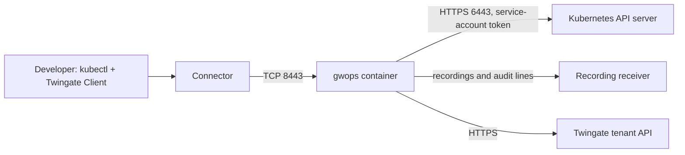

# Developer kubectl access to a cluster

This recipe is for a platform team that gives application developers `kubectl` access to one
cluster through Twingate identity, without handing cluster credentials to laptops. The gateway
holds the cluster credential and proxies every API request. Interactive `exec` and `attach`
sessions are recorded and shipped to a recording receiver, and every API call is shipped as an
HTTP audit line.

## Environment

- One Linux `x86_64` (`linux/amd64`) Docker host with Docker Engine and Compose v2, at
  `10.0.0.20`.
- A Twingate Connector in the Remote Network `Production DC` that reaches the Docker host on TCP
  8443.
- One Kubernetes cluster whose API server, `prod.k8s.internal.example.com:6443`, the Docker host
  reaches directly. You can create a service account in it.
- A recording receiver at `https://recordings.example.com` that implements the
  [recording wire format](../reference/recording-wire-format.md).
- No existing PKI. Outbound HTTPS from the Docker host to the tenant `acme.twingate.com` and the
  receiver.

## What you get

- One Gateway object at `10.0.0.20:8443`, created by gwops, bound to gwops-generated CAs.
- One Twingate Kubernetes resource, `prod`, granted to "App Developers" under the security policy
  "Managed Device Policy" (for example a device-posture policy).
- Developers use `kubectl` with the Twingate Client. The gateway authenticates to the API server
  with its service-account token, so that token's permissions bound what the gateway can do for
  any user. How user identity is presented to the cluster is the gateway's behaviour; see the
  [Twingate documentation](https://www.twingate.com/docs).
- Interactive `kubectl exec` and `kubectl attach` sessions with a TTY are recorded; all API calls
  produce HTTP audit lines. Both ship to the receiver.
- Out of scope: gwops does not create the service account, its RBAC or the token; does not create
  groups or security policies; and serves one cluster per gateway.

## Architecture



A developer's `kubectl` reaches the gateway through the Twingate Client and Connector; the gateway
forwards to the API server with its own service-account token, and gwops ships recordings and
audit lines to the receiver.

## Twingate prerequisites

See the [Twingate documentation](https://www.twingate.com/docs) for each step.

1. The Remote Network `Production DC` and a healthy Connector in it that reaches `10.0.0.20:8443`.
2. The group "App Developers" and the security policy "Managed Device Policy".
3. An API key with read and write access, including resources, certificate authorities and
   gateways.
4. A token for the recording receiver, generated with `openssl rand -hex 32` and configured on the
   receiver.

## Files

### Directory layout

```text
kube-gateway/
  compose.yaml
  .env                  # mode 0600
  seed.yaml
  k8s-creds/            # uid 10001
    prod.token          # 0600
    prod-ca.crt         # 0644
```

### seed.yaml

```yaml
twingate:
  network: acme
  host: twingate.com
  remote_network: Production DC
  gateway_address: 10.0.0.20:8443

k8s_clusters:                       # one cluster per gateway
  - name: prod
    address: prod.k8s.internal.example.com   # no scheme, no port; also the resource address
    port: 6443
    bearer_token_file: /config/k8s-creds/prod.token
    ca_file: /config/k8s-creds/prod-ca.crt
    access:
      groups: ["App Developers"]
      security_policy: "Managed Device Policy"

recording:
  enabled: true
  receiver_url: https://recordings.example.com   # any receiver; gwops POSTs to <url>/ingest

admin_api:
  bind: 0.0.0.0     # reachable through the loopback-only publish in compose.yaml
  port: 8081
```

No `ca` block: gwops generates both CAs. The SSH CA is generated and registered too, but nothing
uses it while the seed has no SSH upstreams.

### .env

```sh
TWINGATE_API_KEY=
# openssl rand -hex 32
GWOPS_ADMIN_TOKEN=
# Bearer token the recording receiver expects.
GWOPS_RECORDING_TOKEN=
```

### compose.yaml

```yaml
services:
  gateway:
    image: ghcr.io/twingate-solutions/gwops:<version>
    pull_policy: missing
    container_name: gwops-gateway
    restart: unless-stopped
    security_opt:
      - "no-new-privileges:true"
    cap_drop:
      - ALL
    read_only: true
    tmpfs:
      - /run/gateway:mode=1777
      - /tmp:mode=1777
    environment:
      TWINGATE_API_KEY: ${TWINGATE_API_KEY:?set TWINGATE_API_KEY in .env}
      GWOPS_ADMIN_TOKEN: ${GWOPS_ADMIN_TOKEN:?set GWOPS_ADMIN_TOKEN in .env}
      GWOPS_RECORDING_TOKEN: ${GWOPS_RECORDING_TOKEN:?set GWOPS_RECORDING_TOKEN in .env}
    volumes:
      - ./seed.yaml:/config/seed.yaml:ro
      - ./k8s-creds:/config/k8s-creds:ro   # the only root gwops reads cluster credentials from
      - gwdata:/data
    ports:
      - "8443:8443"
      - "127.0.0.1:9090:9090"
      - "127.0.0.1:8081:8081"

volumes:
  gwdata:
```

## Deploy

1. [Prepare the cluster credentials](#prepare-the-cluster-credentials).
2. Create the files above. Fill in `.env` and `chmod 0600 .env`.
3. Start the container:

   ```sh
   docker compose up -d
   ```

   On the first pass gwops registers the CAs, creates the Gateway object, copies the credential
   files to `/data/k8s-creds/`, creates the Kubernetes resource and starts the gateway with the
   cluster rendered.
4. Check it:

   ```sh
   export BASE=http://127.0.0.1:8081
   export TOKEN=<admin-token>   # the GWOPS_ADMIN_TOKEN value from .env

   curl -s -H "Authorization: Bearer $TOKEN" $BASE/status | jq '{process: .process.state, tg: .tg, ok: .last_reconcile.ok, errors: .last_reconcile.errors, shipper: .shipper}'
   ```

   A credential file that cannot be read is reported in `last_reconcile.errors` with the path and
   the allowed root `/config/k8s-creds`.

### What developers do

Each developer installs the Twingate Client, signs in, and uses a kubeconfig whose cluster server
is the resource address, `prod.k8s.internal.example.com`. They need no cluster credential of their
own. The [Twingate documentation](https://www.twingate.com/docs) covers the Client and the
kubeconfig setup.

### What is recorded and what is only audited

| Developer action | What ships to the receiver |
| --- | --- |
| `kubectl exec -it` or `kubectl attach -it` (TTY) | Recording lines with the session's terminal output |
| `kubectl get`, `logs`, `apply`, `delete` and other API calls | HTTP audit lines only |
| Each authenticated connection | One `Authenticated connection` line naming the user and groups |

Recordings hold terminal output, not keystrokes, and are not redacted. See
[Session recording](../guides/session-recording.md) for what ships and the
[recording wire format](../reference/recording-wire-format.md) for the line shapes.

### Prepare the cluster credentials

The gateway authenticates to the API server with a bearer token, so the token's permissions bound
what the gateway can do. The Twingate documentation lists the permissions the gateway needs; you
bind them to the service account.

1. Create a namespace, a service account and a long-lived token Secret for it:

   ```sh
   kubectl create namespace twingate-gateway
   kubectl -n twingate-gateway create serviceaccount gateway
   kubectl apply -f - <<'EOF'
   apiVersion: v1
   kind: Secret
   metadata:
     name: gateway-token
     namespace: twingate-gateway
     annotations:
       kubernetes.io/service-account.name: gateway
   type: kubernetes.io/service-account-token
   EOF
   ```

2. Bind the service account to the role the
   [Twingate documentation](https://www.twingate.com/docs) specifies for the gateway.
3. Export the token and the API server's CA certificate:

   ```sh
   mkdir -p k8s-creds
   kubectl -n twingate-gateway get secret gateway-token -o jsonpath='{.data.token}' | base64 -d > k8s-creds/prod.token
   kubectl -n twingate-gateway get secret gateway-token -o jsonpath='{.data.ca\.crt}' | base64 -d > k8s-creds/prod-ca.crt
   sudo chown -R 10001:10001 k8s-creds
   chmod 0600 k8s-creds/prod.token
   chmod 0644 k8s-creds/prod-ca.crt
   ```

A long-lived token is deliberate: every change to the token file makes gwops write a new copy and
drain-restart the gateway, which drops open sessions. See the
[Kubernetes documentation](https://kubernetes.io/docs/) for service-account tokens.

## Verify

### Gateway and resource

```sh
curl -s -H "Authorization: Bearer $TOKEN" $BASE/upstreams/k8s/prod | jq '{kind, tg_resource_id, effective_access, errors}'
docker compose exec gateway ls /data/k8s-creds/
```

- `kind` is `kubernetes`, `tg_resource_id` is set, `errors` is empty, and `effective_access`
  names "App Developers" and "Managed Device Policy".
- `/data/k8s-creds/` holds `prod-token-<sha12>` and `prod-ca-<sha12>.crt`.
- `/status` `process.state` is `running`, `last_reconcile.ok` is `true`, `tg.ok` is `true`.
- On the first pass `last_reconcile.actions` lists `created gateway (<id>) at 10.0.0.20:8443 in
  remote network <id>`, `materialized credential /data/k8s-creds/prod-token-<sha12> for cluster
  'prod'` and `created kubernetes resource 'prod' (<id>)`.

### Recording

- `/status` `shipper.mode` is `spool` and `shipper.shipping` is `true`.
- A developer runs `kubectl get pods`, then `kubectl exec -it <pod> -- sh`, types a command and
  exits. `shipper.pending_lines` rises and drains to 0, and `shipper.last_success_at` advances.
- On the receiver: an HTTP audit line (`logger` `audit`, `message` `API request completed`) for
  `kubectl get pods`, and recording lines (`logger` `session_recording`) for the `exec` session.

### End-user check

A member of "App Developers" on a device that satisfies the policy runs `kubectl get namespaces`
and gets a listing. A user outside the group cannot reach the resource.

## Day 2

- **Token rotation**: rewrite `k8s-creds/prod.token` in place; gwops copies it and drain-restarts
  the gateway on the next pass, or at once with `POST /reconcile`. See
  [Front a Kubernetes API server](../guides/kubernetes.md).
- **Access changes**: change the `access` block, or the group membership on the tenant. gwops never
  changes membership. See [Access control](../guides/access-control.md).
- **Recording**: receiver outages fill the spool (default 256 MiB) and then evict the oldest lines.
  Recording settings are read at startup only. See [Session recording](../guides/session-recording.md).
- **Leaf renewal** is automatic. **Back up `/data`**: see
  [Backup and restore](../operations/backup-and-restore.md).
- **Monitoring**: [Monitoring](../operations/monitoring.md).

## Variations

### More than one cluster

The gateway serves one cluster; a second `k8s_clusters` entry is refused when the config is
rendered. Run one container per cluster. See
[One gateway per remote network or cluster](multiple-remote-networks.md).

### Cluster API only reachable privately (EKS, AKS, GKE private endpoint)

Run the container where it can reach the private endpoint, inside the cloud network next to the
Connector. See [On a cloud VM](cloud-vm.md).

## Related

- [Front a Kubernetes API server](../guides/kubernetes.md)
- [Access control](../guides/access-control.md), [Session recording](../guides/session-recording.md)
- [Use gwops-generated CAs](../guides/private-ca-generated.md),
  [Choose how gwops finds the Gateway object](../guides/gateway-modes.md)
- [Gateway process](../architecture/gateway-process.md),
  [Recording pipeline](../architecture/recording-pipeline.md),
  [Known limitations](../reference/limitations.md)
- Seed reference: [`twingate`](../reference/seed.md#twingate),
  [`k8s_clusters`](../reference/seed.md#k8s_clusters), [`recording`](../reference/seed.md#recording),
  [`admin_api`](../reference/seed.md#admin_api)
