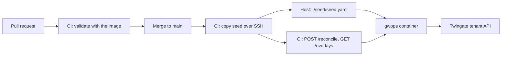

# Seed managed in Git and deployed by CI

For teams that keep the gateway's configuration in a Git repository and want every change to go
through review. A pull request validates the seed against the image's own schema; a merge copies it
to the gateway host, where gwops picks it up within seconds; the pipeline then runs a reconcile pass
and fails if it did not succeed. Nobody edits the seed on the host by hand.

> **Note:** Untested example. The GitHub Actions workflows on this page have not been run by this project. Adapt them to your environment and test them before you rely on them.

## Environment

- One `linux/amd64` Docker host, `10.0.0.20`, with Docker Engine, Compose v2, `curl` and `jq`,
  reachable over SSH from your CI runners.
- A Remote Network `Production DC` with a Connector that reaches the host on TCP 8443.
- A Git repository on GitHub holding the seed and `compose.yaml`. GitHub Actions is the example; any
  CI system that can run `docker` and `ssh` works the same way.
- Secrets in the CI system's secret store: the Twingate API key, the admin token, an SSH deploy key
  and the host's SSH host key. They are written to the host's `.env` at deploy time and never
  committed.
- The host has outbound HTTPS to the tenant (`acme.twingate.com`).

## What you get

- A deployment whose seed is whatever is on the default branch, delivered as a whole file.
- Schema validation on every pull request, using the same gwops code that will load the seed.
- A deploy job that fails when the reconcile pass after the deploy records an error, or when admin
  API changes (overlays) exist that are not in Git.
- Out of scope: gwops does not pull from Git, has no webhook for deploys and does not write the seed
  back. Seed changes are not transactional: a seed that loads but fails on the tenant is applied
  locally and reported, not rolled back.

## Architecture



A pull request is validated with the published image; a merge copies the seed into a directory the
container mounts, gwops reconciles it, and the pipeline gates on the result of a pass it requests.

## Twingate prerequisites

1. The Remote Network `Production DC` and a Connector in it that reaches `10.0.0.20:8443`.
2. The groups and security policies the seed names, here "Platform Engineers" and
   "Privileged Access MFA". gwops never creates them, and the CI check cannot tell whether they
   exist.
3. An API key with read and write access, including resources, certificate authorities and
   gateways, stored as a CI secret.

See the [Twingate documentation](https://www.twingate.com/docs).

## Files

### Directory layout

In the Git repository:

```text
gateway-config/
├── .github/
│   └── workflows/
│       └── gateway.yaml     # validate on pull request, deploy on merge
└── gateway/
    ├── compose.yaml
    ├── ci/
    │   └── gate.sh          # runs on the host after a deploy
    └── seed/
        └── seed.yaml
```

On the gateway host, written by the deploy job:

```text
/opt/gwops/
├── compose.yaml
├── .env                     # 0600, from CI secrets
└── seed/
    └── seed.yaml
```

### seed.yaml

Any seed works. This one fronts three SSH hosts.

```yaml
twingate:
  network: acme
  host: twingate.com
  remote_network: Production DC
  gateway_address: 10.0.0.20:8443
  resource_defaults:
    groups: ["Platform Engineers"]
    security_policy: "Privileged Access MFA"

ssh_upstreams:
  - name: web-1
    address: 10.0.10.5:22
  - name: web-2
    address: 10.0.10.6:22
  - name: db-1
    address: 10.0.10.21:22

admin_api:
  bind: 0.0.0.0   # the gate script calls the API from the host through the loopback-only publish
```

`admin_api.bind: 0.0.0.0` lets the host reach the API through the loopback-only publish; see
[Admin API behind a TLS proxy](../operations/admin-api-behind-tls-proxy.md).

### .env

Written on the host by the deploy job, never committed:

```sh
TWINGATE_API_KEY=<api-key>
GWOPS_ADMIN_TOKEN=<admin-token>
```

### compose.yaml

The shipped file, with the seed mounted as a directory and `GWOPS_SEED_PATH` pointing into it.

```yaml
services:
  gateway:
    image: ghcr.io/twingate-solutions/gwops:<version>
    pull_policy: missing
    container_name: gwops-gateway
    restart: unless-stopped
    security_opt:
      - "no-new-privileges:true"
    cap_drop:
      - ALL
    read_only: true
    tmpfs:
      - /run/gateway:mode=1777
      - /tmp:mode=1777
    environment:
      TWINGATE_API_KEY: ${TWINGATE_API_KEY:?set TWINGATE_API_KEY in .env}
      GWOPS_ADMIN_TOKEN: ${GWOPS_ADMIN_TOKEN:?set GWOPS_ADMIN_TOKEN in .env}
      GWOPS_SEED_PATH: /config/seed/seed.yaml
    volumes:
      - ./seed:/config/seed:ro   # a directory, so a rename-over deploy is visible
      - gwdata:/data
    ports:
      - "8443:8443"
      - "127.0.0.1:9090:9090"
      - "127.0.0.1:8081:8081"

volumes:
  gwdata:
```

Why a directory: the shipped `./seed.yaml:/config/seed.yaml:ro` single-file bind mount keeps pointing
at the file's original inode. A deploy that writes a new file and renames it over the old one
replaces that inode on the host, and the container never sees the new content. With the directory
mounted, gwops watches `/config/seed/` for changes and also compares the seed's content hash every
5 s, so a renamed-in seed is applied within seconds. See
[Configuration model: when changes take effect](../architecture/configuration-model.md#when-changes-take-effect).

### .github/workflows/gateway.yaml

An illustration. Replace `<version>` with the image release you deploy, in both this file and
`compose.yaml`. Secrets: `GATEWAY_SSH_KEY` (a deploy key for the host), `GATEWAY_KNOWN_HOSTS` (the
host's SSH host key line), `TWINGATE_API_KEY`, `GWOPS_ADMIN_TOKEN`. Variable: `GATEWAY_HOST`
(`deploy@10.0.0.20`).

```yaml
name: gateway

on:
  pull_request:
    paths: ["gateway/**"]
  push:
    branches: [main]
    paths: ["gateway/**"]

env:
  GWOPS_IMAGE: ghcr.io/twingate-solutions/gwops:<version>

jobs:
  validate:
    runs-on: ubuntu-latest
    steps:
      - uses: actions/checkout@v4
      - name: Validate the seed with the image's schema
        run: |
          docker run --rm -v "$PWD/gateway/seed:/check:ro" --entrypoint python "$GWOPS_IMAGE" -c '
          import yaml
          from gwops.configmodel.schema import SeedConfig
          SeedConfig.model_validate(yaml.safe_load(open("/check/seed.yaml")))
          print("seed ok")'

  deploy:
    needs: validate
    if: github.event_name == 'push'
    runs-on: ubuntu-latest
    environment: production
    concurrency: gateway-deploy
    env:
      HOST: ${{ vars.GATEWAY_HOST }}
    steps:
      - uses: actions/checkout@v4
      - name: Configure SSH
        env:
          SSH_KEY: ${{ secrets.GATEWAY_SSH_KEY }}
          KNOWN_HOSTS: ${{ secrets.GATEWAY_KNOWN_HOSTS }}
        run: |
          install -m 0700 -d ~/.ssh
          printf '%s\n' "$SSH_KEY" > ~/.ssh/id_ed25519
          chmod 0600 ~/.ssh/id_ed25519
          printf '%s\n' "$KNOWN_HOSTS" > ~/.ssh/known_hosts
      - name: Write .env from the secret store
        env:
          TWINGATE_API_KEY: ${{ secrets.TWINGATE_API_KEY }}
          GWOPS_ADMIN_TOKEN: ${{ secrets.GWOPS_ADMIN_TOKEN }}
        run: |
          printf 'TWINGATE_API_KEY=%s\nGWOPS_ADMIN_TOKEN=%s\n' "$TWINGATE_API_KEY" "$GWOPS_ADMIN_TOKEN" \
            | ssh "$HOST" 'umask 077 && mkdir -p /opt/gwops/seed && cat > /opt/gwops/.env.new && mv /opt/gwops/.env.new /opt/gwops/.env'
      - name: Copy compose.yaml and the seed, then apply
        run: |
          scp gateway/compose.yaml "$HOST:/opt/gwops/compose.yaml"
          scp gateway/seed/seed.yaml "$HOST:/opt/gwops/seed/.seed.yaml.new"
          ssh "$HOST" 'cd /opt/gwops && mv seed/.seed.yaml.new seed/seed.yaml && docker compose pull --quiet gateway && docker compose up -d'
      - name: Gate on the reconcile result
        run: ssh "$HOST" sh -s < gateway/ci/gate.sh
```

The seed is written under a temporary name in the same directory and renamed into place, so gwops
never reads a half-copied file. `docker compose up -d` recreates the container only when
`compose.yaml` or `.env` changed (a new image version, a rotated secret); a seed-only change leaves
the container running and gwops applies it in place.

### gateway/ci/gate.sh

Runs on the host, reads the admin token from `.env`, and fails the job when the pass after the
deploy has errors or when overlays exist.

```sh
#!/bin/sh
set -eu
cd /opt/gwops
BASE=http://127.0.0.1:8081
TOKEN=$(sed -n 's/^GWOPS_ADMIN_TOKEN=//p' .env)

# Wait until the admin API answers at all (it may have just been recreated).
i=0
until [ "$(curl -s -o /dev/null -w '%{http_code}' "$BASE/healthz")" != "000" ]; do
  i=$((i + 1))
  if [ "$i" -ge 36 ]; then echo "admin API did not come up"; exit 1; fi
  sleep 5
done

# Run a pass now. If one is already running, this waits for a follow-up pass that reads the
# current seed, so the result always reflects the file just deployed.
result=$(curl -fsS --max-time 300 -X POST -H "Authorization: Bearer $TOKEN" "$BASE/reconcile")
echo "$result" | jq '{ok, local_ok, actions, errors}'
echo "$result" | jq -e '.ok == true' > /dev/null

# Policy: everything lives in Git. Any admin overlay is drift.
drift=$(curl -fsS -H "Authorization: Bearer $TOKEN" "$BASE/overlays" | jq '[.[] | select(.origin == "admin")] | length')
if [ "$drift" -ne 0 ]; then
  echo "$drift admin overlay(s) on the gateway are not in Git"
  exit 1
fi
```

`ok` is `false` whenever the pass recorded any error, including a short tenant outage. To fail the
deploy only on local problems (a seed that does not load, a missing credential file, a refused
config), test `.local_ok == true` instead and alert on `ok` separately.

## Deploy

### Validate in CI

The `validate` job loads the seed with `SeedConfig` from the published image, without starting
anything. The image carries gwops and PyYAML in its Python environment, and `--entrypoint python`
replaces the normal `python -m gwops` entrypoint. The container runs as uid 10001, so the seed must
be readable by others (`0644`, the checkout default).

What the check covers:

- Unknown keys, types, ranges and name formats.
- The cross-key rules: exactly one gateway mode, `gateway_address` with a port, `public_tls` and
  `ca.x509` not both set, public-mode name coverage, `recording.enabled: true` with
  `recording.receiver_url`.

What it cannot cover, because it needs the host, the tenant or the running process:

- Files the seed names exist and are readable: CA files, Kubernetes credentials, CA bundles, public
  certificate files, the ACME token file.
- Names on the tenant: the Remote Network, groups and security policies.
- The web-app policy, which gwops checks at startup and on every pass.
- A second `k8s_clusters` entry, refused only when the gateway config is rendered.
- The automation-token startup rules (both allowlists present, token different from the admin
  token), which depend on the environment.
- Whether the gateway binary accepts the rendered config (the pre-flight).

The gate after the deploy catches all of these except a startup abort, which shows as the admin API
never answering.

### Steps

1. Prepare the host once: create `/opt/gwops`, a `deploy` user that may run `docker compose`, and
   authorise the deploy key.
2. Add the secrets and the `GATEWAY_HOST` variable in the CI system. Set up the `production`
   environment with required reviewers if merges should wait for approval.
3. Commit `gateway/compose.yaml`, `gateway/seed/seed.yaml`, `gateway/ci/gate.sh` and the workflow.
4. Open a pull request. The `validate` job runs.
5. Merge. The `deploy` job writes `.env`, copies the files, runs `docker compose up -d` (the first
   run creates the container) and runs the gate.
6. Read the gate's output in the job log: `ok`, `actions` and `errors` of the pass.

### Gate on /status

Besides the gate, poll `/status` for drift between deploys. The fields that matter for this
recipe:

```sh
export BASE=http://127.0.0.1:8081
export TOKEN=<admin-token>   # the GWOPS_ADMIN_TOKEN value from .env

curl -s -H "Authorization: Bearer $TOKEN" $BASE/status | jq '{state_error, last_reconcile: {trigger: .last_reconcile.trigger, ok: .last_reconcile.ok, errors: .last_reconcile.errors}, tg: .tg.ok}'
```

- `state_error` is `null`. A seed that stops loading after startup sets it, and the gateway keeps
  running its last good config.
- `last_reconcile.trigger` is `seed-change` after a seed-only deploy picked up by the watch or poll,
  `api` after the gate's pass.

See [Monitoring](../operations/monitoring.md) for the full alert list.

### Overlays and drift

Overlays are admin API changes stored under `/data/overlays/`. They merge over the seed, and the
last layer wins, so an overlay silently overrides whatever Git says for the fields it sets. A GitOps
deployment picks one of two policies:

- **Forbid admin API writes.** Keep the admin token in the CI secret store only. The gate fails if
  an admin overlay appears.
- **Fold changes back into Git.** When someone makes an emergency change through the API, copy the
  effective state into a pull request, merge and deploy it, and only then delete the overlays:

  ```sh
  curl -s -H "Authorization: Bearer $TOKEN" $BASE/state | jq '{state, provenance}'
  curl -s -H "Authorization: Bearer $TOKEN" $BASE/overlays | jq -r '.[] | select(.origin == "admin") | .id'
  curl -s -X DELETE -H "Authorization: Bearer $TOKEN" $BASE/overlays/<id>
  ```

  Delete them after the seed carries the change. Deleting an overlay first removes what it declared
  from the effective state, and gwops deletes the matching tenant resources; the next deploy then
  creates them again with new ids.

`provenance` names the layer that last set each field, so `"0003-..."` entries show what is not in
Git. Overlays may set only `ssh_upstreams`, `k8s_clusters`, `web_apps` and `recording`; the rest of
the seed cannot drift this way. See
[Configuration model: overlays](../architecture/configuration-model.md#overlays).

## Verify

- **Pull request.** The `validate` job prints `seed ok`. Change a key to an unknown name and the job
  fails with the key's path.
- **Deploy.** The gate prints `"ok": true`. On a change that adds a host, `actions` contains
  `created ssh resource '<name>' (<id>)` and `minted TLS leaf (...)`.
- **Pick-up without the gate.** `docker compose logs --no-log-prefix gateway | grep watch.seed_changed`
  shows one `watch.seed_changed` line per deploy, with `source` `watch` or `poll`.
- **No drift.** `GET /overlays` returns no `admin` entries.
- **End user.** A member of "Platform Engineers" runs `ssh <user>@10.0.10.5` through the Twingate
  Client.

## Day 2

- **Changes**: every change is a pull request; nothing else changes the seed.
- **Rotate secrets**: update the CI secret and re-run the deploy job. A changed `.env` recreates the
  container, which drain-restarts the gateway.
- **Upgrade**: change `<version>` in the workflow and `compose.yaml` in one pull request, so the
  check runs with the schema of the version you deploy. See
  [Upgrades and pins](../operations/upgrades-and-pins.md).
- **A failed gate**: read `errors`; see [Troubleshooting](../operations/troubleshooting.md). Revert
  the merge to roll back; the next deploy applies the previous seed.
- **Backups**: `/data` still holds CAs and the ownership registry, which Git does not. See
  [Backup and restore](../operations/backup-and-restore.md).

## Variations

### Webhook-driven upstreams alongside

Automation-token entries are overlays too, with `origin: "automation"`. The gate above counts only
`admin` overlays, so it tolerates them. See
[Upstreams that register themselves](self-registering-upstreams.md).

### Pull instead of push

Instead of CI pushing over SSH, a timer on the host can run `git pull` in a clone and copy the seed
into `./seed/` under a temporary name and rename it. Validate before copying, with the same
`docker run` command, and run the gate script after.

### Trusted pipeline writes overlays

To apply upstream changes transactionally (kept only if the tenant confirms them), a pipeline can
call `POST /overlays` with the admin token instead of deploying the seed. See
[Automation and CI: Pattern B](../guides/automation-and-ci.md#pattern-b-a-trusted-pipeline-with-the-admin-token).

## Related

- [Automation and CI](../guides/automation-and-ci.md)
- [Access control](../guides/access-control.md): allowlists that bound admin API writes.
- [Configuration model](../architecture/configuration-model.md): seed, overlays, merge rules and
  change detection.
- [Monitoring](../operations/monitoring.md), [Troubleshooting](../operations/troubleshooting.md)
- [Admin API reference: `POST /reconcile`](../reference/admin-api.md#post-reconcile),
  [`GET /overlays`](../reference/admin-api.md#get-overlays)
- [Environment reference](../reference/environment.md): `GWOPS_SEED_PATH`.
