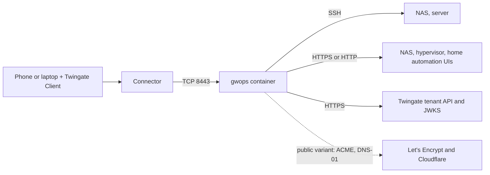

# Homelab or small office

This recipe is for one small machine (a mini PC, a NUC, or a VM on a home hypervisor) that fronts a
few SSH hosts and the web interfaces of a NAS, a hypervisor and a home automation system for a
handful of people. It comes in two variants: a private CA that you install on each person's
devices, or a Let's Encrypt certificate for a domain on Cloudflare that every browser already
trusts. The seed stays small, and the deployment is kept running with a restart policy and backups.

> **Note:** Untested example. The backup command on this page has not been run by this project. Adapt it to your environment and test it before you rely on it.

## Environment

- One x86-64 machine running Linux with Docker Engine and Docker Compose v2, at `10.0.0.20` on the
  LAN. The image is `linux/amd64` only; see [Hardware](#hardware).
- A Twingate Connector in the Remote Network "Home" that reaches `10.0.0.20` on TCP 8443. The
  Connector can run on the same machine; see the
  [Twingate documentation](https://www.twingate.com/docs) for deploying one.
- Two SSH hosts: the NAS at `10.0.0.30` and a server at `10.0.0.31`, both on port 22.
- Three web interfaces:
  - the NAS, HTTPS on port 5001 with a self-signed certificate;
  - the hypervisor console, HTTPS on port 8006 with a certificate from the hypervisor's own CA;
  - home automation, plain HTTP on port 8123.
- Names under `home.example.com` for every device. The recipe pins them in `compose.yaml`, so no
  local DNS is needed.
- For the public variant only: the domain `example.com` on Cloudflare.
- The machine's clock is synced over NTP.

## What you get

- Two SSH resources and three web-app resources, attached to a Gateway object that gwops creates in
  remote-network mode.
- **Private variant:** gwops-generated X.509 and SSH CAs. Each person installs the X.509 CA on the
  devices they open the web interfaces from.
- **Public variant:** a Let's Encrypt wildcard for `*.home.example.com` that gwops issues and
  renews. Browsers trust it with no install. The SSH CA is still generated by gwops.
- Access for the group "Platform Engineers" (call yours what you like; it must exist on the
  tenant).
- Nothing recorded.

Out of scope: ARM hardware, and any DNS provider other than Cloudflare for the public variant.
gwops never creates the group, the Remote Network or the Connector.

## Architecture



People reach the gateway through the Connector, and the gateway fronts the SSH hosts and the web
interfaces on the LAN. In the public variant gwops also talks to Let's Encrypt and Cloudflare.

### Hardware

- The published image is built for `linux/amd64` only. It does not run on a Raspberry Pi or other
  ARM boards, or on Apple Silicon Macs without emulation.
- Any small x86-64 machine or VM works. A VM on a home hypervisor needs a bridged or routed network
  so the Connector can reach its port 8443 and the VM can reach the devices it fronts.

## Twingate prerequisites

Create these first. See the [Twingate documentation](https://www.twingate.com/docs).

1. The Remote Network "Home" with a healthy Connector that reaches `10.0.0.20:8443`.
2. The group "Platform Engineers", with the people who get access as members.
3. An API key with read and write access, including resources, certificate authorities and
   gateways.

Public variant, on Cloudflare (see the [Cloudflare documentation](https://developers.cloudflare.com/)):
an API token with `Zone:Read` and `DNS:Edit` on `example.com` only.

## Files

### Directory layout

```text
gwops/
├── compose.yaml
├── .env
├── seed.yaml
├── webapp-cas/
│   └── hypervisor-ca.pem   # the hypervisor's CA certificate, owner 10001, mode 0644
└── acme/                   # public variant only
    └── cloudflare-token    # owner 10001, mode 0400
```

### seed.yaml (private variant)

```yaml
twingate:
  network: acme
  host: twingate.com
  remote_network: Home
  gateway_address: 10.0.0.20:8443        # this machine as the Connector reaches it
  resource_defaults:
    groups: ["Platform Engineers"]

ssh_upstreams:
  - name: nas
    address: nas.home.example.com
  - name: server
    address: server.home.example.com

web_app_proxy:
  upstream_ca_bundles:
    - name: hypervisor-ca
      file: /config/webapp-cas/hypervisor-ca.pem
  plaintext_upstreams:                   # the only hosts allowed upstream_tls none or insecure
    dns_suffixes: ["nas-ui.home.example.com", "ha.home.example.com"]

web_apps:
  - name: nas-ui
    address: nas-ui.home.example.com:5001
    upstream_tls: insecure               # self-signed certificate; not verified
  - name: hypervisor
    address: hypervisor.home.example.com:8006
    upstream_tls: verify_ca              # chain checked against hypervisor-ca, host name not
  - name: home-automation
    address: ha.home.example.com:8123
    upstream_tls: none                   # plain HTTP on the LAN

admin_api:
  bind: 0.0.0.0                          # reachable through the loopback-only publish below
  port: 8081
```

### seed.yaml (public variant)

```yaml
twingate:
  network: acme
  host: twingate.com
  remote_network: Home
  gateway_address: 10.0.0.20:8443
  resource_defaults:
    groups: ["Platform Engineers"]

# No ca.x509 block: public_tls replaces it. Every served name, SSH addresses included,
# must be a DNS name inside the zone and covered by the certificate.
public_tls:
  zones: ["example.com"]
  registered_root: isrg_root_x1
  acme:
    email: you@example.com
    accept_tos: true
    directory: staging                   # dry run first; change to production in Deploy step 6
    token_file: /config/acme/cloudflare-token
  certificates:
    - name: home-wildcard
      names: ["*.home.example.com"]
      source: acme

ssh_upstreams:
  - name: nas
    address: nas.home.example.com
  - name: server
    address: server.home.example.com

web_app_proxy:
  upstream_ca_bundles:
    - name: hypervisor-ca
      file: /config/webapp-cas/hypervisor-ca.pem
  plaintext_upstreams:
    dns_suffixes: ["nas-ui.home.example.com", "ha.home.example.com"]

web_apps:
  - name: nas-ui
    address: nas-ui.home.example.com:5001
    upstream_tls: insecure
  - name: hypervisor
    address: hypervisor.home.example.com:8006
    upstream_tls: verify_ca
  - name: home-automation
    address: ha.home.example.com:8123
    upstream_tls: none

admin_api:
  bind: 0.0.0.0
  port: 8081
```

The NAS has two names: `nas.home.example.com` for SSH and `nas-ui.home.example.com` for its web
interface, so its SSH resource and its web-app resource have different addresses on the tenant.
Both names point at `10.0.0.30` in `compose.yaml`.

`admin_api.bind: 0.0.0.0` lets `curl` on the machine reach the admin API through the
loopback-only publish; see [Admin API behind a TLS proxy](../operations/admin-api-behind-tls-proxy.md).

### .env

```sh
# Twingate API key: read and write, including resources, certificate authorities and gateways.
TWINGATE_API_KEY=<twingate-api-key>
# Admin API bearer token. Generate with: openssl rand -hex 32
GWOPS_ADMIN_TOKEN=<admin-token>
```

### compose.yaml (private variant)

```yaml
services:
  gateway:
    image: ghcr.io/twingate-solutions/gwops:<version>
    pull_policy: missing
    container_name: gwops-gateway
    restart: unless-stopped                # comes back after a reboot or a crash
    security_opt:
      - "no-new-privileges:true"
    cap_drop:
      - ALL
    read_only: true
    tmpfs:
      - /run/gateway:mode=1777
      - /tmp:mode=1777
    environment:
      TWINGATE_API_KEY: ${TWINGATE_API_KEY:?set TWINGATE_API_KEY in .env}
      GWOPS_ADMIN_TOKEN: ${GWOPS_ADMIN_TOKEN:?set GWOPS_ADMIN_TOKEN in .env}
    extra_hosts:                           # the gateway dials these names itself
      - "nas.home.example.com:10.0.0.30"
      - "nas-ui.home.example.com:10.0.0.30"
      - "server.home.example.com:10.0.0.31"
      - "hypervisor.home.example.com:10.0.0.40"
      - "ha.home.example.com:10.0.0.50"
    volumes:
      - ./seed.yaml:/config/seed.yaml:ro
      - gwdata:/data
      - ./webapp-cas:/config/webapp-cas:ro
    ports:
      - "8443:8443"              # gateway listener; the Connector must reach it
      - "127.0.0.1:9090:9090"    # gateway metrics, host loopback only
      - "127.0.0.1:8081:8081"    # gwops admin API, host loopback only

volumes:
  gwdata:
```

### compose.yaml (public variant)

```yaml
services:
  gateway:
    image: ghcr.io/twingate-solutions/gwops:<version>
    pull_policy: missing
    container_name: gwops-gateway
    restart: unless-stopped
    security_opt:
      - "no-new-privileges:true"
    cap_drop:
      - ALL
    read_only: true
    tmpfs:
      - /run/gateway:mode=1777
      - /tmp:mode=1777
    environment:
      TWINGATE_API_KEY: ${TWINGATE_API_KEY:?set TWINGATE_API_KEY in .env}
      GWOPS_ADMIN_TOKEN: ${GWOPS_ADMIN_TOKEN:?set GWOPS_ADMIN_TOKEN in .env}
    # Public resolvers, so the ACME check sees Cloudflare's records even when a LAN DNS
    # server (Pi-hole, router) answers for home.example.com itself.
    dns: [1.1.1.1, 1.0.0.1]
    extra_hosts:
      - "nas.home.example.com:10.0.0.30"
      - "nas-ui.home.example.com:10.0.0.30"
      - "server.home.example.com:10.0.0.31"
      - "hypervisor.home.example.com:10.0.0.40"
      - "ha.home.example.com:10.0.0.50"
    volumes:
      - ./seed.yaml:/config/seed.yaml:ro
      - gwdata:/data                       # also holds the ACME account and renewal state
      - ./webapp-cas:/config/webapp-cas:ro
      - ./acme:/config/acme:ro
    ports:
      - "8443:8443"
      - "127.0.0.1:9090:9090"
      - "127.0.0.1:8081:8081"

volumes:
  gwdata:
```

Replace `<version>` with a published version tag. `:latest` changes only when a maintainer opts
in, so a pinned tag is also the easiest way to know what you run.

### Mounted files

- `webapp-cas/hypervisor-ca.pem`: the hypervisor's CA certificate, as PEM. It must be a CA
  certificate (`CA:TRUE`) and in date, with no private key and no other text in the file. Export
  it from the hypervisor.
- `acme/cloudflare-token` (public variant): the Cloudflare token as the only content of the file.

## Deploy

1. Create the directory and the files for your variant. Set ownership:

   ```sh
   sudo chown -R 10001:10001 webapp-cas
   chmod 0644 webapp-cas/hypervisor-ca.pem
   ```

2. Public variant only: write the token.

   ```sh
   mkdir -p acme
   read -rs token && printf '%s' "$token" > acme/cloudflare-token && unset token
   sudo chown 10001:10001 acme/cloudflare-token
   chmod 0400 acme/cloudflare-token
   ```

3. Start the container:

   ```sh
   docker compose up -d
   docker compose logs -f gateway
   ```

   Wait for `reconcile.completed` with `"ok": true`, then press Ctrl+C. In the public variant the
   gateway process stays stopped, and the container unhealthy, until step 6.
4. Read the status:

   ```sh
   BASE=http://127.0.0.1:8081
   TOKEN=<admin-token>   # the GWOPS_ADMIN_TOKEN value from .env

   curl -s -H "Authorization: Bearer $TOKEN" $BASE/status | jq '{process: .process.state, ok: .last_reconcile.ok, tg: .tg.ok, mode: .tls.mode}'
   ```

   Private variant: expect `running`, `true`, `true` and `static`.
5. Install the SSH CA on the NAS and the server:

   ```sh
   docker compose exec gateway cat /data/pki/ssh-ca.key.pub > twingate-gateway-ssh-ca.pub
   ```

   On each host, save it as `/etc/ssh/twingate-gateway-ssh-ca.pub`, add
   `TrustedUserCAKeys /etc/ssh/twingate-gateway-ssh-ca.pub` to `/etc/ssh/sshd_config` and reload
   `sshd`. See [SSH resources](../guides/ssh-resources.md#trust-the-ssh-ca-on-each-target). A NAS
   whose SSH configuration is managed by its own interface may not allow this; check its
   documentation.
6. **Private variant:** install the X.509 CA on each device that opens the web interfaces:

   ```sh
   docker compose exec gateway cat /data/pki/x509-ca.crt > gwops-x509-ca.crt
   ```

   Import `gwops-x509-ca.crt` as a trusted root on each phone and laptop. See
   [Use gwops-generated CAs](../guides/private-ca-generated.md#trust-the-x509-ca-in-browsers-web-apps-only).

   **Public variant:** wait for the staging dry run, then switch to production:

   ```sh
   curl -s -H "Authorization: Bearer $TOKEN" $BASE/status | jq '.certs.public[] | {name, state, acme: .acme.state, error: .acme.error_code}'
   ```

   When `acme` is `dry_run_ok`, change `directory: staging` to `directory: production` in
   `seed.yaml` and save. Once the certificate is installed the gateway starts. If the save is not
   picked up within a minute, run `docker compose restart gateway`: an editor that renames a new
   file over `seed.yaml` is not seen through the single-file mount. See
   [Issue public certificates with ACME](../guides/public-certs-acme.md).

### Appliances with self-signed certificates

The gateway verifies each web interface according to its `upstream_tls`:

| The device serves | Use | Needs |
| --- | --- | --- |
| A certificate from a CA you can export (`CA:TRUE`) | `verify_full` if the certificate names the address you use, else `verify_ca` | The CA in `web_app_proxy.upstream_ca_bundles` |
| A self-signed certificate that is not a CA | `insecure` | The name in `web_app_proxy.plaintext_upstreams` |
| Plain HTTP | `none` | The name in `web_app_proxy.plaintext_upstreams` |

Every mode that uses TLS, `insecure` included, needs TLS 1.3 from the device. An older appliance
that only offers TLS 1.2 fails with `502`. If it also serves plain HTTP, point the entry at that
port with `upstream_tls: none`. The modes are covered in
[Web-app upstream TLS](../guides/web-apps-upstream-tls.md).

`verify_ca`, `insecure` and `none` each show in `/status` `web_apps.warnings`. That is a reminder,
not an error.

### Keep it running

- `restart: unless-stopped` brings the container back after a reboot or a crash. Make sure Docker
  itself starts at boot (for systemd, `sudo systemctl enable docker`).
- Everything gwops must remember is on the `gwdata` volume: the CA keys, the record of the tenant
  objects it created, and, in the public variant, the ACME account. Back it up; see
  [Keep the data](#keep-the-data).

## Verify

```sh
curl -s -H "Authorization: Bearer $TOKEN" $BASE/status | jq '{leaf: .certs.leaf_state, public: [.certs.public[]? | {name, state}], warnings: .web_apps.warnings, readiness: [.web_apps.readiness[] | {name, state, reasons}]}'
```

- **Resources:** the first pass's `last_reconcile.actions` lists `created gateway (<id>) at
  10.0.0.20:8443 in remote network <id>`, `created ssh resource 'nas' (<id>)` and one line for each
  other entry.
- **Private variant:** `certs.leaf_state` is `ok`, every app is `ready`, and each carries
  `operator_action` (a reminder that the CA must be installed on devices; it stays after you do).
- **Public variant:** `home-wildcard` is `ok`, `tls.mode` is `public` and
  `certs.registered_root.bound` is `true`.
- **Warnings:** `web_apps.warnings` names `nas-ui` (`insecure`), `hypervisor` (`verify_ca`) and
  `home-automation` (`none`).
- **From a phone:** with the Twingate Client signed in as a member of "Platform Engineers", open
  `https://ha.home.example.com` and `https://hypervisor.home.example.com`. Both load with no
  certificate warning. `ssh <user>@nas.home.example.com` reaches the NAS.

### Keep the data

```sh
docker compose stop gateway
docker compose run --rm -T --no-deps --entrypoint tar gateway -C /data -czf - . > gwdata-$(date +%Y%m%d).tgz
docker compose start gateway
```

Keep the archive somewhere other than this machine, and keep it private: it holds the CA keys.
Restoring is in [Backup and restore](../operations/backup-and-restore.md).

## Day 2

- **Add a device:** add an `extra_hosts` line and a `ssh_upstreams` or `web_apps` entry, then
  `docker compose up -d`. In the public variant the wildcard covers any new name directly under
  `home.example.com`.
- **Certificates:** the gwops leaf (private variant) and the Let's Encrypt certificate (public
  variant) renew themselves and hot-reload. A renewed hypervisor CA needs a new
  `hypervisor-ca.pem`; rewrite the file and run
  `curl -s -X POST -H "Authorization: Bearer $TOKEN" $BASE/reconcile`.
- **Back up** after the first start and after every change; see [Keep the data](#keep-the-data).
- **Upgrade:** change `<version>`, then `docker compose pull && docker compose up -d`. Back up
  first. See [Upgrades and pins](../operations/upgrades-and-pins.md).
- **Health:** `docker compose ps` shows `(healthy)` while the gateway runs and the last pass had
  no local failure. Tenant problems show only in `/status`. See [Monitoring](../operations/monitoring.md).

## Variations

### Local DNS instead of `extra_hosts`

If a LAN DNS server answers for `home.example.com`, the private variant can drop the
`extra_hosts` lines and use it. In the public variant the LAN server must also forward the
`_acme-challenge` name to a public resolver, and the `dns` line then points at the LAN server; see
[Split-horizon DNS](../guides/public-certs-acme.md#split-horizon-dns).

### A dedicated challenge zone

Scope the Cloudflare token to a zone that holds nothing else and point `_acme-challenge` there with
a CNAME, so a leaked token cannot edit your main zone. See
[Production hardening](../guides/public-certs-acme.md#production-hardening).

### Private CA and public certificates together

One container serves one certificate mode. For both, run two containers; see
[Private and public gateways on one host](private-and-public-gateways-one-host.md).

### Record SSH sessions

Turn on recording and run a small receiver beside the gateway. See
[Session recording](../guides/session-recording.md).

## Related

- Guides: [Gateway modes](../guides/gateway-modes.md),
  [Use gwops-generated CAs](../guides/private-ca-generated.md),
  [Issue public certificates with ACME](../guides/public-certs-acme.md),
  [SSH resources](../guides/ssh-resources.md), [Web apps](../guides/web-apps.md),
  [Web-app upstream TLS](../guides/web-apps-upstream-tls.md)
- Operations: [Backup and restore](../operations/backup-and-restore.md),
  [Upgrades and pins](../operations/upgrades-and-pins.md), [Monitoring](../operations/monitoring.md)
- Reference: [Image: published image](../reference/image.md#published-image),
  [Known limitations](../reference/limitations.md)
