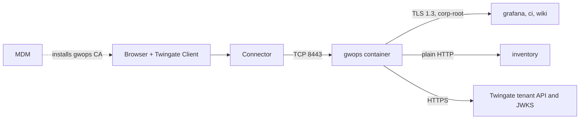

# Internal web apps for managed devices

This recipe is for IT and platform teams who publish internal HTTP and HTTPS apps (dashboards, a
wiki, a CI server, an older inventory tool) to employees on devices that a device management (MDM)
tool controls. The gateway fronts every app as a layer 7 proxy, serves it to the browser with a
leaf signed by a gwops-generated CA that IT installs on the devices, and passes each user's
identity to the apps as headers or as a signed access token.

## Environment

- One Linux `amd64` host with Docker Engine and Docker Compose v2, at `10.0.0.20` on the internal
  network. The image is `linux/amd64` only.
- A Twingate Connector in the Remote Network "Production DC" that reaches `10.0.0.20` on TCP 8443.
- Internal DNS that resolves `*.internal.example.com` to the apps. The Docker host uses it, so the
  container does too.
- Four apps:
  - `grafana.internal.example.com:3000` and `ci.internal.example.com:8443`: HTTPS with
    certificates from the internal CA "corp-root". The dashboards app can verify a JWT.
  - `wiki.internal.example.com`: HTTPS on 443 with a corp-root certificate. It supports
    trusted-header login and is reachable only from the gateway host.
  - `inventory.lab.internal.example.com:8080`: plain HTTP on a lab segment.
- Every upstream that speaks TLS offers TLS 1.3.
- The corp-root CA certificate is available as PEM.
- An MDM tool that can push a trusted root certificate to every device. Pushing it is your MDM
  tool's job, not gwops'.
- The host clock is synced over NTP.

## What you get

- Four Twingate web-app resources, attached to a Gateway object that gwops creates in
  remote-network mode.
- Private CA mode with gwops-generated X.509 and SSH CAs. The X.509 CA signs the leaf that browsers
  see. The Twingate Client trusts the gateway through the CA gwops registers on the tenant.
- Access: every app for the group "App Users"; the CI server for "Platform Engineers" only.
- Identity: every app receives `X-Twingate-User` and `X-Twingate-Groups`; the dashboards app also
  receives the signed access token in `Authorization`.
- An upstream TLS probe that reports a broken upstream certificate before users do.
- Nothing is recorded. Web-app traffic is never session-recorded; turn on
  [session recording](../guides/session-recording.md) to ship HTTP audit lines.

Out of scope: installing the CA on devices, and access from unmanaged devices (see
[Variations](#variations)).

## Architecture



The browser reaches the gateway through the Connector, the gateway verifies the three HTTPS apps
against the corp-root bundle and reaches the inventory app over plain HTTP, and the MDM tool puts
the gwops CA into each device's trust store.

## Twingate prerequisites

Create these on the tenant first. gwops assigns groups and policies but never creates them, and it
never creates Remote Networks or Connectors. See the
[Twingate documentation](https://www.twingate.com/docs).

1. The Remote Network "Production DC" with a healthy Connector that reaches `10.0.0.20:8443`.
2. The groups "App Users" and "Platform Engineers". Each name must match exactly one group.
3. Optionally a security policy for the apps. This recipe leaves policies unmanaged.
4. An API key with read and write access, including resources, certificate authorities and
   gateways.

gwops creates the Gateway object, registers its two CAs and creates the four web-app resources.

## Files

### Directory layout

```text
gwops/
├── compose.yaml
├── .env
├── seed.yaml
└── webapp-cas/
    └── corp-root.pem     # corp-root CA certificate(s), PEM, owner 10001, mode 0644
```

### seed.yaml

```yaml
twingate:
  network: acme
  host: twingate.com
  remote_network: Production DC
  gateway_address: 10.0.0.20:8443        # the Docker host as the Connector reaches it
  resource_defaults:
    groups: ["App Users"]                # every resource, unless its own access says otherwise

web_app_proxy:
  # Sent to every web app. Templates using username or groups make these trusted names:
  # no app's own request_headers may set them.
  request_headers:
    X-Twingate-User: "{{username}}"
    X-Twingate-Groups: "{{groups}}"
  upstream_ca_bundles:
    - name: corp-root
      file: /config/webapp-cas/corp-root.pem
  plaintext_upstreams:                   # the only hosts allowed upstream_tls none or insecure
    dns_suffixes: ["lab.internal.example.com"]
  upstream_tls_probe: true               # TLS 1.3 handshake check of verify_full/verify_ca upstreams

web_apps:
  - name: dashboards
    address: grafana.internal.example.com:3000
    upstream_tls: verify_full            # required for {{jwt}} to a non-loopback upstream
    request_headers:
      Authorization: "Bearer {{jwt}}"    # the app verifies this token
  - name: wiki
    address: wiki.internal.example.com
    alias: kb.internal.example.com       # a second name users can open
    upstream_tls: verify_full
  - name: ci
    address: ci.internal.example.com:8443
    upstream_tls: verify_full
    access:
      groups: ["Platform Engineers"]     # replaces the default group for this app
  - name: inventory
    address: inventory.lab.internal.example.com:8080
    upstream_tls: none                   # allowed only by plaintext_upstreams above

admin_api:
  bind: 0.0.0.0                          # reachable through the loopback-only publish below
  port: 8081
```

`admin_api.bind: 0.0.0.0` lets `curl` on the Docker host reach the admin API. The default,
`127.0.0.1`, is the container's own loopback, which the published port never reaches. The port
is still published on the host's loopback only; see
[Admin API behind a TLS proxy](../operations/admin-api-behind-tls-proxy.md).

### .env

```sh
# Twingate API key: read and write, including resources, certificate authorities and gateways.
TWINGATE_API_KEY=<twingate-api-key>
# Admin API bearer token. Generate with: openssl rand -hex 32
GWOPS_ADMIN_TOKEN=<admin-token>
```

### compose.yaml

```yaml
services:
  gateway:
    image: ghcr.io/twingate-solutions/gwops:<version>
    pull_policy: missing
    container_name: gwops-gateway
    restart: unless-stopped
    security_opt:
      - "no-new-privileges:true"
    cap_drop:
      - ALL
    read_only: true
    tmpfs:
      - /run/gateway:mode=1777
      - /tmp:mode=1777
    environment:
      TWINGATE_API_KEY: ${TWINGATE_API_KEY:?set TWINGATE_API_KEY in .env}
      GWOPS_ADMIN_TOKEN: ${GWOPS_ADMIN_TOKEN:?set GWOPS_ADMIN_TOKEN in .env}
    volumes:
      - ./seed.yaml:/config/seed.yaml:ro
      - gwdata:/data
      - ./webapp-cas:/config/webapp-cas:ro
    ports:
      - "8443:8443"              # gateway listener; the Connector must reach it
      - "127.0.0.1:9090:9090"    # gateway metrics, host loopback only
      - "127.0.0.1:8081:8081"    # gwops admin API, host loopback only

volumes:
  gwdata:
```

Replace `<version>` with a published version tag. Do not use `:latest` for a production deployment.

### webapp-cas/corp-root.pem

The corp-root CA certificate, plus any intermediate CA that issues the apps' certificates. The
file holds `CERTIFICATE` blocks only, with no private key and no text outside the blocks. Each
certificate must be a CA (`CA:TRUE`) and in date. Owner uid 10001, mode 0644, at most 1 MiB. The
rules are in [Web-app upstream TLS](../guides/web-apps-upstream-tls.md#trust-a-private-upstream-ca).

## Deploy

1. Create the directory and the four files above. Set the owner of the bundle:

   ```sh
   sudo chown -R 10001:10001 webapp-cas
   chmod 0644 webapp-cas/corp-root.pem
   ```

2. Check that each app name resolves on the Docker host to the address the gateway should dial.
   The gateway resolves each `address` through the container's resolver and has no separate
   upstream IP setting; see [Web apps](../guides/web-apps.md#make-the-address-resolve-inside-the-container).
3. Start the container:

   ```sh
   docker compose up -d
   docker compose logs -f gateway
   ```

   Wait for `reconcile.completed` with `"ok": true`, then press Ctrl+C.
4. Check that the names resolve inside the container:

   ```sh
   docker compose exec gateway getent hosts grafana.internal.example.com wiki.internal.example.com
   ```

5. Read the first status:

   ```sh
   BASE=http://127.0.0.1:8081
   TOKEN=<admin-token>   # the GWOPS_ADMIN_TOKEN value from .env

   curl -s -H "Authorization: Bearer $TOKEN" $BASE/status | jq '{process: .process.state, ok: .last_reconcile.ok, tg: .tg.ok, leaf: .certs.leaf_state, mode: .tls.mode}'
   ```

   Expect `running`, `true`, `true`, `ok` and `static`.

### Distribute the CA to devices

1. Copy the CA certificate out of the container:

   ```sh
   docker compose exec gateway cat /data/pki/x509-ca.crt > gwops-x509-ca.crt
   ```

2. Push `gwops-x509-ca.crt` to every managed device as a trusted root, through your MDM tool.
   Distribute only `x509-ca.crt`. The key, `/data/pki/x509-ca.key`, never leaves `/data`.

Until a device trusts the CA, its browser shows a certificate warning. The Twingate Client itself
needs nothing: it trusts the CA gwops registers on the tenant.

`/status` keeps reminding you after the push, because gwops cannot see device trust stores:

- `web_apps.browser_trust` holds a note that browsers trust the apps only once the CA is installed.
- Every app's `web_apps.readiness[].reasons` holds `operator_action`. It is informational: the app
  stays `ready`.

> **Security:** A root in the device trust store is trusted for every name, not only the gateway's.
> Protect `/data/pki/x509-ca.key` and its backups like any CA key. Leave
> `ca.x509.on_demand_issuance` off: with a browser-trusted CA it lets anyone who reaches port 8443
> obtain a certificate for any name. See [On-demand issuance](../guides/on-demand-issuance.md).

### Choose header or token per app

| The app can | Send | Requirement |
| --- | --- | --- |
| Verify an ES256 JWT against the tenant's key set | `{{jwt}}` in a per-app header, as on `dashboards` | `upstream_tls: verify_full`, or a loopback upstream |
| Log users in from a trusted header | The gateway-wide `X-Twingate-User` and `X-Twingate-Groups` | The app is reachable only through the gateway |
| Neither | Nothing extra; Twingate still decides who reaches the app | None |

The app owner's checks for the token (algorithm, key set, `aud`, `iss`, `typ: GAT`, and
`resource.id` equal to the app's `tg_resource_id`) are listed in
[Pass identity to a web app](../guides/web-apps-identity.md#what-the-app-owner-verifies).
`{{jwt}}` is refused gateway-wide: it would go to every app.

### Make the legacy app safe

- `upstream_tls: none` is accepted only because `inventory.lab.internal.example.com` ends in
  `lab.internal.example.com`, which `web_app_proxy.plaintext_upstreams` lists. Any other host with
  `none` or `insecure` is refused at load.
- `{{jwt}}` is never sent to it: a `{{jwt}}` header toward a `none` upstream is refused unless the
  upstream is loopback.
- The gateway-wide identity headers do reach it, in plain text on the lab segment. If the app
  trusts them, firewall it so only the gateway host can reach port 8080.
- `/status` `web_apps.warnings` lists it with `upstream_tls 'none' sends upstream traffic in
  plaintext`.

## Verify

```sh
curl -s -H "Authorization: Bearer $TOKEN" $BASE/status | jq '{trust: .web_apps.browser_trust, warnings: .web_apps.warnings, jwks: .jwks.ok, readiness: [.web_apps.readiness[] | {name, state, reasons, probe: .probe.outcome}]}'
curl -s -H "Authorization: Bearer $TOKEN" $BASE/upstreams/webapp/dashboards | jq '{tg_resource_id, upstream_tls, request_headers, effective_access, errors}'
```

- **Resources:** each app has a `tg_resource_id` and empty `errors`. The first pass's
  `last_reconcile.actions` lists `created webapp resource 'dashboards' (<id>)` and one line for
  each other app, and
  `materialized CA bundle /data/upstream-ca/corp-root-<sha12>.pem for 'corp-root'`.
- **Gateway and CAs:** the first pass lists `created gateway (<id>) at 10.0.0.20:8443 in remote
  network <id>`, `registered X.509 CA (<id>) and bound it to gateway` and
  `registered SSH CA (<id>) and bound it to gateway`.
- **Readiness:** every `web_apps.readiness[]` entry has `state: "ready"` with `operator_action` in
  `reasons`. With the probe on, `dashboards`, `wiki` and `ci` show `probe: "ok"` once the first
  batch has run (`probe_pending` until then). `inventory` is not probed.
- **Token keys:** `jwks.ok` is `true`. The gateway fetches the same key set to check every request.
- **Access:** `ci` shows `effective_access.groups` with "Platform Engineers"; the others show
  "App Users".
- **Browser:** on a managed device with the Twingate Client signed in, open
  `https://wiki.internal.example.com` and `https://kb.internal.example.com`. The page loads with no
  certificate warning. A user outside "Platform Engineers" cannot open
  `https://ci.internal.example.com`.
- **Identity:** in the dashboards app's log, confirm that requests carry `Authorization` (log the
  header name, not the token) and that the app accepts the token.

## Day 2

- **Add an app:** add a `web_apps` entry to the seed, or `PUT /upstreams/webapp/{name}` with the
  admin token. Its name must resolve inside the container first. Each new address or alias
  re-mints the leaf, which hot-reloads. See [Web apps](../guides/web-apps.md).
- **Update the corp-root bundle:** rewrite `webapp-cas/corp-root.pem`. The next pass copies it to a
  new content-addressed path and drain-restarts the gateway. File changes under `/config` do not
  trigger a pass by themselves: wait for the periodic pass (every 600 s by default) or run
  `curl -s -X POST -H "Authorization: Bearer $TOKEN" $BASE/reconcile`.
- **Leaf renewal:** automatic, 90-day leaves renewed within 14 days of expiry, hot-reloaded. Devices
  need nothing.
- **X.509 CA rotation:** stage the new CA, push it through MDM beside the current one, then
  complete the rotation. See [Rotate the leaf and the CA](../operations/ca-and-leaf-rotation.md).
- **Backups:** `/data` holds the CA that every device trusts. Losing it means a new CA and a new
  MDM push. See [Backup and restore](../operations/backup-and-restore.md).
- **Monitoring:** alert on `web_apps.readiness[].state == "action_required"` and `jwks.ok == false`.
  See [Monitoring](../operations/monitoring.md).
- **Seed edits:** an editor that saves by renaming a new file over `seed.yaml` is not seen through
  the single-file mount; restart the container after such a save. See
  [Configuration model](../architecture/configuration-model.md#when-changes-take-effect).
- **Upgrades:** see [Upgrades and pins](../operations/upgrades-and-pins.md).

## Variations

### Devices already trust your CA

Bring your own X.509 CA instead of the generated one. gwops never registers a CA you bring, so it
cannot create the Gateway object: this needs pinned-gateway mode. Readiness then reports `byo_ca`
instead of `operator_action`, and no MDM push is needed. See
[Bring your own CA](../guides/private-ca-byo.md) and
[Kubernetes and web apps with your CA from a secret store](k8s-and-web-apps-ca-from-secret-store.md).

### Browsers on unmanaged devices

Where no CA can be installed, serve publicly trusted certificates instead. See
[Browser-trusted web apps with Let's Encrypt on Cloudflare](public-web-apps-acme-cloudflare.md) or
[Browser-trusted web apps with certificates you renew](public-web-apps-own-acme-client.md).

### Plain HTTP inside the tunnel

`downstream.tls: none` serves an app as `http://` inside the Twingate tunnel and needs no device
CA, but `Secure` cookies break and the app is reported in `web_apps.warnings`. See
[Web apps](../guides/web-apps.md).

### Record HTTP audit lines

Turn on recording to ship each request's audit line to your receiver. See
[Session recording](../guides/session-recording.md).

## Related

- Guides: [Web apps](../guides/web-apps.md), [Pass identity to a web app](../guides/web-apps-identity.md),
  [Web-app upstream TLS](../guides/web-apps-upstream-tls.md),
  [Use gwops-generated CAs](../guides/private-ca-generated.md),
  [Access control](../guides/access-control.md), [Gateway modes](../guides/gateway-modes.md)
- Operations: [Rotate the leaf and the CA](../operations/ca-and-leaf-rotation.md),
  [Backup and restore](../operations/backup-and-restore.md), [Monitoring](../operations/monitoring.md),
  [Admin API behind a TLS proxy](../operations/admin-api-behind-tls-proxy.md)
- Architecture: [Web apps](../architecture/web-apps.md)
- Reference: [Seed: `web_apps`](../reference/seed.md#web_apps),
  [`web_app_proxy`](../reference/seed.md#web_app_proxy),
  [Admin API: `web_apps` in `/status`](../reference/admin-api.md#web_apps),
  [Known limitations: web apps](../reference/limitations.md#web-apps)
