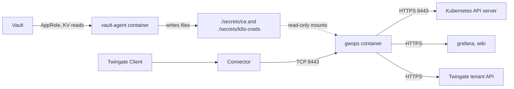

# Kubernetes and web apps with your CA from Vault or a secret store

This recipe is for a platform team that fronts one Kubernetes API server and a few internal web
apps, under a policy that CA keys and cluster credentials live in HashiCorp Vault or another secret
store. Devices already trust the corporate X.509 CA, so browsers accept the web apps with no extra
step. A Vault Agent sidecar writes the CA material and the cluster credentials as files; gwops reads
those files, mints the gateway's TLS leaf under your CA and keeps the Twingate resources in sync.

> **Note:** Untested example. The Vault Agent configuration and templates on this page have not been run by this project. Adapt them to your environment and test them before you rely on them.

## Environment

- One Linux `x86_64` (`linux/amd64`) Docker host with Docker Engine and Compose v2, at
  `10.0.0.20`.
- A Twingate Connector in the Remote Network `Platform` that reaches the Docker host on TCP 8443.
- A Kubernetes API server at `prod.k8s.internal.example.com:6443` and two web apps,
  `grafana.apps.example.com:3000` and `wiki.apps.example.com`, all reachable from the Docker host.
  Their names resolve through the DNS the containers use.
- The wiki serves a certificate from the corporate internal CA; Grafana serves a publicly trusted
  one.
- HashiCorp Vault at `https://vault.example.com:8200` with a KV version 2 engine at `secret/` and an
  AppRole the gateway host can use. The same pattern works with AWS Secrets Manager, Azure Key
  Vault, 1Password or any tool that writes secrets to files; see
  [Other secret stores](#other-secret-stores).
- Devices that open the web apps trust the corporate root CA.
- Outbound HTTPS from the Docker host to the tenant `acme.twingate.com`, to Vault, and to the
  tenant's key set at `https://acme.twingate.com/api/v1/jwk/ec`.

## What you get

- Pinned-gateway mode: gwops serves a Gateway object you create, and registers or binds nothing on
  it.
- Private CA mode with your X.509 CA (the gateway's TLS leaf is signed by it) and your SSH CA.
- One Twingate Kubernetes resource and two web-app resources, granted to "Platform Engineers" and
  "App Users".
- Each web app receives the user's signed access token in a request header, which the app can
  verify.
- Out of scope: gwops has no Vault, KMS, HSM or secret-store integration. It reads files from
  mounts and never talks to Vault. It does not register your CAs on the tenant, rotate them, or
  create groups and policies.

## Architecture



Vault Agent reads the CA material and cluster credentials from Vault and writes them to host
directories that gwops mounts read-only; Clients reach the gateway through the Connector, and the
gateway proxies to the API server and the web apps.

## Twingate prerequisites

See the [Twingate documentation](https://www.twingate.com/docs) for each step.

1. The Remote Network `Platform` and a healthy Connector in it that reaches `10.0.0.20:8443`.
2. A Gateway object in that Remote Network at `10.0.0.20:8443`, created in the Admin Console or
   by Terraform. Note its GraphQL id for `twingate.gateway_id`.
3. Your X.509 CA certificate (the file the agent writes as `x509-ca.crt`) registered as an X.509
   certificate authority, and your SSH CA public key (`ssh-ca.key.pub`) registered as an SSH
   certificate authority. Bind both to the Gateway object. gwops does neither for a
   bring-your-own CA.
4. The groups "Platform Engineers" and "App Users", and the security policy "Privileged Access
   MFA".
5. An API key with read and write access, including resources, certificate authorities and
   gateways.

Remote-network mode cannot be used here: it creates a Gateway object only with a CA gwops
generated and registered. See [Choose how gwops finds the Gateway object](../guides/gateway-modes.md).

## Files

### Directory layout

```text
platform-gateway/
  compose.yaml
  .env                    # mode 0600
  seed.yaml
  vault-agent/
    agent.hcl
    role-id               # AppRole role id; uid 10001, mode 0600
    secret-id             # AppRole secret id; uid 10001, mode 0600
  secrets/                # written by vault-agent; uid 10001, mode 0700
    ca/
      x509-ca.crt         # 0644
      x509-ca.key         # 0600
      ssh-ca.key          # 0600
      ssh-ca.key.pub      # 0644
    k8s-creds/
      prod.token          # 0600
      prod-ca.crt         # 0644
  webapp-cas/
    corp-root.pem         # the internal CA that signs the wiki's certificate; uid 10001, 0644
```

### seed.yaml

```yaml
twingate:
  network: acme
  host: twingate.com
  # Pinned-gateway mode: required with a bring-your-own X.509 CA.
  gateway_id: R2F0ZXdheTox
  resource_defaults:
    groups: ["Platform Engineers"]
    security_policy: "Privileged Access MFA"

ca:
  x509:
    generate: false
    cert_path: /config/ca/x509-ca.crt
    key_path: /config/ca/x509-ca.key
  ssh:
    generate: false
    key_path: /config/ca/ssh-ca.key    # gwops also reads /config/ca/ssh-ca.key.pub

k8s_clusters:                           # one cluster per gateway
  - name: prod
    address: prod.k8s.internal.example.com
    port: 6443
    bearer_token_file: /config/k8s-creds/prod.token   # must resolve under /config/k8s-creds/
    ca_file: /config/k8s-creds/prod-ca.crt

web_apps:
  - name: grafana
    address: grafana.apps.example.com:3000
    upstream_tls: verify_full          # {{jwt}} is allowed only toward verify_full or loopback
    downstream:
      tls: tls13                       # browsers trust it through your CA
    request_headers:
      Authorization: "Bearer {{jwt}}"
    access:
      groups: ["App Users"]
  - name: wiki
    address: wiki.apps.example.com     # port 443 by default
    upstream_tls: verify_full          # verified against corp-root below
    request_headers:
      X-Twingate-Token: "{{jwt}}"
    access:
      groups: ["App Users"]

web_app_proxy:
  upstream_ca_bundles:
    - name: corp-root
      file: /config/webapp-cas/corp-root.pem   # must resolve under /config/webapp-cas/

admin_api:
  bind: 0.0.0.0     # reachable through the loopback-only publish in compose.yaml
  port: 8081
```

### .env

```sh
TWINGATE_API_KEY=
# openssl rand -hex 32
GWOPS_ADMIN_TOKEN=
```

Compose reads `.env` from the project directory when it creates the container, and gwops reads
both values once at startup. A secrets agent can render this file too, but it must exist before
`docker compose up`, and a changed value takes effect only after the container is recreated
(`docker compose up -d --force-recreate gateway`).

### compose.yaml

```yaml
services:
  vault-agent:
    image: hashicorp/vault:<vault-version>
    container_name: vault-agent
    restart: unless-stopped
    user: "10001:10001"            # files it writes are owned by gwops' uid
    entrypoint: ["vault"]
    command: ["agent", "-config=/vault/config/agent.hcl"]
    security_opt:
      - "no-new-privileges:true"
    cap_drop:
      - ALL
    volumes:
      - ./vault-agent:/vault/config:ro
      - ./secrets/ca:/secrets/ca
      - ./secrets/k8s-creds:/secrets/k8s-creds
    healthcheck:
      # Healthy once every file gwops needs has been rendered.
      test: ["CMD-SHELL", "test -s /secrets/ca/x509-ca.crt && test -s /secrets/ca/x509-ca.key && test -s /secrets/ca/ssh-ca.key && test -s /secrets/ca/ssh-ca.key.pub && test -s /secrets/k8s-creds/prod.token && test -s /secrets/k8s-creds/prod-ca.crt"]
      interval: 10s
      timeout: 5s
      retries: 30

  gateway:
    image: ghcr.io/twingate-solutions/gwops:<version>
    pull_policy: missing
    container_name: gwops-gateway
    restart: unless-stopped
    depends_on:
      vault-agent:
        condition: service_healthy   # unusable CA material at startup aborts gwops
    security_opt:
      - "no-new-privileges:true"
    cap_drop:
      - ALL
    read_only: true
    tmpfs:
      - /run/gateway:mode=1777
      - /tmp:mode=1777
    environment:
      TWINGATE_API_KEY: ${TWINGATE_API_KEY:?set TWINGATE_API_KEY in .env}
      GWOPS_ADMIN_TOKEN: ${GWOPS_ADMIN_TOKEN:?set GWOPS_ADMIN_TOKEN in .env}
    volumes:
      - ./seed.yaml:/config/seed.yaml:ro
      - ./secrets/ca:/config/ca:ro
      - ./secrets/k8s-creds:/config/k8s-creds:ro
      - ./webapp-cas:/config/webapp-cas:ro
      - gwdata:/data
    ports:
      - "8443:8443"
      - "127.0.0.1:9090:9090"
      - "127.0.0.1:8081:8081"

volumes:
  gwdata:
```

The secrets directories are directory bind mounts, so a file the agent replaces by renaming is
visible inside the gwops container at once.

### vault-agent/agent.hcl

```hcl
vault {
  address = "https://vault.example.com:8200"
}

auto_auth {
  method "approle" {
    config = {
      role_id_file_path                   = "/vault/config/role-id"
      secret_id_file_path                 = "/vault/config/secret-id"
      remove_secret_id_file_after_reading = false
    }
  }
}

template_config {
  exit_on_retry_failure         = true
  static_secret_render_interval = "5m"   # how often KV secrets are re-read
}

template {
  destination          = "/secrets/ca/x509-ca.crt"
  perms                = "0644"
  error_on_missing_key = true
  contents             = "{{ with secret \"secret/data/twingate-gateway/ca\" }}{{ .Data.data.x509_cert }}{{ end }}"
}

template {
  destination          = "/secrets/ca/x509-ca.key"
  perms                = "0600"
  error_on_missing_key = true
  contents             = "{{ with secret \"secret/data/twingate-gateway/ca\" }}{{ .Data.data.x509_key }}{{ end }}"
}

template {
  destination          = "/secrets/ca/ssh-ca.key"
  perms                = "0600"
  error_on_missing_key = true
  contents             = "{{ with secret \"secret/data/twingate-gateway/ca\" }}{{ .Data.data.ssh_key }}{{ end }}"
}

template {
  destination          = "/secrets/ca/ssh-ca.key.pub"
  perms                = "0644"
  error_on_missing_key = true
  contents             = "{{ with secret \"secret/data/twingate-gateway/ca\" }}{{ .Data.data.ssh_pub }}{{ end }}"
}

template {
  destination          = "/secrets/k8s-creds/prod.token"
  perms                = "0600"
  error_on_missing_key = true
  contents             = "{{ with secret \"secret/data/twingate-gateway/k8s-prod\" }}{{ .Data.data.token }}{{ end }}"
}

template {
  destination          = "/secrets/k8s-creds/prod-ca.crt"
  perms                = "0644"
  error_on_missing_key = true
  contents             = "{{ with secret \"secret/data/twingate-gateway/k8s-prod\" }}{{ .Data.data.ca_crt }}{{ end }}"
}
```

If Vault's certificate is signed by a private CA, mount that CA into the agent container and set
`VAULT_CACERT`. For the agent's configuration options, see the
[Vault documentation](https://developer.hashicorp.com/vault/docs).

### Permissions

```sh
mkdir -p secrets/ca secrets/k8s-creds webapp-cas
sudo chown -R 10001:10001 secrets vault-agent webapp-cas
chmod 0700 secrets secrets/ca secrets/k8s-creds
chmod 0600 vault-agent/role-id vault-agent/secret-id
chmod 0644 webapp-cas/corp-root.pem
```

The agent runs as uid 10001, so the files it renders are owned by the user gwops reads them as.
`corp-root.pem` must hold `CERTIFICATE` PEM blocks only, each `CA:TRUE` and in date.

## Deploy

1. Store the CA material and cluster credentials in Vault, and create the AppRole and its policy
   ([What the CA material must look like](#what-the-ca-material-must-look-like)).
2. Complete the [Twingate prerequisites](#twingate-prerequisites): Gateway object created, both
   CAs registered and bound to it.
3. Create the files above and set the permissions. Fill in `.env` (`chmod 0600 .env`).
4. Start the agent alone and wait until it is healthy:

   ```sh
   docker compose up -d vault-agent
   docker compose ps vault-agent
   ```

   If it does not become healthy, `docker compose logs vault-agent` names the failing template or
   the authentication error.
5. Start everything:

   ```sh
   docker compose up -d
   ```

6. Check the first pass:

   ```sh
   export BASE=http://127.0.0.1:8081
   export TOKEN=<admin-token>   # the GWOPS_ADMIN_TOKEN value from .env

   curl -s -H "Authorization: Bearer $TOKEN" $BASE/status | jq '{tg: .tg, certs: .certs, tls: .tls, errors: .last_reconcile.errors}'
   ```

   Unusable CA material aborts startup with `supervisor.startup_failed` in
   `docker compose logs gateway`, naming the file and the problem (for example an RSA key).

### Write atomically

gwops reads the CA files on every reconcile pass and the cluster credential files on every pass
too. A pass that catches a rewrite halfway can see a mix:

- **CA files.** A new certificate with the old key, or one file missing, is a local error
  (`CA material is unusable: ...` in `last_reconcile.errors`). Nothing is applied and the gateway
  keeps running on its last good config. The next pass, once both files are in place, succeeds.
- **Cluster credentials.** A missing or unreadable file is a local error naming the path and the
  allowed root; the gateway keeps its last good config.
- **At startup** the same CA problems abort gwops, which is why `gateway` waits for the agent's
  healthcheck.

So the agent must write each file to a temporary name and rename it into place, never truncate and
rewrite. Vault Agent's template renderer does this; check it for any other tool. Keep the
certificate and key in one secret so they change in the same version.

Symlinks: the CA paths are used as given. The cluster credential paths must resolve under
`/config/k8s-creds/` inside the container, so a tool that writes symlinks must keep their targets
inside that mounted directory. A path that resolves outside it is refused.

### What the CA material must look like

| File | Requirement |
| --- | --- |
| `x509-ca.crt` | PEM. gwops uses the first certificate in the file. `basicConstraints` `CA:TRUE`, inside its validity period. |
| `x509-ca.key` | Unencrypted PEM, **EC** (P-256 recommended), matching the certificate. RSA and other key types are refused: gwops signs the leaf with ECDSA. |
| `ssh-ca.key` | The SSH CA private key in OpenSSH format, unencrypted: the gateway reads it directly. |
| `ssh-ca.key.pub` | Its public key, OpenSSH format, beside the private key. |

A Vault PKI engine whose CA key was generated inside Vault (type `internal`) never releases that
key, and the Vault SSH secrets engine's signing key cannot be exported either. Neither can supply
these files. Two options:

- Generate an intermediate CA with an exported key (the PKI engine's `intermediate/generate/exported`
  endpoint, `key_type=ec`, `key_bits=256`), sign it with the corporate root, and store the
  certificate and key in a KV secret. Devices that trust the root accept the leaf, which carries
  the intermediate.
- Store an existing CA certificate and key in a KV secret.

Store an SSH CA key pair in KV the same way.

> **Security:** whichever you choose, the CA private keys end up as unencrypted files on the
> Docker host, readable by uid 10001, the user gwops and the gateway run as. Anyone who can read
> `./secrets/ca/` or run code in the gwops container can sign certificates that your devices and
> SSH hosts trust. Vault still controls who can read the KV secret and audits each read, but not
> what happens to the file afterwards. Prefer a dedicated intermediate for this gateway over the
> corporate root.

Write the secrets, for example:

```sh
vault kv put secret/twingate-gateway/ca \
  x509_cert=@x509-ca.crt x509_key=@x509-ca.key \
  ssh_key=@ssh-ca.key ssh_pub=@ssh-ca.key.pub

vault kv put secret/twingate-gateway/k8s-prod \
  token=@prod.token ca_crt=@prod-ca.crt
```

The AppRole's policy needs only read access:

```hcl
path "secret/data/twingate-gateway/*" {
  capabilities = ["read"]
}
```

For the cluster token and its permissions, see [Front a Kubernetes API server](../guides/kubernetes.md).

### Rotation through the agent

- **X.509 CA.** `POST /certs/rotate-ca` answers `409` for a bring-your-own CA; rotate it yourself:
  1. Register the new CA certificate on the tenant.
  2. Write the new certificate and key to the KV secret in one `vault kv put`.
  3. The agent re-renders within `static_secret_render_interval` (5 minutes above).
  4. gwops picks the files up on its next pass, at most `GWOPS_RECONCILE_TICK_SECONDS` (600 s)
     later, and re-mints the leaf under the new CA. Run one at once with
     `curl -s -X POST -H "Authorization: Bearer $TOKEN" $BASE/reconcile`.
  5. Bind the Gateway object to the new CA on the tenant.

  Between steps 4 and 5 the leaf is signed by a CA the tenant does not yet bind to the gateway, and
  Clients may refuse new connections. Keep that gap short. See
  [Bring your own X.509 or SSH CA](../guides/private-ca-byo.md) and
  [Rotate the leaf and the CA](../operations/ca-and-leaf-rotation.md).
- **SSH CA.** Replace the key pair in the KV secret, update the CA on the tenant, roll the new
  public key out to SSH targets, then `docker compose restart gateway` so the gateway starts with
  the new key.
- **Cluster token.** Each new token content makes gwops write a new content-addressed copy and
  drain-restart the gateway, which drops open connections. Prefer token lifetimes measured in days
  or longer, not minutes.
- **Twingate API key and admin token**: update `.env` and recreate the container.

## Verify

### Certificates

- `certs.x509_ca_not_after` is your CA certificate's expiry; `certs.leaf_state` is `ok`; `tls.mode`
  is `static`.
- `last_reconcile.actions` contains no `registered X.509 CA` or `registered SSH CA` line: gwops
  registers nothing for a bring-your-own CA.
- The leaf chains to your CA:

  ```sh
  docker compose exec gateway cat /data/pki/leaf/fullchain.pem > leaf.pem
  openssl verify -CAfile secrets/ca/x509-ca.crt leaf.pem
  ```

### Kubernetes

```sh
curl -s -H "Authorization: Bearer $TOKEN" $BASE/upstreams/k8s/prod | jq '{kind, tg_resource_id, effective_access, errors}'
docker compose exec gateway ls /data/k8s-creds/
```

- `kind` is `kubernetes`, `tg_resource_id` is set and `errors` is empty.
- `/data/k8s-creds/` holds `prod-token-<sha12>` and `prod-ca-<sha12>.crt`.
- `last_reconcile.actions` on the first pass lists `created kubernetes resource 'prod' (<id>)`.
- A member of "Platform Engineers" with the Twingate Client signed in runs `kubectl get
  namespaces` with a kubeconfig pointing at the resource address; see the
  [Twingate documentation](https://www.twingate.com/docs) for the kubeconfig.

### Web apps

```sh
curl -s -H "Authorization: Bearer $TOKEN" $BASE/status | jq '{jwks: .jwks, readiness: .web_apps.readiness}'
```

- `jwks.ok` is `true`.
- Each app's `readiness[]` entry has `state: "ready"`, with the informational reason `byo_ca`:
  browser trust is whatever your CA already has.
- A member of "App Users" with the Twingate Client signed in opens
  `https://grafana.apps.example.com` and `https://wiki.apps.example.com` with no certificate
  warning. Port 3000 in Grafana's `address` is the port the gateway dials; users open
  `downstream.port`, 443 by default.

## Day 2

- **Rotating CAs, the cluster token or the env secrets**: see
  [Rotation through the agent](#rotation-through-the-agent).
- **Leaf renewal** is automatic, 14 days before the 90-day leaf expires, and hot-reloads.
- **Adding web apps**: seed edit or `PUT /upstreams/webapp/{name}`; see [Web apps](../guides/web-apps.md).
  Each new name must resolve inside the gwops container.
- **Back up `/data`**: overlays, the ownership registry and the leaf. Your CA keys stay in Vault.
  See [Backup and restore](../operations/backup-and-restore.md).
- **Monitoring**: [Monitoring](../operations/monitoring.md).

## Variations

### Other secret stores

Any tool that writes the same files works, with the same rules: render before gwops starts, write
by rename, keep the files owned by uid 10001. Examples are a host cron job or systemd timer that
reads from AWS Secrets Manager, Azure Key Vault or Google Cloud Secret Manager with the provider's
CLI, or a 1Password or Vault Agent equivalent. When gwops runs inside Kubernetes, tools such as
[External Secrets Operator](https://external-secrets.io/) or the
[Secrets Store CSI Driver](https://secrets-store-csi-driver.sigs.k8s.io/) fill the same role; this
recipe does not cover that hosting shape.

### Generated SSH CA, bring-your-own X.509 only

Remove the `ca.ssh` block and the SSH templates. gwops generates the SSH CA, registers it as
`gwops-ssh-R2F0ZXdheTox` and binds it to the Gateway object, leaving the X.509 CA binding as you
set it. SSH targets must then trust the generated key; see
[Use gwops-generated CAs](../guides/private-ca-generated.md).

## Related

- [Bring your own X.509 or SSH CA](../guides/private-ca-byo.md),
  [Choose how gwops finds the Gateway object](../guides/gateway-modes.md)
- [Front a Kubernetes API server](../guides/kubernetes.md)
- [Web apps](../guides/web-apps.md), [Pass identity to a web app](../guides/web-apps-identity.md),
  [Web-app upstream TLS](../guides/web-apps-upstream-tls.md)
- [Rotate the leaf and the CA](../operations/ca-and-leaf-rotation.md)
- [Certificates](../architecture/certificates.md), [Web apps architecture](../architecture/web-apps.md),
  [Known limitations](../reference/limitations.md)
- Seed reference: [`twingate`](../reference/seed.md#twingate), [`ca`](../reference/seed.md#ca),
  [`k8s_clusters`](../reference/seed.md#k8s_clusters), [`web_apps`](../reference/seed.md#web_apps),
  [`web_app_proxy`](../reference/seed.md#web_app_proxy), [`admin_api`](../reference/seed.md#admin_api)
