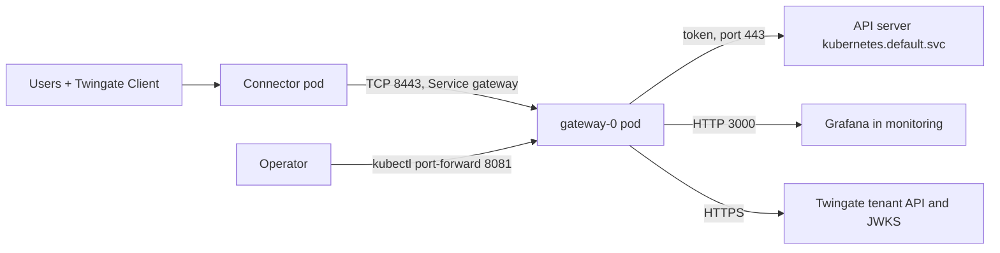

# Inside a Kubernetes cluster

> [!WARNING]
> **Untested deployment pattern.** The project ships and supports Docker Compose only. It does not
> ship Kubernetes manifests and does not test the image on Kubernetes. The manifests on this page
> are a starting point: adapt them to your cluster and validate them before you rely on them. Every
> constraint below comes from the image (`Dockerfile`, `compose.yaml`) and from gwops' own
> behaviour, not from a tested Kubernetes deployment.

This recipe is for a platform team that runs the gateway as a pod in the cluster it fronts. The
gateway reaches the cluster's own API server by its in-cluster name and an in-cluster web app by
its Service DNS name. A Connector in the same cluster reaches the gateway through a ClusterIP
Service. The pod runs as a single-replica StatefulSet with a PersistentVolumeClaim for `/data`,
the seed in a ConfigMap and the secrets in a Secret.

## Environment

- A Kubernetes cluster with `amd64` nodes. The published image is `linux/amd64` only.
- A default StorageClass that provisions `ReadWriteOnce` volumes.
- The cluster domain is `cluster.local`. If yours differs, change every `svc.cluster.local` name
  below.
- A CNI plugin that enforces NetworkPolicy. Without one, the NetworkPolicy below has no effect.
- A Twingate Connector for the Remote Network "Production Cluster", running in the namespace
  `twingate-connector` of the same cluster, for example from the Twingate Helm chart. It resolves
  cluster DNS names.
- The cluster's API server, reachable from pods at `kubernetes.default.svc:443`.
- Grafana at `grafana.monitoring.svc.cluster.local:3000`, plain HTTP, in the namespace
  `monitoring`.
- Pods may open outbound HTTPS to the tenant (`acme.twingate.com`). There is no offline mode.
- Browsers that open the web app run on managed devices that can be given a CA certificate.
- You have `kubectl` with rights to create namespaces, RBAC objects, Secrets and StatefulSets.

## What you get

- A Gateway object that gwops creates in remote-network mode at the Service DNS name, with a
  Kubernetes resource for this cluster and a web-app resource for Grafana.
- Private CA mode with gwops-generated X.509 and SSH CAs, stored on the PersistentVolumeClaim.
- Access: "Platform Engineers" with the "Privileged Access MFA" policy on the cluster; "App Users"
  on Grafana. Identity headers on every web-app request.
- The gateway authenticates to the API server with a long-lived service-account token mounted
  from a Secret.
- The admin API reachable only through `kubectl port-forward`.

Out of scope: more than one replica, high availability, a Helm chart, an Ingress, public
certificate mode (`kubernetes.default.svc` cannot be served in it), session recording (see
[Variations](#variations)), and the RBAC rules the gateway's service account needs, which come from
the Twingate documentation. gwops never creates groups, security policies, Remote Networks or
Connectors, and never talks to the Kubernetes API itself: only the gateway does, as the upstream.

## Architecture



Users reach the gateway pod through the in-cluster Connector and the `gateway` Service on port
8443; the gateway fronts the cluster's API server and Grafana, gwops talks to the tenant, and an
operator reaches the admin API only through `kubectl port-forward`.

## Twingate prerequisites

Create these first. See the [Twingate documentation](https://www.twingate.com/docs).

1. The Remote Network "Production Cluster" with a healthy Connector deployed in the namespace
   `twingate-connector` of this cluster.
2. The groups "Platform Engineers" and "App Users".
3. The security policy "Privileged Access MFA". The name must match exactly one object.
4. An API key with read and write access, including resources, certificate authorities and
   gateways.

On the cluster: a ClusterRole named `twingate-gateway` with the rules the
[Twingate documentation](https://www.twingate.com/docs) lists for the gateway. The binding below
grants it to the gateway's service account; the token's permissions bound what the gateway can do
in the cluster.

## Files

### Directory layout

```text
gwops-k8s/
├── .env                          # becomes the Secret gwops-env; never commit it
├── seed.yaml                     # becomes the ConfigMap gwops-seed
└── manifests/
    ├── 00-namespace.yaml
    ├── 10-serviceaccount.yaml
    ├── 11-gateway-token.yaml
    ├── 12-clusterrolebinding.yaml
    ├── 20-service.yaml
    ├── 21-networkpolicy.yaml
    └── 30-statefulset.yaml
```

### seed.yaml

```yaml
twingate:
  network: acme                          # tenant slug, from acme.twingate.com
  host: twingate.com
  # Remote-network mode: gwops adopts the Gateway object at gateway_address in this Remote
  # Network, or creates one. The address is the Service DNS name the Connector resolves
  # (untested: see "A ClusterIP instead of a DNS name" below).
  remote_network: Production Cluster
  gateway_address: gateway.twingate-gateway.svc.cluster.local:8443
  resource_defaults:
    groups: ["Platform Engineers"]
    security_policy: "Privileged Access MFA"

# Both CAs are generated on first start under /data/pki/, on the PersistentVolumeClaim.
ca:
  x509:
    generate: true
  ssh:
    generate: true

# The cluster this pod runs in. Private CA mode only: public mode refuses this name.
k8s_clusters:
  - name: this-cluster
    address: kubernetes.default.svc      # resolved through the pod's cluster DNS search path
    port: 443
    bearer_token_file: /config/k8s-creds/this-cluster.token
    ca_file: /config/k8s-creds/this-cluster-ca.crt

web_apps:
  - name: grafana
    address: grafana.monitoring.svc.cluster.local:3000
    upstream_tls: none                   # allowed only by plaintext_upstreams below
    access:
      groups: ["App Users"]

web_app_proxy:
  request_headers:                       # sent to every web app
    X-Twingate-User: "{{username}}"
    X-Twingate-Groups: "{{groups}}"
  plaintext_upstreams:
    dns_suffixes: ["monitoring.svc.cluster.local"]

# Read at startup only. 0.0.0.0 so the pod IP serves it; the NetworkPolicy keeps other pods out.
admin_api:
  bind: 0.0.0.0
  port: 8081
```

The seed is not read from the default `/config/seed.yaml`. The StatefulSet mounts the ConfigMap
as the directory `/config/seed/` and sets `GWOPS_SEED_PATH=/config/seed/seed.yaml`; see
[How seed changes apply](#how-seed-changes-apply).

### .env

```sh
# Loaded into the Secret gwops-env with: kubectl create secret generic --from-env-file
# Twingate API key: read and write, including resources, certificate authorities and gateways.
TWINGATE_API_KEY=<twingate-api-key>
# Admin API bearer token. Generate with: openssl rand -hex 32
GWOPS_ADMIN_TOKEN=<admin-token>
# Add these only when you use them:
# GWOPS_RECORDING_TOKEN=<receiver-token>            # recording on in the seed
# GWOPS_AUTOMATION_TOKEN=<automation-token>   # needs both allowlists in the seed
```

### 00-namespace.yaml

```yaml
apiVersion: v1
kind: Namespace
metadata:
  name: twingate-gateway
  labels:
    # The pod below is written to meet the restricted Pod Security Standard.
    pod-security.kubernetes.io/enforce: restricted
```

### 10-serviceaccount.yaml

```yaml
apiVersion: v1
kind: ServiceAccount
metadata:
  name: gateway
  namespace: twingate-gateway
automountServiceAccountToken: false      # gwops never calls the Kubernetes API itself
```

### 11-gateway-token.yaml

A long-lived token for the service account. Kubernetes fills in `token` and `ca.crt`.

```yaml
apiVersion: v1
kind: Secret
metadata:
  name: gateway-token
  namespace: twingate-gateway
  annotations:
    kubernetes.io/service-account.name: gateway
type: kubernetes.io/service-account-token
```

### 12-clusterrolebinding.yaml

```yaml
apiVersion: rbac.authorization.k8s.io/v1
kind: ClusterRoleBinding
metadata:
  name: twingate-gateway
roleRef:
  apiGroup: rbac.authorization.k8s.io
  kind: ClusterRole
  name: twingate-gateway                 # you create it with the rules from the Twingate docs
subjects:
  - kind: ServiceAccount
    name: gateway
    namespace: twingate-gateway
```

### 20-service.yaml

```yaml
apiVersion: v1
kind: Service
metadata:
  name: gateway                          # never start a Service name here with "gwops"
  namespace: twingate-gateway
spec:
  type: ClusterIP
  selector:
    app.kubernetes.io/name: twingate-gateway
  # Keep the endpoint when the readiness probe fails; see "Probes".
  publishNotReadyAddresses: true
  ports:
    - name: gateway
      port: 8443
      targetPort: 8443
      protocol: TCP
```

Only 8443 is in the Service. The admin API (8081) and the gateway metrics (9090) are not.

### 21-networkpolicy.yaml

```yaml
apiVersion: networking.k8s.io/v1
kind: NetworkPolicy
metadata:
  name: gateway-ingress
  namespace: twingate-gateway
spec:
  podSelector:
    matchLabels:
      app.kubernetes.io/name: twingate-gateway
  policyTypes: ["Ingress"]
  ingress:
    - from:
        - namespaceSelector:
            matchLabels:
              kubernetes.io/metadata.name: twingate-connector
      ports:
        - protocol: TCP
          port: 8443
```

Only pods in `twingate-connector` reach the gateway, and only on 8443. Egress is not restricted:
the pod needs the tenant over HTTPS, cluster DNS, the API server and Grafana.

### 30-statefulset.yaml

```yaml
apiVersion: apps/v1
kind: StatefulSet
metadata:
  name: gateway
  namespace: twingate-gateway
spec:
  replicas: 1                            # never more than one; see "Why exactly one replica"
  serviceName: gateway
  selector:
    matchLabels:
      app.kubernetes.io/name: twingate-gateway
  template:
    metadata:
      labels:
        app.kubernetes.io/name: twingate-gateway
    spec:
      serviceAccountName: gateway
      automountServiceAccountToken: false
      enableServiceLinks: false          # optional: keeps Service env vars out of the pod
      terminationGracePeriodSeconds: 60  # gwops teardown plus its 30 s gateway drain
      nodeSelector:
        kubernetes.io/arch: amd64        # the image is linux/amd64 only
      securityContext:
        runAsNonRoot: true
        runAsUser: 10001                 # the image's gwops user
        runAsGroup: 10001
        fsGroup: 10001                   # makes the PVC writable by uid 10001
        fsGroupChangePolicy: OnRootMismatch
        seccompProfile:
          type: RuntimeDefault           # Docker applies its default profile; Kubernetes does not
      containers:
        - name: gateway
          image: ghcr.io/twingate-solutions/gwops:<version>
          imagePullPolicy: IfNotPresent
          env:
            - name: GWOPS_SEED_PATH
              value: /config/seed/seed.yaml
          envFrom:
            - secretRef:
                name: gwops-env
          ports:
            - name: gateway
              containerPort: 8443
            - name: metrics
              containerPort: 9090
            - name: admin
              containerPort: 8081
          securityContext:
            allowPrivilegeEscalation: false   # compose: no-new-privileges:true
            readOnlyRootFilesystem: true      # compose: read_only: true
            capabilities:
              drop: ["ALL"]                   # compose: cap_drop: ALL
          # The image HEALTHCHECK (30 s interval, 5 s timeout, 30 s start period, 3 retries).
          startupProbe:
            exec:
              command: ["python", "-m", "gwops.healthcheck"]
            periodSeconds: 10
            timeoutSeconds: 5
            failureThreshold: 30         # up to 5 minutes for the first reconcile pass
          readinessProbe:
            exec:
              command: ["python", "-m", "gwops.healthcheck"]
            periodSeconds: 30
            timeoutSeconds: 5
            failureThreshold: 3
          volumeMounts:
            - name: data
              mountPath: /data
            - name: seed
              mountPath: /config/seed
              readOnly: true
            - name: k8s-creds
              mountPath: /config/k8s-creds
              readOnly: true
            - name: run-gateway
              mountPath: /run/gateway
            - name: tmp
              mountPath: /tmp
      volumes:
        - name: seed
          configMap:
            name: gwops-seed             # a directory mount; never use subPath for the seed
        - name: k8s-creds
          secret:
            secretName: gateway-token
            defaultMode: 0440            # readable by gid 10001 through fsGroup
            items:
              - key: token
                path: this-cluster.token
              - key: ca.crt
                path: this-cluster-ca.crt
        - name: run-gateway              # compose: tmpfs /run/gateway
          emptyDir:
            medium: Memory
        - name: tmp                      # compose: tmpfs /tmp
          emptyDir:
            medium: Memory
  volumeClaimTemplates:
    - metadata:
        name: data
      spec:
        accessModes: ["ReadWriteOnce"]
        resources:
          requests:
            storage: 1Gi
```

Replace `<version>` with a published version tag. Do not use `:latest`. If the GHCR package is
private, add an `imagePullSecrets` entry for `ghcr.io`.

How each image constraint maps to the manifest:

| Image or `compose.yaml` | Manifest |
| --- | --- |
| `USER gwops` (uid and gid 10001) | `runAsUser: 10001`, `runAsGroup: 10001`. `runAsNonRoot` needs the numeric uid, because the image names its user. |
| `/data` must be writable by uid 10001 | The PVC with `fsGroup: 10001` |
| `read_only: true`, `tmpfs` at `/run/gateway` and `/tmp` | `readOnlyRootFilesystem: true` and two `emptyDir` volumes with `medium: Memory` |
| `cap_drop: ALL`, `no-new-privileges:true` | `capabilities.drop: ["ALL"]`, `allowPrivilegeEscalation: false`. No capability is needed: the gateway listens on unprivileged ports. |
| `HEALTHCHECK python -m gwops.healthcheck` | `startupProbe` and `readinessProbe` running the same command |
| `linux/amd64` image | `nodeSelector` on `kubernetes.io/arch: amd64` |
| Files under the four `/config/` confined roots | The token Secret at `/config/k8s-creds/` |

Memory-backed `emptyDir` volumes count against the container's memory. The manifest sets no
resource requests or limits; set them from observed usage. See
[Image reference: runtime user and filesystem](../reference/image.md#runtime-user-and-filesystem).

### Mounted files

- `/config/k8s-creds/this-cluster.token` and `this-cluster-ca.crt`: the `token` and `ca.crt` keys of
  the `gateway-token` Secret. Kubernetes mounts them as symlinks into a `..data/` directory inside
  the mount. gwops resolves symlinks before its containment check, and the resolved paths stay
  under `/config/k8s-creds/`, so they are accepted. Each must be a regular file of at most 1 MiB.
  See [Front a Kubernetes API server](../guides/kubernetes.md).
- `/config/seed/seed.yaml`: the `seed.yaml` key of the `gwops-seed` ConfigMap, mounted the same
  way.

## Deploy

1. Create the namespace, the service account, its token and the role binding. Create the
   `twingate-gateway` ClusterRole from the Twingate documentation first.

   ```sh
   kubectl apply -f manifests/00-namespace.yaml
   kubectl apply -f manifests/10-serviceaccount.yaml -f manifests/11-gateway-token.yaml -f manifests/12-clusterrolebinding.yaml
   kubectl -n twingate-gateway get secret gateway-token -o json | jq '.data | keys'
   ```

   The last command lists `ca.crt`, `namespace` and `token` once Kubernetes has filled the Secret
   in, without printing the token.
2. Create the Secret and the ConfigMap from `.env` and `seed.yaml`:

   ```sh
   kubectl -n twingate-gateway create secret generic gwops-env --from-env-file=.env
   kubectl -n twingate-gateway create configmap gwops-seed --from-file=seed.yaml
   ```

3. Create the Service, the NetworkPolicy and the StatefulSet:

   ```sh
   kubectl apply -f manifests/20-service.yaml -f manifests/21-networkpolicy.yaml
   kubectl apply -f manifests/30-statefulset.yaml
   kubectl -n twingate-gateway rollout status statefulset/gateway --timeout=10m
   kubectl -n twingate-gateway logs -f gateway-0
   ```

   Wait for `reconcile.completed` with `"ok": true`, then press Ctrl+C.
4. In a second terminal, forward the admin API:

   ```sh
   kubectl -n twingate-gateway port-forward pod/gateway-0 8081:8081
   ```

5. Read the first status:

   ```sh
   BASE=http://127.0.0.1:8081
   TOKEN=<admin-token>   # the GWOPS_ADMIN_TOKEN value from .env

   curl -s -H "Authorization: Bearer $TOKEN" $BASE/status | jq '{process: .process.state, ok: .last_reconcile.ok, tg: .tg.ok, leaf: .certs.leaf_state}'
   ```

   Expect `running`, `true`, `true` and `ok`.
6. Install the X.509 CA on the devices that open Grafana:

   ```sh
   kubectl -n twingate-gateway exec gateway-0 -- cat /data/pki/x509-ca.crt > gwops-x509-ca.crt
   ```

   Push `gwops-x509-ca.crt` as a trusted root with your device management tool. See
   [Use gwops-generated CAs](../guides/private-ca-generated.md#trust-the-x509-ca-in-browsers-web-apps-only).

> **Security:** the admin API is plain HTTP, and with `bind: 0.0.0.0` it listens on the pod IP.
> Without an enforcing NetworkPolicy, any pod that can route to the pod IP reaches it, and the bearer
> token is the only control left. Keep the NetworkPolicy, and never add 8081 to a Service that
> leaves the cluster. If you use only `kubectl port-forward`, you can keep the default bind
> `127.0.0.1`: port-forward connects inside the pod's network namespace. Anyone allowed to
> `kubectl exec` into the pod or read its volume can read the CA keys under `/data/pki/` and the
> secrets in its environment; restrict those rights in the namespace.

### Why exactly one replica

Never run more than one replica, and never point two pods at the same seed.

- **One Gateway object.** In remote-network mode each gwops adopts the Gateway object at
  `gateway_address`, or creates it. Two pods with this seed would both manage the same Gateway
  object.
- **One CA binding.** `volumeClaimTemplates` gives every replica its own `/data`, so a second
  replica would generate its own X.509 CA, register it and rebind the Gateway object to it. A
  Gateway object is bound to one X.509 CA, so the other pod's leaf would no longer match.
- **One ownership registry.** `/data/state.json` records the tenant objects one gwops created. A
  pod whose registry has no id for a resource creates it, so a second replica would create a
  duplicate of every resource.
- **Overlays live on one volume.** An admin-API change persists under one pod's
  `/data/overlays/`; a second pod would never see it.
- **No coordination.** gwops has no leader election and no cross-process lock. A shared
  `ReadWriteMany` volume does not make two pods safe.

A StatefulSet with `replicas: 1` does not start a replacement pod until the old one has
terminated, which a Deployment's default rolling update does not guarantee. That guarantee breaks
if you force-delete the pod on an unreachable node; do not. See the Kubernetes documentation on
[StatefulSets](https://kubernetes.io/docs/concepts/workloads/controllers/statefulset/).

### Service names and environment variables

Kubernetes can inject variables named after the Services in the namespace: a Service called
`gwops-admin` produces `GWOPS_ADMIN_SERVICE_HOST` and `GWOPS_ADMIN_PORT=tcp://<ip>:8081`. gwops
reads only the settings it declares and ignores every other `GWOPS_*` variable, and no setting ends
in `_PORT`, so these variables cannot collide with a setting whatever you name your Services. The
StatefulSet sets `enableServiceLinks: false` only to keep the pod environment free of unused
variables; it is optional. See [Environment: settings](../reference/environment.md#settings).

### How seed changes apply

The ConfigMap is mounted as a directory. Kubernetes updates such a mount by writing a new
generation directory and swapping the `..data` symlink inside the mount; `/config/seed/seed.yaml`
itself stays a symlink that never changes. What gwops does with that:

- **The file watch does not fire.** It watches `/config/seed/` and reacts only to events on
  `seed.yaml`, and the swap touches only `..data` and the generation directories.
- **The content-hash poll does.** Every 5 s gwops hashes the seed through the symlink. When the
  hash changes it re-reads every 0.5 s until two reads agree, then runs a pass. The log shows
  `watch.seed_changed` with `"source": "poll"`.
- **Kubernetes adds its own delay.** The kubelet updates a mounted ConfigMap on its sync period
  plus its cache delay, so allow a minute or more after `kubectl apply` before the poll can see
  the change. See [ConfigMaps](https://kubernetes.io/docs/concepts/configuration/configmap/).
- **A `subPath` mount never updates.** Mounting `seed.yaml` with `subPath` freezes the seed at
  pod start. That is why the seed has its own directory and `GWOPS_SEED_PATH`.

`recording.*`, `admin_api.*` and every environment variable are read once at startup: restart the
pod for those.

Changes to the files under `/config/k8s-creds/` are not watched. They apply on the next pass: the
periodic one (every 600 s by default), or at once with `POST /reconcile`.

### Probes

Docker's `HEALTHCHECK` only reports health; it never restarts the container. The manifest keeps
that behaviour:

- **`startupProbe`** runs `python -m gwops.healthcheck`, which sends `GET /healthz` to the admin
  API. With `bind: 0.0.0.0` it probes `127.0.0.1`. The admin API does not listen until the first
  reconcile pass has finished, and a slow or throttled tenant can stretch that pass past several
  minutes, so the probe allows 5 minutes. A seed with no upstreams holds the gateway down and
  never passes this probe.
- **`readinessProbe`** uses the image's interval, timeout and retry count. `/healthz` is `503`
  when the gateway is not running or the last pass had a local failure. Tenant-side problems
  never fail it.
- **No `livenessProbe`.** A refused seed edit makes `/healthz` `503` while the gateway keeps
  serving its last good config. A liveness restart would start the pod on the same invalid seed,
  which aborts startup, and turn a refused edit into a crash loop.
- **`publishNotReadyAddresses: true`** on the Service keeps the pod's endpoint while it is not
  ready, for the same reason: the gateway still serves its last good config.

Nothing restarts a gwops process that hangs without exiting. See
[Image reference: healthcheck](../reference/image.md#healthcheck) and
[Health and observability](../architecture/health-and-observability.md#healthz).

### Shutdown

On pod termination the kubelet sends SIGTERM to gwops (PID 1). gwops stops its triggers and the
admin API, waits for an in-flight pass, then sends SIGTERM to the gateway and waits up to 30 s
before SIGKILL, and finally seals the recording spool. The Kubernetes default grace period is 30 s,
which would kill the pod at the moment gwops' own escalation is due. `terminationGracePeriodSeconds:
60` leaves room for the full drain. See
[Startup and shutdown](../architecture/startup-and-shutdown.md#shutdown-order).

## Verify

```sh
curl -s -H "Authorization: Bearer $TOKEN" $BASE/status | jq '{tg: .tg.ok, mismatches: .tg.gateway_mismatches, leaf: .certs.leaf_state, mode: .tls.mode, jwks: .jwks.ok, actions: .last_reconcile.actions, readiness: [.web_apps.readiness[] | {name, state, reasons}]}'
```

### Pod

```sh
kubectl -n twingate-gateway get pod gateway-0
kubectl -n twingate-gateway get pvc data-gateway-0
```

The pod is `1/1 Running` with no restarts, and the claim is `Bound`.

### Tenant and certificates

- `tg.ok` is `true` and `tg.gateway_mismatches` is `{}`.
- The first pass's `last_reconcile.actions` lists `created gateway (<id>) at
  gateway.twingate-gateway.svc.cluster.local:8443 in remote network <id>`,
  `registered X.509 CA (<id>) and bound it to gateway`, `registered SSH CA (<id>) and bound it to
  gateway`, `created kubernetes resource 'this-cluster' (<id>)` and
  `created webapp resource 'grafana' (<id>)`. Later passes list only changes.
- `certs.leaf_state` is `ok` and `tls.mode` is `static`.

### Kubernetes

```sh
curl -s -H "Authorization: Bearer $TOKEN" $BASE/upstreams/k8s/this-cluster | jq '{kind, tg_resource_id, effective_access, errors}'
kubectl -n twingate-gateway exec gateway-0 -- ls /data/k8s-creds/
```

`kind` is `kubernetes`, `errors` is empty, and the directory lists `this-cluster-token-<sha12>`
and `this-cluster-ca-<sha12>.crt`. A member of "Platform Engineers" runs `kubectl get ns` with a
kubeconfig that points at the resource address `kubernetes.default.svc`; see the
[Twingate documentation](https://www.twingate.com/docs) for the Client and kubeconfig setup.

### Web app

- The `grafana` entry in `web_apps.readiness[]` is `ready`, with `operator_action` among its
  reasons. That reason stays after you install the CA, because gwops cannot see device trust
  stores.
- `jwks.ok` is `true`.
- On a managed device, `https://grafana.monitoring.svc.cluster.local` opens
  with no certificate warning, and Grafana receives `X-Twingate-User`.

### Seed updates

Change the seed, then apply it:

```sh
kubectl -n twingate-gateway create configmap gwops-seed --from-file=seed.yaml --dry-run=client -o yaml | kubectl apply -f -
kubectl -n twingate-gateway logs -f gateway-0 | grep watch.seed_changed
```

A line with `"source": "poll"` appears once the kubelet has updated the mount, followed by a pass.

### NetworkPolicy

From a pod outside `twingate-connector`, a connection to `gateway.twingate-gateway.svc.cluster.local`
on 8443 and to the pod IP on 8081 times out.

## Day 2

- **Upstreams:** edit `seed.yaml` and apply the ConfigMap as in [Seed updates](#seed-updates), or
  use the admin API through the port-forward. Kubernetes cluster changes take the admin token
  only. See [Web apps](../guides/web-apps.md) and
  [Front a Kubernetes API server](../guides/kubernetes.md).
- **Secrets and startup settings:** update the Secret, then restart:

  ```sh
  kubectl -n twingate-gateway create secret generic gwops-env --from-env-file=.env --dry-run=client -o yaml | kubectl apply -f -
  kubectl -n twingate-gateway rollout restart statefulset/gateway
  ```

- **Cluster token:** the token in `gateway-token` does not expire. To rotate it, delete and
  re-create the Secret; after the kubelet updates the mount, the next pass copies the new token
  and drain-restarts the gateway, which drops open sessions.
- **Leaf and CA rotation:** the leaf renews itself. For the X.509 CA, see
  [Rotate the leaf and the CA](../operations/ca-and-leaf-rotation.md).
- **Backups:** the claim `data-gateway-0` holds both CA keys, the ownership registry and the
  overlays. Deleting the StatefulSet keeps the claim by default; deleting the claim loses them. For
  a consistent copy, scale to zero and snapshot the volume with your storage's tooling. A copy
  taken while the pod runs (`kubectl exec gateway-0 -- tar -C /data -czf - . > gwdata.tgz`) is
  crash-consistent at best. See [Backup and restore](../operations/backup-and-restore.md).
- **Monitoring:** alert on `last_reconcile.ok`, `tg.ok`, `certs.leaf_state` and `jwks.ok`, and on
  the pod's readiness. Gateway metrics are on port 9090 in the pod; reach them with
  `kubectl port-forward`, or allow your scraper in the NetworkPolicy. See
  [Monitoring](../operations/monitoring.md).
- **Upgrades:** back up `/data`, change `<version>` in the StatefulSet and apply it. With one
  replica the old pod stops before the new one starts, so expect a short outage. See
  [Upgrades and pins](../operations/upgrades-and-pins.md).

## Variations

### Projected service-account token

Instead of the long-lived token Secret, mount a projected token and the cluster CA:

```yaml
- name: k8s-creds
  projected:
    defaultMode: 0440
    sources:
      - serviceAccountToken:
          path: this-cluster.token
          expirationSeconds: 86400
      - configMap:
          name: kube-root-ca.crt
          items:
            - key: ca.crt
              path: this-cluster-ca.crt
```

The kubelet rotates a projected token on its own schedule, at least once a day whatever
`expirationSeconds` you set. Every new token content makes gwops write a new content-addressed copy
and drain-restart the gateway, so this variation restarts the gateway, and drops open sessions, at
least daily. The long-lived Secret in the main recipe avoids that. See
[Configure service accounts for pods](https://kubernetes.io/docs/tasks/configure-pod-container/configure-service-account/).

### Connector outside the cluster

Change the Service to a type the Connector can reach, for example an internal `LoadBalancer` with
a fixed address, and set `gateway_address` to that address and port. Replace the NetworkPolicy's
`namespaceSelector` with an `ipBlock` for the Connector's source address. See
[Gateway modes](../guides/gateway-modes.md#remote-network-mode).

### A ClusterIP instead of a DNS name

The seed accepts any `host:port` for `gateway_address`. If you prefer an IP, set `spec.clusterIP`
on the Service to a free address in the cluster's Service range and use it as `gateway_address`.

> **Note:** Untested example. A DNS name as `gateway_address` has not been run against a tenant by
> this project; the other recipes use IP addresses. Test it before you rely on it, and use a fixed
> ClusterIP if the Connector cannot reach the gateway by name.

### Admin API for in-cluster callers

For an in-cluster automation job, add a ClusterIP Service for port 8081 (with a name that does not
start with `gwops`) and a NetworkPolicy rule that admits only that job's namespace on 8081. Give
the job `GWOPS_AUTOMATION_TOKEN`, not the admin token. See
[Automation and CI](../guides/automation-and-ci.md) and
[Admin API behind a TLS proxy](../operations/admin-api-behind-tls-proxy.md).

### Session recording

Add a `recording` block to the seed and `GWOPS_RECORDING_TOKEN` to `.env`, update the Secret and
ConfigMap, and restart the pod. The spool lives on the claim, so size the claim for it. See
[Session recording](../guides/session-recording.md).

### Your CA from a Kubernetes Secret

Mount a Secret written by External Secrets or the Secrets Store CSI driver at `/config/ca/` and
point `ca.x509` and `ca.ssh` at its files. A bring-your-own X.509 CA needs pinned-gateway mode.
See [Bring your own X.509 or SSH CA](../guides/private-ca-byo.md) and
[Kubernetes and web apps with your CA from Vault or a secret store](k8s-and-web-apps-ca-from-secret-store.md).

## Related

- Guides: [Gateway modes](../guides/gateway-modes.md),
  [Front a Kubernetes API server](../guides/kubernetes.md),
  [Use gwops-generated CAs](../guides/private-ca-generated.md),
  [Bring your own X.509 or SSH CA](../guides/private-ca-byo.md), [Web apps](../guides/web-apps.md),
  [Pass identity to a web app](../guides/web-apps-identity.md),
  [Web-app upstream TLS](../guides/web-apps-upstream-tls.md#allow-a-plaintext-or-unverified-upstream)
- Operations: [Backup and restore](../operations/backup-and-restore.md),
  [Monitoring](../operations/monitoring.md),
  [Admin API behind a TLS proxy](../operations/admin-api-behind-tls-proxy.md),
  [Upgrades and pins](../operations/upgrades-and-pins.md)
- Architecture: [Startup and shutdown](../architecture/startup-and-shutdown.md),
  [Health and observability](../architecture/health-and-observability.md)
- Reference: [Image reference](../reference/image.md), [Environment](../reference/environment.md),
  [Seed reference](../reference/seed.md), [Known limitations](../reference/limitations.md)
- Recipes: [Developer kubectl access to a cluster](developer-kubectl-access.md),
  [One gateway per remote network or cluster](multiple-remote-networks.md)
