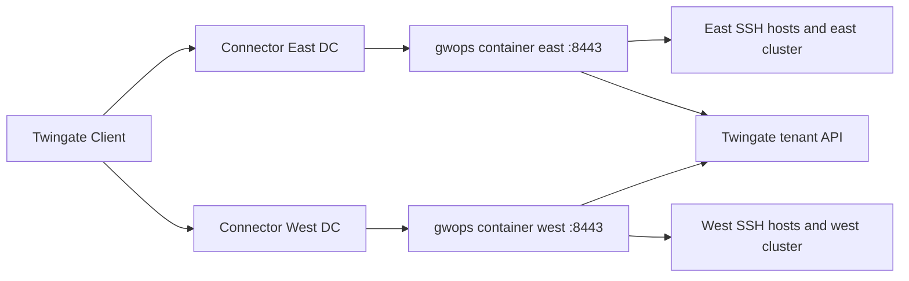

# One gateway per remote network or cluster

For organisations with several sites, VPCs or Kubernetes clusters, where each needs a gateway close
to its own upstreams. You run one gwops container per Remote Network (or per cluster), each with its
own seed, its own `/data` volume and its own Gateway object. This is also how you front more than
one Kubernetes cluster: one gateway serves at most one cluster.

## Environment

- Two sites, each with a Remote Network on the tenant and a Connector in it: `East DC` and
  `West DC`. The recipe shows two; add more the same way.
- At each site, one `linux/amd64` Docker host running Docker Engine and Compose v2: `10.10.0.20`
  in East DC, `10.20.0.20` in West DC. The site's Connector reaches its Docker host on TCP 8443.
- At each site, SSH hosts and one Kubernetes API server reachable from that site's Docker host
  only: `10.10.1.0/24` and `east.k8s.internal.example.com:6443` in East DC, `10.20.1.0/24` and
  `west.k8s.internal.example.com:6443` in West DC.
- Each Docker host has outbound HTTPS to the tenant (`acme.twingate.com`).
- No existing PKI. Each gateway uses its own generated CAs.

## What you get

- Two Gateway objects, one per Remote Network, each created by its own gwops container in
  remote-network mode.
- At each site, SSH resources and one Kubernetes resource attached to that site's Gateway object
  and created in that site's Remote Network.
- The same access model at both sites: `resource_defaults` grants "Platform Engineers" with the
  "Privileged Access MFA" policy, copied into both seeds.
- Generated X.509 and SSH CAs per gateway, registered on the tenant as `gwops-x509-<address>` and
  `gwops-ssh-<address>`.
- No recording. Out of scope: any coordination between the containers. Each one is independent
  and knows nothing about the others.

## Architecture



A Client reaches each site's gateway through that site's Connector; each container fronts only
its own site's upstreams and talks to the same tenant API on its own.

## Twingate prerequisites

Create these on the tenant first. gwops never creates Remote Networks, Connectors, groups or
security policies.

1. A Remote Network per site: `East DC` and `West DC`. Names must be unique on the tenant: a name
   that matches two Remote Networks is an error.
2. A Connector in each Remote Network that can reach that site's Docker host on TCP 8443.
3. The group "Platform Engineers" and the security policy "Privileged Access MFA". Both seeds refer
   to them by exact name.
4. An API key with read and write access, including resources, certificate authorities and
   gateways. One key can serve every site. One key per site limits the blast radius of a leak: you
   can revoke or rotate one site's key without touching the others, and a leaked key points to one
   host.

See the [Twingate documentation](https://www.twingate.com/docs).

## Files

### Directory layout

Keep every site's files in one repository and copy each site's directory to its Docker host.

```text
gateways/
├── common/
│   └── access.yaml          # the shared resource_defaults block, copied into each seed by hand
├── east/
│   ├── compose.yaml
│   ├── .env                 # not in version control
│   ├── seed.yaml
│   └── k8s-creds/
│       ├── east-k8s.token
│       └── east-k8s-ca.crt
└── west/
    ├── compose.yaml
    ├── .env                 # not in version control
    ├── seed.yaml
    └── k8s-creds/
        ├── west-k8s.token
        └── west-k8s-ca.crt
```

gwops has no include or templating mechanism: each seed is one self-contained file. `common/`
only holds the text you copy. If you generate the seeds with a templating tool, the output is still
one plain file per site.

### seed.yaml (East DC)

```yaml
twingate:
  network: acme
  host: twingate.com
  remote_network: East DC          # exact Remote Network name for this site
  gateway_address: 10.10.0.20:8443 # this site's Docker host, as its Connector reaches it
  resource_defaults:               # identical in every site's seed
    groups: ["Platform Engineers"]
    security_policy: "Privileged Access MFA"

ssh_upstreams:
  - name: east-web-1               # site prefix keeps names readable across the tenant
    address: 10.10.1.11:22
  - name: east-web-2
    address: 10.10.1.12:22
  - name: east-db-1
    address: 10.10.1.21:22

k8s_clusters:                      # at most one per gateway
  - name: east-k8s
    address: east.k8s.internal.example.com
    port: 6443
    bearer_token_file: /config/k8s-creds/east-k8s.token
    ca_file: /config/k8s-creds/east-k8s-ca.crt

admin_api:
  bind: 0.0.0.0                    # so the loopback-only publish reaches it from the host
```

### seed.yaml (West DC)

```yaml
twingate:
  network: acme
  host: twingate.com
  remote_network: West DC
  gateway_address: 10.20.0.20:8443
  resource_defaults:
    groups: ["Platform Engineers"]
    security_policy: "Privileged Access MFA"

ssh_upstreams:
  - name: west-web-1
    address: 10.20.1.11:22
  - name: west-db-1
    address: 10.20.1.21:22

k8s_clusters:
  - name: west-k8s
    address: west.k8s.internal.example.com
    port: 6443
    bearer_token_file: /config/k8s-creds/west-k8s.token
    ca_file: /config/k8s-creds/west-k8s-ca.crt

admin_api:
  bind: 0.0.0.0
```

The two seeds differ only in `twingate.remote_network`, `twingate.gateway_address` and the
upstreams. `admin_api.bind: 0.0.0.0` lets `curl` on each Docker host reach the API through the
loopback-only publish; see [Admin API behind a TLS proxy](../operations/admin-api-behind-tls-proxy.md).

### .env

One per host. Use a different admin token at each site.

```sh
TWINGATE_API_KEY=<api-key>
GWOPS_ADMIN_TOKEN=<admin-token-for-this-site>
```

Generate each admin token with `openssl rand -hex 32`. Restrict the file: `chmod 0600 .env`.

### compose.yaml

The same file at every site.

```yaml
services:
  gateway:
    image: ghcr.io/twingate-solutions/gwops:<version>
    pull_policy: missing
    container_name: gwops-gateway
    restart: unless-stopped
    stop_grace_period: 40s
    security_opt:
      - "no-new-privileges:true"
    cap_drop:
      - ALL
    read_only: true
    tmpfs:
      - /run/gateway:mode=1777
      - /tmp:mode=1777
    environment:
      TWINGATE_API_KEY: ${TWINGATE_API_KEY:?set TWINGATE_API_KEY in .env}
      GWOPS_ADMIN_TOKEN: ${GWOPS_ADMIN_TOKEN:?set GWOPS_ADMIN_TOKEN in .env}
    volumes:
      - ./seed.yaml:/config/seed.yaml:ro
      - ./k8s-creds:/config/k8s-creds:ro
      - gwdata:/data
    ports:
      - "8443:8443"
      - "127.0.0.1:9090:9090"
      - "127.0.0.1:8081:8081"

volumes:
  gwdata:
```

Replace `<version>` with the release you deploy. Roll the same version to every site, one site at
a time. `stop_grace_period: 40s` gives the gateway its full 30 s drain on a stop.

### Kubernetes credential files

At each site, a bearer token for the cluster and the API server's CA certificate, readable by uid
10001. How to prepare them is in [Front a Kubernetes API server](../guides/kubernetes.md).

```sh
sudo chown -R 10001:10001 k8s-creds
chmod 0600 k8s-creds/*.token
chmod 0644 k8s-creds/*-ca.crt
```

## Deploy

### What is shared and what is not

| Shared across sites | Per gateway |
| --- | --- |
| The tenant, its groups and security policies | The seed and the `/data` volume |
| The API key, if you choose one key | The Gateway object and its address |
| The access model, by copying `resource_defaults` | The generated X.509 and SSH CAs |
|  | The ownership registry (`/data/state.json`) and the resources it lists |

Each container changes only the tenant objects in its own ownership registry, so one site can never
delete or change another site's resources. Never share a `/data` volume between two containers.

Because each gateway generates its own SSH CA, an SSH host trusts the SSH CA of the gateway that
fronts it. To have every host trust one key instead, bring your own SSH CA and use it in every seed;
see [SSH fleet that already trusts your SSH CA](ssh-fleet-existing-ssh-ca.md).

### Naming

Upstream names are per seed: each container keys its registry by its own names, so two sites could
both use `web-1` without a conflict inside gwops. The names also become Twingate resource names,
where two resources called `web-1` are hard to tell apart. Prefix names with the site.

### Steps

Repeat for each site.

1. Copy the site's directory to its Docker host and `cd` into it.
2. Write `.env` (see [.env](#env)) and set the file modes for `.env` and `k8s-creds/`.
3. Check that the site's `seed.yaml` names this site's Remote Network and this host's address in
   `gateway_address`.
4. Start the container:

   ```sh
   docker compose up -d
   docker compose logs -f gateway
   ```

5. Read the first pass on that host:

   ```sh
   export BASE=http://127.0.0.1:8081
   export TOKEN=<admin-token>   # this site's GWOPS_ADMIN_TOKEN

   curl -s -H "Authorization: Bearer $TOKEN" $BASE/status | jq '{process: .process.state, ok: .last_reconcile.ok, actions: .last_reconcile.actions, tg: .tg}'
   ```

6. Roll the site's SSH CA out to that site's SSH hosts; see
   [Trust the SSH CA on each target](../guides/ssh-resources.md#trust-the-ssh-ca-on-each-target):

   ```sh
   docker compose exec gateway cat /data/pki/ssh-ca.key.pub > twingate-gateway-ssh-ca-east.pub
   ```

Bring up one site, verify it, then the next.

## Verify

On each Docker host:

- **Gateway object.** `last_reconcile.actions` on the first pass contains
  `created gateway (<id>) at 10.10.0.20:8443 in remote network <id>` (or
  `adopted existing gateway (<id>) at 10.10.0.20:8443` if one already existed at that address),
  then `registered X.509 CA (<id>) and bound it to gateway` and
  `registered SSH CA (<id>) and bound it to gateway`. `tg.ok` is `true`.
- **Resources.** `last_reconcile.actions` contains `created ssh resource 'east-web-1' (<id>)` for
  each SSH host and `created kubernetes resource 'east-k8s' (<id>)`. Later passes do not repeat
  these lines.
- **Process.** `process.state` is `running`; `docker compose ps` shows `(healthy)`.
- **Certificates.** `certs.leaf_state` is `ok`.
- **Placement.** In the Admin Console, each site's resources sit in that site's Remote Network and
  are attached to that site's Gateway object. `tg.gateway_mismatches` is `{}`.
- **End user.** A member of "Platform Engineers", signed in to the Twingate Client, runs
  `ssh <user>@10.10.1.11` and `kubectl get pods` with a kubeconfig pointing at
  `east.k8s.internal.example.com`, then does the same for the West DC addresses.

## Day 2

- **Add or remove upstreams** at a site: edit that site's seed, or use the admin API on that
  site's host. See [SSH resources](../guides/ssh-resources.md).
- **Change the access model**: edit `resource_defaults` in every seed. Nothing keeps the copies in
  step; diff the `twingate.resource_defaults` block of each seed in review. See
  [Access control](../guides/access-control.md).
- **Rotate Kubernetes credentials** per site: rewrite the files; the gateway drain-restarts. See
  [Front a Kubernetes API server](../guides/kubernetes.md#rotate-the-credentials).
- **Upgrade** one site at a time, verifying each before the next. See
  [Upgrades and pins](../operations/upgrades-and-pins.md).
- **Monitor** each container's `/healthz` and `/status` separately. See
  [Monitoring](../operations/monitoring.md).
- **Back up** each `/data` volume separately; a restore must go back to the same site. See
  [Backup and restore](../operations/backup-and-restore.md).

## Variations

### Two clusters on one host

Two clusters reachable from one Docker host need two containers on that host, each with its own
seed, `/data` volume, container name and host ports. Inside both containers the gateway listens on
8443 and the admin API on 8081; only the host side of each publish differs, and `gateway_address`
uses the host port the Connector reaches.

```yaml
x-gateway: &gateway
  image: ghcr.io/twingate-solutions/gwops:<version>
  pull_policy: missing
  restart: unless-stopped
  stop_grace_period: 40s
  security_opt:
    - "no-new-privileges:true"
  cap_drop:
    - ALL
  read_only: true
  tmpfs:
    - /run/gateway:mode=1777
    - /tmp:mode=1777

services:
  gateway-a:
    <<: *gateway
    container_name: gwops-gateway-a
    environment:
      TWINGATE_API_KEY: ${TWINGATE_API_KEY:?set TWINGATE_API_KEY in .env}
      GWOPS_ADMIN_TOKEN: ${GWOPS_ADMIN_TOKEN_A:?set GWOPS_ADMIN_TOKEN_A in .env}
    volumes:
      - ./a/seed.yaml:/config/seed.yaml:ro
      - ./a/k8s-creds:/config/k8s-creds:ro
      - gwdata-a:/data
    ports:
      - "8443:8443"
      - "127.0.0.1:9090:9090"
      - "127.0.0.1:8081:8081"
  gateway-b:
    <<: *gateway
    container_name: gwops-gateway-b
    environment:
      TWINGATE_API_KEY: ${TWINGATE_API_KEY:?set TWINGATE_API_KEY in .env}
      GWOPS_ADMIN_TOKEN: ${GWOPS_ADMIN_TOKEN_B:?set GWOPS_ADMIN_TOKEN_B in .env}
    volumes:
      - ./b/seed.yaml:/config/seed.yaml:ro
      - ./b/k8s-creds:/config/k8s-creds:ro
      - gwdata-b:/data
    ports:
      - "8444:8443"
      - "127.0.0.1:9091:9090"
      - "127.0.0.1:8082:8081"

volumes:
  gwdata-a:
  gwdata-b:
```

Seed `a/seed.yaml` sets `gateway_address: 10.10.0.20:8443` and seed `b/seed.yaml` sets
`gateway_address: 10.10.0.20:8444`, both with `remote_network: East DC`. Remote-network mode adopts a
Gateway object only when its address matches exactly, so the two containers create and keep two
separate Gateway objects in the same Remote Network. The Connector must reach both host ports. Use
`docker compose exec gateway-a ...` and `BASE=http://127.0.0.1:8082` for the second container.
[Private and public gateways on one host](private-and-public-gateways-one-host.md) uses the same
layout for a different reason.

### One SSH CA for every site

Bring your own SSH CA and set `ca.ssh.generate: false` with `key_path` in every seed. Each gateway
still generates its own X.509 CA, so remote-network mode keeps creating the Gateway objects; bind
your SSH CA to each one on the tenant yourself. See
[SSH fleet that already trusts your SSH CA](ssh-fleet-existing-ssh-ca.md) and
[Bring your own X.509 or SSH CA](../guides/private-ca-byo.md).

### Pinned Gateway objects

If someone else creates the Gateway objects (for example with Terraform), set `twingate.gateway_id`
in each seed instead of `remote_network` and `gateway_address`. See
[Choose how gwops finds the Gateway object](../guides/gateway-modes.md).

## Related

- [Choose how gwops finds the Gateway object](../guides/gateway-modes.md)
- [Front a Kubernetes API server](../guides/kubernetes.md)
- [SSH resources](../guides/ssh-resources.md)
- [Access control](../guides/access-control.md)
- [Bring your own X.509 or SSH CA](../guides/private-ca-byo.md)
- [Monitoring](../operations/monitoring.md), [Upgrades and pins](../operations/upgrades-and-pins.md),
  [Backup and restore](../operations/backup-and-restore.md)
- [Twingate integration](../architecture/twingate-integration.md): the ownership registry and where
  resources are created.
- [Seed reference: `twingate`](../reference/seed.md#twingate),
  [Known limitations: Kubernetes](../reference/limitations.md#kubernetes)
