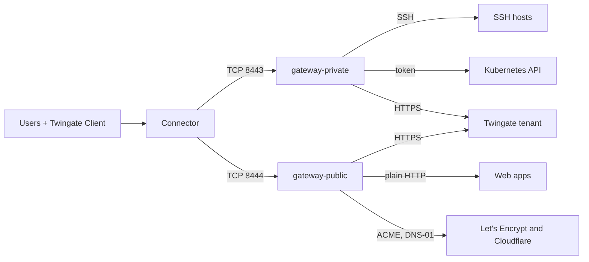

# Private and public gateways on one host

This recipe is for teams who front SSH hosts and a Kubernetes cluster with a private CA, and also
publish web apps that unmanaged browsers must trust. One container cannot do both: private CA
mode and public certificate mode are mutually exclusive. So you run two containers on one Docker
host, each with its own seed, `/data` volume, Gateway object and host port.

> **Note:** Untested example. The backup command on this page has not been run by this project. Adapt it to your environment and test it before you rely on it.

## Environment

- One Linux `amd64` host with Docker Engine and Docker Compose v2, at `10.0.0.5`. The image is
  `linux/amd64` only.
- A Twingate Connector in the Remote Network "Production DC" that reaches `10.0.0.5` on TCP 8443
  and TCP 8444.
- For the private gateway: SSH hosts at `10.0.10.5` and `10.0.10.6`, and a Kubernetes API server
  at `k8s.internal.example.com:6443` with a service-account token and its CA certificate.
- For the public gateway: the zone `example.com` on Cloudflare, a challenge zone
  `acme-challenges.example.net` on Cloudflare that holds nothing else, and two plain-HTTP apps on a
  private segment, `grafana.apps.example.com` at `10.0.30.11:3000` and `wiki.apps.example.com` at
  `10.0.30.12:8080`. The app names are not in public DNS.
- Outbound HTTPS to the tenant from both containers; to Let's Encrypt and `api.cloudflare.com`
  from the public one.
- The host clock is synced over NTP.

## What you get

- **Container `gateway-private`**, in private CA mode with gwops-generated X.509 and SSH CAs, in
  remote-network mode at `10.0.0.5:8443`: two SSH resources and one Kubernetes resource for
  "Platform Engineers".
- **Container `gateway-public`**, in public certificate mode with a Let's Encrypt wildcard for
  `*.apps.example.com` that gwops issues and renews, in remote-network mode at `10.0.0.5:8444`: two
  web-app resources for "App Users", trusted by any browser.
- Two Gateway objects in one Remote Network, each created by its own container and bound to its
  own CAs.
- Nothing recorded. Each container can turn recording on separately.

gwops does not coordinate the two containers. Each manages only the tenant objects in its own
ownership registry, `/data/state.json` on its own volume.

## Architecture



The Connector reaches the private gateway on host port 8443 and the public gateway on host port
8444. The private gateway fronts SSH and Kubernetes; the public one fronts the web apps and gets
its certificate from Let's Encrypt. Both sync with the tenant.

## Twingate prerequisites

Create these first. See the [Twingate documentation](https://www.twingate.com/docs).

1. The Remote Network "Production DC" with a healthy Connector that reaches `10.0.0.5` on TCP 8443
   and TCP 8444. One Remote Network can hold both Gateway objects.
2. The groups "Platform Engineers" and "App Users".
3. An API key with read and write access, including resources, certificate authorities and
   gateways. One key can serve both containers; separate keys limit what a leaked key exposes.

On Cloudflare, for the public gateway (see the
[Cloudflare documentation](https://developers.cloudflare.com/)):

1. In `example.com`, a CNAME from `_acme-challenge.apps.example.com` to a name inside
   `acme-challenges.example.net`, for example `apps-example-com.acme-challenges.example.net`.
2. An API token with `Zone:Read` and `DNS:Edit` on `acme-challenges.example.net` only.

On the cluster: a service account and a long-lived bearer token with the permissions the
[Twingate documentation](https://www.twingate.com/docs) lists for the gateway.

Each container finds no Gateway object at its own address on its first pass and creates one. gwops
matches the address exactly, so the two never adopt each other's Gateway object.

## Files

### Directory layout

```text
gwops/
├── compose.yaml
├── .env
├── private/
│   ├── seed.yaml
│   └── k8s-creds/
│       ├── prod.token        # owner 10001, mode 0600
│       └── prod-ca.crt       # owner 10001, mode 0644
└── public/
    ├── seed.yaml
    └── acme/
        └── cloudflare-token  # owner 10001, mode 0400
```

### private/seed.yaml

```yaml
twingate:
  network: acme
  host: twingate.com
  remote_network: Production DC
  gateway_address: 10.0.0.5:8443         # host port 8443 -> container 8443
  resource_defaults:
    groups: ["Platform Engineers"]

# Private CA mode: both CAs generated (the default, written out).
ca:
  x509:
    generate: true
  ssh:
    generate: true

ssh_upstreams:
  - name: web-1
    address: 10.0.10.5
  - name: web-2
    address: 10.0.10.6

k8s_clusters:
  - name: prod
    address: k8s.internal.example.com
    port: 6443
    bearer_token_file: /config/k8s-creds/prod.token
    ca_file: /config/k8s-creds/prod-ca.crt

admin_api:
  bind: 0.0.0.0                          # reachable through the loopback-only publish
  port: 8081
```

### public/seed.yaml

```yaml
twingate:
  network: acme
  host: twingate.com
  remote_network: Production DC
  gateway_address: 10.0.0.5:8444         # host port 8444 -> container 8443
  resource_defaults:
    groups: ["App Users"]

# Public certificate mode. No ca.x509 block: public_tls replaces it.
public_tls:
  zones: ["example.com"]
  registered_root: isrg_root_x1
  acme:
    email: ops@example.com
    accept_tos: true
    directory: staging                   # dry run first; change to production in Deploy step 5
    token_file: /config/acme/cloudflare-token
  certificates:
    - name: apps-wildcard
      names: ["*.apps.example.com"]
      source: acme
      challenge_alias: acme-challenges.example.net

web_app_proxy:
  request_headers:
    X-Twingate-User: "{{username}}"
    X-Twingate-Groups: "{{groups}}"
  plaintext_upstreams:
    dns_suffixes: ["grafana.apps.example.com", "wiki.apps.example.com"]

web_apps:
  - name: grafana
    address: grafana.apps.example.com:3000
    upstream_tls: none
  - name: wiki
    address: wiki.apps.example.com:8080
    upstream_tls: none

admin_api:
  bind: 0.0.0.0                          # container port stays 8081; the host port differs
  port: 8081
```

Both seeds keep `admin_api.port: 8081`. The image's healthcheck reads the port from each
container's own seed, so it keeps working; only the host-side publish differs.

### .env

```sh
# Twingate API key: read and write, including resources, certificate authorities and gateways.
# One key for both containers here; use two variables to give each its own key.
TWINGATE_API_KEY=<twingate-api-key>
# A separate admin token per container. Generate each with: openssl rand -hex 32
GWOPS_ADMIN_TOKEN_PRIVATE=<admin-token-private>
GWOPS_ADMIN_TOKEN_PUBLIC=<admin-token-public>
```

### compose.yaml

```yaml
services:
  gateway-private:
    image: ghcr.io/twingate-solutions/gwops:<version>
    pull_policy: missing
    container_name: gwops-private
    restart: unless-stopped
    security_opt:
      - "no-new-privileges:true"
    cap_drop:
      - ALL
    read_only: true
    tmpfs:
      - /run/gateway:mode=1777
      - /tmp:mode=1777
    environment:
      TWINGATE_API_KEY: ${TWINGATE_API_KEY:?set TWINGATE_API_KEY in .env}
      GWOPS_ADMIN_TOKEN: ${GWOPS_ADMIN_TOKEN_PRIVATE:?set GWOPS_ADMIN_TOKEN_PRIVATE in .env}
    volumes:
      - ./private/seed.yaml:/config/seed.yaml:ro
      - gwdata-private:/data
      - ./private/k8s-creds:/config/k8s-creds:ro
    ports:
      - "8443:8443"              # private gateway listener
      - "127.0.0.1:9090:9090"    # private gateway metrics, host loopback only
      - "127.0.0.1:8081:8081"    # private admin API, host loopback only
    networks: [private]

  gateway-public:
    image: ghcr.io/twingate-solutions/gwops:<version>
    pull_policy: missing
    container_name: gwops-public
    restart: unless-stopped
    security_opt:
      - "no-new-privileges:true"
    cap_drop:
      - ALL
    read_only: true
    tmpfs:
      - /run/gateway:mode=1777
      - /tmp:mode=1777
    environment:
      TWINGATE_API_KEY: ${TWINGATE_API_KEY:?set TWINGATE_API_KEY in .env}
      GWOPS_ADMIN_TOKEN: ${GWOPS_ADMIN_TOKEN_PUBLIC:?set GWOPS_ADMIN_TOKEN_PUBLIC in .env}
    dns: [1.1.1.1, 1.0.0.1]      # public resolvers, so the ACME check sees Cloudflare's records
    extra_hosts:                 # the app names are not in public DNS
      - "grafana.apps.example.com:10.0.30.11"
      - "wiki.apps.example.com:10.0.30.12"
    volumes:
      - ./public/seed.yaml:/config/seed.yaml:ro
      - gwdata-public:/data
      - ./public/acme:/config/acme:ro
    ports:
      - "8444:8443"              # public gateway listener: host 8444, container 8443
      - "127.0.0.1:9091:9090"    # public gateway metrics, host loopback only
      - "127.0.0.1:8082:8081"    # public admin API, host loopback only
    networks: [public]

volumes:
  gwdata-private:
  gwdata-public:

networks:
  private:
  public:
```

Replace `<version>` with a published version tag, the same in both services. Do not use `:latest`
for a production deployment.

Each service is the shipped one with its own name, volume, mounts and host ports. Each sits on its
own Docker network: with `admin_api.bind: 0.0.0.0` a container on a shared network could reach the
other's admin port (the token still guards it).

### Keep the two apart

- **Separate `/data` volumes, always.** Each volume holds that container's CAs and its ownership
  registry. Two containers on one volume would both treat the same Gateway object and resources as
  their own. Never share or copy a volume between them.
- **Separate seeds and Gateway objects.** Different `gateway_address` values (or different
  `gateway_id` values in pinned-gateway mode). The CAs each registers are named after its own
  address.
- **Distinct upstreams.** Give each container its own upstream names and addresses. Keep resource
  names unique across the tenant so the Admin Console stays readable.
- **Separate admin tokens.** A token for one container does not work on the other.

### Ports

| Purpose | Container port (both) | `gateway-private` host port | `gateway-public` host port |
| --- | --- | --- | --- |
| Gateway listener | 8443 | `8443` | `8444` |
| Gateway metrics | 9090 | `127.0.0.1:9090` | `127.0.0.1:9091` |
| Admin API | 8081 | `127.0.0.1:8081` | `127.0.0.1:8082` |

The gateway always listens on 8443 and serves metrics on 9090 inside the container; no
setting changes that. Change the host side only, and set `gateway_address` to the
host port.

## Deploy

1. Create the directory and the files above, then set ownership:

   ```sh
   sudo chown -R 10001:10001 private/k8s-creds
   chmod 0600 private/k8s-creds/prod.token
   mkdir -p public/acme
   read -rs token && printf '%s' "$token" > public/acme/cloudflare-token && unset token
   sudo chown 10001:10001 public/acme/cloudflare-token
   chmod 0400 public/acme/cloudflare-token
   ```

2. Start both containers:

   ```sh
   docker compose up -d
   ```

3. Check the private gateway:

   ```sh
   BASE=http://127.0.0.1:8081
   TOKEN=<admin-token-private>      # GWOPS_ADMIN_TOKEN_PRIVATE from .env
   BASE_PUBLIC=http://127.0.0.1:8082
   TOKEN_PUBLIC=<admin-token-public> # GWOPS_ADMIN_TOKEN_PUBLIC from .env

   curl -s -H "Authorization: Bearer $TOKEN" $BASE/status | jq '{process: .process.state, ok: .last_reconcile.ok, mode: .tls.mode, leaf: .certs.leaf_state}'
   ```

   Expect `running`, `true`, `static` and `ok`.
4. Wait for the public gateway's staging dry run. Its gateway process stays stopped, and the
   container unhealthy, until a production certificate is installed:

   ```sh
   curl -s -H "Authorization: Bearer $TOKEN_PUBLIC" $BASE_PUBLIC/status | jq '.certs.public[] | {name, state, acme: .acme.state, error: .acme.error_code}'
   ```

   Wait for `"acme": "dry_run_ok"`.
5. In `public/seed.yaml`, change `directory: staging` to `directory: production` and save. Wait for
   the certificate to be installed and the gateway to start:

   ```sh
   curl -s -H "Authorization: Bearer $TOKEN_PUBLIC" $BASE_PUBLIC/status | jq '{process: .process.state, mode: .tls.mode, root: .certs.registered_root.bound, cert: [.certs.public[] | {name, state}]}'
   ```

   Expect `running`, `public`, `true` and `ok`. The staging-then-production flow and its failures
   are in [Issue public certificates with ACME](../guides/public-certs-acme.md).
6. Install the private gateway's SSH CA on both SSH hosts:

   ```sh
   docker compose exec gateway-private cat /data/pki/ssh-ca.key.pub > twingate-gateway-ssh-ca.pub
   ```

   Install it as in [SSH resources](../guides/ssh-resources.md#trust-the-ssh-ca-on-each-target).

## Verify

```sh
curl -s -H "Authorization: Bearer $TOKEN" $BASE/status | jq '{tg: .tg.ok, actions: .last_reconcile.actions}'
curl -s -H "Authorization: Bearer $TOKEN_PUBLIC" $BASE_PUBLIC/status | jq '{tg: .tg.ok, jwks: .jwks.ok, readiness: [.web_apps.readiness[] | {name, state, reasons}]}'
docker compose ps
```

- **Two Gateway objects:** the first pass of `gateway-private` lists `created gateway (<id>) at
  10.0.0.5:8443 in remote network <id>`; that of `gateway-public` lists the same with
  `10.0.0.5:8444`. The two ids differ. Both appear in the Admin Console under "Production DC".
- **Private CA mode:** `gateway-private` lists `registered X.509 CA (<id>) and bound it to
  gateway` and `registered SSH CA (<id>) and bound it to gateway`, then `created ssh resource` for
  `web-1` and `web-2` and `created kubernetes resource 'prod' (<id>)`.
- **Public certificate mode:** `gateway-public` lists the ISRG Root X1 registration
  (`registered public root isrg_root_x1 as X.509 CA <id> (<name>)`, or an `adopted X.509 CA`
  line) and `created webapp resource` for `grafana` and `wiki`. Both apps are `ready`.
- **Health:** `docker compose ps` shows both containers healthy.
- **End users:** a member of "Platform Engineers" connects with `ssh <user>@10.0.10.5` and runs
  `kubectl get ns` against the cluster resource. A member of "App Users" on any device opens
  `https://grafana.apps.example.com` and sees a Let's Encrypt certificate, with no warning.

## Day 2

- **Each container is managed on its own.** Upstream changes, rotations and restarts on one do not
  touch the other. Use `docker compose restart gateway-private` or `gateway-public`.
- **Public certificate renewal** is automatic in `gateway-public`; see
  [Issue public certificates with ACME](../guides/public-certs-acme.md#renewal).
- **Private leaf renewal** is automatic in `gateway-private`; for its X.509 CA see
  [Rotate the leaf and the CA](../operations/ca-and-leaf-rotation.md).
- **Backups:** back up both volumes, each with its own archive. With the backup commands in
  [Backup and restore](../operations/backup-and-restore.md), name the service, for example
  `docker compose run --rm -T --no-deps --entrypoint tar gateway-private -C /data -czf - . > gwdata-private.tgz`.
  Restore each archive only into its own volume.
- **Monitoring:** poll both `/status` endpoints and scrape both metrics ports (`127.0.0.1:9090`
  and `127.0.0.1:9091`). See [Monitoring](../operations/monitoring.md).
- **Upgrades:** move both services to the same `<version>` together, one container at a time if
  you want to limit the impact. See [Upgrades and pins](../operations/upgrades-and-pins.md).

## Variations

### Two hosts instead

Run each container on its own host, each with its own `gateway_address` on port 8443. See
[One gateway per remote network or cluster](multiple-remote-networks.md).

### Certificates you renew yourself

Use `source: file` in `gateway-public` with your own ACME client. See
[Browser-trusted web apps with certificates you renew](public-web-apps-own-acme-client.md).

### Pinned-gateway mode

Create both Gateway objects on the tenant first and set `twingate.gateway_id` in each seed
instead of `remote_network` and `gateway_address`. See [Gateway modes](../guides/gateway-modes.md).

### Two compose projects

Put each service in its own directory with its own `compose.yaml` and `.env`. The rules in
[Keep the two apart](#keep-the-two-apart) and the port table still apply.

## Related

- Guides: [Gateway modes](../guides/gateway-modes.md),
  [Use gwops-generated CAs](../guides/private-ca-generated.md),
  [Issue public certificates with ACME](../guides/public-certs-acme.md),
  [Serve public certificates from files](../guides/public-certs-files.md),
  [Mix certificate sources](../guides/public-mode-mixed.md#no-split-mode),
  [SSH resources](../guides/ssh-resources.md), [Front a Kubernetes API server](../guides/kubernetes.md),
  [Web apps](../guides/web-apps.md)
- Operations: [Backup and restore](../operations/backup-and-restore.md),
  [Monitoring](../operations/monitoring.md), [Upgrades and pins](../operations/upgrades-and-pins.md)
- Architecture: [Twingate integration](../architecture/twingate-integration.md)
- Reference: [Image: ports](../reference/image.md#ports),
  [Environment: settings](../reference/environment.md#settings)
- Recipes: [Constraints that shape the choice](README.md#constraints-that-shape-the-choice),
  [Browser-trusted web apps with Let's Encrypt on Cloudflare](public-web-apps-acme-cloudflare.md)
