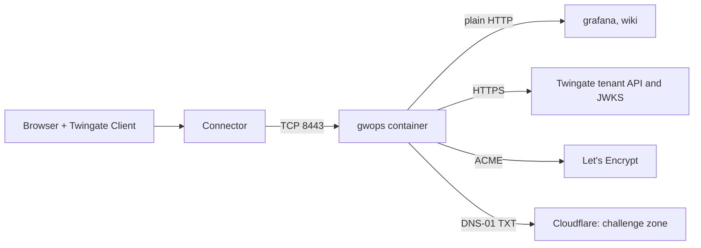

# Browser-trusted web apps with Let's Encrypt on Cloudflare

This recipe is for teams whose users open internal web apps from unmanaged or personal devices,
where no private CA can be installed. gwops runs in public certificate mode: it obtains a Let's
Encrypt wildcard certificate itself, answering the DNS-01 challenge through the Cloudflare API, and
renews it. Browsers trust it with no device step.

> **Security:** Public certificate mode registers ISRG Root X1 as the Gateway object's X.509 CA on
> your tenant. A Twingate Client then accepts any certificate that chains to ISRG Root X1 for the
> names it dials through this gateway, not only the certificate gwops serves. That is the cost of
> browser trust without a private CA. Use this recipe only where that is acceptable. See
> [Serve public certificates from files](../guides/public-certs-files.md).

## Environment

- One Linux `amd64` host with Docker Engine and Docker Compose v2, at `10.0.0.20`. The image is
  `linux/amd64` only.
- A Twingate Connector in the Remote Network "Production DC" that reaches `10.0.0.20` on TCP 8443.
- The zone `example.com` is hosted on Cloudflare. The app names live under `apps.example.com` and
  are not in public DNS.
- A second Cloudflare zone, `acme-challenges.example.net`, that holds nothing else. It receives the
  ACME challenge records, so the DNS token never needs access to `example.com`.
- Two apps on a private segment, `10.0.30.0/24`, that speak plain HTTP and log users in from a
  trusted header:
  - `grafana.apps.example.com` at `10.0.30.11:3000`,
  - `wiki.apps.example.com` at `10.0.30.12:8080`.
- Outbound HTTPS from the container to the tenant, to `acme-v02.api.letsencrypt.org`,
  `acme-staging-v02.api.letsencrypt.org` and `api.cloudflare.com`, and outbound DNS to public
  resolvers.
- The host clock is synced over NTP.

## What you get

- Two Twingate web-app resources, attached to a Gateway object that gwops creates in
  remote-network mode, bound to the registered root ISRG Root X1.
- One Let's Encrypt certificate for `*.apps.example.com`, issued and renewed by gwops, served to
  every browser. Nothing to install on devices.
- Access for the group "App Users". Each app receives `X-Twingate-User` and `X-Twingate-Groups`.
- Nothing recorded. Web-app traffic is never session-recorded.

Out of scope: DNS providers other than Cloudflare, and certificate authorities other than Let's
Encrypt. gwops answers only DNS-01 challenges, only through Cloudflare. For anything else see
[Browser-trusted web apps with certificates you renew](public-web-apps-own-acme-client.md).

## Architecture



The browser reaches the gateway through the Connector and is served the Let's Encrypt
certificate. The gateway forwards to the apps over plain HTTP. gwops gets the certificate from
Let's Encrypt and writes the challenge records into the dedicated Cloudflare zone.

## Twingate prerequisites

Create these first. gwops never creates Remote Networks, Connectors, groups or security policies.
See the [Twingate documentation](https://www.twingate.com/docs).

1. The Remote Network "Production DC" with a healthy Connector that reaches `10.0.0.20:8443`.
2. The group "App Users".
3. An API key with read and write access, including resources, certificate authorities and
   gateways.

On Cloudflare (see the [Cloudflare documentation](https://developers.cloudflare.com/)):

1. The zone `acme-challenges.example.net`, holding nothing else.
2. In `example.com`, a CNAME from `_acme-challenge.apps.example.com` to a name inside the
   challenge zone, for example `apps-example-com.acme-challenges.example.net`. The wildcard
   `*.apps.example.com` and `apps.example.com` share this one challenge name.
3. An API token with `Zone:Read` and `DNS:Edit` on `acme-challenges.example.net` only.

On first start gwops registers ISRG Root X1 as an X.509 CA on the tenant (or reuses a CA object
that already has its fingerprint), registers its SSH CA, and creates the Gateway object bound to
them.

## Files

### Directory layout

```text
gwops/
├── compose.yaml
├── .env
├── seed.yaml
└── acme/
    └── cloudflare-token    # the Cloudflare API token, owner 10001, mode 0400
```

### seed.yaml

```yaml
twingate:
  network: acme
  host: twingate.com
  remote_network: Production DC
  gateway_address: 10.0.0.20:8443        # the Docker host as the Connector reaches it
  resource_defaults:
    groups: ["App Users"]

# No ca.x509 block: public_tls replaces it, and the two are mutually exclusive.
public_tls:
  zones: ["example.com"]                 # every served name must be inside a zone
  registered_root: isrg_root_x1          # the only accepted value
  acme:
    email: ops@example.com               # ACME account contact; a change registers a new account
    accept_tos: true                     # you accept Let's Encrypt's terms of service
    directory: staging                   # dry run first; change to production in Deploy step 6
    token_file: /config/acme/cloudflare-token
  certificates:
    - name: apps-wildcard
      names: ["*.apps.example.com"]      # covers grafana.apps.example.com and wiki.apps.example.com
      source: acme
      challenge_alias: acme-challenges.example.net   # the zone the CNAME points into

web_app_proxy:
  request_headers:
    X-Twingate-User: "{{username}}"
    X-Twingate-Groups: "{{groups}}"
  plaintext_upstreams:                   # the only hosts allowed upstream_tls none
    dns_suffixes: ["grafana.apps.example.com", "wiki.apps.example.com"]

web_apps:
  - name: grafana
    address: grafana.apps.example.com:3000
    upstream_tls: none
  - name: wiki
    address: wiki.apps.example.com:8080
    upstream_tls: none

admin_api:
  bind: 0.0.0.0                          # reachable through the loopback-only publish below
  port: 8081
```

`plaintext_upstreams` lists the two exact names, so a later app under `apps.example.com` with
`upstream_tls: none` is refused until you list it. `admin_api.bind: 0.0.0.0` lets `curl` on the
Docker host reach the admin API through the loopback-only publish; see
[Admin API behind a TLS proxy](../operations/admin-api-behind-tls-proxy.md).

### .env

```sh
# Twingate API key: read and write, including resources, certificate authorities and gateways.
TWINGATE_API_KEY=<twingate-api-key>
# Admin API bearer token. Generate with: openssl rand -hex 32
GWOPS_ADMIN_TOKEN=<admin-token>
```

The Cloudflare token does not go in `.env`. gwops ignores `CF_*` and `CLOUDFLARE_*` variables and
logs `supervisor.acme_cloudflare_environment_ignored` if it finds any; lego reads the token only
from `token_file`.

### compose.yaml

```yaml
services:
  gateway:
    image: ghcr.io/twingate-solutions/gwops:<version>
    pull_policy: missing
    container_name: gwops-gateway
    restart: unless-stopped
    security_opt:
      - "no-new-privileges:true"
    cap_drop:
      - ALL
    read_only: true
    tmpfs:
      - /run/gateway:mode=1777
      - /tmp:mode=1777
    environment:
      TWINGATE_API_KEY: ${TWINGATE_API_KEY:?set TWINGATE_API_KEY in .env}
      GWOPS_ADMIN_TOKEN: ${GWOPS_ADMIN_TOKEN:?set GWOPS_ADMIN_TOKEN in .env}
    # Public resolvers, so lego's propagation check sees Cloudflare's records, and fixed
    # entries for the app names, which are not in public DNS.
    dns: [1.1.1.1, 1.0.0.1]
    extra_hosts:
      - "grafana.apps.example.com:10.0.30.11"
      - "wiki.apps.example.com:10.0.30.12"
    volumes:
      - ./seed.yaml:/config/seed.yaml:ro
      - gwdata:/data                       # also holds the ACME account and renewal state
      - ./acme:/config/acme:ro
    ports:
      - "8443:8443"              # gateway listener; the Connector must reach it
      - "127.0.0.1:9090:9090"    # gateway metrics, host loopback only
      - "127.0.0.1:8081:8081"    # gwops admin API, host loopback only

volumes:
  gwdata:
```

Replace `<version>` with a published version tag. Do not use `:latest` for a production deployment.

If your LAN DNS serves its own copy of `example.com`, it has no `_acme-challenge` record and the
check fails with `dns_propagation`. The `dns` and `extra_hosts` lines above avoid that. The other
working setup, a LAN resolver that forwards the challenge name, is in
[Split-horizon DNS](../guides/public-certs-acme.md#split-horizon-dns).

### acme/cloudflare-token

The Cloudflare API token, as the only content of the file. A non-empty regular file under
`/config/acme/`, owner uid 10001, mode 0400. gwops checks that it exists and never reads it.

> **Security:** The gateway process runs as the same uid as gwops and lego, so it can read the
> token. Scoping the token to the challenge zone means a leaked token can edit only that zone.

## Deploy

1. Create the directory, `seed.yaml`, `.env` and `compose.yaml` from above.
2. Write the token without putting it in your shell history:

   ```sh
   mkdir -p acme
   read -rs token && printf '%s' "$token" > acme/cloudflare-token && unset token
   sudo chown 10001:10001 acme/cloudflare-token
   chmod 0400 acme/cloudflare-token
   ```

3. Start the container:

   ```sh
   docker compose up -d
   docker compose logs -f gateway
   ```

   Startup logs `supervisor.acme_staging_dry_run` and `supervisor.waiting_for_acme`. The gateway
   process stays stopped: no certificate can be served yet. `docker compose ps` shows the container
   unhealthy until a production certificate is installed. That is expected.
4. Read the dry run's progress:

   ```sh
   BASE=http://127.0.0.1:8081
   TOKEN=<admin-token>   # the GWOPS_ADMIN_TOKEN value from .env

   curl -s -H "Authorization: Bearer $TOKEN" $BASE/status | jq '.certs.public[] | {name, state, acme: .acme.state, staging: .acme.staging, error: .acme.error_code}'
   ```

5. Wait for `"acme": "dry_run_ok"` with `"staging": true`. Staging issues from Let's Encrypt's
   staging CA and validates the result, except the chain to ISRG Root X1, and installs nothing,
   because Clients do not trust staging roots. If `error` is set, fix the cause from
   [Common failures](../guides/public-certs-acme.md#common-failures) first; staging failures do
   not count against production rate limits.
6. Switch to production. Change one line in `seed.yaml`:

   ```yaml
   public_tls:
     zones: ["example.com"]
     registered_root: isrg_root_x1
     acme:
       email: ops@example.com
       accept_tos: true
       directory: production
       token_file: /config/acme/cloudflare-token
     certificates:
       - name: apps-wildcard
         names: ["*.apps.example.com"]
         source: acme
         challenge_alias: acme-challenges.example.net
   # ...rest of your seed
   ```

   Save it. gwops sees the change within a few seconds; no restart is needed. If your editor saves
   by renaming a new file over `seed.yaml`, the single-file mount does not see it: run
   `docker compose restart gateway`.
7. Wait for the production certificate. When it is installed, gwops starts the gateway and binds
   the Gateway object to the root:

   ```sh
   curl -s -H "Authorization: Bearer $TOKEN" $BASE/status | jq '{process: .process.state, mode: .tls.mode, root: .certs.registered_root.bound, cert: [.certs.public[] | {name, state, not_after, installed: .acme.installed}]}'
   ```

   Expect `running`, `public`, `true` and the certificate `ok` with `installed: true`.
   `registered_root.bound` is `null` in the pass that sends the binding and becomes `true` on the
   next pass.

### Certificate Transparency

Every certificate Let's Encrypt issues is published in public Certificate Transparency logs,
including each name in it. A wildcard keeps the individual app names out of those logs: only
`*.apps.example.com` is published. Issue per-name certificates only for names you are content to
make public.

### The registered public root

The security note at the top of this page is the trade-off of this recipe. In addition:

- gwops reads the Gateway object's binding on every pass and rebinds it to the root whenever it
  differs. `/status` `certs.registered_root.bound` reports it, and every app gets the readiness
  reason `gateway_ca_unbound` while it is not bound.
- Leaving public mode later does not rebind the gateway to a gwops CA. See the rollback in
  [Serve public certificates from files](../guides/public-certs-files.md#roll-back).

## Verify

```sh
curl -s -H "Authorization: Bearer $TOKEN" $BASE/status | jq '{tg: .tg.ok, jwks: .jwks.ok, trust: .web_apps.browser_trust, readiness: [.web_apps.readiness[] | {name, state, reasons}], acme: [.certs.public[] | {name, next: .acme.next_attempt_at, error: .acme.error_code}]}'
```

- **Tenant:** `tg.ok` is `true`. The first pass's `last_reconcile.actions` lists
  `registered public root isrg_root_x1 as X.509 CA <id> (<name>)` (or `adopted X.509 CA <id> as
  registered public root isrg_root_x1`), `created gateway (<id>) at 10.0.0.20:8443 in remote
  network <id>`, and `created webapp resource 'grafana' (<id>)` and the same for `wiki`.
- **Certificate:** the pass after the production issue lists
  `installed public certificate 'apps-wildcard' generation <id> (gateway hot-reloads)` and, on the
  first install, `started gateway`. `certs.public[].acme.error_code` is `null` and
  `next_attempt_at` is about 12 hours out.
- **Readiness:** both apps are `ready`. `web_apps.browser_trust` is `null`: browsers need nothing.
  `web_apps.warnings` lists both apps for `upstream_tls 'none'`.
- **Token keys:** `jwks.ok` is `true`.
- **Browser:** on any device with the Twingate Client signed in as a member of "App Users", open
  `https://grafana.apps.example.com`. The certificate is issued by Let's Encrypt for
  `*.apps.example.com`, with no warning.
- **From the command line:** `openssl s_client -connect grafana.apps.example.com:443 -servername
  grafana.apps.example.com` on such a device shows the same certificate.

## Day 2

- **Renewal** is automatic. gwops checks the certificate every 12 hours (up to 1 hour of jitter)
  and lego renews it when Let's Encrypt's renewal information says so or a third of its lifetime
  remains. The gateway hot-reloads it. A failed attempt keeps the installed certificate serving
  and backs off from 15 minutes to 24 hours. See
  [Issue public certificates with ACME](../guides/public-certs-acme.md#renewal).
- **Force an attempt:** `curl -s -X POST -H "Authorization: Bearer $TOKEN"
  $BASE/certs/public/apps-wildcard/issue`.
- **Add an app** under `apps.example.com`: add a `web_apps` entry, an `extra_hosts` line and a
  `plaintext_upstreams` entry if it speaks plain HTTP, then `docker compose up -d`. The wildcard
  already covers the name. A name outside `*.apps.example.com`, including `apps.example.com`
  itself and `a.b.apps.example.com`, needs its own `public_tls` coverage first, or the seed is
  refused.
- **Rotate the Cloudflare token:** rewrite `acme/cloudflare-token`. lego reads it on the next
  attempt.
- **Backups:** `/data/acme/` holds the ACME account and the renewal schedule. Losing it means a
  new account and a fresh order, which count against Let's Encrypt's rate limits. See
  [Backup and restore](../operations/backup-and-restore.md).
- **Monitoring:** alert on `certs.public[].acme.error_code` not `null`, `certs.public[].state` of
  `expiring` or `invalid`, and `certs.registered_root.bound == false`. See
  [Monitoring](../operations/monitoring.md), and the ACME rows in
  [Troubleshooting](../operations/troubleshooting.md#certificates-and-acme).
- **Upgrades:** see [Upgrades and pins](../operations/upgrades-and-pins.md).

## Variations

### Zone not on Cloudflare

Run your own ACME client and give gwops the files. See
[Browser-trusted web apps with certificates you renew](public-web-apps-own-acme-client.md).

### Without a challenge zone

Leave out `challenge_alias` and the CNAME, and scope the token to `example.com` itself
(`Zone:Read`, `DNS:Edit`). The token can then edit every record in your main zone.

### Upstreams over TLS, or the access token

Apps that serve HTTPS with an internal CA need `upstream_tls: verify_full` and the CA as an
`upstream_ca_bundles` entry; see [Web-app upstream TLS](../guides/web-apps-upstream-tls.md). An
app that verifies the signed access token gets a per-app `Authorization: "Bearer {{jwt}}"`
header, which requires `verify_full`; see
[Pass identity to a web app](../guides/web-apps-identity.md).

### Also front SSH and Kubernetes in public mode

SSH and Kubernetes addresses are served names too: each must be a DNS name inside a zone and
covered by exactly one certificate. IP addresses are refused. Mixing ACME and file certificates in
one `public_tls` block is covered in
[Mix certificate sources; SSH and Kubernetes in public mode](../guides/public-mode-mixed.md).

### Private-CA SSH and Kubernetes beside these apps

One container cannot serve both a private CA and public certificates. Run two; see
[Private and public gateways on one host](private-and-public-gateways-one-host.md).

## Related

- Guides: [Issue public certificates with ACME](../guides/public-certs-acme.md),
  [Serve public certificates from files](../guides/public-certs-files.md),
  [Mix certificate sources](../guides/public-mode-mixed.md), [Web apps](../guides/web-apps.md),
  [Pass identity to a web app](../guides/web-apps-identity.md),
  [Gateway modes](../guides/gateway-modes.md)
- Operations: [Monitoring](../operations/monitoring.md),
  [Troubleshooting](../operations/troubleshooting.md),
  [Backup and restore](../operations/backup-and-restore.md)
- Architecture: [ACME](../architecture/acme.md), [Certificates](../architecture/certificates.md)
- Reference: [Seed: `public_tls`](../reference/seed.md#public_tls),
  [Admin API: `certs.public[].acme`](../reference/admin-api.md#certspublicacme),
  [Image: network egress](../reference/image.md#network-egress),
  [Known limitations: certificates and public mode](../reference/limitations.md#certificates-and-public-mode)
- External: [Let's Encrypt documentation](https://letsencrypt.org/docs/),
  [lego](https://go-acme.github.io/lego/), [Cloudflare documentation](https://developers.cloudflare.com/)
