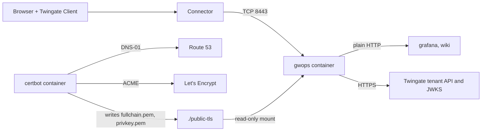

# Browser-trusted web apps with certificates you renew

This recipe is for teams who want browser-trusted certificates on their web apps without
installing a CA on devices, but whose DNS is not on Cloudflare (Route 53, Azure DNS, BIND and so
on), or whose certificates are issued by another team's tooling. An ACME client you run obtains
Let's Encrypt certificates and writes them into a directory gwops reads. gwops validates each
pair, installs it, and the gateway hot-reloads it. The example uses certbot with its Route 53
plugin in a second container; any ACME client that writes the two files works the same way.

> **Security:** Public certificate mode registers ISRG Root X1 as the Gateway object's X.509 CA on
> your tenant. A Twingate Client then accepts any certificate that chains to ISRG Root X1 for the
> names it dials through this gateway, not only the certificate gwops serves. Use this recipe only
> where that is acceptable. See
> [Serve public certificates from files](../guides/public-certs-files.md).

> **Note:** Untested example. The certbot container and its flags on this page have not been run by this project. Adapt them to your environment and test them before you rely on them.

## Environment

- One Linux `amd64` host with Docker Engine and Docker Compose v2, at `10.0.0.20`. The image is
  `linux/amd64` only.
- A Twingate Connector in the Remote Network "Production DC" that reaches `10.0.0.20` on TCP 8443.
- The zone `example.com` is hosted on Amazon Route 53. The app names live under
  `apps.example.com`.
- AWS credentials that allow the certbot Route 53 plugin to change records in that zone.
- Two apps that speak plain HTTP on a private segment and log users in from a trusted header:
  `grafana.apps.example.com` at `10.0.30.11:3000` and `wiki.apps.example.com` at
  `10.0.30.12:8080`. Internal DNS resolves both names; the container uses the host's resolver.
- Outbound HTTPS from the host to the tenant, to Let's Encrypt and to the Route 53 API.
- The host clock is synced over NTP.

## What you get

- Two Twingate web-app resources, attached to a Gateway object that gwops creates in
  remote-network mode, bound to the registered root ISRG Root X1.
- A Let's Encrypt certificate for `*.apps.example.com`, issued and renewed by certbot, validated
  and served by gwops. Nothing to install on devices.
- Access for the group "App Users". Each app receives `X-Twingate-User` and `X-Twingate-Groups`.
- Nothing recorded.

gwops does not contact a CA for these certificates and does not schedule renewal. It never writes
the files you supply: it copies each validated pair into `/data/public-tls/` and serves that copy.

## Architecture



certbot obtains the certificate from Let's Encrypt, answering the challenge in Route 53, and writes
the pair into `./public-tls`. gwops reads that directory read-only, and the gateway serves the
certificate to browsers that reach it through the Connector.

## Twingate prerequisites

Create these first. gwops never creates Remote Networks, Connectors, groups or security policies.
See the [Twingate documentation](https://www.twingate.com/docs).

1. The Remote Network "Production DC" with a healthy Connector that reaches `10.0.0.20:8443`.
2. The group "App Users".
3. An API key with read and write access, including resources, certificate authorities and
   gateways.

On first start gwops registers ISRG Root X1 as an X.509 CA on the tenant (or reuses a CA object
that already has its fingerprint), registers its SSH CA, and creates the Gateway object bound to
them.

### Why only Let's Encrypt

`public_tls.registered_root` accepts only `isrg_root_x1`, and gwops refuses a certificate whose
chain does not reach that root. ISRG Root X1 is Let's Encrypt's root, so certificates from another
public CA are refused, whatever tool issues them. gwops also applies the CA/Browser Forum profile
when it validates the chain.

Let's Encrypt's RSA intermediates are signed by ISRG Root X1 directly. Its ECDSA certificates chain
to ISRG Root X2, so an ECDSA `fullchain.pem` must include the intermediate that cross-signs X2
with X1. This recipe asks certbot for an RSA key, which avoids the question. For ECDSA, request the
chain that ends at ISRG Root X1 (certbot: `--preferred-chain "ISRG Root X1"`) and check the
result with `/status`.

## Files

### Directory layout

```text
gwops/
├── compose.yaml
├── .env
├── seed.yaml
├── hooks/
│   └── gwops-deploy.sh   # certbot deploy hook, mode 0755
└── public-tls/
    └── apps-wildcard/     # written by the hook
        ├── fullchain.pem  # owner 10001, mode 0644
        └── privkey.pem    # owner 10001, mode 0600
```

### seed.yaml

```yaml
twingate:
  network: acme
  host: twingate.com
  remote_network: Production DC
  gateway_address: 10.0.0.20:8443        # the Docker host as the Connector reaches it
  resource_defaults:
    groups: ["App Users"]

# No ca.x509 block: public_tls replaces it, and the two are mutually exclusive.
public_tls:
  zones: ["example.com"]
  registered_root: isrg_root_x1
  certificates:
    - name: apps-wildcard
      names: ["*.apps.example.com"]      # the coverage you declare; the SANs must cover it
      source: file
      cert_file: /config/public-tls/apps-wildcard/fullchain.pem   # leaf first, then intermediates
      key_file: /config/public-tls/apps-wildcard/privkey.pem      # one unencrypted key

web_app_proxy:
  request_headers:
    X-Twingate-User: "{{username}}"
    X-Twingate-Groups: "{{groups}}"
  plaintext_upstreams:
    dns_suffixes: ["grafana.apps.example.com", "wiki.apps.example.com"]

web_apps:
  - name: grafana
    address: grafana.apps.example.com:3000
    upstream_tls: none
  - name: wiki
    address: wiki.apps.example.com:8080
    upstream_tls: none

admin_api:
  bind: 0.0.0.0                          # reachable through the loopback-only publish below
  port: 8081
```

`admin_api.bind: 0.0.0.0` lets `curl` on the Docker host reach the admin API through the
loopback-only publish; see [Admin API behind a TLS proxy](../operations/admin-api-behind-tls-proxy.md).

### .env

```sh
# Twingate API key: read and write, including resources, certificate authorities and gateways.
TWINGATE_API_KEY=<twingate-api-key>
# Admin API bearer token. Generate with: openssl rand -hex 32
GWOPS_ADMIN_TOKEN=<admin-token>
# For the certbot container only. gwops never receives these.
AWS_ACCESS_KEY_ID=<aws-access-key-id>
AWS_SECRET_ACCESS_KEY=<aws-secret-access-key>
```

On an EC2 host with an instance role that grants the Route 53 permissions, leave out the two AWS
lines and the matching `environment:` entries of the `certbot` service.

### compose.yaml

```yaml
services:
  gateway:
    image: ghcr.io/twingate-solutions/gwops:<version>
    pull_policy: missing
    container_name: gwops-gateway
    restart: unless-stopped
    security_opt:
      - "no-new-privileges:true"
    cap_drop:
      - ALL
    read_only: true
    tmpfs:
      - /run/gateway:mode=1777
      - /tmp:mode=1777
    environment:
      TWINGATE_API_KEY: ${TWINGATE_API_KEY:?set TWINGATE_API_KEY in .env}
      GWOPS_ADMIN_TOKEN: ${GWOPS_ADMIN_TOKEN:?set GWOPS_ADMIN_TOKEN in .env}
    volumes:
      - ./seed.yaml:/config/seed.yaml:ro
      - gwdata:/data
      - ./public-tls:/config/public-tls:ro
    ports:
      - "8443:8443"              # gateway listener; the Connector must reach it
      - "127.0.0.1:9090:9090"    # gateway metrics, host loopback only
      - "127.0.0.1:8081:8081"    # gwops admin API, host loopback only

  certbot:
    image: certbot/dns-route53:<certbot-version>
    restart: unless-stopped
    # Try a renewal twice a day; certbot renews only when the certificate is due.
    entrypoint:
      - /bin/sh
      - -c
      - 'trap exit TERM; while :; do certbot renew --deploy-hook /hooks/gwops-deploy.sh; sleep 43200 & wait $${!}; done'
    environment:
      AWS_ACCESS_KEY_ID: ${AWS_ACCESS_KEY_ID:?set AWS_ACCESS_KEY_ID in .env}
      AWS_SECRET_ACCESS_KEY: ${AWS_SECRET_ACCESS_KEY:?set AWS_SECRET_ACCESS_KEY in .env}
    volumes:
      - letsencrypt:/etc/letsencrypt     # certbot's account, keys and renewal configuration
      - ./hooks:/hooks:ro
      - ./public-tls:/public-tls         # the only place the hook writes

volumes:
  gwdata:
  letsencrypt:
```

Replace `<version>` with a published gwops version tag and `<certbot-version>` with a certbot
release. Do not use `:latest`. The gateway service is the shipped one with one added mount.

### hooks/gwops-deploy.sh

certbot runs the deploy hook after each successful issue or renewal, with `RENEWED_LINEAGE` set to
the certificate's directory under `/etc/letsencrypt/live/`. The hook writes both files under
temporary names, sets their owner and mode, then renames them into place.

```sh
#!/bin/sh
# certbot deploy hook: hand the renewed pair to gwops.
set -eu

dest=/public-tls/apps-wildcard
mkdir -p "$dest"

# Write under temporary names in the same directory, so each rename is atomic.
cat "$RENEWED_LINEAGE/fullchain.pem" > "$dest/.fullchain.pem.new"
cat "$RENEWED_LINEAGE/privkey.pem" > "$dest/.privkey.pem.new"
chown 10001:10001 "$dest" "$dest/.fullchain.pem.new" "$dest/.privkey.pem.new"
chmod 0644 "$dest/.fullchain.pem.new"
chmod 0600 "$dest/.privkey.pem.new"

mv -f "$dest/.privkey.pem.new" "$dest/privkey.pem"
mv -f "$dest/.fullchain.pem.new" "$dest/fullchain.pem"
```

The two renames are separate steps. A pass that reads the pair between them sees a key that does
not match the leaf, refuses the pair, reports `invalid` and keeps serving the last good copy; the
next pass installs the finished pair.

## Deploy

The gateway must not start before the first certificate exists: at startup, a missing or refused
`source: file` certificate aborts startup.

1. Create the directory, `seed.yaml`, `.env`, `compose.yaml` and `hooks/gwops-deploy.sh` from
   above, then:

   ```sh
   chmod 0755 hooks/gwops-deploy.sh
   mkdir -p public-tls
   ```

2. Test the DNS challenge against Let's Encrypt's staging CA. `--dry-run` saves nothing and runs no
   deploy hook:

   ```sh
   docker compose run --rm --entrypoint certbot certbot certonly --dry-run \
     --dns-route53 -d '*.apps.example.com' --cert-name apps-wildcard \
     --key-type rsa --non-interactive --agree-tos -m ops@example.com
   ```

3. Issue the production certificate. The deploy hook writes the pair into `public-tls/apps-wildcard/`:

   ```sh
   docker compose run --rm --entrypoint certbot certbot certonly \
     --dns-route53 -d '*.apps.example.com' --cert-name apps-wildcard \
     --key-type rsa --non-interactive --agree-tos -m ops@example.com \
     --deploy-hook /hooks/gwops-deploy.sh
   ls -ln public-tls/apps-wildcard/
   ```

   Both files are owned by uid 10001.
4. Start both services:

   ```sh
   docker compose up -d
   docker compose logs -f gateway
   ```

   Wait for `reconcile.completed` with `"ok": true`, then press Ctrl+C. If startup fails, the
   `supervisor.startup_failed` line names the certificate, the file and the property gwops
   refused; see [What gwops checks in each pair](../guides/public-certs-files.md#what-gwops-checks-in-each-pair).
5. Read the first status:

   ```sh
   BASE=http://127.0.0.1:8081
   TOKEN=<admin-token>   # the GWOPS_ADMIN_TOKEN value from .env

   curl -s -H "Authorization: Bearer $TOKEN" $BASE/status | jq '{process: .process.state, mode: .tls.mode, root: .certs.registered_root.bound, public: .certs.public}'
   ```

   Expect `running`, `public`, and `apps-wildcard` with `state: "ok"`. `registered_root.bound` is
   `null` in the pass that sends the binding and `true` from the next pass.

### Renewal hand-off

1. certbot renews when the certificate is due, by its own renewal window (see the
   [certbot documentation](https://eff-certbot.readthedocs.io/)), and runs the hook, which
   rewrites both files.
2. gwops reads the files on its next reconcile pass. A file change under `/config` does not start
   a pass by itself: the periodic pass runs every `GWOPS_RECONCILE_TICK_SECONDS` (600 s by
   default). To apply at once, run
   `curl -s -X POST -H "Authorization: Bearer $TOKEN" $BASE/reconcile`.
3. gwops validates the new pair (the checks are in
   [What gwops checks in each pair](../guides/public-certs-files.md#what-gwops-checks-in-each-pair)),
   installs it under `/data/public-tls/apps-wildcard/`, and the gateway hot-reloads it with no
   restart.
4. A refused pair shows as `state: "invalid"` with `last_error` in `/status` `certs.public[]`, and
   the last good pair keeps serving until it expires. gwops does not retry the CA; fix the files.

With less than a third of its lifetime left a certificate is `expiring`, and the apps it covers get
the informational readiness reason `public_cert_expiring:apps-wildcard`. Renew before that point,
so the state appears only when a renewal has failed. An expired certificate is refused.

## Verify

```sh
curl -s -H "Authorization: Bearer $TOKEN" $BASE/status | jq '{tg: .tg.ok, jwks: .jwks.ok, trust: .web_apps.browser_trust, cert: [.certs.public[] | {name, state, not_after, generation, last_error}], readiness: [.web_apps.readiness[] | {name, state, reasons}]}'
```

- **Tenant:** `tg.ok` is `true`. The first pass's `last_reconcile.actions` lists the root
  registration (`registered public root isrg_root_x1 as X.509 CA <id> (<name>)`, or an
  `adopted X.509 CA` line), `created gateway (<id>) at 10.0.0.20:8443 in remote network <id>`, and
  `created webapp resource 'grafana' (<id>)` and the same for `wiki`.
- **Certificate:** `apps-wildcard` is `ok`, with a `not_after` about 90 days out, a `generation`
  and `last_error: null`. `certs.leaf_state` is `null`: there is no gwops leaf in this mode.
- **Readiness:** both apps are `ready`; `web_apps.browser_trust` is `null`.
- **Browser:** on any device with the Twingate Client signed in as a member of "App Users", open
  `https://wiki.apps.example.com`. The certificate is issued by Let's Encrypt for
  `*.apps.example.com`, with no warning.
- **Renewal path:** run `docker compose exec certbot certbot renew --dry-run` to test that renewal
  still works. It saves nothing and does not run the hook.

## Day 2

- **Watch expiry:** alert on `certs.public[].state` of `expiring` or `invalid`. gwops cannot renew
  these certificates itself. See [Monitoring](../operations/monitoring.md).
- **Add an app** under `apps.example.com`: the wildcard covers it. A name outside it needs a
  certificate that covers it, declared in `public_tls` first, or the seed is refused. To widen a
  certificate, issue it with the new names, then add them to its `names`; adding or removing a
  certificate entry drain-restarts the gateway.
- **A refused pair:** [Troubleshooting](../operations/troubleshooting.md#certificates-and-acme)
  lists the common refusals.
- **Backups:** back up the `letsencrypt` volume with certbot's account and keys, and `/data`
  (see [Backup and restore](../operations/backup-and-restore.md)). gwops reinstalls `source: file`
  certificates from `/config/public-tls` if `/data/public-tls/` is lost.
- **Seed edits:** an editor that saves by renaming a new file over `seed.yaml` is not seen through
  the single-file mount; restart the container after such a save. See
  [Configuration model](../architecture/configuration-model.md#when-changes-take-effect).
- **Upgrades:** see [Upgrades and pins](../operations/upgrades-and-pins.md).

## Variations

### Another ACME client or DNS provider

acme.sh, lego and other clients work the same way: issue from Let's Encrypt's production
directory, then write the full chain (leaf first) and the unencrypted key to the two paths, owned
by uid 10001. Use the client's own post-issue hook for the copy. See the
[lego documentation](https://go-acme.github.io/lego/), [acme.sh](https://github.com/acmesh-official/acme.sh)
and the [certbot documentation](https://eff-certbot.readthedocs.io/) for their DNS plugins.

### Certificates from another team

If another team's pipeline delivers the files, have it write them to the same paths with the same
ownership, temporary names and renames. The certificates must still come from Let's Encrypt.

### Mix with ACME for a Cloudflare zone

Names in a Cloudflare zone can be issued by gwops itself in the same `public_tls` block, beside
`source: file` certificates. See
[Mix certificate sources; SSH and Kubernetes in public mode](../guides/public-mode-mixed.md) and
[Browser-trusted web apps with Let's Encrypt on Cloudflare](public-web-apps-acme-cloudflare.md).

### Upstreams over TLS

Apps that serve HTTPS with an internal CA need `upstream_tls: verify_full` and an
`upstream_ca_bundles` entry. See [Web-app upstream TLS](../guides/web-apps-upstream-tls.md).

## Related

- Guides: [Serve public certificates from files](../guides/public-certs-files.md),
  [Mix certificate sources](../guides/public-mode-mixed.md), [Web apps](../guides/web-apps.md),
  [Pass identity to a web app](../guides/web-apps-identity.md),
  [Gateway modes](../guides/gateway-modes.md)
- Operations: [Troubleshooting](../operations/troubleshooting.md),
  [Monitoring](../operations/monitoring.md), [Backup and restore](../operations/backup-and-restore.md)
- Architecture: [Certificates](../architecture/certificates.md)
- Reference: [Seed: `public_tls`](../reference/seed.md#public_tls),
  [Image: mounts](../reference/image.md#mounts),
  [Known limitations: certificates and public mode](../reference/limitations.md#certificates-and-public-mode)
- External: [Let's Encrypt documentation](https://letsencrypt.org/docs/),
  [certbot documentation](https://eff-certbot.readthedocs.io/)
