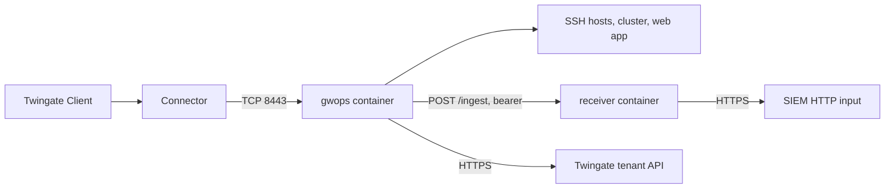

# Session recording into your SIEM or log pipeline

This recipe is for an organisation whose compliance rules require SSH and `kubectl exec` session
recordings, and the gateway's HTTP audit lines for web apps and Kubernetes, to land in its SIEM. One
gateway fronts SSH hosts, a cluster and a web app with recording on. A small receiver container
beside it checks the bearer token and forwards each batch to the SIEM's HTTP input.

## Environment

- One Linux `x86_64` (`linux/amd64`) Docker host with Docker Engine and Compose v2, at
  `10.0.0.20`.
- A Twingate Connector in the Remote Network `Production DC` that reaches the Docker host on TCP
  8443.
- Two SSH hosts, one Kubernetes API server and one web app, all reachable from the Docker host.
- A SIEM or log collector with an HTTP input at `https://collector.example.com:8088`, reachable from
  the Docker host. It splits a request body on newlines into events, accepts bodies up to 16 MiB,
  and answers `2xx` only once a batch is durably queued.
- No existing PKI. Outbound HTTPS to the tenant `acme.twingate.com`.

## What you get

- A gateway in remote-network mode with generated CAs, fronting `web-1`, `db-1`, the cluster `prod`
  and the web app `grafana`.
- Every kept gateway line delivered at least once, in order, to the SIEM through the receiver:
  session recordings, HTTP audit lines and connection starts.
- A bounded on-disk spool that rides out SIEM outages up to its size.
- Out of scope: gwops does not redact lines, does not deduplicate on the receiving side, does not
  ship SSH audit events or the gateway's operational log (collect that from `docker logs`), and
  has no integration with any specific SIEM product. No log product has been tested against the shipper.

> **Note:** Untested example. The Caddy receiver configuration on this page has not been run by this project. Adapt it to your environment and test it before you rely on it.

## Architecture



gwops spools the gateway's recording and audit lines and POSTs them in batches to the receiver on
the private compose network; the receiver checks the token and forwards each batch to the SIEM,
passing the SIEM's answer back so gwops resends anything the SIEM did not accept.

## Twingate prerequisites

See the [Twingate documentation](https://www.twingate.com/docs) for each step.

1. The Remote Network `Production DC` and a healthy Connector in it that reaches `10.0.0.20:8443`.
2. The groups "Platform Engineers" and "App Users", and the security policy "Privileged Access
   MFA".
3. An API key with read and write access, including resources, certificate authorities and
   gateways.

## Files

### Directory layout

```text
recording-gateway/
  compose.yaml
  .env              # mode 0600
  seed.yaml
  receiver/
    Caddyfile
  k8s-creds/        # uid 10001
    prod.token      # 0600
    prod-ca.crt     # 0644
```

### seed.yaml

```yaml
twingate:
  network: acme
  host: twingate.com
  remote_network: Production DC
  gateway_address: 10.0.0.20:8443
  resource_defaults:
    groups: ["Platform Engineers"]
    security_policy: "Privileged Access MFA"

ssh_upstreams:
  - name: web-1
    address: 10.0.10.5
  - name: db-1
    address: 10.0.20.7

k8s_clusters:
  - name: prod
    address: prod.k8s.internal.example.com
    port: 6443
    bearer_token_file: /config/k8s-creds/prod.token
    ca_file: /config/k8s-creds/prod-ca.crt

web_apps:
  - name: grafana
    address: grafana.apps.example.com:3000
    access:
      groups: ["App Users"]

recording:
  enabled: true
  # The receiver container on the private compose network. gwops POSTs to <url>/ingest.
  # Plain http is acceptable only because this hop never leaves the Docker host.
  receiver_url: http://receiver:8080
  spool_max_bytes: 1073741824     # 1 GiB; at least 16 MiB

admin_api:
  bind: 0.0.0.0     # reachable through the loopback-only publish in compose.yaml
  port: 8081
```

`recording.receiver_url` takes the base URL of any receiver. The `http://` URL makes gwops log `shipper.insecure_transport` at startup. Use `https://` for any
receiver that is not on the same host.

### .env

```sh
TWINGATE_API_KEY=
# openssl rand -hex 32
GWOPS_ADMIN_TOKEN=
# Bearer token between gwops and the receiver. openssl rand -hex 32
GWOPS_RECORDING_TOKEN=
# Credential the SIEM's HTTP input expects from the receiver.
COLLECTOR_TOKEN=
```

### compose.yaml

```yaml
services:
  gateway:
    image: ghcr.io/twingate-solutions/gwops:<version>
    pull_policy: missing
    container_name: gwops-gateway
    restart: unless-stopped
    security_opt:
      - "no-new-privileges:true"
    cap_drop:
      - ALL
    read_only: true
    tmpfs:
      - /run/gateway:mode=1777
      - /tmp:mode=1777
    environment:
      TWINGATE_API_KEY: ${TWINGATE_API_KEY:?set TWINGATE_API_KEY in .env}
      GWOPS_ADMIN_TOKEN: ${GWOPS_ADMIN_TOKEN:?set GWOPS_ADMIN_TOKEN in .env}
      GWOPS_RECORDING_TOKEN: ${GWOPS_RECORDING_TOKEN:?set GWOPS_RECORDING_TOKEN in .env}
    volumes:
      - ./seed.yaml:/config/seed.yaml:ro
      - ./k8s-creds:/config/k8s-creds:ro
      - gwdata:/data
    ports:
      - "8443:8443"
      - "127.0.0.1:9090:9090"
      - "127.0.0.1:8081:8081"

  receiver:
    image: caddy:<caddy-version>
    container_name: recording-receiver
    restart: unless-stopped
    environment:
      RECEIVER_TOKEN: ${GWOPS_RECORDING_TOKEN:?set GWOPS_RECORDING_TOKEN in .env}
      COLLECTOR_TOKEN: ${COLLECTOR_TOKEN:?set COLLECTOR_TOKEN in .env}
    volumes:
      - ./receiver/Caddyfile:/etc/caddy/Caddyfile:ro
    # No ports: only the gateway, on the compose network, reaches it.

volumes:
  gwdata:
```

### receiver/Caddyfile

```text
:8080 {
    @ingest {
        method POST
        path /ingest
        header Authorization "Bearer {$RECEIVER_TOKEN}"
    }
    handle @ingest {
        rewrite * /<collector-input-path>
        reverse_proxy https://collector.example.com:8088 {
            header_up Host {upstream_hostport}
            header_up Authorization "<collector-auth-scheme> {$COLLECTOR_TOKEN}"
        }
    }
    handle {
        respond 401
    }
}
```

The receiver passes the collector's status code back to gwops, so a batch the collector refuses is
resent. Set `<collector-input-path>` and `<collector-auth-scheme>` to what your SIEM's HTTP input
expects. If the input needs a different body framing or envelope, replace Caddy with a small
service that converts each batch; the minimal receiver in
[Session recording](../guides/session-recording.md) is a starting point. See the
[Caddy documentation](https://caddyserver.com/docs/) for the directives.

## Deploy

1. Create the files above. Put the cluster credentials in `k8s-creds/` (see
   [Front a Kubernetes API server](../guides/kubernetes.md)). Fill in `.env` and `chmod 0600 .env`.
2. Confirm the SIEM input accepts a test batch from the Docker host before you rely on it.
3. Start both containers:

   ```sh
   docker compose up -d
   ```

4. Check the pass and the shipper:

   ```sh
   export BASE=http://127.0.0.1:8081
   export TOKEN=<admin-token>   # the GWOPS_ADMIN_TOKEN value from .env

   curl -s -H "Authorization: Bearer $TOKEN" $BASE/status | jq '{tg: .tg, ok: .last_reconcile.ok, shipper: .shipper}'
   ```

5. Trust the SSH CA on `web-1` and `db-1`; see [SSH resources](../guides/ssh-resources.md).
   `grafana.apps.example.com` must resolve inside the gwops container; see
   [Web apps](../guides/web-apps.md).

Recording settings and `GWOPS_RECORDING_TOKEN` are read once, at startup. After changing `recording.*`,
restart (`docker compose restart gateway`); after changing `.env` or `compose.yaml`, recreate
(`docker compose up -d`).

### What reaches the SIEM and what does not

| Line | Reaches the SIEM | Source |
| --- | --- | --- |
| Interactive SSH shell sessions | Yes, as recording lines (`logger` `session_recording`) | SSH |
| Interactive `kubectl exec` / `attach` with a TTY | Yes, as recording lines | Kubernetes |
| Kubernetes API calls and web-app requests | Yes, as HTTP audit lines (`logger` `audit`, `API request completed` or `API request failed`) | Kubernetes, web apps |
| Connection starts | Yes, `Authenticated connection` lines; web-app ones carry a `gwops` object naming the app | All |
| SSH `exec` and `subsystem` requests (`ssh host cmd`, `scp`, `sftp`) | No recording is made | SSH |
| SSH audit events (`SSH connection established`, `SSH connection closed`) | No, dropped as `not_allowlisted` | SSH |
| The gateway's operational log | No; it reaches `docker logs` as `gateway.system` events | All |

`docker logs` is not an audit channel. It carries gwops' own events and the gateway's operational
(`system`) lines, never its audit lines or session recordings. The recording pipeline is the only
way gateway audit and recording data leaves the container. Field-level shapes are in the
[recording wire format](../reference/recording-wire-format.md).

### Sizing and back-pressure

- **The spool** at `/data/spool` holds every kept line until the receiver acknowledges it, up to
  `recording.spool_max_bytes` (1 GiB here; default 256 MiB, minimum 16 MiB). Size it for the
  longest SIEM outage you want to survive at your recording rate.
- **When it fills**, gwops deletes the oldest undelivered segment and logs `spool.evicted` with the
  lines and bytes lost. Those recordings are gone; alert on that event.
- **Retries** never stop: backoff from 1 s doubling to 30 s, one batch at a time, up to 500 lines or
  16 MiB per batch.
- **Long sessions**: an SSH session can be one line; a line over 16 MiB is dropped whole as
  `too_long`.
- **Memory**: a maximum-size line can take about 200 MiB of memory while it is parsed. If you set a
  memory limit on the container, leave room for that.
- **Duplicates**: delivery is at least once. Deduplicate in the SIEM, on a hash of the line or on
  the gateway's identifiers (`conn_id`, `request_id`, `asciicast_sequence_num`); see
  [Deduplication](../reference/recording-wire-format.md).

### Protecting the data

> **Security:** shipped lines are not redacted. They carry terminal output, full URLs with query
> strings, request and response header values (`Authorization`, `Cookie`, `Set-Cookie`,
> `X-Api-Key`), and user ids, user names and groups. Treat the SIEM index, the receiver and the
> spool on `/data` as holding those credentials.

- Restrict who can search the recording index, and set its retention to what your policy requires.
- `/data` backups contain the undelivered spool; protect them the same way.
- Use `https://` for any hop that leaves the Docker host, as the Caddyfile does toward the
  collector.

## Verify

### Shipper

```sh
curl -s -H "Authorization: Bearer $TOKEN" $BASE/status | jq .shipper
```

- `mode` is `spool` and `shipping` is `true`. `shipping: false` means `GWOPS_RECORDING_TOKEN` was not set
  at startup.
- `pending_lines` returns to 0 after activity, and `last_success_at` advances.
- `dropped_lines.not_allowlisted` grows as the gateway logs SSH audit events and operational
  lines, which are dropped by design; `too_long` and `spool_failed` stay at 0.

### End to end

1. Open an SSH session to `10.0.10.5` through the Twingate Client, run a few commands, exit.
2. Run `kubectl get pods` and `kubectl exec -it <pod> -- sh` against the cluster.
3. Open `https://grafana.apps.example.com`.

In the SIEM, search for:

- `logger` `session_recording` lines for the SSH shell and the `exec` session.
- `logger` `audit` lines with `message` `API request completed` for the Kubernetes calls and the
  Grafana requests.
- `message` `Authenticated connection` lines, one per connection, with `resource_type` `SSH`,
  `KUBERNETES` and `WEB_APP`.

Delivery failures appear in the gwops log as `shipper.post_rejected` (with the status code and the
start of the response body) or `shipper.post_failed`: `docker compose logs gateway | grep shipper`.

## Day 2

- **Receiver or SIEM changes**: a new `receiver_url` or token needs a restart or recreate, as in
  [Deploy](#deploy).
- **Gateway upgrades**: the shipper's filter keys on the gateway's logger names. Check the drop
  counters after every upgrade; a renamed logger shows up as a jump in `not_allowlisted`. See
  [Upgrades and pins](../operations/upgrades-and-pins.md).
- **Monitoring**: watch `shipper.pending_lines`, `shipper.last_success_at` and the `spool.evicted`
  and `shipper.lines_dropped` events. See [Monitoring](../operations/monitoring.md).
- **Adding upstreams** does not change recording: new SSH hosts and clusters are recorded as soon
  as they exist.

## Variations

### Receiver on another host

Point `recording.receiver_url` at `https://receiver.example.com` and run the receiver behind TLS
there. For a receiver certificate from a private CA, set `SSL_CERT_FILE` to a mounted bundle that
holds the public roots as well as your CA, and test delivery: the variable replaces the trust store
for every gwops HTTPS call and also reaches the gateway. See
[Environment reference](../reference/environment.md).

### Through an outbound proxy

The shipper honours `HTTPS_PROXY`, `HTTP_PROXY` and `NO_PROXY`. With a proxy configured, add the
in-network receiver's name (`receiver` here) to `NO_PROXY`.

### A recording browser instead of a SIEM

Any service that implements the [recording wire format](../reference/recording-wire-format.md)
works in place of the receiver, for example a recording-ingest and playback service. See
[Session recording](../guides/session-recording.md).

## Related

- [Session recording](../guides/session-recording.md)
- [SSH resources](../guides/ssh-resources.md), [Front a Kubernetes API server](../guides/kubernetes.md),
  [Web apps](../guides/web-apps.md)
- [Recording wire format](../reference/recording-wire-format.md),
  [Known limitations](../reference/limitations.md), [Environment reference](../reference/environment.md)
- [Recording pipeline](../architecture/recording-pipeline.md)
- [Monitoring](../operations/monitoring.md)
- Admin API: [`shipper` block](../reference/admin-api.md#shipper)
- Seed reference: [`recording`](../reference/seed.md#recording), [`twingate`](../reference/seed.md#twingate),
  [`ssh_upstreams`](../reference/seed.md#ssh_upstreams), [`k8s_clusters`](../reference/seed.md#k8s_clusters),
  [`web_apps`](../reference/seed.md#web_apps), [`admin_api`](../reference/seed.md#admin_api)
