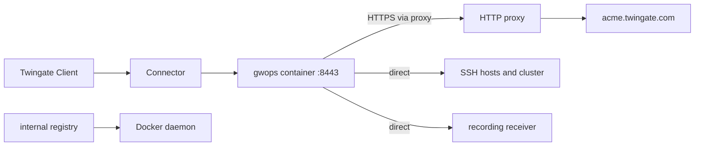

# Restricted egress and outbound proxies

For gateway hosts with no direct internet access, where outbound traffic must go through an HTTP(S)
proxy or match a short firewall allowlist. The recipe lists exactly what the container must reach,
sets the proxy variables for gwops and the gateway binary, keeps internal traffic off the proxy,
and pulls the image from an internal registry mirror. It uses private CA mode, which needs no ACME
egress.

## Environment

- One `linux/amd64` Docker host, `10.0.0.20`, with Docker Engine and Compose v2, in the Remote
  Network `Production DC`. A Connector in that network reaches it on TCP 8443.
- No direct route to the internet. An HTTP proxy at `http://proxy.internal.example.com:3128`
  accepts `CONNECT` to an allowlist of host names. It does not inspect TLS.
- An internal registry, `registry.internal.example.com`, that the Docker daemon can pull from.
- SSH hosts in `10.0.10.0/24` and a Kubernetes API server at `prod.k8s.internal.example.com:6443`,
  reachable directly from the Docker host.
- A recording receiver inside the network at `https://recording.internal.example.com`, with a
  certificate that chains to a public root.
- Internal DNS resolves the internal names for the container.

## What you get

- A gateway in remote-network mode with generated X.509 and SSH CAs, fronting the SSH hosts and the
  cluster, with recording delivered to the internal receiver.
- gwops' Twingate API calls and JWKS checks sent through the proxy; upstream, receiver and loopback
  traffic sent directly.
- The image pulled by digest from the internal mirror.
- Out of scope: an air-gapped deployment. The container must reach the tenant API and the tenant's
  token-signing keys at all times; there is no offline mode. Connector egress is the Connector's own
  concern and is not covered here.

## Architecture



Clients arrive through the Connector; the container reaches the tenant only through the proxy and
everything internal directly, and the Docker daemon pulls the image from the internal mirror.

## Twingate prerequisites

1. The Remote Network `Production DC` and a Connector in it that reaches `10.0.0.20:8443`. The
   Connector's own outbound connections are separate from the gateway's; see the
   [Twingate documentation](https://www.twingate.com/docs).
2. The proxy allowlist entry for the tenant host, `acme.twingate.com` (`<network>.<host>` from the
   seed), on port 443.
3. The group "Platform Engineers".
4. An API key with read and write access, including resources, certificate authorities and
   gateways.

## Files

### Directory layout

```text
gwops/
├── compose.yaml
├── .env
├── seed.yaml
└── k8s-creds/
    ├── prod.token
    └── prod-ca.crt
```

### seed.yaml

Nothing proxy-related goes in the seed.

```yaml
twingate:
  network: acme
  host: twingate.com              # acme.twingate.com is the one internet host gwops needs
  remote_network: Production DC
  gateway_address: 10.0.0.20:8443
  resource_defaults:
    groups: ["Platform Engineers"]

ssh_upstreams:
  - name: web-1
    address: 10.0.10.5:22
  - name: db-1
    address: 10.0.10.21:22

k8s_clusters:
  - name: prod
    address: prod.k8s.internal.example.com
    port: 6443
    bearer_token_file: /config/k8s-creds/prod.token
    ca_file: /config/k8s-creds/prod-ca.crt

recording:
  enabled: true
  receiver_url: https://recording.internal.example.com   # any receiver that implements the wire format

admin_api:
  bind: 0.0.0.0                   # so the loopback-only publish reaches it from the host
```

No `ca` block: gwops generates both CAs, so no certificate traffic leaves the network. Recording
settings are read only at startup. `admin_api.bind: 0.0.0.0` is explained in
[Admin API behind a TLS proxy](../operations/admin-api-behind-tls-proxy.md).

### .env

```sh
TWINGATE_API_KEY=<api-key>
GWOPS_ADMIN_TOKEN=<admin-token>
GWOPS_RECORDING_TOKEN=<receiver-token>
```

`GWOPS_RECORDING_TOKEN` is the bearer token gwops sends to the recording receiver. `chmod 0600 .env`.

### compose.yaml

The proxy variables are not secrets, so they go in `compose.yaml` directly.

```yaml
services:
  gateway:
    image: registry.internal.example.com/mirror/gwops:<version>@sha256:<digest>
    pull_policy: missing
    container_name: gwops-gateway
    restart: unless-stopped
    security_opt:
      - "no-new-privileges:true"
    cap_drop:
      - ALL
    read_only: true
    tmpfs:
      - /run/gateway:mode=1777
      - /tmp:mode=1777
    environment:
      TWINGATE_API_KEY: ${TWINGATE_API_KEY:?set TWINGATE_API_KEY in .env}
      GWOPS_ADMIN_TOKEN: ${GWOPS_ADMIN_TOKEN:?set GWOPS_ADMIN_TOKEN in .env}
      GWOPS_RECORDING_TOKEN: ${GWOPS_RECORDING_TOKEN:?set GWOPS_RECORDING_TOKEN in .env}
      HTTP_PROXY: http://proxy.internal.example.com:3128
      HTTPS_PROXY: http://proxy.internal.example.com:3128
      # Loopback first: the healthcheck calls 127.0.0.1:8081 and would otherwise go to the proxy.
      NO_PROXY: 127.0.0.1,localhost,recording.internal.example.com,.internal.example.com,10.0.0.0/8
    volumes:
      - ./seed.yaml:/config/seed.yaml:ro
      - ./k8s-creds:/config/k8s-creds:ro
      - gwdata:/data
    ports:
      - "8443:8443"
      - "127.0.0.1:9090:9090"
      - "127.0.0.1:8081:8081"

volumes:
  gwdata:
```

### Kubernetes credential files

A bearer token and the API server's CA certificate, readable by uid 10001; see
[Front a Kubernetes API server](../guides/kubernetes.md).

```sh
sudo chown -R 10001:10001 k8s-creds
chmod 0600 k8s-creds/prod.token
```

## Deploy

### Exactly what must be allowed

Outbound, for this recipe:

| From | To | Port | Path |
| --- | --- | --- | --- |
| gwops | `https://acme.twingate.com/api/graphql/` (resources, CAs, Gateway object) | 443 | Proxy |
| gwops | `https://acme.twingate.com/api/v1/jwk/ec` (reachability check, every 600 s) | 443 | Proxy |
| gateway | `https://acme.twingate.com/api/v1/jwk/ec` (token-signing keys) | 443 | Proxy variables passed to it |
| gwops | `https://recording.internal.example.com/ingest` | 443 | Direct (`NO_PROXY`) |
| gateway | SSH hosts and the Kubernetes API server | 22, 6443 | Direct |
| Docker daemon | `registry.internal.example.com` | 443 | Daemon configuration |

Inbound, only the Connector needs `10.0.0.20:8443`. Nothing needs to reach the container from the
internet. The full table, including ACME, is in
[Image reference: network egress](../reference/image.md#network-egress).

### How the proxy variables apply

- **gwops** (the Twingate API client, the recording shipper, the JWKS check and the healthcheck)
  uses httpx, which reads `HTTP_PROXY`, `HTTPS_PROXY` and `NO_PROXY`. httpx matches `NO_PROXY`
  entries as host names, domain suffixes (`.internal.example.com`) and exact IP addresses. It does
  **not** match CIDR ranges: `10.0.0.0/8` does not exempt `10.1.2.3`. List every internal host
  gwops calls by name or exact IP.
- **The healthcheck** runs `python -m gwops.healthcheck` in the container with the same environment
  and calls `http://127.0.0.1:8081/healthz`. Without `127.0.0.1` and `localhost` in `NO_PROXY` that
  request goes to the proxy and the container reports unhealthy.
- **The gateway** gets `HTTP_PROXY`, `HTTPS_PROXY` and `NO_PROXY` (and their lowercase forms)
  through its environment allowlist; every other variable, including all secrets, is dropped. The
  binary is written in Go, whose standard proxy handling also matches CIDR ranges in `NO_PROXY`; the
  `10.0.0.0/8` entry is there for it. How the binary uses the variables for each connection is
  defined by the binary, not by gwops, so test sessions end to end after any proxy change.
- **The upstream TLS probe** (`web_app_proxy.upstream_tls_probe`, off here) ignores proxy variables
  and dials directly, so its result can differ from what the gateway sees.

Set either the uppercase or the lowercase form of each variable, not both with different values.
See [Environment: variables that gwops' own HTTP clients read](../reference/environment.md#variables-that-gwops-own-http-clients-read)
and [Image reference: gateway child environment](../reference/image.md#gateway-child-environment).

### What does not work offline

- Without the tenant API, gwops cannot create resources, register CAs or resolve the Gateway object.
  Every pass records the error; the gateway keeps serving its last good config, and admin API writes
  that change upstreams roll back with `503`.
- Without `https://acme.twingate.com/api/v1/jwk/ec`, the gateway cannot fetch the keys that sign
  access tokens, so sessions fail.
- Leaving `TWINGATE_API_KEY` unset is not an offline mode: every pass records
  `TG sync skipped: TWINGATE_API_KEY is not set`, and the shipped `compose.yaml` refuses to start
  without it.

### Mirroring the image

On a machine that can reach both registries, copy the release to the mirror and read its digest:

```sh
crane copy ghcr.io/twingate-solutions/gwops:<version> \
  registry.internal.example.com/mirror/gwops:<version>
crane digest registry.internal.example.com/mirror/gwops:<version>
```

A registry-to-registry copy (`crane copy`, or `skopeo copy --all`) keeps the manifest digest.
`docker pull`, `docker tag` and `docker push` also work, but read the digest from the mirror after
the push. Put the digest in `compose.yaml` after the tag (`:<version>@sha256:<digest>`): Docker
then pulls exactly those bytes, whatever the tag points at later. The published image is
`linux/amd64` only. To build your own image into the internal registry instead, see
[Build and publish](../operations/build-and-publish.md).

The Docker daemon pulls images itself, with its own proxy and registry settings; the container's
`HTTPS_PROXY` does not apply to the pull.

### Steps

1. Add `acme.twingate.com:443` to the proxy allowlist.
2. Mirror the image and put the tag and digest in `compose.yaml`.
3. Write `seed.yaml`, `.env` and `k8s-creds/` on the Docker host.
4. Check from the host that the proxy passes the tenant:

   ```sh
   curl -s -o /dev/null -w '%{http_code}\n' -x http://proxy.internal.example.com:3128 https://acme.twingate.com/api/v1/jwk/ec
   ```

   `200` means the path works.
5. Start the container:

   ```sh
   docker compose pull gateway
   docker compose up -d
   docker compose logs -f gateway
   ```

6. Read the first pass:

   ```sh
   export BASE=http://127.0.0.1:8081
   export TOKEN=<admin-token>   # the GWOPS_ADMIN_TOKEN value from .env

   curl -s -H "Authorization: Bearer $TOKEN" $BASE/status | jq '{tg: .tg, jwks: .jwks, shipper: .shipper, ok: .last_reconcile.ok}'
   ```

7. Roll the SSH CA out to the SSH hosts; see
   [Trust the SSH CA on each target](../guides/ssh-resources.md#trust-the-ssh-ca-on-each-target).

## Verify

- **Tenant through the proxy.** `tg.ok` is `true`; the first pass's `last_reconcile.actions`
  contains `created gateway (<id>) at 10.0.0.20:8443 in remote network <id>` and
  `created ssh resource 'web-1' (<id>)`. A proxy refusal shows in `tg.errors`.
- **JWKS.** `jwks.ok` is `true`. `jwks.error_class` `unreachable` with a proxy refusal or `407`
  means the proxy blocks or needs authentication; `degraded` means a timeout.
- **Health.** `docker compose ps` shows `(healthy)`. An unhealthy container with `process.state`
  `running` and `last_reconcile.local_ok` `true` points at a missing loopback entry in `NO_PROXY`.
- **Recording.** `shipper.shipping` is `true` and `shipper.last_success_at` advances after a
  session. `shipper.post_failed` log lines mean the receiver is unreachable, often because its
  name is missing from `NO_PROXY`.
- **End user.** A member of "Platform Engineers" runs `ssh <user>@10.0.10.5` and
  `kubectl get pods` through the Twingate Client. A session that fails while `jwks.ok` is `true`
  points at the gateway binary's own path to the tenant.

## Day 2

- **Upgrades**: mirror the new version, update the tag and digest, pull, `docker compose up -d`.
  See [Upgrades and pins](../operations/upgrades-and-pins.md).
- **Adding an internal host that gwops calls** (a new receiver): add its exact name to `NO_PROXY`
  and recreate the container. Environment variables are read once at startup.
- **Adding upstreams**: no proxy change unless their names fall outside the `NO_PROXY` entries.
  See [SSH resources](../guides/ssh-resources.md).
- **Monitoring**: alert on `tg.ok`, `jwks.ok` and the shipper fields. See
  [Monitoring](../operations/monitoring.md).
- **Backups**: see [Backup and restore](../operations/backup-and-restore.md).

## Variations

### Firewall allowlist instead of a proxy

Without a proxy, allow outbound TCP 443 from the Docker host to `acme.twingate.com` and leave the
proxy variables out of `compose.yaml`. The tenant host's addresses are not fixed by this project;
allow it by name if your firewall supports that.

### A TLS-inspecting proxy

> **Security:** a proxy that terminates TLS sees the `X-API-KEY` header on every Twingate API call
> and the recording receiver's bearer token if that traffic is proxied. Exempt those hosts from
> inspection where you can.

To trust the proxy's CA, mount a bundle that holds the public roots plus that CA and point
`SSL_CERT_FILE` at it (for example `SSL_CERT_FILE: /config/trust/ca-bundle.pem` with
`./trust:/config/trust:ro`). gwops' clients and the gateway both read it, so the bundle must still
verify the tenant, the receiver and every web-app upstream. See
[Environment: variables that gwops' own HTTP clients read](../reference/environment.md#variables-that-gwops-own-http-clients-read).
A TLS-intercepting proxy for lego is not supported; with ACME, exempt the ACME directory and
`api.cloudflare.com` from inspection.

### ACME through the proxy

Public certificate mode with `source: acme` adds lego's egress: the ACME directory
(`acme-v02.api.letsencrypt.org` and, for staging, `acme-staging-v02.api.letsencrypt.org`) and
`https://api.cloudflare.com`, both through the proxy, plus DNS lookups through the container's
resolver, which are never proxied. With `propagation: authoritative`, lego also needs UDP and TCP 53
to the zone's nameservers. See
[Issue public certificates with ACME](../guides/public-certs-acme.md).

## Related

- [Image reference: network egress](../reference/image.md#network-egress) and
  [gateway child environment](../reference/image.md#gateway-child-environment)
- [Environment reference](../reference/environment.md)
- [Use gwops-generated CAs](../guides/private-ca-generated.md)
- [Issue public certificates with ACME](../guides/public-certs-acme.md)
- [Session recording](../guides/session-recording.md)
- [Build and publish](../operations/build-and-publish.md), [Upgrades and pins](../operations/upgrades-and-pins.md)
- [Known limitations: certificates and public mode](../reference/limitations.md#certificates-and-public-mode)
