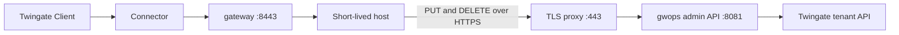

# Upstreams that register themselves

For fleets whose hosts come and go: autoscaling groups, CI runners, short-lived preview
environments. Each host registers itself as a Twingate SSH resource when it boots and removes
itself when it shuts down, by calling the gwops admin API with the limited automation token. The
seed fixes the bounds: which names, which address ranges and which groups a host may use.

> **Note:** Untested example. The registration script, systemd unit, cloud-init snippet and Caddyfile on this page have not been run by this project. Adapt them to your environment and test them before you rely on them.

## Environment

- One `linux/amd64` Docker host, `10.0.0.20`, running gwops with Docker Engine and Compose v2, in
  the Remote Network `Production DC`. A Connector in that network reaches it on TCP 8443.
- Short-lived Linux hosts in `10.20.0.0/16`, reachable from the Docker host on TCP 22, running
  systemd and `curl`. Their image already trusts the gateway's SSH CA (see [Deploy](#deploy)).
- A TLS reverse proxy (Caddy) in the same compose project, answering as `gwops-admin.example.com`
  on `10.0.0.20:443`, with a certificate from your internal CA that the hosts trust. Internal DNS
  resolves the name for the hosts. The host firewall lets only `10.20.0.0/16` reach port 443.
- The automation token is stored in your secret store and fetched by each host at boot.
- A few long-lived hosts are declared in the seed as a baseline.

## What you get

- One Twingate SSH resource per running host, named `auto-<hostname>`, created when the host boots
  and deleted when it shuts down cleanly.
- Access for registered hosts limited to the groups "App Users" and "Platform Engineers", with no
  host able to set a security policy.
- Registrations limited to addresses in `10.20.0.0/16`, and to names starting with `auto-`.
- Seed entries and admin-API entries that the automation token cannot change or delete.
- Out of scope: gwops does not expire registrations. A host that dies without deregistering stays
  registered until something deletes it. The automation token can never manage Kubernetes
  clusters, change the seed, or create groups or policies.

## Architecture



A host calls the admin API through the TLS proxy to register or deregister itself; gwops creates or
deletes the Twingate resource, and Clients then reach the host through the Connector and the
gateway.

## Twingate prerequisites

1. The Remote Network `Production DC` and a Connector in it that reaches `10.0.0.20:8443`.
2. The groups "App Users" and "Platform Engineers". gwops never creates groups or policies. If a
   name in `twingate.access_allowlist` matches no group, gwops cannot decide what is allowed, and
   every write that sends `access` fails with `503`.
3. An API key with read and write access, including resources, certificate authorities and
   gateways.

See the [Twingate documentation](https://www.twingate.com/docs).

## Files

### Directory layout

On the Docker host:

```text
gwops/
├── compose.yaml
├── .env
├── seed.yaml
├── Caddyfile
└── admin-certs/
    ├── fullchain.pem    # certificate for gwops-admin.example.com
    └── privkey.pem
```

On each short-lived host (baked into the image or written by cloud-init):

```text
/etc/gwops/automation-token                    # 0600, root, fetched at boot
/usr/local/sbin/gwops-register                 # 0755
/etc/systemd/system/gwops-register.service
/etc/ssh/twingate-gateway-ssh-ca.pub           # the gateway's SSH CA public key
```

### seed.yaml

```yaml
twingate:
  network: acme
  host: twingate.com
  remote_network: Production DC
  gateway_address: 10.0.0.20:8443
  resource_defaults:
    groups: ["Platform Engineers"]     # used when a registration sends no access
  access_allowlist:                    # what any admin-API write may reference
    groups: ["App Users", "Platform Engineers"]
    security_policies: []              # no write may set a policy
  address_allowlist:                   # where any admin-API write may point
    cidrs: ["10.20.0.0/16"]
    dns_suffixes: ["previews.apps.example.com"]

ssh_upstreams:                         # baseline hosts; the automation token cannot touch these
  - name: bastion-1
    address: 10.0.10.5:22
  - name: build-1
    address: 10.0.10.31:22

admin_api:
  bind: 0.0.0.0                        # the proxy reaches gwops over the compose network
  automation:
    name_prefix: auto-                 # every automation name must start with this
```

Both allowlists bind the admin token too, not only the automation token. Seed entries and
`resource_defaults` are written by the seed's author and are not checked against them. Startup
aborts when `GWOPS_AUTOMATION_TOKEN` is set and either allowlist is missing.

### .env

```sh
TWINGATE_API_KEY=<api-key>
GWOPS_ADMIN_TOKEN=<admin-token>
GWOPS_AUTOMATION_TOKEN=<automation-token>
```

Generate both tokens with `openssl rand -hex 32`. They must differ, or startup aborts with
`supervisor.startup_failed`. `chmod 0600 .env`.

### compose.yaml

```yaml
services:
  gateway:
    image: ghcr.io/twingate-solutions/gwops:<version>
    pull_policy: missing
    container_name: gwops-gateway
    restart: unless-stopped
    security_opt:
      - "no-new-privileges:true"
    cap_drop:
      - ALL
    read_only: true
    tmpfs:
      - /run/gateway:mode=1777
      - /tmp:mode=1777
    environment:
      TWINGATE_API_KEY: ${TWINGATE_API_KEY:?set TWINGATE_API_KEY in .env}
      GWOPS_ADMIN_TOKEN: ${GWOPS_ADMIN_TOKEN:?set GWOPS_ADMIN_TOKEN in .env}
      GWOPS_AUTOMATION_TOKEN: ${GWOPS_AUTOMATION_TOKEN:?set GWOPS_AUTOMATION_TOKEN in .env}
    volumes:
      - ./seed.yaml:/config/seed.yaml:ro
      - gwdata:/data
    ports:
      - "8443:8443"
      - "127.0.0.1:9090:9090"
      - "127.0.0.1:8081:8081"          # host loopback only, for operators on the host

  admin-proxy:
    image: caddy:<caddy-version>
    restart: unless-stopped
    ports:
      - "10.0.0.20:443:443"            # the address the hosts call; firewall it to 10.20.0.0/16
    volumes:
      - ./Caddyfile:/etc/caddy/Caddyfile:ro
      - ./admin-certs:/certs:ro
      - caddy-data:/data

volumes:
  gwdata:
  caddy-data:
```

`GWOPS_AUTOMATION_TOKEN` uses `:?` here so a missing value fails `docker compose up` instead of
starting gwops without the automation principal.

### Caddyfile

```text
gwops-admin.example.com {
    tls /certs/fullchain.pem /certs/privkey.pem
    reverse_proxy gateway:8081
}
```

The proxy passes the `Authorization` header through unchanged; gwops checks every token itself.
Writes run a reconcile pass before they answer, so a call can take several seconds. See
[Admin API behind a TLS proxy](../operations/admin-api-behind-tls-proxy.md), option B.

### /usr/local/sbin/gwops-register

```sh
#!/bin/sh
# gwops-register up|down: register or deregister this host as a Twingate SSH resource.
set -eu

API=https://gwops-admin.example.com
TOKEN=$(cat /etc/gwops/automation-token)
GATEWAY_HOST=10.0.0.20

# Name: auto- plus the short host name, lowercased, other characters replaced; at most 63.
NAME="auto-$(hostname -s | tr 'A-Z' 'a-z' | tr -c 'a-z0-9\n-' '-' | cut -c1-58)"
# Address: this host's source address toward the gateway host.
ADDR=$(ip -4 -o route get "$GATEWAY_HOST" | awk '{for (i = 1; i < NF; i++) if ($i == "src") print $(i + 1)}')
OUT=$(mktemp)
trap 'rm -f "$OUT"' EXIT

# One attempt; prints the HTTP status, 000 when the API did not answer.
attempt() {
  if [ "$1" = PUT ]; then
    curl -s -o "$OUT" -w '%{http_code}' --max-time 120 -X PUT \
      -H "Authorization: Bearer $TOKEN" -H "Content-Type: application/json" \
      -d "{\"address\": \"$ADDR:22\", \"access\": {\"groups\": [\"App Users\"]}}" \
      "$API/upstreams/ssh/$NAME" || echo 000
  else
    curl -s -o "$OUT" -w '%{http_code}' --max-time 120 -X DELETE \
      -H "Authorization: Bearer $TOKEN" \
      "$API/upstreams/ssh/$NAME" || echo 000
  fi
}

call() {
  i=0
  while :; do
    code=$(attempt "$1")
    case "$code" in
      200) cat "$OUT"; echo; return 0 ;;
      000|503) ;;                                   # API or tenant unreachable: retry
      422) grep -q 'rate-limited' "$OUT" || { cat "$OUT"; echo; return 1; } ;;
      *) cat "$OUT"; echo; return 1 ;;              # 401, 403, 404, 409: do not retry
    esac
    i=$((i + 1))
    if [ "$i" -ge 10 ]; then echo "giving up after $i attempts" >&2; return 1; fi
    sleep $((i * 10))
  done
}

case "${1:-}" in
  up)   call PUT ;;
  down) call DELETE ;;
  *)    echo "usage: $0 up|down" >&2; exit 2 ;;
esac
```

Retrying is safe. `PUT` with the same body is idempotent, and `DELETE` of a name that does not
exist answers `200 {"deleted": false}` for the automation token and writes nothing. A call that
timed out on the client side may still have completed, which a retry then confirms.

### /etc/systemd/system/gwops-register.service

```text
[Unit]
Description=Register this host as a Twingate SSH resource
Wants=network-online.target
After=network-online.target sshd.service

[Service]
Type=oneshot
RemainAfterExit=yes
ExecStart=/usr/local/sbin/gwops-register up
ExecStop=/usr/local/sbin/gwops-register down
TimeoutStartSec=15min
TimeoutStopSec=5min

[Install]
WantedBy=multi-user.target
```

`ExecStop` runs on a clean shutdown. A host that is terminated without one does not deregister.

### cloud-init

```yaml
#cloud-config
runcmd:
  - install -d -m 0700 /etc/gwops
  - sh -c 'umask 077; <command that reads the automation token from your secret store> > /etc/gwops/automation-token'
  - systemctl daemon-reload
  - systemctl enable --now gwops-register.service
```

Fetch the token from a secret store with the instance's own identity. Do not put it in the user
data itself, which is usually readable from the instance metadata.

## Deploy

### Bound what the token can do

Every automation write passes these checks in order. Any failure answers at once and nothing is
stored.

| Check | Seed setting | Failure |
| --- | --- | --- |
| Route and kind: only `PUT`, `GET` and `DELETE` on `/upstreams/ssh/...` (and `webapp` with the opt-in) | `admin_api.automation.web_apps.enabled` | `403` |
| Name starts with the prefix | `admin_api.automation.name_prefix` | `403` |
| The body is valid on its own |  | `422` |
| The entry is the token's own, not a seed or admin entry |  | `409` |
| Address inside the allowlist | `twingate.address_allowlist` | `403` |
| Groups and policy exist, then are inside the allowlist | `twingate.access_allowlist` | `422` (unknown name), `403` (not allowed) |
| The tenant confirms the change |  | `422` or `503`, rolled back |

The automation token can never reach `k8s` entries: a cluster entry names credential files inside
the container. See [Automation and CI](../guides/automation-and-ci.md) and
[Access control](../guides/access-control.md#5-restrict-admin-api-writes-with-allowlists).

### Steps

1. Create the groups on the tenant. Write `seed.yaml`, `.env`, `Caddyfile` and `admin-certs/` on
   the Docker host. Make the certificate files readable by the Caddy container.
2. Start both services:

   ```sh
   docker compose up -d
   docker compose logs -f gateway
   ```

3. Check the first pass from the Docker host:

   ```sh
   export BASE=http://127.0.0.1:8081
   export TOKEN=<admin-token>   # the GWOPS_ADMIN_TOKEN value from .env

   curl -s -H "Authorization: Bearer $TOKEN" $BASE/status | jq '{process: .process.state, ok: .last_reconcile.ok, errors: .last_reconcile.errors}'
   ```

4. Copy the gateway's SSH CA public key into the host image, and reference it from `sshd_config`
   with `TrustedUserCAKeys /etc/ssh/twingate-gateway-ssh-ca.pub`. See
   [Trust the SSH CA on each target](../guides/ssh-resources.md#trust-the-ssh-ca-on-each-target):

   ```sh
   docker compose exec gateway cat /data/pki/ssh-ca.key.pub > twingate-gateway-ssh-ca.pub
   ```

5. Add `gwops-register`, the systemd unit and the token fetch to the host image or its cloud-init.
6. Store the automation token in your secret store and grant the hosts' identity read access.
7. Launch one host and watch it register (see [Verify](#verify)).

### What happens on a bad request

- A name without `auto-`: `403` `automation upstream names must start with 'auto-'`.
- An address outside `10.20.0.0/16`, such as `192.168.1.50`: `403` naming the address.
- A group outside the allowlist: `403`. A group name that does not exist: `422`.
- A security policy of any kind: `403`, because `security_policies: []` allows none.
- A name that belongs to the seed or the admin token: `409`.
- The admin token's routes (`/status`, `/overlays`, `/reconcile`): `403`.

In each case nothing is persisted and the tenant is not touched. Every `PUT` and `DELETE`, accepted
or refused, writes one `api.audit` log line with the principal, method, route and status, plus the
overlay id when one was stored.

## Verify

- **Registration.** On a new host, `journalctl -u gwops-register` shows `200` with
  `"origin": "automation"`. Read it back with the automation token:

  ```sh
  export AUTOMATION_TOKEN=<automation-token>
  curl -s -H "Authorization: Bearer $AUTOMATION_TOKEN" https://gwops-admin.example.com/upstreams/ssh/auto-<hostname> | jq '{origin, address, tg_resource_id, effective_access, errors}'
  ```

  `origin` is `automation`, `tg_resource_id` is set and `errors` is empty.
- **Reconcile.** On the Docker host, `GET /status` shows `last_reconcile.trigger` `api` and
  `last_reconcile.actions` with `created ssh resource 'auto-<hostname>' (<id>)`.
- **Audit.** `docker compose logs --no-log-prefix gateway | grep '"api.audit"'` shows the call with
  `principal` `automation`.
- **Bounds.** From a host, `PUT` an entry named `test-1`: `403`. `GET $BASE/status` with the
  automation token: `403`.
- **Deregistration.** Stop a host cleanly; `last_reconcile.actions` shows
  `deleted ssh resource 'auto-<hostname>' (<id>)`.
- **End user.** A member of "App Users" connects with `ssh <user>@<host address>` through the
  Twingate Client.

## Day 2

- **Stale registrations**: list entries with the admin token and delete the ones whose hosts are
  gone. `GET /state` shows each entry, and `provenance` shows the overlay that wrote it:

  ```sh
  curl -s -H "Authorization: Bearer $TOKEN" $BASE/state | jq -r '.state.ssh_upstreams[] | select(.name | startswith("auto-")) | "\(.name) \(.address)"'
  curl -s -X DELETE -H "Authorization: Bearer $TOKEN" $BASE/upstreams/ssh/auto-<hostname>
  ```

- **Overlays accumulate**: every registration and deregistration is an overlay file under
  `/data/overlays/`, and there is no compaction. Include `/data` in backups; see
  [Backup and restore](../operations/backup-and-restore.md).
- **Rotate the automation token**: generate a new one, update `.env` and the secret store, run
  `docker compose up -d`, and let hosts fetch it at their next boot. Entries the old token created
  stay and remain owned by the automation principal.
- **Revoke it**: remove `GWOPS_AUTOMATION_TOKEN` from `.env` and `compose.yaml` and run
  `docker compose up -d`.
- **Monitor** the proxy and `/status`; see [Monitoring](../operations/monitoring.md).

## Variations

### Web apps too

Preview environments can register web apps under `previews.apps.example.com`. Opt in, and name the
request headers the token may set:

```yaml
twingate:
  network: acme
  host: twingate.com
  remote_network: Production DC
  gateway_address: 10.0.0.20:8443
  access_allowlist:
    groups: ["App Users"]
    security_policies: []
  address_allowlist:
    cidrs: ["10.20.0.0/16"]
    dns_suffixes: ["previews.apps.example.com"]
admin_api:
  bind: 0.0.0.0
  automation:
    name_prefix: auto-
    web_apps:
      enabled: true
      request_header_names: [X-Env]
```

```sh
curl -s -X PUT -H "Authorization: Bearer $AUTOMATION_TOKEN" -H "Content-Type: application/json" \
  -d '{"address": "pr-42.previews.apps.example.com", "upstream_tls": "verify_full", "request_headers": {"X-Env": "preview"}}' \
  https://gwops-admin.example.com/upstreams/webapp/auto-pr-42
```

The token's web-app writes must use `upstream_tls: verify_full`, may set only the listed headers
and never a `{{jwt}}` value, and need an address and alias that no seed entry, other entry or tenant
resource already uses. The name must resolve inside the gateway container, and the app's certificate
must verify against the system roots or a bundle in `web_app_proxy.upstream_ca_bundles`. See
[Web apps](../guides/web-apps.md) and [Automation and CI](../guides/automation-and-ci.md).

### Admin API through a Twingate resource

Instead of a proxy on the hosts' network, publish 8081 on the Docker host address the Connector
reaches and create a Twingate resource for it. The calling hosts then need a Twingate Client
signed in. See [Admin API behind a TLS proxy](../operations/admin-api-behind-tls-proxy.md),
option A.

## Related

- [Automation and CI](../guides/automation-and-ci.md), Pattern A
- [Access control](../guides/access-control.md)
- [SSH resources](../guides/ssh-resources.md), [Web apps](../guides/web-apps.md)
- [Admin API behind a TLS proxy](../operations/admin-api-behind-tls-proxy.md)
- [Admin API architecture](../architecture/admin-api.md): principals and guardrails.
- [Admin API reference: automation and web apps](../reference/admin-api.md#automation-and-web-apps),
  [write semantics](../reference/admin-api.md#write-semantics)
- [Seed reference: `admin_api`](../reference/seed.md#admin_api)
