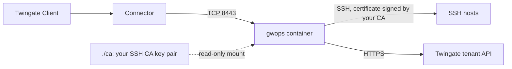

# SSH fleet that already trusts your SSH CA

This recipe is for a team whose servers already trust a corporate SSH user CA through
`TrustedUserCAKeys` and that will not roll out a second CA. The gateway signs its short-lived user
certificates with your existing SSH CA key, so the hosts need no change. gwops still generates the
X.509 CA for the gateway's TLS leaf, which lets it create the Gateway object for you.

## Environment

- One Linux `x86_64` (`linux/amd64`) Docker host with Docker Engine and Compose v2, at
  `10.0.0.20`.
- A Twingate Connector in the Remote Network `Production DC` that reaches the Docker host on TCP
  8443.
- SSH hosts that already have `TrustedUserCAKeys` pointing at your SSH CA public key, reachable
  from the Docker host.
- The SSH CA key pair in OpenSSH format, available as files: an unencrypted private key and its
  `.pub` beside it.
- Outbound HTTPS from the Docker host to the tenant `acme.twingate.com`.

## What you get

- One Gateway object at `10.0.0.20:8443` in `Production DC`, created by gwops and bound to the
  gwops-generated X.509 CA. You bind your SSH CA to it.
- Twingate SSH resources for the hosts, with access defaults and one per-host override.
- The gateway signs a 5-minute user certificate for each session with your SSH CA key.
- Out of scope: gwops never registers your SSH CA on the tenant, never binds it to the Gateway
  object, never writes to your key files and never rotates them. It does not create groups or
  security policies.

## Architecture



The Client reaches the container through the Connector; the gateway signs each session's user
certificate with your SSH CA key, read from a read-only mount, and the hosts accept it because they
already trust that CA.

## Twingate prerequisites

See the [Twingate documentation](https://www.twingate.com/docs) for each step.

1. The Remote Network `Production DC` and a healthy Connector in it that reaches `10.0.0.20:8443`.
2. The groups "Platform Engineers" and "Database Admins", and the security policies "Privileged
   Access MFA" and "Database Admin MFA".
3. Your SSH CA public key registered on the tenant as an SSH certificate authority. You can do
   this before or after the first start; binding it comes after (see
   [Bind the SSH CA after first start](#bind-the-ssh-ca-after-first-start)).
4. An API key with read and write access, including resources, certificate authorities and
   gateways.

## Files

### Directory layout

```text
ssh-gateway/
  compose.yaml
  .env                  # mode 0600
  seed.yaml
  ca/
    ssh-ca.key          # your SSH CA private key, unencrypted; uid 10001, mode 0600
    ssh-ca.key.pub      # its public key, OpenSSH format; uid 10001, mode 0644
```

### seed.yaml

```yaml
twingate:
  network: acme
  host: twingate.com
  remote_network: Production DC
  gateway_address: 10.0.0.20:8443
  resource_defaults:
    groups: ["Platform Engineers"]
    security_policy: "Privileged Access MFA"

ca:
  # No x509 block: gwops generates the X.509 CA, which remote-network mode needs to create
  # the Gateway object.
  ssh:
    generate: false
    key_path: /config/ca/ssh-ca.key   # gwops also reads /config/ca/ssh-ca.key.pub

ssh_upstreams:
  - name: web-1
    address: 10.0.10.5
  - name: web-2
    address: 10.0.10.6
  - name: build-box
    address: build.internal.example.com
  - name: db-1
    address: 10.0.20.7
    access:
      groups: ["Database Admins"]
      security_policy: "Database Admin MFA"

admin_api:
  bind: 0.0.0.0     # reachable through the loopback-only publish in compose.yaml
  port: 8081
```

`ca.ssh.generate: false` without `key_path` is a seed error. The path is used as given; it is not
confined to a mount root. See [Bring your own X.509 or SSH CA](../guides/private-ca-byo.md).

### .env

```sh
TWINGATE_API_KEY=
# openssl rand -hex 32
GWOPS_ADMIN_TOKEN=
```

### compose.yaml

```yaml
services:
  gateway:
    image: ghcr.io/twingate-solutions/gwops:<version>
    pull_policy: missing
    container_name: gwops-gateway
    restart: unless-stopped
    security_opt:
      - "no-new-privileges:true"
    cap_drop:
      - ALL
    read_only: true
    tmpfs:
      - /run/gateway:mode=1777
      - /tmp:mode=1777
    environment:
      TWINGATE_API_KEY: ${TWINGATE_API_KEY:?set TWINGATE_API_KEY in .env}
      GWOPS_ADMIN_TOKEN: ${GWOPS_ADMIN_TOKEN:?set GWOPS_ADMIN_TOKEN in .env}
    volumes:
      - ./seed.yaml:/config/seed.yaml:ro
      - ./ca:/config/ca:ro          # your SSH CA key pair, outside the writable /data volume
      - gwdata:/data
    ports:
      - "8443:8443"
      - "127.0.0.1:9090:9090"
      - "127.0.0.1:8081:8081"

volumes:
  gwdata:
```

### ca/

```sh
mkdir -p ca
cp /path/to/ssh-ca.key /path/to/ssh-ca.key.pub ca/
sudo chown 10001:10001 ca/ssh-ca.key ca/ssh-ca.key.pub
chmod 0600 ca/ssh-ca.key
chmod 0644 ca/ssh-ca.key.pub
```

Both halves must be present. With only one, startup aborts with `SSH CA is incomplete: exactly one
of ... exists`.

## Deploy

1. Create the files above, fill in `.env` (`chmod 0600 .env`) and place the key pair in `./ca/`.
2. If not done yet, register your SSH CA public key on the tenant.
3. Start the container:

   ```sh
   docker compose up -d
   ```

4. Check the first pass:

   ```sh
   export BASE=http://127.0.0.1:8081
   export TOKEN=<admin-token>   # the GWOPS_ADMIN_TOKEN value from .env

   curl -s -H "Authorization: Bearer $TOKEN" $BASE/status | jq '{tg: .tg, actions: .last_reconcile.actions}'
   ```

5. Bind your SSH CA to the Gateway object, as below.

### Bind the SSH CA after first start

On its first pass with a fresh `/data` volume, gwops:

1. Registers the generated X.509 CA as `gwops-x509-10.0.0.20:8443`. It registers nothing for your
   SSH CA.
2. Creates the Gateway object at `10.0.0.20:8443`, bound to that X.509 CA and **with no SSH CA**.
   (If a Gateway object already exists at that address, gwops adopts it, rebinds its X.509 CA and
   leaves its SSH CA binding unchanged.)
3. Creates the SSH resources and mints the TLS leaf.

`last_reconcile.actions` shows `registered X.509 CA (<id>) and bound it to gateway` and `created
gateway (<id>) at 10.0.0.20:8443 in remote network <id>`, and no `registered SSH CA` line.

Then, in the Admin Console or through the Twingate API, bind your registered SSH CA to the new
Gateway object. gwops does not read the Gateway object's SSH CA binding, so `/status` looks the
same before and after; confirm the binding on the tenant. gwops never changes that binding later:
it only binds SSH CAs it generated.

> **Note:** Untested behaviour. gwops creates the Gateway object with no SSH CA binding in this
> mode, but this project has not run that against a tenant. Test it before you rely on it. If your
> tenant refuses it, use [pinned-gateway mode](#pinned-gateway-mode-instead).

### Why the key must be unencrypted and on disk

> **Security:** the gateway reads the SSH CA private key directly from `key_path` to sign user
> certificates. It cannot prompt for a passphrase or use an SSH agent, HSM or KMS, so the key sits
> unencrypted on the Docker host and is readable by uid 10001, the user that gwops and the gateway
> run as. Anyone who can read `./ca/ssh-ca.key`, or run code in the container, can sign a
> certificate that every host trusting this CA accepts. Restrict access to the Docker host to the
> people who already hold that CA key.

If policy forbids the corporate CA key on this host, let gwops generate a dedicated SSH CA and add
its public key to `TrustedUserCAKeys` beside the existing one instead; see
[Privileged SSH to a server fleet](ssh-fleet-generated-ca.md).

## Verify

- `/status` `tg.ok` is `true` and `tg.errors` is `[]`; `certs.leaf_state` is `ok`; `tls.mode` is
  `static`.
- `last_reconcile.actions` lists `created ssh resource '<name>' (<id>)` for each host on the first
  pass.
- The public key gwops loaded is yours:

  ```sh
  docker compose exec gateway cat /config/ca/ssh-ca.key.pub
  ```

  It matches the key named by `TrustedUserCAKeys` on the hosts.
- In the Admin Console, the Gateway object shows `gwops-x509-10.0.0.20:8443` as its X.509 CA and
  your CA as its SSH CA.
- End-user check: a member of "Platform Engineers" with the Twingate Client signed in runs
  `ssh <user>@10.0.10.5` and gets a shell with no change on the host.

## Day 2

- **Hosts**: add and remove `ssh_upstreams` entries in the seed, or through
  `PUT`/`DELETE /upstreams/ssh/{name}`. See [SSH resources](../guides/ssh-resources.md). New hosts
  only need the trust they already have for your CA.
- **Replacing your SSH CA**: replace `ssh-ca.key` and `ssh-ca.key.pub` together, update the CA on
  the tenant, roll the new public key out to the hosts, then restart the container
  (`docker compose restart gateway`) so the gateway starts with the new key. gwops restarts the
  gateway by itself only when `key_path` changes. See
  [Bring your own X.509 or SSH CA](../guides/private-ca-byo.md) ("Replace a BYO CA").
- **X.509 CA and leaf**: generated and renewed by gwops; see
  [Rotate the leaf and the CA](../operations/ca-and-leaf-rotation.md).
- **Back up `/data`** (generated X.509 CA, ownership registry, overlays) and keep your SSH CA key
  in its existing secure store. See [Backup and restore](../operations/backup-and-restore.md).
- **Monitoring**: [Monitoring](../operations/monitoring.md).

## Variations

### Pinned-gateway mode instead

Create the Gateway object yourself, bind your SSH CA to it first, and set
`twingate.gateway_id: <gateway-id>` in place of `remote_network` and `gateway_address`. On its first
pass gwops registers the generated X.509 CA and rebinds only the Gateway object's X.509 CA; the SSH
CA binding you set stays. See [Choose how gwops finds the Gateway object](../guides/gateway-modes.md).

### Also bring your X.509 CA

With `ca.x509.generate: false` as well, gwops has no CA it can register, so remote-network mode
cannot create the Gateway object. Use pinned-gateway mode and register and bind both CAs yourself.
See [Kubernetes and web apps with your CA from Vault or a secret store](k8s-and-web-apps-ca-from-secret-store.md).

### Moving an existing deployment to your SSH CA

A deployment that ran with a generated SSH CA has it registered and bound (`ca/ssh` in
`/data/state.json`). Switching to `generate: false` does not unbind it: bind your SSH CA to the
Gateway object on the tenant yourself, and delete the `gwops-ssh-*` CA object when nothing uses it.

## Related

- [Bring your own X.509 or SSH CA](../guides/private-ca-byo.md)
- [Choose how gwops finds the Gateway object](../guides/gateway-modes.md)
- [SSH resources](../guides/ssh-resources.md), [Access control](../guides/access-control.md)
- [Certificates](../architecture/certificates.md),
  [Twingate integration](../architecture/twingate-integration.md)
- Seed reference: [`ca`](../reference/seed.md#ca), [`twingate`](../reference/seed.md#twingate),
  [`ssh_upstreams`](../reference/seed.md#ssh_upstreams)
