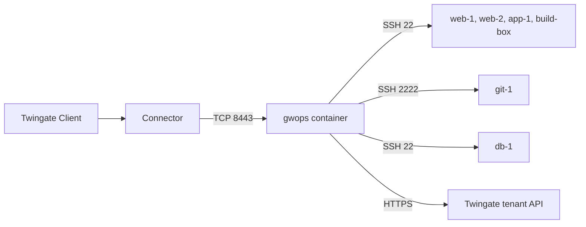

# Privileged SSH to a server fleet

This recipe is for an operations team that needs audited, identity-bound SSH to a fleet of
production Linux servers and has no PKI of its own. One gwops container fronts every host. gwops
creates the Gateway object, generates the X.509 and SSH CAs, and keeps one Twingate SSH resource
per host in sync with the seed. It is the usual first production deployment after the
[quickstart](../quickstart/README.md).

## Environment

- One Linux `x86_64` (`linux/amd64`) Docker host with Docker Engine and Compose v2, at
  `10.0.0.20` on the data-centre LAN.
- A Twingate Connector in the Remote Network `Production DC` that reaches the Docker host on TCP
  8443.
- Six SSH hosts the Docker host reaches directly: five on port 22, one Git server on port 2222.
  One host carries a database and needs stricter access than the rest.
- No existing SSH CA or X.509 CA. The SSH hosts are managed with a configuration-management tool,
  or by hand.
- The Docker host has outbound HTTPS to the tenant `acme.twingate.com`.

## What you get

- One Gateway object at `10.0.0.20:8443` in `Production DC`, created by gwops.
- Two gwops-generated CAs: an X.509 CA for the gateway's TLS leaf and an SSH CA that signs a
  5-minute user certificate for each session.
- Six Twingate SSH resources, granted to the group "Platform Engineers" under the security policy
  "Privileged Access MFA". The database host is granted to "Database Admins" under "Database Admin
  MFA" instead.
- Interactive SSH sessions recorded, if you add the [recording variation](#record-every-session).
- Out of scope: gwops does not create the groups or security policies, does not change group
  membership, and does not configure the SSH hosts. Each host must trust the SSH CA itself.

## Architecture



A user's Twingate Client reaches the gwops container through the Connector on port 8443; the
gateway opens the SSH session to the host with a short-lived certificate, and gwops keeps the
tenant's resources in step with the seed over the Twingate API.

## Twingate prerequisites

Create these on the tenant first. See the [Twingate documentation](https://www.twingate.com/docs).

1. The Remote Network `Production DC`.
2. A Connector in that Remote Network, healthy, that reaches `10.0.0.20:8443`.
3. The groups "Platform Engineers" and "Database Admins", with their members.
4. The security policies "Privileged Access MFA" and "Database Admin MFA".
5. An API key with read and write access, including resources, certificate authorities and
   gateways.

Do not create the Gateway object: in remote-network mode gwops creates it. If one already exists
at `10.0.0.20:8443` in that Remote Network, gwops adopts it and rebinds it to the generated CAs. See
[Choose how gwops finds the Gateway object](../guides/gateway-modes.md).

## Files

### Directory layout

```text
ssh-gateway/
  compose.yaml
  .env          # mode 0600, never committed
  seed.yaml
```

### seed.yaml

```yaml
twingate:
  network: acme
  host: twingate.com
  # Remote-network mode: gwops finds or creates the Gateway object at this address.
  remote_network: Production DC
  gateway_address: 10.0.0.20:8443    # how the Connector reaches this container; port required
  # Applied to every resource whose own access block omits a key.
  resource_defaults:
    groups: ["Platform Engineers"]
    security_policy: "Privileged Access MFA"

# No ca block: gwops generates both CAs on first start and keeps them in /data/pki/.

ssh_upstreams:
  - name: web-1
    address: 10.0.10.5            # port 22 by default
  - name: web-2
    address: 10.0.10.6
  - name: app-1
    address: 10.0.10.7
  - name: build-box
    address: build.internal.example.com
  - name: git-1
    address: 10.0.10.9:2222       # the port the gateway dials
  - name: db-1
    address: 10.0.20.7
    access:
      groups: ["Database Admins"]           # replaces the default groups
      security_policy: "Database Admin MFA" # replaces the default policy

admin_api:
  # Listen on every container interface so the loopback-only publish in compose.yaml
  # reaches it from the Docker host. The API stays off the network.
  bind: 0.0.0.0
  port: 8081
```

`admin_api.bind: 0.0.0.0` is needed because Docker forwards a published port to the container's
network interface, not its loopback. The `127.0.0.1:8081:8081` publish keeps the API on the host's
loopback; see [Admin API behind a TLS proxy](../operations/admin-api-behind-tls-proxy.md).

### .env

```sh
# Twingate API key: read and write, including resources, certificate authorities and gateways.
TWINGATE_API_KEY=
# Bearer token for the admin API. Generate with: openssl rand -hex 32
GWOPS_ADMIN_TOKEN=
```

### compose.yaml

```yaml
services:
  gateway:
    image: ghcr.io/twingate-solutions/gwops:<version>
    pull_policy: missing
    container_name: gwops-gateway
    restart: unless-stopped
    security_opt:
      - "no-new-privileges:true"
    cap_drop:
      - ALL
    read_only: true
    tmpfs:
      - /run/gateway:mode=1777
      - /tmp:mode=1777
    environment:
      TWINGATE_API_KEY: ${TWINGATE_API_KEY:?set TWINGATE_API_KEY in .env}
      GWOPS_ADMIN_TOKEN: ${GWOPS_ADMIN_TOKEN:?set GWOPS_ADMIN_TOKEN in .env}
    volumes:
      - ./seed.yaml:/config/seed.yaml:ro
      - gwdata:/data
    ports:
      - "8443:8443"              # gateway listener; the Connector must reach it
      - "127.0.0.1:9090:9090"    # gateway metrics, host loopback only
      - "127.0.0.1:8081:8081"    # gwops admin API, host loopback only

volumes:
  gwdata:
```

Replace `<version>` with a published version tag. See
[Image reference](../reference/image.md#published-image).

## Deploy

1. Create the directory and the three files above. Fill in `.env` and restrict it:
   `chmod 0600 .env`.
2. Start the container:

   ```sh
   docker compose up -d
   ```

   gwops generates the CAs, registers them on the tenant, creates the Gateway object bound to them,
   creates the six SSH resources and mints the TLS leaf, all in the first pass.
3. Check the first pass:

   ```sh
   export BASE=http://127.0.0.1:8081
   export TOKEN=<admin-token>   # the GWOPS_ADMIN_TOKEN value from .env

   curl -s -H "Authorization: Bearer $TOKEN" $BASE/status | jq '{tg: .tg, actions: .last_reconcile.actions, errors: .last_reconcile.errors}'
   ```

   `tg.ok` is `true` and `last_reconcile.errors` is empty. If `errors` names a group or policy
   (`access: no group named '...'`), fix the name on the tenant or in the seed; that resource is
   not created until it resolves.
4. Roll the SSH CA out to the fleet, as below.

### Roll the SSH CA out to the fleet

Every SSH host must trust the gwops SSH CA public key. gwops does not configure the hosts.

1. Copy the public key out of the container:

   ```sh
   docker compose exec gateway cat /data/pki/ssh-ca.key.pub > twingate-gateway-ssh-ca.pub
   ```

2. Install it on every host as `/etc/ssh/twingate-gateway-ssh-ca.pub` (mode 0644, owned by root)
   and add this line to `/etc/ssh/sshd_config`, or to a drop-in under `/etc/ssh/sshd_config.d/`
   where your distribution's `sshd_config` includes that directory:

   ```text
   TrustedUserCAKeys /etc/ssh/twingate-gateway-ssh-ca.pub
   ```

   In a configuration-management tool this is one file resource and one line in the `sshd`
   configuration, applied to every host in the fleet.
3. Check the configuration and reload `sshd` on each host: `sudo sshd -t && sudo systemctl reload
   sshd` (the unit is `ssh` on some distributions).

Login names and principals are target-side settings; see [SSH resources](../guides/ssh-resources.md)
and the [Twingate documentation](https://www.twingate.com/docs).

### Add and remove hosts

Two ways, with different persistence:

- **Edit the seed.** Add or remove an `ssh_upstreams` entry and save. gwops picks up the change
  within about 5 seconds, creates or deletes the SSH resource and re-mints the leaf. The seed stays
  the record of the fleet.
- **Use the admin API.** A `PUT` or `DELETE` persists as an overlay under `/data/overlays/`, which
  wins over the seed:

  ```sh
  curl -s -X PUT -H "Authorization: Bearer $TOKEN" -H "Content-Type: application/json" \
    -d '{"address": "10.0.10.8:22"}' \
    $BASE/upstreams/ssh/web-3

  curl -s -X DELETE -H "Authorization: Bearer $TOKEN" $BASE/upstreams/ssh/web-3
  ```

  The write is reconciled before the response returns and kept only if the tenant confirms it.

Pick one as the source of truth for the fleet. A host added through the API is not in the seed,
and a seed host changed through the API keeps the overlay's values until you delete that overlay
(`GET /overlays`, then `DELETE /overlays/{id}`). See [SSH resources](../guides/ssh-resources.md).

A new host must also trust the SSH CA before anyone can log in.

## Verify

### Gateway object and CAs

```sh
curl -s -H "Authorization: Bearer $TOKEN" $BASE/status | jq '{tg: .tg, certs: .certs, tls: .tls}'
```

- `tg.ok` is `true` and `tg.errors` is `[]`.
- `certs.leaf_state` is `ok`, `certs.leaf_not_after` is about 90 days out, `tls.mode` is `static`.
- On the first pass, `last_reconcile.actions` contains:
  - `registered X.509 CA (<id>) and bound it to gateway`
  - `registered SSH CA (<id>) and bound it to gateway`
  - `created gateway (<id>) at 10.0.0.20:8443 in remote network <id>`, or `adopted existing
    gateway (<id>) at 10.0.0.20:8443` if one existed
- In the Admin Console, the Gateway object shows the CAs `gwops-x509-10.0.0.20:8443` and
  `gwops-ssh-10.0.0.20:8443`.

### Resources and access

```sh
curl -s -H "Authorization: Bearer $TOKEN" $BASE/upstreams/ssh/db-1 | jq '{tg_resource_id, effective_access, applied_access, errors}'
```

- `tg_resource_id` is set and `errors` is empty.
- `effective_access` names "Database Admins" and "Database Admin MFA"; for `web-1` it names the
  defaults.
- `last_reconcile.actions` on the first pass lists `created ssh resource '<name>' (<id>)` for each
  of the six hosts.

### End-user check

A member of "Platform Engineers", signed in to the Twingate Client, runs `ssh <user>@10.0.10.5`.
The session opens without a password or key prompt from the host. A member who is not in "Database
Admins" cannot reach `10.0.20.7`.

## Day 2

- **Hosts come and go**: [Add and remove hosts](#add-and-remove-hosts) above; every new host needs
  the SSH CA line.
- **Leaf renewal** is automatic, 14 days before expiry, and hot-reloads. The X.509 CA is valid for
  10 years; to replace it, follow [Rotate the leaf and the CA](../operations/ca-and-leaf-rotation.md).
  There is no rotation route for the SSH CA.
- **Back up `/data`.** It holds the only copy of the SSH CA key. If you lose it, gwops generates a
  new SSH CA and every host must trust the new public key. See
  [Backup and restore](../operations/backup-and-restore.md).
- **Monitoring**: container health, `/status` and the gwops log. See
  [Monitoring](../operations/monitoring.md).
- **Upgrades**: change the image tag and recreate. See
  [Upgrades and pins](../operations/upgrades-and-pins.md).
- **Seed edits**: the seed is a single-file bind mount. An editor that saves by writing a new file
  and renaming it over the old one leaves the container reading the old file until a restart. See
  [Environment reference](../reference/environment.md) for `GWOPS_SEED_PATH`, which moves the seed
  into a mounted directory.

## Variations

### Production vs staging tiers

Give staging hosts their own access block, for example `groups: ["Platform Engineers",
"Contractors"]` with a lighter policy, and leave production on the defaults. A key set on an entry
replaces the default for that key; it is never merged. See
[Access control](../guides/access-control.md).

### Record every session

Add a `recording` block pointing at your receiver, set `GWOPS_RECORDING_TOKEN` in `.env` and
`compose.yaml`, and recreate the container. Interactive SSH shells are recorded; SSH `exec` and
`subsystem` requests are not. See [Session recording](../guides/session-recording.md) and
[Session recording into your SIEM or log pipeline](recording-to-siem.md).

### Hosts on a non-default port

Write the port in `address` (`10.0.10.9:2222`). It is the port the gateway dials; the Twingate
resource address is the host without the port. See [SSH resources](../guides/ssh-resources.md).

## Related

- [Choose how gwops finds the Gateway object](../guides/gateway-modes.md)
- [Use gwops-generated CAs](../guides/private-ca-generated.md)
- [SSH resources](../guides/ssh-resources.md), [Access control](../guides/access-control.md),
  [Session recording](../guides/session-recording.md)
- [Backup and restore](../operations/backup-and-restore.md), [Monitoring](../operations/monitoring.md)
- [Twingate integration](../architecture/twingate-integration.md),
  [Certificates](../architecture/certificates.md)
- Seed reference: [`twingate`](../reference/seed.md#twingate),
  [`ssh_upstreams`](../reference/seed.md#ssh_upstreams), [`admin_api`](../reference/seed.md#admin_api)
