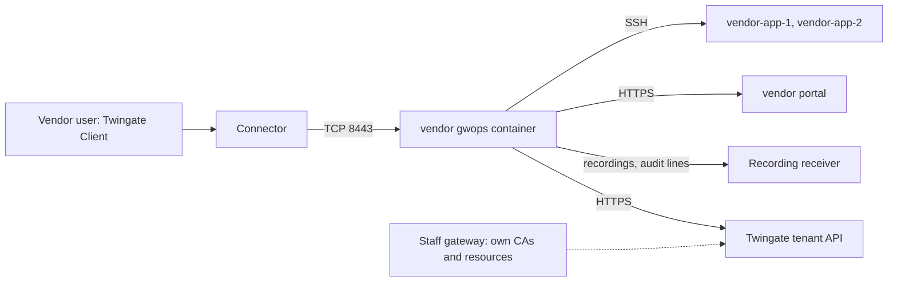

# Contractor and vendor access on a separate gateway

This recipe is for an organisation that gives a vendor or contractor access to a few hosts and one
web app, isolated from staff access, recorded, and easy to switch off. The vendor gets a gateway of
its own: a separate container with its own Gateway object, its own CAs and its own resources. Every
session is recorded. Removing the vendor's access never touches the staff gateway.

## Environment

- A Linux `x86_64` (`linux/amd64`) Docker host dedicated to vendor access, with Docker Engine and
  Compose v2, at `10.0.30.5`. Running it on the staff gateway's host also works if every host port
  differs (8443, and the loopback publishes for 9090 and 8081).
- A Twingate Connector in the Remote Network `Production DC` that reaches `10.0.30.5:8443`.
- Two hosts the vendor maintains, `10.0.40.11` and `10.0.40.12`, and the vendor's support portal
  `portal.vendor.internal.example.com`, all reachable from the Docker host.
- A recording receiver at `https://recordings.example.com` that implements the
  [recording wire format](../reference/recording-wire-format.md).
- Outbound HTTPS from the Docker host to the tenant `acme.twingate.com` and the receiver.

## What you get

- A Gateway object at `10.0.30.5:8443`, created by gwops, bound to CAs generated for this gateway
  only. Its SSH CA is installed on the vendor's hosts and nowhere else.
- Two SSH resources and one web-app resource, granted only to the group "Vendor - Example Corp"
  under the security policy "Vendor Access Policy".
- The gateway signs a 5-minute SSH user certificate for each session, so there is no long-lived
  vendor key on the hosts.
- The web app receives the vendor user's Twingate user name in `X-Twingate-User`.
- Every interactive SSH session recorded, and every web-app request shipped as an HTTP audit line.
- The admin API reachable from the Docker host's loopback only; no Twingate resource or proxy
  exposes it.
- Out of scope: gwops does not manage group membership, access expiry or the vendor's user
  accounts. Time limits and offboarding happen on the tenant.

## Architecture



Vendor users reach only the vendor gateway, which fronts the vendor's hosts and portal and ships
every session to the receiver; the staff gateway is a separate Gateway object with its own CAs and
shares nothing with it but the tenant.

## Twingate prerequisites

See the [Twingate documentation](https://www.twingate.com/docs) for each step.

1. The Remote Network `Production DC` and a Connector in it that reaches `10.0.30.5:8443`.
2. The group "Vendor - Example Corp", holding only the vendor's users.
3. The security policy "Vendor Access Policy", with the authentication and device requirements you
   set for third parties.
4. How the vendor's access is time-bounded: configure it on the tenant, through group membership or
   the access controls Twingate offers. gwops does not manage either.
5. An API key with read and write access, including resources, certificate authorities and
   gateways.

## Files

### Directory layout

```text
vendor-gateway/
  compose.yaml
  .env            # mode 0600
  seed.yaml
```

### seed.yaml

```yaml
twingate:
  network: acme
  host: twingate.com
  remote_network: Production DC
  gateway_address: 10.0.30.5:8443    # a Gateway object of its own, separate from staff

# No ca block: gwops generates CAs for this gateway only, separate from the staff gateway's.

ssh_upstreams:
  - name: vendor-app-1
    address: 10.0.40.11
    access:
      groups: ["Vendor - Example Corp"]
      security_policy: "Vendor Access Policy"
  - name: vendor-app-2
    address: 10.0.40.12
    access:
      groups: ["Vendor - Example Corp"]
      security_policy: "Vendor Access Policy"

web_apps:
  - name: vendor-portal
    address: portal.vendor.internal.example.com
    upstream_tls: verify_full
    request_headers:
      X-Twingate-User: "{{username}}"     # the portal maps this to its own user
    access:
      groups: ["Vendor - Example Corp"]
      security_policy: "Vendor Access Policy"

recording:
  enabled: true
  receiver_url: https://recordings.example.com   # any receiver; gwops POSTs to <url>/ingest

admin_api:
  bind: 0.0.0.0     # reachable only through the loopback publish in compose.yaml
  port: 8081
```

Each resource names its access explicitly instead of using `twingate.resource_defaults`, so a
reader of the seed sees exactly who reaches what. The portal must accept `X-Twingate-User` only from
the gateway; see [Pass identity to a web app](../guides/web-apps-identity.md).

### .env

```sh
TWINGATE_API_KEY=
# openssl rand -hex 32; different from the staff gateway's token
GWOPS_ADMIN_TOKEN=
# Bearer token for the recording receiver
GWOPS_RECORDING_TOKEN=
```

### compose.yaml

```yaml
services:
  gateway:
    image: ghcr.io/twingate-solutions/gwops:<version>
    pull_policy: missing
    container_name: gwops-vendor-gateway
    restart: unless-stopped
    security_opt:
      - "no-new-privileges:true"
    cap_drop:
      - ALL
    read_only: true
    tmpfs:
      - /run/gateway:mode=1777
      - /tmp:mode=1777
    environment:
      TWINGATE_API_KEY: ${TWINGATE_API_KEY:?set TWINGATE_API_KEY in .env}
      GWOPS_ADMIN_TOKEN: ${GWOPS_ADMIN_TOKEN:?set GWOPS_ADMIN_TOKEN in .env}
      GWOPS_RECORDING_TOKEN: ${GWOPS_RECORDING_TOKEN:?set GWOPS_RECORDING_TOKEN in .env}   # recording is mandatory here
    volumes:
      - ./seed.yaml:/config/seed.yaml:ro
      - gwdata:/data
    ports:
      - "8443:8443"
      - "127.0.0.1:9090:9090"
      - "127.0.0.1:8081:8081"    # admin API on host loopback only

volumes:
  gwdata:
```

The `/data` volume belongs to this container alone. Never share it with the staff gateway: each
container's ownership registry must list only the objects it created.

## Deploy

1. Create the files above. Fill in `.env` and `chmod 0600 .env`.
2. Start the container:

   ```sh
   docker compose up -d
   ```

3. Check the first pass:

   ```sh
   export BASE=http://127.0.0.1:8081
   export TOKEN=<admin-token>   # the GWOPS_ADMIN_TOKEN value from .env

   curl -s -H "Authorization: Bearer $TOKEN" $BASE/status | jq '{tg: .tg, actions: .last_reconcile.actions, errors: .last_reconcile.errors, shipper: .shipper}'
   ```

4. Install this gateway's SSH CA public key on the two vendor hosts, and only there:

   ```sh
   docker compose exec gateway cat /data/pki/ssh-ca.key.pub > vendor-gateway-ssh-ca.pub
   ```

   On each host, reference it with `TrustedUserCAKeys` and reload `sshd`; see
   [SSH resources](../guides/ssh-resources.md).
5. Make `portal.vendor.internal.example.com` resolve inside the container; see
   [Web apps](../guides/web-apps.md).
6. Install this gateway's X.509 CA in the trust store of the devices that open the portal, or tell
   the vendor how to; see [Use gwops-generated CAs](../guides/private-ca-generated.md). Until then
   browsers show a certificate warning.

### Switch it off

Two ways, depending on whether access should be able to come back quickly:

- **Remove the resources.** Delete the `ssh_upstreams` and `web_apps` entries from the seed and
  save. On its next pass gwops deletes the three resources it created
  (`deleted ssh resource 'vendor-app-1' (<id>)` and so on in `last_reconcile.actions`, followed by
  `no upstreams configured; gateway held down until the first upstream arrives`). Confirm the
  deletions, then stop the container with `docker compose stop`.
  The Gateway object and the `gwops-*` CA objects stay on the tenant; delete them in the Admin
  Console if the vendor will not return.
- **Stop the container only** (`docker compose stop`). The gateway stops serving at once, but the
  resources stay on the tenant, still granted to the vendor group, pointing at a gateway that does
  not answer. Starting the container again restores access exactly as before. Use this for a pause,
  not for an end of contract.

gwops deletes only resources recorded in its own `/data/state.json`, so neither path touches the
staff gateway's resources.

### Offboarding

Remove the vendor's users from "Vendor - Example Corp", or remove the group's access, on the tenant
or in your identity provider. gwops never changes group membership. Then remove the resources as in
[Switch it off](#switch-it-off), and remove `TrustedUserCAKeys` for this gateway's CA from the
vendor hosts.

### Why short-lived SSH certificates matter here

The gateway signs each session's SSH user certificate with this gateway's CA, valid for 5 minutes.
The vendor never holds a key the hosts accept on their own, so removing the resource or the group
membership ends access without collecting keys from the vendor.

## Verify

### Gateway, resources and access

- `/status` `tg.ok` is `true`; `certs.leaf_state` is `ok`.
- On the first pass `last_reconcile.actions` lists `created gateway (<id>) at 10.0.30.5:8443 in
  remote network <id>`, the two `registered ... CA (<id>) and bound it to gateway` lines, and
  `created ssh resource 'vendor-app-1' (<id>)`, `'vendor-app-2'` and
  `created webapp resource 'vendor-portal' (<id>)`.
- Each resource's access is the vendor group and policy:

  ```sh
  curl -s -H "Authorization: Bearer $TOKEN" $BASE/upstreams/ssh/vendor-app-1 | jq '{effective_access, applied_access, errors}'
  ```

- In the Admin Console, the three resources are attached to the Gateway object at
  `10.0.30.5:8443`, not to the staff gateway.

### Recording

- `/status` `shipper.mode` is `spool` and `shipper.shipping` is `true`.
- A vendor user opens an SSH shell on `10.0.40.11`. `shipper.pending_lines` rises and drains to 0;
  the receiver holds the session's `session_recording` lines and its `Authenticated connection`
  line naming the user.
- A vendor user opens the portal; the receiver gets HTTP audit lines for the requests.

### End-user check

- A vendor user signed in to the Twingate Client runs `ssh <user>@10.0.40.11` and opens
  `https://portal.vendor.internal.example.com`.
- A staff member who is not in the vendor group cannot reach either resource, and a vendor user
  cannot reach any staff resource.

## Day 2

- **Access windows**: grant and revoke on the tenant (group membership or access expiry); the seed
  does not change. See [Access control](../guides/access-control.md).
- **Adding a host for the vendor**: add an `ssh_upstreams` entry with the vendor access block and
  install the vendor gateway's SSH CA on that host only.
- **Recording**: settings are read at startup; a receiver outage fills the spool and then evicts the
  oldest lines. See [Session recording](../guides/session-recording.md).
- **Back up `/data`** while the vendor gateway is in use; see
  [Backup and restore](../operations/backup-and-restore.md).
- **Monitoring and upgrades**: [Monitoring](../operations/monitoring.md),
  [Upgrades and pins](../operations/upgrades-and-pins.md).

## Variations

### Same gateway, separate groups

Put the vendor's hosts and portal on the staff gateway with their own `access` blocks naming the
vendor group. This is simpler, but the vendor's hosts then trust the same SSH CA as staff hosts,
switching off means editing the staff seed, and the admin API that manages staff resources also
manages the vendor's. See [Access control](../guides/access-control.md).

### Several vendors

Run one vendor gateway per vendor, each with its own seed, `/data` volume, container name and host
ports, so each can be switched off alone.

### Contractor apps that verify a token

For a portal that can verify a signed token, send `{{jwt}}` instead of `{{username}}` (allowed
toward `upstream_tls: verify_full` upstreams). See
[Pass identity to a web app](../guides/web-apps-identity.md).

## Related

- [Access control](../guides/access-control.md)
- [SSH resources](../guides/ssh-resources.md), [Web apps](../guides/web-apps.md),
  [Pass identity to a web app](../guides/web-apps-identity.md)
- [Session recording](../guides/session-recording.md)
- [Choose how gwops finds the Gateway object](../guides/gateway-modes.md),
  [Use gwops-generated CAs](../guides/private-ca-generated.md)
- [Twingate integration](../architecture/twingate-integration.md),
  [Certificates](../architecture/certificates.md), [Known limitations](../reference/limitations.md)
- Seed reference: [`twingate`](../reference/seed.md#twingate),
  [`ssh_upstreams`](../reference/seed.md#ssh_upstreams), [`web_apps`](../reference/seed.md#web_apps),
  [`recording`](../reference/seed.md#recording), [`admin_api`](../reference/seed.md#admin_api)
